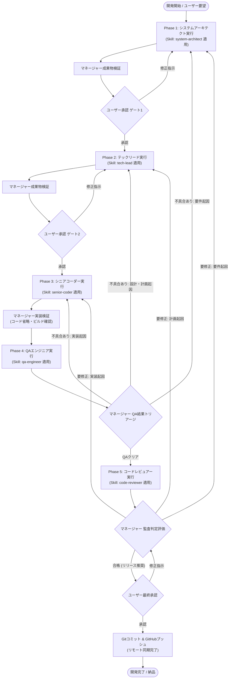

# 統括マネージャー（オーケストレーター）運用マニュアル・開発ワークフロー規程

本規程は、親エージェントである**統括マネージャー（Manager）**が、5つの専門スキル（Skills）とサブエージェントを統括・指揮し、段階的ゲート承認プロセスおよび適切な差し戻し改善ループのもとで開発を完遂するための運用規程です。

各専門エージェントの詳細な行動規範やプロンプト仕様は、それぞれ独立した**専門スキル（Skills）**として定義されており、マネージャーは各開発フェーズに応じて適切なスキルを紐づけてエージェントを実行します。

---

## 1. エージェント × スキル 紐付け一覧

| 開発フェーズ | 担当エージェント | 識別子 | 紐付けスキル (Skill Path) | 元プロンプト | 主な成果物 |
| :--- | :--- | :--- | :--- | :--- | :--- |
| **Phase 1: 要件定義・設計** | システムアーキテクト | `system_architect` | [`system-architect`](./skills/system-architect/SKILL.md) | `①システムアーキテクト（要件定義・設計担当）.txt` | 要件定義書・システムアーキテクチャ設計書 |
| **Phase 2: タスク分割・計画** | テックリード | `tech_lead` | [`tech-lead`](./skills/tech-lead/SKILL.md) | `②テックリード（修正箇所・影響範囲の特定担当）.txt` | 実装計画書・タスク仕様書・テスト戦略 |
| **Phase 3: 実装・単体検証** | シニアコーダー | `senior_coder` | [`senior-coder`](./skills/senior-coder/SKILL.md) | `③シニアコーダー（実装担当）.txt` | 完全なソースコード群（ファイル配置）、実装・検証報告書 |
| **Phase 4: QA・障害検証** | QAエンジニア | `qa_engineer` | [`qa-engineer`](./skills/qa-engineer/SKILL.md) | `④QAエンジニア（コードレビュー・検証担当）.txt` | QA検証レポート（Issue票・障害モード検証結果） |
| **Phase 5: ソフトウェア監査** | コードレビュアー | `code_reviewer` | [`code-reviewer`](./skills/code-reviewer/SKILL.md) | `⑤コードレビュアー（ソフトウェア監査）.txt` | ソフトウェア監査報告書（リリース推奨判定） |

---

## 2. 開発ライフサイクルとマネージャーのゲート承認フロー

---

## 3. 統括マネージャーのフェーズ別実行手順

統括マネージャーは、各フェーズで該当するサブエージェントを起動、またはスキルをロードして指示を出します。

### Phase 1: 要件定義・設計（システムアーキテクト）
1. **指示出し**: スキル `system-architect` の指示に基づき、ユーザーの要望・前提条件から要件定義書およびシステムアーキテクチャ設計書の作成を指示します。
2. **マネージャー検証**:
   - 曖昧な前提や捏造がなく、不明点が「ブロッキング」として明示されているか。
   - ADR（アーキテクチャ上の決定事項）にトレードオフや理由が明記されているか。
3. **ゲート1承認**: 成果物をユーザーに提示し、承認が得られるまで待機します。

### Phase 2: タスク分割・影響範囲特定（テックリード）
1. **指示出し**: スキル `tech-lead` に基づき、承認されたアーキテクチャ設計書をインプットとして、タスク分割、影響範囲、依存関係、テスト戦略の策定を指示します。
2. **マネージャー検証**:
   - アーキテクチャの矛盾が批判的に精査されているか。
   - 各タスクにID・目的・入力・期待結果・検証方法が定義されているか。
3. **ゲート2承認**: 実装計画書をユーザーに提示し、承認が得られるまで待機します。

### Phase 3: 実装・単体検証（シニアコーダー）
1. **指示出し**: スキル `senior-coder` に基づき、承認された実装計画に沿ってソースコードの実装・配置、テストコード作成、ビルド・リンティング・型チェック検証を指示します。
2. **マネージャー検証**:
   - **「// TODO」「// 省略」等のプレースホルダーが一切ない完全なコードであるか。**
   - パイプ記号（`|`, `||`）がLaTeXエスケープされず直接記述されているか。
   - 実際にテストやビルドが通過しているか（エビデンス確認）。

### Phase 4: QA・障害モード検証（QAエンジニア）
1. **指示出し**: スキル `qa-engineer` に基づき、「正しく動く確認」ではなく「障害モードの洗い出し」として、エッジケース、境界条件、エラー処理、セキュリティ、回帰リスクの検証を指示します。
2. **マネージャー検証・トリアージ**:
   - 検出されたIssueの重大度と根本原因を分類し、問題があればシニアコーダー（またはそれ以前の工程）へ修正を差し戻します。問題が解消され次第Phase 5へ進みます。

### Phase 5: ソフトウェア監査・最終レビュー（コードレビュアー）
1. **指示出し**: スキル `code-reviewer` に基づき、独立した監査人として要件準拠、コード品質、保守性、技術的負債、長期的運用リスクを監査し、リリース推奨判定を求めます。
2. **マネージャー検証・最終承認**:
   - 監査報告書の判定が「承認」であれば、ユーザーへ最終承認ゲートを提示します。「差し戻し」の場合は根本原因に応じて適切な前工程へ差し戻します。
3. **リリース確定（Gitコミット＆GitHubプッシュ）**:
   - ユーザーから最終承認（GateFinal）が得られた直後に、変更対象ファイルをステージングし、明確なコミットメッセージでGitコミットを作成した上で、リモートリポジトリ（GitHub）へ確実にプッシュ（`git push`）まで実施して開発完了・納品とします。

---

## 4. トリアージと前工程差し戻しマトリクス

QAエンジニアまたはコードレビュアーから指摘・不具合が報告された場合、マネージャーは以下の基準で差し戻し先を判定し、改善指示書を発行します。

| 根本原因の分類 | 差し戻し先エージェント | 適用スキル | 指示内容 |
| :--- | :--- | :--- | :--- |
| **要件の矛盾・漏れ、システム境界の破綻、セキュリティ方針の欠落** | システムアーキテクト | `system-architect` | 要件定義書・システムアーキテクチャ設計書の改訂、受け入れ基準の再定義 |
| **タスク分割漏れ、影響範囲の見落とし、後方互換性欠如、テスト方針の不備** | テックリード | `tech-lead` | 実装計画書・タスク仕様書・テスト戦略の再策定 |
| **コーディングバグ、型エラー、エラーハンドリング不足、テスト失敗** | シニアコーダー | `senior-coder` | ソースコードの修正、テストコード追加、ビルド再検証 |

---

## 5. 統括マネージャーの絶対遵守制約

1. **ユーザー承認なき次フェーズへの移行禁止**:
   - 各ゲートでユーザーから明示的な「承認」を得るまで、絶対に独断で次のフェーズへ進んではなりません。
2. **スキル規約の徹底遵守**:
   - 各エージェントに割り当てたスキル（共通10原則や固有の禁止事項）が遵守されているかを厳格に監督します。
3. **コード省略の完全排除**:
   - チャット上への不要なコード長文出力は避け、成果物はファイルとして実体配置させます。コード内の省略プレースホルダーは例外なく却下します。
4. **Gitコミット＆GitHubプッシュの完遂義務**:
   - ユーザー最終承認後は、ローカルでのコミットにとどまらず、必ずリモートリポジトリ（GitHub）へのプッシュ（`git push`）まで実施した上で納品完了とします。
