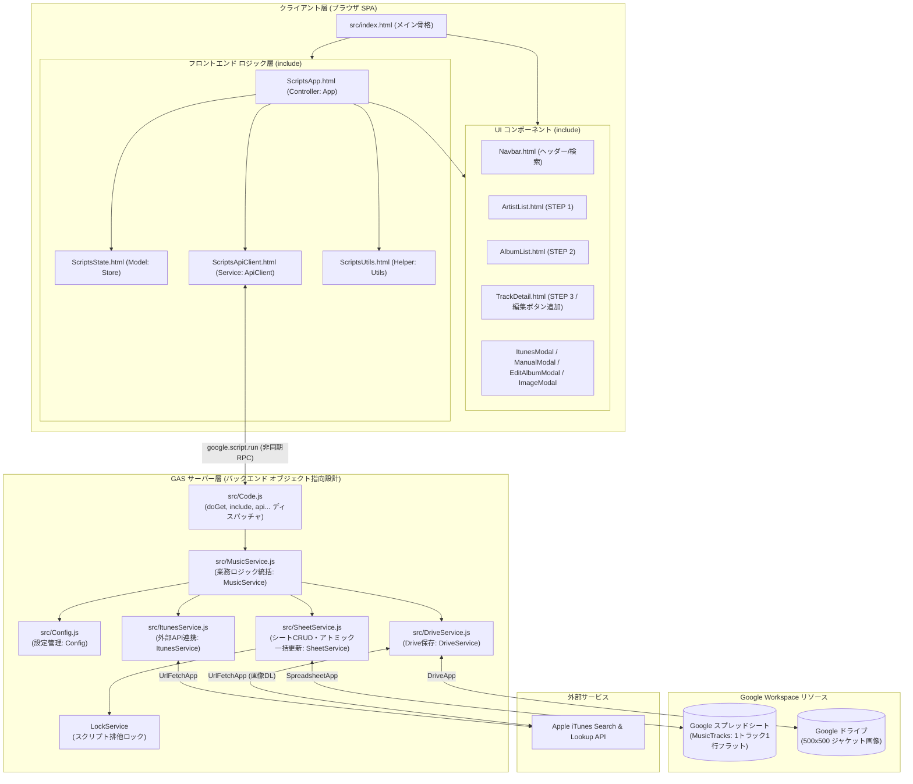
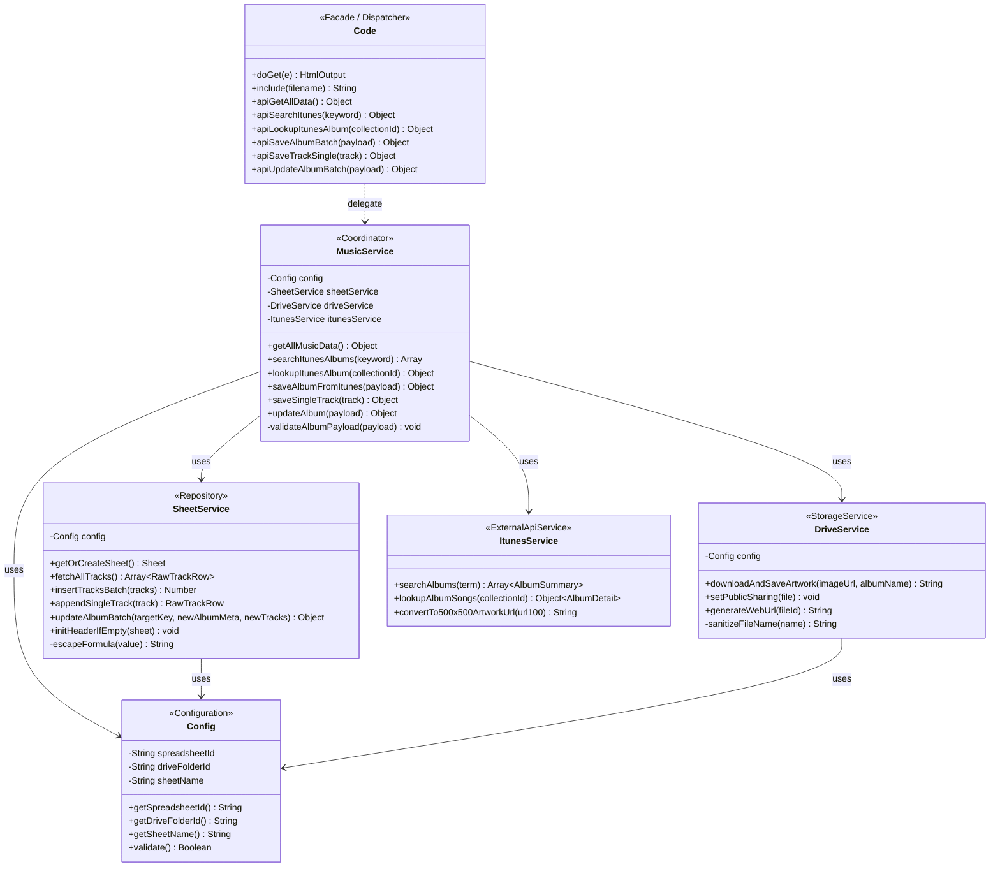
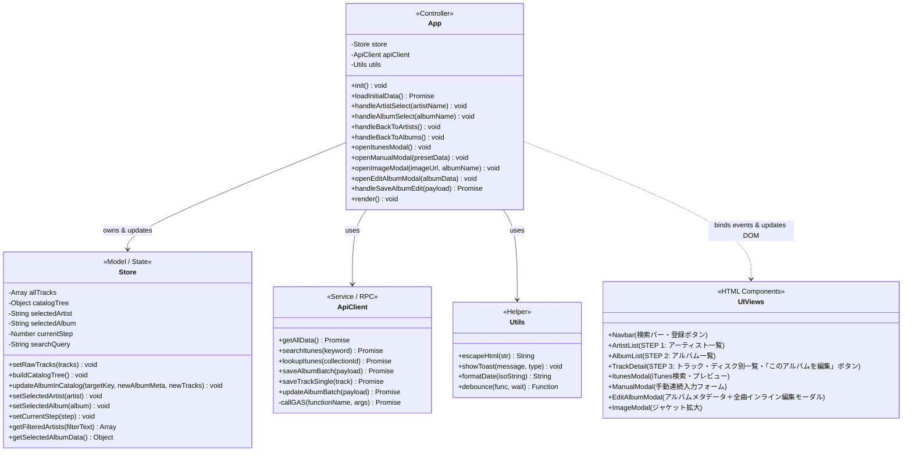
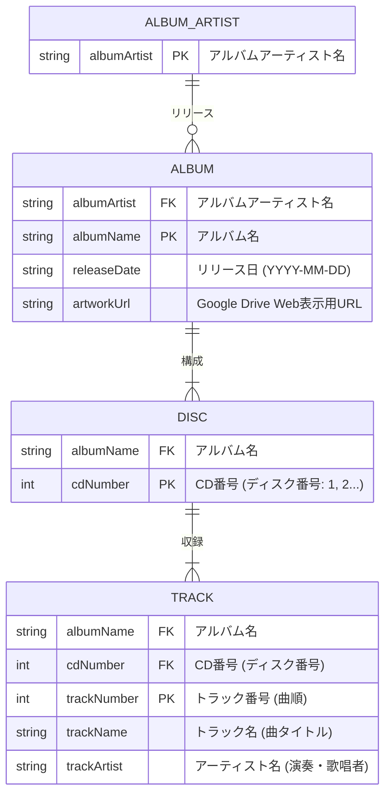
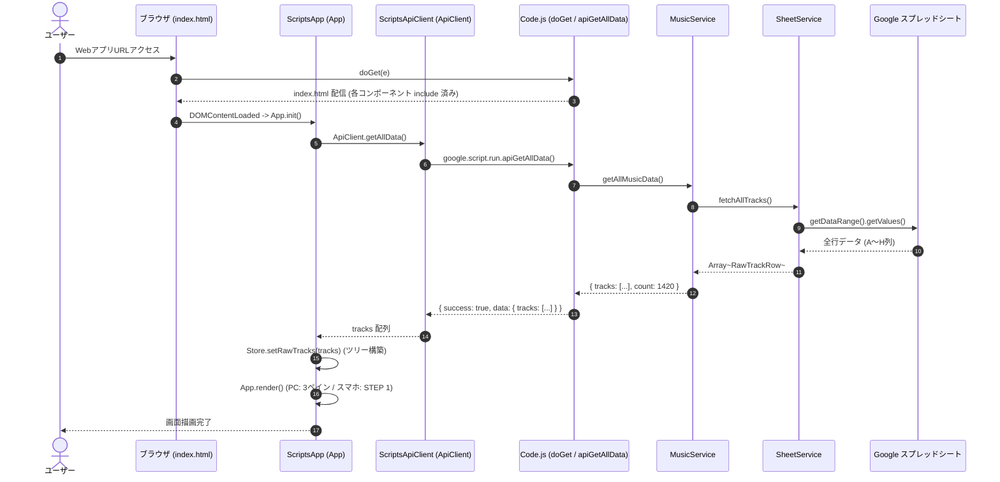
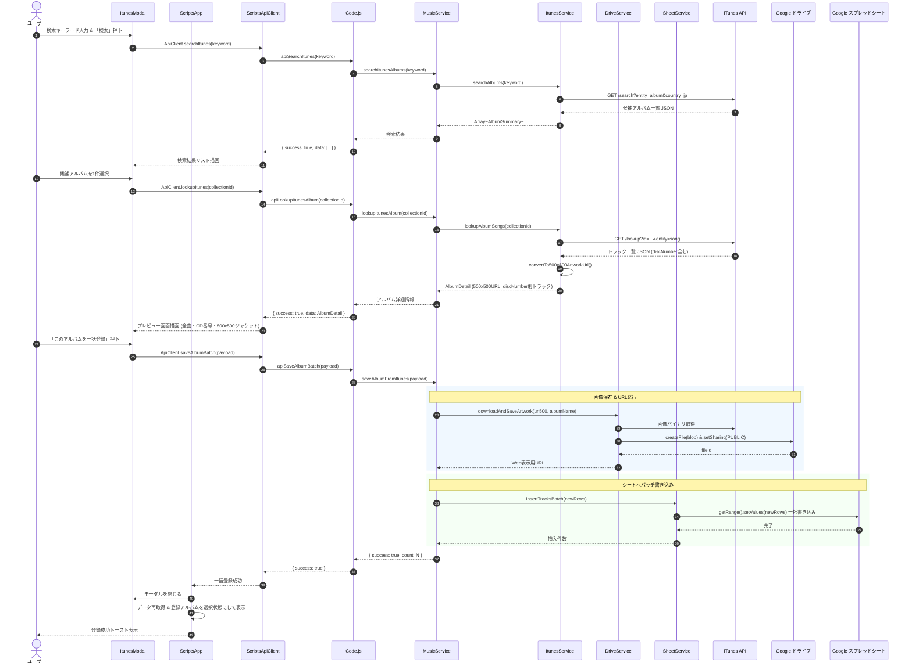
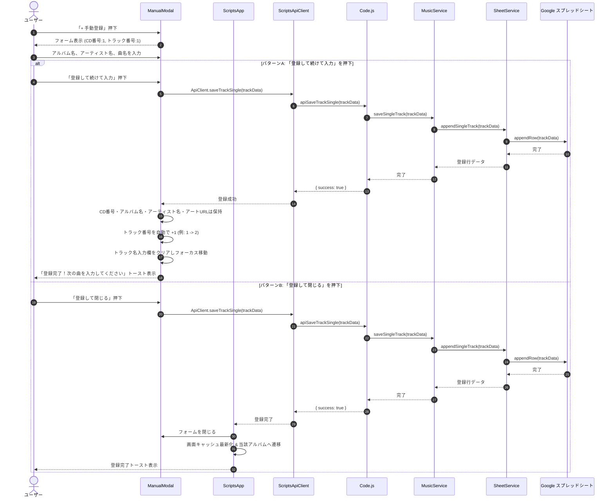
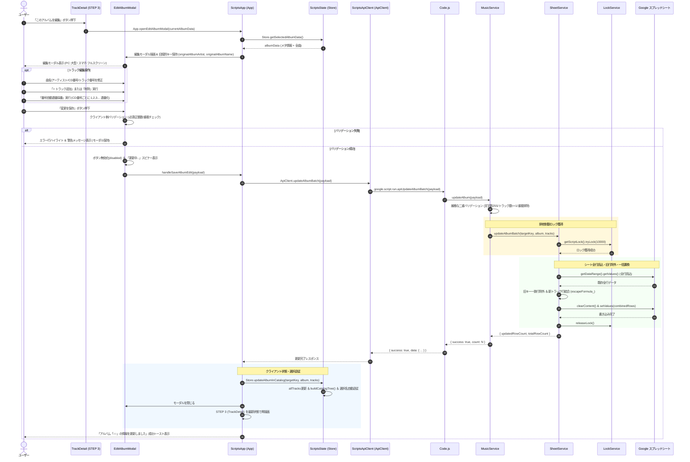

# 音楽管理Webアプリケーション 基本設計書

- **文書バージョン**: 1.2.0
- **作成日**: 2026年10月17日
- **最終更新日**: 2026年10月17日
- **作成ロール**: システムアーキテクト／基本設計者 (`basic_designer`)
- **準拠要件定義書**: `docs/REQUIREMENTS.md` (v1.3.0)
- **ステータス**: 登録済みアルバムデータ編集機能追加・完全レスポンシブ確定反映版（Gate 2 レビュー対象）

---

## 目次

1. [システム基本方針・全体アーキテクチャ設計](#1-システム基本方針全体アーキテクチャ設計)
   - 1.1 システム設計方針（オブジェクト指向と単一責任原則の徹底）
   - 1.2 技術スタック選定
   - 1.3 全体システム構成図（コンポーネント協調構成）
   - 1.4 ディレクトリ・ファイル構成一覧（役割毎分割）
   - 1.5 オブジェクト指向クラス図・コンポーネント構成図 (Mermaid)
2. [バックエンド オブジェクト指向設計 (GAS)](#2-バックエンド-オブジェクト指向設計-gas)
   - 2.1 設定管理クラス: `Config.js`
   - 2.2 スプレッドシート永続化サービス: `SheetService.js` (一括更新・排他制御・式保護)
   - 2.3 Google Drive ストレージサービス: `DriveService.js`
   - 2.4 iTunes API 連携サービス: `ItunesService.js`
   - 2.5 業務ロジック統括サービス: `MusicService.js` (編集バリデーション・整合性検証)
   - 2.6 エントリーポイント & RPCディスパッチャ: `Code.js`
3. [フロントエンド 役割分割・コンポーネント設計 (HTML / JS)](#3-フロントエンド-役割分割コンポーネント設計-html--js)
   - 3.1 GAS テンプレート include アーキテクチャ
   - 3.2 メイン骨格: `index.html`
   - 3.3 スタイル定義: `Styles.html`
   - 3.4 ヘッダー・検索ナビゲーション: `Navbar.html`
   - 3.5 STEP 1 アーティスト一覧: `ArtistList.html`
   - 3.6 STEP 2 アルバムカード一覧: `AlbumList.html`
   - 3.7 STEP 3 トラック詳細・ディスク別テーブル: `TrackDetail.html` (編集ボタン配置)
   - 3.8 モーダルコンポーネント群: `ItunesModal.html`, `ManualModal.html`, `EditAlbumModal.html`, `ImageModal.html`
   - 3.9 クライアントロジック層: `ScriptsState.html`, `ScriptsApiClient.html`, `ScriptsApp.html`, `ScriptsUtils.html`
4. [画面・UI/UX詳細設計](#4-画面uiux詳細設計)
   - 4.1 レスポンシブ方針とブレークポイント定義
   - 4.2 画面状態遷移設計 (アルバム編集を含む全体遷移)
   - 4.3 PC / タブレット横画面レイアウト（3ペイン横並び）
   - 4.4 スマートフォン画面レイアウト（ステップドリルダウン遷移方式）
   - 4.5 モーダル表示仕様（iTunes一括登録、手動登録、アルバム編集、ジャケット拡大）
     - 4.5.1 iTunes検索・一括登録モーダル (`ItunesModal.html`)
     - 4.5.2 手動楽曲登録フォーム (`ManualModal.html`)
     - 4.5.3 アルバムアート拡大モーダル (`ImageModal.html`)
     - 4.5.4 アルバム編集モーダル詳細仕様 (`EditAlbumModal.html`)
5. [データモデル・ストレージ設計](#5-データモデルストレージ設計)
   - 5.1 概念データモデル・ER図
   - 5.2 スプレッドシートテーブル定義（案A: 1トラック1行フラット方式）
     - 5.2.1 アルバムデータ編集・更新時のアトミック置換仕様
   - 5.3 クライアント内部データ構造（メモリキャッシュツリー）
   - 5.4 Google Drive ストレージ仕様（命名規約・公開権限・Web表示URL）
6. [主要処理フロー・シーケンス設計 (クラス間協調)](#6-主要処理フローシーケンス設計-クラス間協調)
   - 6.1 アプリ起動・全データ初期ロード シーケンス
   - 6.2 3段階ドリルダウン表示制御フロー
   - 6.3 iTunes検索 〜 プレビュー 〜 一括登録 シーケンス
   - 6.4 手動楽曲登録（連続登録アシスト）シーケンス
   - 6.5 全体クイック検索・インクリメンタルフィルタリング処理フロー
   - 6.6 登録済みアルバムデータ編集・一括更新シーケンス (Mermaid)
7. [非機能・セキュリティ・例外設計](#7-非機能セキュリティ例外設計)
   - 7.1 セキュリティ設計（XSS対策、権限境界、スプレッドシート式インジェクション防止）
   - 7.2 パフォーマンス・排他制御設計（キャッシュ、LockService排他ロック、二重送信抑止）
   - 7.3 モバイル・タッチ操作性設計（44pxターゲット、仮想キーボード最適化）
   - 7.4 エラーハンドリング・例外設計（共通規約、リカバリ仕様、入力内容保持）
   - 7.5 スクリプトプロパティ構成と初期セットアップ設計
8. [まとめと実装フェーズへの引き継ぎ](#8-まとめと実装フェーズへの引き継ぎ)

---

## 1. システム基本方針・全体アーキテクチャ設計

### 1.1 システム設計方針（オブジェクト指向と単一責任原則の徹底）

本システムは、要件定義書 `docs/REQUIREMENTS.md` (v1.3.0) およびユーザー要望「**ソースファイルを1つに集約せず、オブジェクト指向のように役割毎に分割する**」に厳格に準拠して設計する。

1. **バックエンド（GAS）の単一責任原則（SRP: Single Responsibility Principle）**:
   - Google Apps Script（GAS）では同一プロジェクト内のスクリプトファイル（`.js` / `.gs`）が同一グローバルスコープでロードされる特性を活かし、**各役割に特化したES6クラス**を独立したファイルに定義する。
   - 設定取得（`Config`）、スプレッドシート入出力・排他更新（`SheetService`）、Google Driveファイル管理（`DriveService`）、iTunes外部API連携（`ItunesService`）、およびそれらを協調させる業務ロジック（`MusicService`）をクラスとして完全に分離する。
   - エントリーポイント（`Code.js`）は、HTTP要求のハンドリング（`doGet`）およびRPCディスパッチのみを担当する薄いファサード（Facade）とする。
   - 登録済みアルバム編集機能（FN-EDIT-001〜006）の導入に伴い、排他制御（`LockService`）、スプレッドシート式インジェクション防止（`escapeFormula_`）、および一括置換アトミック更新の責務を各クラスに明確に配置する。

2. **フロントエンドのコンポーネント分割（GAS include方式）**:
   - GASのHTMLServiceでは通常1ファイルにHTML/CSS/JSを詰め込みがちであるが、本設計では `<?!= include('FileName'); ?>` パターンを採用し、HTMLを役割毎のコンポーネントへ細分化する。
   - 見た目（ビューコンポーネント）、スタイル（Tailwind/カスタムCSS）、状態管理（`Store` クラス）、非同期API通信（`ApiClient` クラス）、コントローラー（`App` クラス）、共通ユーティリティ（`Utils`）を完全に分離し、高凝集・疎結合な設計を実現する。
   - 新規コンポーネント `EditAlbumModal.html` を追加し、アルバムメタデータおよび全収録曲のインライン編集・行追加・行削除・自動連番採番・バリデーション制御を独立した責務として実装する。

3. **クライアントサイド・キャッシングによる高速応答**:
   - 初期ロード時にスプレッドシート全行を1回のRPC通信で取得し、ブラウザ内メモリ（`Store`）でツリー構造化して保持。階層ドリルダウンや検索をミリ秒単位（100ms未満）で完結させる。
   - アルバムデータ編集保存時にも、サーバー側の一括更新成功後、クライアント側Store内の該当アルバムキャッシュを即時更新・ツリー再構築し、画面（STEP 3）を再描画することで、無駄な全件再取得を行わずシームレスな操作性を維持する。

4. **完全レスポンシブ・アダプティブUI**:
   - PC（幅 768px以上）: 3ペイン横並びでコレクション全体を俯瞰。アルバム編集は大型中央モーダルで快適に操作。
   - スマートフォン（幅 768px未満）: 1画面1ステップのステップドリルダウン遷移方式（上部「< 戻る」ナビゲーション常備、タップターゲット 44px 以上）。アルバム編集は端末全域を活用するフルスクリーンモーダルを採用。

---

### 1.2 技術スタック選定

| 分類 | 技術・ライブラリ | バージョン/規約 | 選定理由 |
| :--- | :--- | :--- | :--- |
| **実行環境** | Google Apps Script (V8 Runtime) | V8 | ES6+（クラス構文 `class`、アロー関数、Promise、async/await等）を利用したオブジェクト指向設計。 |
| **フロントエンド構文** | HTML5 / Vanilla JavaScript (ES2020+) | ネイティブ | React/Vue等の重量フレームワークを排し、ビルドレスでGAS HTMLServiceと親和性の高い高速描画を実現。 |
| **CSS フレームワーク** | Tailwind CSS (CDN版) | 3.x (Play CDN) | ユーティリティファーストによる柔軟かつ保守性の高いレスポンシブ設計（`sm:`, `md:`, `lg:`）。 |
| **アイコン** | Lucide Icons / Heroicons (インラインSVG) | - | 外部フォント依存を排除し、SVGインライン展開により軽量かつ通信遮断時にも安定表示。 |
| **データベース** | Google スプレッドシート | - | 案A（1トラック1行フラット方式）の採用により、スプレッドシート直接の閲覧・編集が容易。 |
| **ファイルストレージ** | Google ドライブ | - | 高解像度（500×500）アルバムアートの永続保存と公開Web表示URLの自動生成。 |
| **排他制御** | `LockService` (GAS標準) | - | 同時編集によるスプレッドシート行破壊やデータ消失を防ぐスクリプトロック機構。 |
| **外部通信** | `UrlFetchApp` (GAS標準) | - | iTunes APIへのHTTPS GET通信および画像バイナリ（Blob）のダウンロード。 |

---

### 1.3 全体システム構成図（コンポーネント協調構成）



---

### 1.4 ディレクトリ・ファイル構成一覧（役割毎分割）

プロジェクト全体を以下の役割毎のファイル群に分割して構成する。

```
MusicInfo-app/
├── docs/
│   ├── REQUIREMENTS.md           # 要件定義書 (v1.3.0)
│   └── BASIC_DESIGN.md           # 基本設計書 (本書 v1.2.0)
├── src/
│   ├── appsscript.json           # GAS マニフェスト (OAuthスコープ定義、V8指定)
│   │
│   │   ─── 【GAS バックエンド オブジェクト指向クラス群】 ───
│   ├── Config.js                 # 設定・スクリプトプロパティ管理クラス (Config)
│   ├── SheetService.js           # スプレッドシート読み書き・初期化・一括置換アトミック更新・排他制御クラス (SheetService)
│   ├── DriveService.js           # Google Drive画像ダウンロード・保存・URL生成クラス (DriveService)
│   ├── ItunesService.js          # iTunes Search & Lookup API通信・500x500変換・トラック抽出 (ItunesService)
│   ├── MusicService.js           # 業務ロジック統括クラス (MusicService: バリデーション、整合性検証)
│   ├── Code.js                   # Web Appsエントリポイント (doGet, include, apiディスパッチャ)
│   │
│   │   ─── 【フロントエンド UI コンポーネント (HTML)】 ───
│   ├── index.html                # メイン骨格 (3ペイン & スマホステップレイアウト、include呼出)
│   ├── Styles.html               # Tailwind CSS設定、カスタムスクロールバー、ユーティリティCSS
│   ├── Navbar.html               # ヘッダー、全体検索バー、手動/iTunes登録ボタン
│   ├── ArtistList.html           # STEP 1 アーティスト一覧コンポーネント (インクリメンタル絞り込み)
│   ├── AlbumList.html            # STEP 2 アルバムカード一覧コンポーネント (戻るボタン含む)
│   ├── TrackDetail.html          # STEP 3 トラック詳細・ディスク別テーブルコンポーネント (編集ボタン追加)
│   ├── ItunesModal.html          # iTunes一括検索・プレビュー登録モーダル
│   ├── ManualModal.html          # 手動楽曲登録フォーム (連続入力アシスト・テンキー対応)
│   ├── EditAlbumModal.html       # アルバム情報・全収録曲インライン編集モーダル (★新規: PC/スマホ完全レスポンシブ)
│   ├── ImageModal.html           # アルバムアート 500x500 拡大プレビューモーダル
│   │
│   │   ─── 【フロントエンド ロジック クラス群 (JavaScript)】 ───
│   ├── ScriptsState.html         # フロントエンド状態管理クラス (Store: キャッシュ同期、選択追従)
│   ├── ScriptsApiClient.html     # バックエンド非同期通信クライアントクラス (ApiClient: updateAlbumBatch追加)
│   ├── ScriptsApp.html           # アプリケーションコントローラークラス (App: 編集モーダル制御・再描画)
│   └── ScriptsUtils.html         # XSSサニタイズ (escapeHtml)、トースト通知等のユーティリティ (Utils)
└── README.md
```

---

### 1.5 オブジェクト指向クラス図・コンポーネント構成図 (Mermaid)

#### ① バックエンド クラス図 (GAS)



#### ② フロントエンド コンポーネント・クラス構成図



---

## 2. バックエンド オブジェクト指向設計 (GAS)

### 2.1 設定管理クラス: `src/Config.js`

#### 責務
- GASのスクリプトプロパティ（`PropertiesService.getScriptProperties()`）から環境依存値（スプレッドシートID、Google DriveフォルダID、シート名）を読み込み、安全にカプセル化して提供する。
- 必須プロパティの欠落を検知し、わかりやすい例外メッセージを送出する。

#### クラス定義概要
```javascript
class Config {
  constructor() {
    const props = PropertiesService.getScriptProperties().getProperties();
    this.spreadsheetId = props.SPREADSHEET_ID || '';
    this.driveFolderId = props.DRIVE_FOLDER_ID || '';
    this.sheetName = props.SHEET_NAME || 'MusicTracks';
  }

  getSpreadsheetId() {
    if (!this.spreadsheetId) throw new Error('CONFIG_ERROR: SPREADSHEET_ID が未設定です。スクリプトプロパティを確認してください。');
    return this.spreadsheetId;
  }

  getDriveFolderId() {
    if (!this.driveFolderId) throw new Error('CONFIG_ERROR: DRIVE_FOLDER_ID が未設定です。スクリプトプロパティを確認してください。');
    return this.driveFolderId;
  }

  getSheetName() {
    return this.sheetName;
  }

  validate() {
    return Boolean(this.spreadsheetId && this.driveFolderId);
  }
}
```

---

### 2.2 スプレッドシート永続化サービス: `src/SheetService.js` (一括更新・排他制御・式保護)

#### 責務
- スプレッドシート（案A: 1トラック1行フラット方式）に対する読み込み・書き込み・自動初期化・一括置換アトミック更新・式インジェクション防止を専任で行う。
- シートの存在確認および未存在時のヘッダー自動作成（初期化）。
- 全データの2次元配列からオブジェクト配列へのマッピング変換。
- 複数トラックの一括挿入（`insertTracksBatch`）および単一トラックの追記（`appendSingleTrack`）。
- **アルバムデータ一括更新（`updateAlbumBatch`）**:
  - `LockService.getScriptLock()` による排他ロックを取得（最大10秒待機）。
  - 旧識別複合キー（`originalAlbumArtist` ＋ `originalAlbumName`）に一致するスプレッドシート行を特定。
  - 旧キーに一致しない全行を保持し、編集後の新トラック行群と結合。
  - シートのデータ行領域（2行目以降）をクリアし、再構築した全行配列を一括書き戻し（`clearContents` ＋ `setValues`）。
  - 式インジェクション防止エスケープ処理（`escapeFormula_`）を全文字列項目に適用。
  - 処理終了後に確実にロックを解放（`finally` 節）。

#### 主要メソッド設計
- `getOrCreateSheet()`: シート名で取得。無ければ作成しヘッダー（8列）を初期化・1行固定。
- `fetchAllTracks()`: 全行データを取得し、`RawTrackRow` 配列に整形して返却。
- `insertTracksBatch(tracks)`: 配列データを2次元配列に変換し、最終行の後ろに一括挿入。
- `appendSingleTrack(track)`: 手動登録の1件を末尾行に追加。
- `updateAlbumBatch(targetKey, newAlbumMeta, newTracks)`:
  ```javascript
  updateAlbumBatch(targetKey, newAlbumMeta, newTracks) {
    const lock = LockService.getScriptLock();
    const hasLock = lock.tryLock(10000); // 最大10秒待機
    if (!hasLock) {
      throw new Error('LOCK_TIMEOUT: 他の更新処理が実行中のため、ロックを取得できませんでした。しばらく時間をおいて再試行してください。');
    }

    try {
      const sheet = this.getOrCreateSheet();
      const lastRow = sheet.getLastRow();
      if (lastRow < 2) {
        throw new Error('NOT_FOUND: スプレッドシートにデータが存在しません。');
      }

      // 全データ取得 (2行目〜最終行, A〜H列)
      const dataRange = sheet.getRange(2, 1, lastRow - 1, 8);
      const rawRows = dataRange.getValues();

      const origArtist = String(targetKey.originalAlbumArtist || '').trim();
      const origAlbum = String(targetKey.originalAlbumName || '').trim();

      // 旧アルバムに合致しない既存行のみを抽出して保持
      const retainedRows = [];
      let matchCount = 0;

      for (let i = 0; i < rawRows.length; i++) {
        const row = rawRows[i];
        const rowCd = row[0];
        const rowAlbumArtist = String(row[1] || '').trim();
        const rowAlbumName = String(row[2] || '').trim();

        if (rowAlbumArtist === origArtist && rowAlbumName === origAlbum) {
          matchCount++;
        } else {
          retainedRows.push(row);
        }
      }

      if (matchCount === 0) {
        throw new Error(`NOT_FOUND: 更新対象のアルバム「${origAlbum} (${origArtist})」が見つかりませんでした。`);
      }

      // 編集後の新トラック行配列を組み立て
      const newRows = newTracks.map(t => [
        Number(t.cdNumber) || 1,
        this.escapeFormula_(newAlbumMeta.albumArtist),
        this.escapeFormula_(newAlbumMeta.albumName),
        this.escapeFormula_(t.trackArtist || newAlbumMeta.albumArtist),
        Number(t.trackNumber) || 1,
        this.escapeFormula_(t.trackName),
        this.escapeFormula_(newAlbumMeta.releaseDate || ''),
        this.escapeFormula_(newAlbumMeta.artworkUrl || '')
      ]);

      // 保持行 + 新トラック行を結合
      const combinedRows = retainedRows.concat(newRows);

      // データ領域を一括置換（アトミック更新）
      dataRange.clearContent();
      if (combinedRows.length > 0) {
        sheet.getRange(2, 1, combinedRows.length, 8).setValues(combinedRows);
      }

      SpreadsheetApp.flush();
      return {
        updatedRowCount: newRows.length,
        totalRowCount: combinedRows.length,
        previousRowCount: matchCount
      };
    } finally {
      lock.releaseLock();
    }
  }

  escapeFormula_(val) {
    if (val === null || val === undefined) return '';
    const str = String(val);
    if (/^[=+\-@\t\r]/.test(str)) {
      return "'" + str;
    }
    return str;
  }
  ```

---

### 2.3 Google Drive ストレージサービス: `src/DriveService.js`

#### 責務
- iTunesから取得した 500×500 解像度画像のBlobをダウンロードし、Google Driveの指定フォルダへ永続保存する。
- 保存したファイルの共有アクセス権を「リンクを知っている全員が閲覧可能」に設定。
- スプレッドシートおよびWeb UIで表示可能な公開URL（`https://drive.google.com/uc?export=view&id={fileId}` 等）を発行する。
- ファイル名サニタイズ（禁止文字 `\/:*?"<>|` を `_` に置換）および重複防止タイムスタンプ付与。

#### 主要メソッド設計
- `downloadAndSaveArtwork(imageUrl500, albumName)`: 画像ダウンロードから保存・共有設定・Web表示URL返却までを一括実行。
- `setPublicSharing(file)`: ファイルの閲覧権限を設定。
- `generateWebUrl(fileId)`: 表示用URL文字列を生成。
- `sanitizeFileName(name)`: ファイル名として安全な文字列に置換。

---

### 2.4 iTunes API 連携サービス: `src/ItunesService.js`

#### 責務
- Apple 公式 iTunes Search API & Lookup API との通信（`UrlFetchApp`）を担当。
- 日本国内（`country=jp`）優先の検索クエリ構築。
- アルバムアートURLの高解像度化（`100x100bb` → `500x500bb` 置換）。
- Lookup API レスポンスから、アルバムメタデータおよびトラック情報（特に確定仕様の `discNumber` ＝ CD番号）を抽出・正規化。

#### 主要メソッド設計
- `searchAlbums(term)`: キーワードからアルバムリスト（`entity=album`）を最大25件検索。
- `lookupAlbumSongs(collectionId)`: アルバムIDから全トラック一覧（`wrapperType=track`）およびディスク番号を取得。
- `convertTo500x500ArtworkUrl(url100)`: 正規表現を用いて 500×500 高精細URLへ変換。

---

### 2.5 業務ロジック統括サービス: `src/MusicService.js` (編集バリデーション・整合性検証)

#### 責務
- ドメインロジックの調整役（オーケストレーター）。
- `Config`, `SheetService`, `DriveService`, `ItunesService` を協調させ、ユースケース（閲覧全データ取得、iTunes一括登録、手動登録、アルバムデータ編集・一括更新）を実行する。
- **アルバムデータ編集バリデーション**:
  - `targetKey` の旧キー（`originalAlbumArtist`, `originalAlbumName`）が空文字でないことを検証。
  - 新アルバム名、新アルバムアーティスト名が必須かつ各255文字以内であることを検証。
  - 新トラック一覧が最低1曲以上存在することを検証（全削除防止）。
  - 各トラックのCD番号、トラック番号が1以上の正整数であることを検証。
  - 各トラックの曲名が必須かつ255文字以内であることを検証。
  - 同一アルバム・同一CD番号内での「トラック番号」重複が存在しないことを厳密に検証。

#### 主要メソッド設計
- `getAllMusicData()`: `SheetService` から全曲データを取得し、件数等のメタ情報を付与して返却。
- `searchItunesAlbums(keyword)`: `ItunesService` を呼び出して候補アルバムを検索。
- `lookupItunesAlbum(collectionId)`: `ItunesService` を呼び出してトラックプレビュー・CD番号・500x500画像を返却。
- `saveAlbumFromItunes(payload)`:
  1. `DriveService.downloadAndSaveArtwork` で 500x500 ジャケットを保存しWeb表示URLを取得。
  2. 各トラックデータにDriveのWeb表示URLを付与。
  3. `SheetService.insertTracksBatch` で一括保存。
- `saveSingleTrack(track)`: `SheetService.appendSingleTrack` で手動入力行を保存。
- `updateAlbum(payload)`:
  ```javascript
  updateAlbum(payload) {
    this.validateAlbumPayload_(payload);
    const { targetKey, album, tracks } = payload;
    return this.sheetService.updateAlbumBatch(targetKey, album, tracks);
  }

  validateAlbumPayload_(payload) {
    if (!payload || !payload.targetKey || !payload.album || !Array.isArray(payload.tracks)) {
      throw new Error('VALIDATION_ERROR: リクエストペイロードの形式が不正です。');
    }
    const { targetKey, album, tracks } = payload;
    if (!targetKey.originalAlbumArtist || !targetKey.originalAlbumName) {
      throw new Error('VALIDATION_ERROR: 編集対象の旧アルバム識別キーが指定されていません。');
    }
    if (!album.albumName || String(album.albumName).trim() === '') {
      throw new Error('VALIDATION_ERROR: アルバム名は必須です。');
    }
    if (!album.albumArtist || String(album.albumArtist).trim() === '') {
      throw new Error('VALIDATION_ERROR: アルバムアーティスト名は必須です。');
    }
    if (album.albumName.length > 255 || album.albumArtist.length > 255) {
      throw new Error('VALIDATION_ERROR: アルバム名またはアーティスト名は255文字以内で入力してください。');
    }
    if (tracks.length === 0) {
      throw new Error('VALIDATION_ERROR: 収録曲は最低1曲必要です。');
    }

    const trackKeySet = new Set();
    for (let i = 0; i < tracks.length; i++) {
      const t = tracks[i];
      const cd = Number(t.cdNumber);
      const trackNo = Number(t.trackNumber);
      if (!Number.isInteger(cd) || cd < 1) {
        throw new Error(`VALIDATION_ERROR: トラック #${i + 1} のCD番号は1以上の整数である必要があります。`);
      }
      if (!Number.isInteger(trackNo) || trackNo < 1) {
        throw new Error(`VALIDATION_ERROR: トラック #${i + 1} のトラック番号は1以上の整数である必要があります。`);
      }
      if (!t.trackName || String(t.trackName).trim() === '') {
        throw new Error(`VALIDATION_ERROR: トラック #${i + 1} の曲名は必須です。`);
      }
      if (t.trackName.length > 255) {
        throw new Error(`VALIDATION_ERROR: トラック名「${t.trackName}」は255文字以内で入力してください。`);
      }

      // 同一CD番号内でのトラック番号重複検証
      const uniqueKey = `${cd}_${trackNo}`;
      if (trackKeySet.has(uniqueKey)) {
        throw new Error(`VALIDATION_ERROR: CD番号 ${cd} の中に重複するトラック番号 #${trackNo} が存在します。番号を調整してください。`);
      }
      trackKeySet.add(uniqueKey);
    }
  }
  ```

---

### 2.6 エントリーポイント & RPCディスパッチャ: `src/Code.js`

#### 責務
- GASのWeb Apps規格に対応するグローバル関数のみを定義。
- `doGet(e)`: `index.html` テンプレートを評価（evaluate）してHTMLレスポンスを出力。
- `include(filename)`: HTMLServiceのテンプレート内で別ファイルをインクルードするためのヘルパー関数。
- フロントエンドからの `google.script.run` RPCリクエストを受信し、`MusicService` のインスタンスに処理を委譲。
- グローバルな例外捕捉（`try-catch`）を行い、フロントエンドが扱いやすい `{ success: boolean, data?: any, error?: string }` 形式でレスポンスを返却。

#### 主要関数設計
```javascript
// doGet: Web Apps エントリーポイント
function doGet(e) {
  return HtmlService.createTemplateFromFile('index')
    .evaluate()
    .setTitle('MusicInfo Manager')
    .addMetaTag('viewport', 'width=device-width, initial-scale=1.0, maximum-scale=1.0, user-scalable=no')
    .setXFrameOptionsMode(HtmlService.XFrameOptionsMode.ALLOWALL);
}

// include ヘルパー関数
function include(filename) {
  return HtmlService.createHtmlOutputFromFile(filename).getContent();
}

// サービスシングルトン取得ヘルパー
function getMusicService() {
  const config = new Config();
  const sheetService = new SheetService(config);
  const driveService = new DriveService(config);
  const itunesService = new ItunesService();
  return new MusicService(config, sheetService, driveService, itunesService);
}

// RPC ディスパッチャ群
function apiGetAllData() {
  try {
    return { success: true, data: getMusicService().getAllMusicData() };
  } catch (err) {
    return { success: false, error: err.message };
  }
}

function apiSearchItunes(keyword) {
  try {
    return { success: true, data: getMusicService().searchItunesAlbums(keyword) };
  } catch (err) {
    return { success: false, error: err.message };
  }
}

function apiLookupItunesAlbum(collectionId) {
  try {
    return { success: true, data: getMusicService().lookupItunesAlbum(collectionId) };
  } catch (err) {
    return { success: false, error: err.message };
  }
}

function apiSaveAlbumBatch(payload) {
  try {
    return { success: true, data: getMusicService().saveAlbumFromItunes(payload) };
  } catch (err) {
    return { success: false, error: err.message };
  }
}

function apiSaveTrackSingle(track) {
  try {
    return { success: true, data: getMusicService().saveSingleTrack(track) };
  } catch (err) {
    return { success: false, error: err.message };
  }
}

// アルバムデータ一括更新 RPC エンドポイント
function apiUpdateAlbumBatch(payload) {
  try {
    return { success: true, data: getMusicService().updateAlbum(payload) };
  } catch (err) {
    return { success: false, error: err.message };
  }
}
```

---

## 3. フロントエンド 役割分割・コンポーネント設計 (HTML / JS)

### 3.1 GAS テンプレート include アーキテクチャ

GAS HTMLService の制限（単一のHTMLOutputを返す）を克服し、メンテナンス性を最大化するため、**テンプレートインクルード構文**を活用する。

#### `src/index.html` のインクルード構造
```html
<!DOCTYPE html>
<html lang="ja" class="h-full bg-slate-950 text-slate-100">
<head>
  <meta charset="UTF-8">
  <title>MusicInfo Manager</title>
  <!-- Tailwind CSS CDN -->
  <script src="https://cdn.tailwindcss.com"></script>
  <!-- スタイルコンポーネント include -->
  <?!= include('Styles'); ?>
</head>
<body class="h-full flex flex-col overflow-hidden font-sans antialiased select-none">

  <!-- ヘッダーコンポーネント include -->
  <?!= include('Navbar'); ?>

  <!-- メインコンテンツ (PC: 3ペイン / スマホ: ステップ切り替え) -->
  <main class="flex-1 flex overflow-hidden relative">
    <?!= include('ArtistList'); ?>
    <?!= include('AlbumList'); ?>
    <?!= include('TrackDetail'); ?>
  </main>

  <!-- モーダルコンポーネント群 include -->
  <?!= include('ItunesModal'); ?>
  <?!= include('ManualModal'); ?>
  <?!= include('EditAlbumModal'); ?>
  <?!= include('ImageModal'); ?>

  <!-- フロントエンド ロジック層 (JavaScript) include -->
  <?!= include('ScriptsUtils'); ?>
  <?!= include('ScriptsApiClient'); ?>
  <?!= include('ScriptsState'); ?>
  <?!= include('ScriptsApp'); ?>

</body>
</html>
```

---

### 3.2 フロントエンド各ファイルの責務と構成

#### ① スタイル定義: `src/Styles.html`
- Tailwind CSS のカラーテーマ拡張（ダークモード、アクセントカラー `indigo` / `violet`）。
- スクロールバーのカスタマイズ（幅 4px〜6px、透過バー）。
- スマホ表示時のタップハイライト消去（`-webkit-tap-highlight-color: transparent`）。
- アニメーション（フェードイン、スピナー回転、スライドイン）。

#### ② ヘッダーコンポーネント: `src/Navbar.html`
- アプリロゴ & タイトル。
- 全体クイック検索入力欄（曲名・アルバム名・アーティスト名・CD番号横断）。
- 登録アクションボタン群:
  - `[+ 手動登録]` ボタン（スマホ時はコンパクト表示）
  - `[+ iTunes検索で登録]` ボタン（スマホ時はコンパクト表示）
- 全体データ同期ステータス・ローディングバッジ。

#### ③ STEP 1 アーティスト一覧コンポーネント: `src/ArtistList.html`
- PC: 左側固定幅ペイン（幅 260px〜300px）。
- スマホ: STEP 1 表示ペイン（全画面幅）。
- アーティスト内インクリメンタル検索フィルター入力欄。
- 五十音・アルファベット順にソートされたアーティスト一覧リスト。
- 各行に保有アルバム数バッジ、タップターゲット高さ 44px 以上の確保。

#### ④ STEP 2 アルバムカード一覧コンポーネント: `src/AlbumList.html`
- PC: 中央ペイン（幅 320px〜380px）。
- スマホ: STEP 2 表示ペイン（全画面幅）。
- **スマホ専用ナビゲーションヘッダー**: 「`< アーティスト一覧に戻る`」ボタン（高さ 44px 以上）。
- 選択中アーティスト名バナーおよびアルバム総数バッジ。
- アルバムカードグリッド（ジャケットサムネイル、アルバム名、発売年、収録トラック数）。

#### ⑤ STEP 3 トラック詳細・ディスク別テーブルコンポーネント: `src/TrackDetail.html`
- PC: 右側ペイン（残り全幅、フレキシブル）。
- スマホ: STEP 3 表示ペイン（全画面幅）。
- **スマホ専用ナビゲーションヘッダー**: 「`< アルバム一覧に戻る`」ボタン。
- **パンくずナビゲーション**: 「`アーティスト名 > アルバム名`」。
- アルバムヘッダー情報: ジャケット画像（タップで拡大）、アルバム名、アーティスト名、発売日、総曲数。
- **アルバム操作アクションボタン群**:
  - **「このアルバムを編集」ボタン（鉛筆アイコン）**: 押下時に `App.openEditAlbumModal()` を呼び出し、アルバム編集モーダルを開く。タップターゲット 44px 以上確保。
  - **「このアルバムに曲を追加」ボタン（＋アイコン）**: 押下時に既存アルバム情報を保持した手動登録モーダルを開く。
- **ディスク別トラック一覧表示**:
  - 複数枚組アルバム時の「Disc 1 (CD番号: 1)」「Disc 2 (CD番号: 2)」セクション区切り。
  - PCではテーブル形式（曲順、曲名、アーティスト名）。
  - スマホでは横スクロールなしのコンパクト縦積みリスト形式。

#### ⑥ モーダルコンポーネント群
- `src/ItunesModal.html`:
  - アルバム/アーティスト名検索バー、候補アルバム一覧リスト。
  - 選択アルバムの全トラック一覧プレビュー、CD番号（`discNumber`）確認。
  - 500x500 高精細ジャケット画像のプレビュー。
  - 「一括登録」ボタンおよび登録中プログレススピナー。
  - スマホでは全画面/ボトムシート形式で仮想キーボード対応。
- `src/ManualModal.html`:
  - 必須8項目に対応した手動入力フォーム。
  - CD番号・トラック番号に `type="number" inputmode="numeric"`（テンキー自動起動）。
  - 「★ 登録して続けて入力」ボタン（アルバム情報保持・トラック番号 +1 インクリメント・曲名に自動フォーカス）。
  - 「登録して閉じる」ボタン。
- `src/EditAlbumModal.html` (新規コンポーネント):
  - 登録済みアルバムのメタ情報（アルバム名、アルバムアーティスト名、リリース日、アートURL）の入力・プレビュー。
  - 全収録曲インライン編集エリア（PCはテーブル行、スマホはコンパクトカード）。
  - 各行のCD番号・トラック番号・曲名・アーティスト名編集および「削除」ボタン。
  - 「+ トラック追加」ボタン（末尾行追加入力支援）。
  - 「番号自動連番採番」ボタン（CD番号単位で 1, 2, 3... と自動再採番）。
  - 保存ボタンの二重送信抑止（スピナー表示・`disabled` 制御）。
  - PC大型モーダルおよびスマホフルスクリーンモーダルに完全対応。
- `src/ImageModal.html`:
  - 500×500 オリジナルジャケット画像のフルサイズオーバーレイ。
  - 背景タップで即座に閉じる。

---

### 3.3 クライアントロジック層のクラス設計

#### ① フロントエンド状態管理クラス: `src/ScriptsState.html` (`Store`)
```javascript
class Store {
  constructor() {
    this.allTracks = [];       // フラット行データ配列
    this.catalogTree = {};     // アーティスト > アルバム > ディスク > トラック 階層ツリー
    this.selectedArtist = '';  // 選択中アーティスト名
    this.selectedAlbum = '';   // 選択中アルバム名
    this.currentStep = 1;      // スマホ表示用ステップ (1, 2, 3)
    this.artistFilter = '';    // アーティスト絞り込み文字
    this.quickSearch = '';     // 全体クイック検索文字
  }

  setRawTracks(tracks) {
    this.allTracks = tracks;
    this.buildCatalogTree();
  }

  buildCatalogTree() {
    const tree = {};
    for (const t of this.allTracks) {
      const art = t.albumArtist || '不明なアーティスト';
      const alb = t.albumName || '不明なアルバム';
      const disc = t.cdNumber || 1;

      if (!tree[art]) tree[art] = { artistName: art, albums: {}, albumCount: 0 };
      if (!tree[art].albums[alb]) {
        tree[art].albums[alb] = {
          albumName: alb,
          albumArtist: art,
          releaseDate: t.releaseDate || '',
          artworkUrl: t.artworkUrl || '',
          discs: {},
          totalTracks: 0
        };
        tree[art].albumCount++;
      }
      const albumObj = tree[art].albums[alb];
      if (!albumObj.discs[disc]) {
        albumObj.discs[disc] = { cdNumber: disc, tracks: [] };
      }
      albumObj.discs[disc].tracks.push({
        trackNumber: Number(t.trackNumber) || 0,
        trackName: t.trackName || '',
        trackArtist: t.trackArtist || art,
        cdNumber: disc
      });
      albumObj.totalTracks++;
    }

    // 各ディスク内でトラック番号順にソート
    for (const art in tree) {
      for (const alb in tree[art].albums) {
        for (const disc in tree[art].albums[alb].discs) {
          tree[art].albums[alb].discs[disc].tracks.sort((a, b) => a.trackNumber - b.trackNumber);
        }
      }
    }
    this.catalogTree = tree;
  }

  // 編集完了後のキャッシュ即時更新・選択追従
  updateAlbumInCatalog(targetKey, newAlbumMeta, newTracks) {
    const origArtist = targetKey.originalAlbumArtist;
    const origAlbum = targetKey.originalAlbumName;

    // 旧アルバム行を除外
    const retained = this.allTracks.filter(t => {
      return !(t.albumArtist === origArtist && t.albumName === origAlbum);
    });

    // 編集後の新トラック行を追加
    const updatedRows = newTracks.map(t => ({
      cdNumber: Number(t.cdNumber) || 1,
      albumArtist: newAlbumMeta.albumArtist,
      albumName: newAlbumMeta.albumName,
      trackArtist: t.trackArtist || newAlbumMeta.albumArtist,
      trackNumber: Number(t.trackNumber) || 1,
      trackName: t.trackName,
      releaseDate: newAlbumMeta.releaseDate || '',
      artworkUrl: newAlbumMeta.artworkUrl || ''
    }));

    this.allTracks = retained.concat(updatedRows);
    this.buildCatalogTree();

    // アルバム名やアーティスト名の変更に追従
    this.selectedArtist = newAlbumMeta.albumArtist;
    this.selectedAlbum = newAlbumMeta.albumName;
  }

  getFilteredArtists() {
    const query = this.artistFilter.trim().toLowerCase();
    const artists = Object.keys(this.catalogTree).sort((a, b) => a.localeCompare(b, 'ja'));
    if (!query) return artists;
    return artists.filter(name => name.toLowerCase().includes(query));
  }

  getSelectedAlbumData() {
    if (!this.selectedArtist || !this.selectedAlbum) return null;
    return this.catalogTree[this.selectedArtist]?.albums[this.selectedAlbum] || null;
  }
}
```

#### ② バックエンド通信クライアントクラス: `src/ScriptsApiClient.html` (`ApiClient`)
```javascript
class ApiClient {
  static call(actionName, payload = null) {
    return new Promise((resolve, reject) => {
      const runner = google.script.run
        .withSuccessHandler(response => {
          if (response && response.success) {
            resolve(response.data);
          } else {
            reject(new Error(response?.error || '通信エラーが発生しました。'));
          }
        })
        .withFailureHandler(err => {
          reject(new Error(err.message || 'GASサーバー接続エラー'));
        });

      if (payload !== null) {
        runner[actionName](payload);
      } else {
        runner[actionName]();
      }
    });
  }

  static getAllData() {
    return this.call('apiGetAllData');
  }

  static searchItunes(keyword) {
    return this.call('apiSearchItunes', keyword);
  }

  static lookupItunes(collectionId) {
    return this.call('apiLookupItunesAlbum', collectionId);
  }

  static saveAlbumBatch(payload) {
    return this.call('apiSaveAlbumBatch', payload);
  }

  static saveTrackSingle(track) {
    return this.call('apiSaveTrackSingle', track);
  }

  // アルバム一括更新 RPC
  static updateAlbumBatch(payload) {
    return this.call('apiUpdateAlbumBatch', payload);
  }
}
```

#### ③ アプリケーションコントローラークラス: `src/ScriptsApp.html` (`App`)
- 全体のライフサイクル管理、イベントリスナー登録、DOM更新ディスパッチ。
- スマホでの画面ステップ切り替え（`currentStep` に応じて `.hidden` クラスを制御）。
- アルバム編集モーダル制御:
  - `openEditAlbumModal(albumData)`: 選択中アルバム情報を元に編集モーダル入力欄を初期化し、全収録曲をテーブル/カードとして動的生成。
  - `handleSaveAlbumEdit(payload)`: クライアントバリデーション、二重送信防止（ボタン非活性化・スピナー）、API通信呼び出し、Store更新、画面再描画、成功トースト表示、エラーハンドリング。

#### ④ 共通ユーティリティ: `src/ScriptsUtils.html` (`Utils`)
- `escapeHtml(str)`: XSS防止のサニタイズ関数。
- `showToast(msg, type)`: トースト通知の動的表示（成功/エラー/情報）。
- `debounce(fn, delay)`: インクリメンタル検索の負荷軽減。

---

## 4. 画面・UI/UX詳細設計

### 4.1 レスポンシブ方針とブレークポイント定義

Tailwind CSS標準ブレークポイントに準拠し、CSSメディアクエリとJavaScriptの画面リサイズ検知を組み合わせる。

| ブレークポイント | 画面幅 | 対象デバイス例 | 画面構成方針 |
| :--- | :--- | :--- | :--- |
| **`mobile` (base)** | 320px 〜 767px | iPhone SE, 13/14/15, Galaxy, Pixel | **ステップドリルダウン方式（1画面1ステップ）**。<br>上部ナビゲーション（戻るボタン、パンくず）。トラックは縦積み。モーダルはフルスクリーン。タップターゲット 44px 厳守。 |
| **`tablet` / `pc` (`md:`〜)** | 768px 以上 | iPad (横), ノートPC, デスクトップ | **3ペイン横並び同時表示**。<br>左: アーティスト一覧(250px〜300px)、中央: アルバム一覧(300px〜350px)、右: トラック詳細(残り全幅)。モーダルは大型中央ダイアログ。 |

---

### 4.2 画面状態遷移設計

#### 全体画面・モーダル状態遷移図

```mermaid
stateDiagram-v2
    [*] --> Step1_Artists: アプリ初期ロード完了

    state Step1_Artists {
        description: アーティスト一覧 (五十音/英数ソート + 検索フィルター)
    }

    state Step2_Albums {
        description: 選択アーティストのアルバムカード一覧 (< 戻るボタン)
    }

    state Step3_Tracks {
        description: アルバム詳細ヘッダー + ディスク別トラック一覧 (< 戻るボタン + パンくず)
    }

    state Modal_iTunes {
        description: iTunes検索一括登録 (フルスクリーン/ボトムシート)
    }

    state Modal_Manual {
        description: 手動1曲登録フォーム (連続入力アシスト / テンキー対応)
    }

    state Modal_EditAlbum {
        description: アルバム情報・全収録曲インライン編集モーダル (PC大型 / スマホフルスクリーン)
    }

    state Modal_ImageZoom {
        description: 500x500 ジャケット拡大表示 (タップで閉じる)
    }

    Step1_Artists --> Step2_Albums: アーティストタップ
    Step2_Albums --> Step1_Artists: 「< アーティスト一覧に戻る」タップ

    Step2_Albums --> Step3_Tracks: アルバムタップ
    Step3_Tracks --> Step2_Albums: 「< アルバム一覧に戻る」タップ
    Step3_Tracks --> Step1_Artists: パンくずの「アーティスト」タップ

    Step1_Artists --> Modal_iTunes: 「+ iTunes」タップ
    Step2_Albums --> Modal_iTunes: 「+ iTunes」タップ
    Step3_Tracks --> Modal_iTunes: 「+ iTunes」タップ

    Step1_Artists --> Modal_Manual: 「+ 手動」タップ
    Step2_Albums --> Modal_Manual: 「+ 手動」タップ
    Step3_Tracks --> Modal_Manual: 「このアルバムに曲を追加」タップ (情報引き継ぎ)

    Step3_Tracks --> Modal_EditAlbum: 「このアルバムを編集」タップ
    Modal_EditAlbum --> Step3_Tracks: 保存完了 (新名称追従・自動再描画)
    Modal_EditAlbum --> Step3_Tracks: キャンセル / 閉じる

    Step3_Tracks --> Modal_ImageZoom: ジャケット画像タップ

    Modal_iTunes --> Step3_Tracks: 一括登録完了 (自動で登録アルバムを表示)
    Modal_Manual --> Step3_Tracks: 登録して閉じる (自動更新)
```

---

### 4.3 PC / タブレット横画面レイアウト（3ペイン横並び）

PC表示（`md:` 以上）では画面を3ペインに分割し、ブラウジングと詳細確認をスムーズに行える構成とする。

```
+--------------------------------------------------------------------------------------------------------------------+
| [Logo] MusicInfo Manager    [Q アーティスト/アルバム/曲名/CD番号で検索...]        [+ 手動登録]   [+ iTunes検索で登録]  |
+--------------------------------------------------------------------------------------------------------------------+
| [STEP 1: アーティスト]       | [STEP 2: アルバム選択]                   | [STEP 3: トラック詳細]                   |
| 絞り込み: [__________]       | 宇多田ヒカル (3 アルバム)                | [Jacket 140x140] First Love             |
|------------------------------+------------------------------------------|                  宇多田ヒカル           |
| > 宇多田ヒカル          (3)  | +------------------+ +------------------+|                  1999-03-10 / 12曲      |
|   椎名林檎              (5)  | | [Jacket]         | | [Jacket]         ||                  [✎ このアルバムを編集]   |
|   BUMP OF CHICKEN       (4)  | | First Love       | | Distance         ||                  [+ このアルバムに曲追加]|
|   YOASOBI               (2)  | | 1999 (12曲)      | | 2001 (13曲)      ||-----------------------------------------|
|   RADWIMPS              (6)  | +------------------+ +------------------+| [Disc 1 (CD番号: 1)]                    |
|   米津玄師              (5)  | +------------------+                     |  #   曲名               アーティスト    |
|                              | | [Jacket]         |                     |  1   Automatic          宇多田ヒカル    |
|                              | | BADモード        |                     |  2   Movin' on without  宇多田ヒカル    |
|                              | | 2022 (14曲)      |                     |  3   In My Room         宇多田ヒカル    |
|                              | +------------------+                     |  4   First Love         宇多田ヒカル    |
+------------------------------+------------------------------------------+-----------------------------------------+
| ステータス: 全 42 アーティスト / 118 アルバム / 1,420 トラック 読み込み完了                                       |
+--------------------------------------------------------------------------------------------------------------------+
```

---

### 4.4 スマートフォン画面レイアウト（ステップドリルダウン遷移方式）

スマホ表示（`md:` 未満）では画面全体を1ステップに割り当て、片手親指で自然に操作できるタッチUIを提供する。

#### ① STEP 1: アーティスト一覧画面 (`src/ArtistList.html`)
```
+------------------------------------------+
| [Logo] MusicInfo       [+ 手動]  [+ iTunes] |
+------------------------------------------+
| [Q 全体クイック検索 (曲名/アルバム)...]   |
+------------------------------------------+
| アーティスト一覧 (42組)                   |
| [アーティスト絞り込み...              ]   |
+------------------------------------------+
| 宇多田ヒカル                         (3) >|  <- 最小高さ 48px
|------------------------------------------|
| 椎名林檎                             (5) >|  <- タップ領域 44px以上確保
|------------------------------------------|
| BUMP OF CHICKEN                      (4) >|
|------------------------------------------|
| YOASOBI                              (2) >|
+------------------------------------------+
```

#### ② STEP 2: アルバム選択画面 (`src/AlbumList.html`)
```
+------------------------------------------+
| [< アーティスト一覧に戻る]               |  <- 戻るナビゲーションバー (常時固定)
+------------------------------------------+
| 宇多田ヒカル (3 アルバム)                |
+------------------------------------------+
| +--------------------------------------+ |
| | [Jacket 80x80]  First Love           | |  <- リスト/カード形式
| |                 1999-03-10           | |  <- タップでSTEP 3へ遷移
| |                 12 Tracks          > | |
| +--------------------------------------+ |
+------------------------------------------+
```

#### ③ STEP 3: トラック詳細画面 (`src/TrackDetail.html`)
```
+------------------------------------------+
| [< アルバム一覧に戻る]                   |  <- 戻るナビゲーション
+------------------------------------------+
| 宇多田ヒカル  >  First Love              |  <- パンくずリンク
+------------------------------------------+
| [Jacket 120x120]  First Love             |
| (タップで拡大)     宇多田ヒカル           |
|                   1999-03-10 / 全12曲    |
|                   [✎ このアルバムを編集]  |  <- 最小高さ 44px
|                   [+ このアルバムに曲追加]|
+------------------------------------------+
| ■ Disc 1 (CD番号: 1)                     |  <- ディスク別ヘッダー
+------------------------------------------+
| [#1] Automatic                           |  <- 横スクロールなし・縦積み表示
|      宇多田ヒカル                        |
|------------------------------------------|
| [#2] Movin' on without you               |
|      宇多田ヒカル                        |
+------------------------------------------+
```

---

### 4.5 モーダル表示仕様

#### 4.5.1 iTunes検索・一括登録モーダル (`src/ItunesModal.html`)
- キーワード入力欄（`enterkeyhint="search"`）、検索ボタン。
- 候補アルバムリスト、トラック詳細プレビュー（CD番号 / DiscNumber 確認）。
- 500×500 解像度ジャケットプレビュー。
- スマホでは全画面覆い（ボトムシート）でキーボード表示領域を確保。

#### 4.5.2 手動楽曲登録フォーム (`src/ManualModal.html`)
- 全8項目（CD番号、アルバムアーティスト、アルバム名、アーティスト名、トラック番号、トラック名、リリース日、アルバムアートURL）の入力。
- CD番号・トラック番号に `inputmode="numeric"`（テンキー起動）。
- 「★ 登録して続けて入力」ボタン: アルバム共通情報を保持し、トラック番号を +1 してトラック名にフォーカス。

#### 4.5.3 アルバムアート拡大モーダル (`src/ImageModal.html`)
- 500×500 オリジナル画像を黒半透明背景（`bg-black/80`）でポップアップ表示。

#### 4.5.4 アルバム編集モーダル詳細仕様 (`src/EditAlbumModal.html`)

##### A. PC / タブレット横（`md:` 以上: 768px〜）: 大型中央モーダル
- **レイアウト**:
  - 画面中央配置、最大幅 `max-w-4xl`（約896px）、最大高さ `90vh`。
  - 背景: `bg-slate-900/95`、`border border-slate-700`、`shadow-2xl`、`rounded-2xl`。
  - ヘッダー固定: タイトル「アルバム情報の編集」、右上に「✕」閉じるボタン。
  - 本文スクロールエリア:
    - **セクション1: アルバム基本情報**: アルバム名、アーティスト名、リリース日（カレンダーピッカー）、アートURL入力＋横にリアルタイム 80×80 サムネイルプレビュー。
    - **セクション2: 収録曲インライン編集テーブル**:
      - ツールバー: 「+ トラック追加」ボタン、「番号自動連番採番」ボタン。
      - テーブル列: CD番号 (幅60px), # (幅60px), トラック名 (可変), アーティスト名 (可変), 削除ボタン。
  - フッター固定: 左側に「※アルバム名変更時は全トラックのメタ情報が一括更新されます」、右側に「キャンセル」「変更を保存」ボタン。

##### B. スマートフォン（`md:` 未満: 320px〜480px）: フルスクリーンモーダル
- **レイアウト**:
  - `fixed inset-0 z-50 bg-slate-950 flex flex-col`: 端末画面全体を隙間なく覆い、ブラウザの横揺れを完全抑止。
  - 上部固定ヘッダー（高さ 56px）: 左に「✕ 閉じる」ボタン、中央に「アルバム編集」、右上に「保存」プライマリボタン（親指で届く最適配置）。
  - 本文縦スクロールエリア:
    - **セクション1: アルバム共通メタ情報**: 縦積みフォームレイアウト。
    - **セクション2: 収録曲編集カードリスト**: 各トラックをカード型（またはコンパクト行）で縦積み配置。
      - 1行目: `CD [ 1 ]` `No. [ 1 ]` `[ 🗑 削除 ]`
      - 2行目: 曲名入力欄（全幅）
      - 3行目: アーティスト名入力欄（全幅）
    - 数値入力欄には `type="number" inputmode="numeric"` を設定し、数字テンキーを即座に表示。
    - タップターゲット最小 44px 以上を徹底。

```
【スマートフォン アルバム編集モーダル ワイヤーフレーム】
+------------------------------------------+
| [✕]       アルバム編集         [ 保存 ]  | <- 上部固定バー (56px)
+------------------------------------------+
| ■ アルバム基本情報                       |
| アルバム名 *                             |
| [ First Love                           ] |
| アルバムアーティスト名 *                 |
| [ 宇多田ヒカル                         ] |
| リリース日                               |
| [ 1999-03-10                          📅]|
| アルバムアートURL                        |
| [ https://drive.google.com/uc?id=...   ] |
| [サムネイルプレビュー 64x64]             |
+------------------------------------------+
| ■ 収録曲一覧 (全12曲)                    |
| [+ トラック追加]   [番号自動連番採番]    |
+------------------------------------------+
| +--------------------------------------+ |
| | CD: [ 1 ]   #: [ 1 ]        [🗑 削除] | | <- 最小高さ 44px
| | 曲名: [ Automatic                  ] | |
| | 歌手: [ 宇多田ヒカル               ] | |
| +--------------------------------------+ |
| +--------------------------------------+ |
| | CD: [ 1 ]   #: [ 2 ]        [🗑 削除] | |
| | 曲名: [ Movin' on without you      ] | |
| | 歌手: [ 宇多田ヒカル               ] | |
| +--------------------------------------+ |
| ...                                      |
+------------------------------------------+
```

---

## 5. データモデル・ストレージ設計

### 5.1 概念データモデル・ER図



---

### 5.2 スプレッドシートテーブル定義（案A: 1トラック1行フラット方式）

ユーザー承認に基づく正式採用方式。スプレッドシート上のシート名: `MusicTracks`。
全8項目を1行1トラックとしてフラットに格納。

| 列 | ヘッダー名（1行目） | 物理キー名 | 型 | 必須 | 制約・検証ルール | 具体例 |
| :---: | :--- | :--- | :---: | :---: | :--- | :--- |
| **A** | **CD番号** | `cdNumber` | 数値 / 文字列 | **Yes** | 1以上の整数（1枚組: `1`、複数枚組: `1`, `2`...） | `1` |
| **B** | **アルバムアーティスト名** | `albumArtist` | 文字列 | **Yes** | 最大255文字。空文字不可。 | `宇多田ヒカル` |
| **C** | **アルバム名** | `albumName` | 文字列 | **Yes** | 最大255文字。空文字不可。 | `First Love` |
| **D** | **アーティスト名** | `trackArtist` | 文字列 | **Yes** | 最大255文字。各トラックの歌唱者。 | `宇多田ヒカル` |
| **E** | **トラック番号** | `trackNumber` | 数値 | **Yes** | 1以上の整数。同一CD番号内で一意。 | `1` |
| **F** | **トラック名** | `trackName` | 文字列 | **Yes** | 最大255文字。空文字不可。 | `Automatic` |
| **G** | **リリース日** | `releaseDate` | 文字列 | No | `YYYY-MM-DD` 形式（正規表現: `^\d{4}-\d{2}-\d{2}$`） | `1999-03-10` |
| **H** | **アルバムアートURL** | `artworkUrl` | 文字列 (URL) | No | Google DriveのWeb表示URLまたはHTTP(S)形式URL | `https://drive.google.com/uc?id=...` |

#### 5.2.1 アルバムデータ編集・更新時のアトミック置換仕様
1. **識別キー**: 編集開始時の旧 `originalAlbumArtist` ＋ `originalAlbumName`。
2. **行数伸縮の整合性**: トラックの追加や削除によって行数が増減した場合でも、シート上の旧該当行を一旦除外し、新行群を結合して全データ領域をアトミックに上書き更新することで、行ズレやゴミデータの残留を完全防止。
3. **式インジェクション防止**: ユーザー入力値の先頭が `=`, `+`, `-`, `@` の場合、先頭に `'` を付与してスプレッドシート関数の意図しない実行を防止。

---

### 5.3 クライアント内部データ構造（メモリキャッシュツリー）

```typescript
interface RawTrackRow {
  cdNumber: number | string;
  albumArtist: string;
  albumName: string;
  trackArtist: string;
  trackNumber: number;
  trackName: string;
  releaseDate: string;
  artworkUrl: string;
}

interface TrackDetail {
  cdNumber: number | string;
  trackNumber: number;
  trackName: string;
  trackArtist: string;
}

interface DiscGroup {
  cdNumber: number | string;
  tracks: TrackDetail[];
}

interface AlbumData {
  albumName: string;
  albumArtist: string;
  releaseDate: string;
  artworkUrl: string;
  totalTracks: number;
  discs: Record<string | number, DiscGroup>; // CD番号キー
}

interface ArtistData {
  artistName: string;
  albumCount: number;
  albums: Record<string, AlbumData>; // アルバム名キー
}

type CatalogTree = Record<string, ArtistData>; // アーティスト名キー
```

---

### 5.4 Google Drive ストレージ仕様

1. **格納フォルダ**: スクリプトプロパティ `DRIVE_FOLDER_ID` で指定されたフォルダ。
2. **ファイル名規約**: `artwork_{サニタイズ済みアルバム名}_{タイムスタンプ}.jpg`
3. **公開権限**: 保存時に `file.setSharing(DriveApp.Access.ANYONE_WITH_LINK, DriveApp.Permission.VIEW)` を実行。
4. **Web表示用URL**: `https://drive.google.com/uc?export=view&id={fileId}` をスプレッドシートH列に格納。

---

## 6. 主要処理フロー・シーケンス設計 (クラス間協調)

### 6.1 アプリ起動・全データ初期ロード シーケンス



---

### 6.2 3段階ドリルダウン表示制御フロー

#### PC表示時
- STEP 1 でアーティスト行をクリック → `Store.setSelectedArtist(artist)`。中央の STEP 2 にアルバムカード一覧を描画。先頭のアルバムを自動選択して `Store.setSelectedAlbum(album)`、右側の STEP 3 にトラック詳細を展開。

#### スマートフォン表示時（ステップ切り替え）
- **STEP 1 → STEP 2**:
  - アーティスト行（タップターゲット 44px 以上）をタップ。
  - `Store.setSelectedArtist(artist)` & `Store.setCurrentStep(2)`。
  - STEP 1 を非表示にし、STEP 2（アルバム一覧画面）を表示。
  - 画面上部に「`< アーティスト一覧に戻る`」ボタンを表示。
- **STEP 2 → STEP 3**:
  - アルバムカードをタップ。
  - `Store.setSelectedAlbum(album)` & `Store.setCurrentStep(3)`。
  - STEP 2 を非表示にし、STEP 3（トラック詳細画面）を表示。
  - 画面上部に「`< アルバム一覧に戻る`」および「`アーティスト名 > アルバム名`」パンくずを表示。
  - ディスク（CD番号）単位でグループ化し、スマホ向け縦積みリストとして描画。

---

### 6.3 iTunes検索 〜 プレビュー 〜 一括登録 シーケンス



---

### 6.4 手動楽曲登録（連続登録アシスト）シーケンス



---

### 6.5 全体クイック検索・インクリメンタルフィルタリング処理フロー

1. ユーザーがヘッダーの「全体クイック検索」に文字を入力（`Utils.debounce` 200ms）。
2. クライアント側メモリ内の `Store.allTracks` 配列に対して以下の項目を大文字小文字無視でインクリメンタル検索：
   - アルバムアーティスト名
   - アルバム名
   - トラック名
   - アーティスト名
   - CD番号
3. 一致した楽曲群を抽出し、検索結果サジェストまたは一覧リストを瞬時にオーバーレイ表示。
4. サジェスト項目をタップ/クリックすると、直接そのアルバム（PCでは3ペイン、スマホではSTEP 3）へジャンプして対象楽曲をハイライト表示。

---

### 6.6 登録済みアルバムデータ編集・一括更新シーケンス (Mermaid)

登録済みアルバムの編集ボタン押下から、インライン編集、クライアントバリデーション、排他ロック獲得、スプレッドシート一括置換更新、クライアントStore同期、画面再描画に至る完全なシーケンスを定義する。



#### 処理ステップ詳細
1. **編集画面起動**: ユーザーがSTEP 3の「このアルバムを編集」ボタンを押下すると、`App` が現在選択中のアルバムデータを取り出し、旧識別キー（`originalAlbumArtist`, `originalAlbumName`）を内部に保持した上で `EditAlbumModal` を起動。
2. **インライン編集**: ユーザーはモーダル内でアルバム名、アーティスト名、リリース日、アートURLの編集のほか、収録曲一覧のCD番号、トラック番号、曲名、アーティスト名を直接インライン編集できる。行追加や行削除、自動連番採番ボタンも利用可能。
3. **クライアントバリデーション**: 「変更を保存」押下時に、必須入力、CD番号・トラック番号の1以上の整数チェック、同一CD番号内でのトラック番号重複を検査。違反時は対象行を赤枠でハイライトし保存を中断。
4. **二重送信防止**: 保存実行時、即座にボタンを `disabled` にし、スピナーアニメーションと「更新中...」を表示。
5. **排他制御・原子的更新**: サーバー側で `LockService` を最大10秒取得。旧キーに合致する既存行を除外した行リストと、`escapeFormula_` で無害化された新トラック行リストを結合し、スプレッドシートのデータ領域を一括置換（`setValues`）。完了後ロックを解放。
6. **クライアントキャッシュ即時同期**: サーバーから成功レスポンスを受信後、全行再取得を行わず、クライアント内の `Store.allTracks` を更新してツリーを再構築。アルバム名やアーティスト名の改名時にも `selectedArtist` / `selectedAlbum` を新名称に追従させて STEP 3 をシームレスに再描画。

---

## 7. 非機能・セキュリティ・例外設計

### 7.1 セキュリティ設計

#### ① XSS（クロスサイトスクリプティング）対策
- スプレッドシートおよび iTunes API から取得した文字列を HTML に動的挿入する際、`innerHTML` による生文字埋め込みを厳禁とする。
- `Utils.escapeHtml(str)` によるエスケープ処理を徹底するか、DOM API の `textContent` プロパティを使用して要素を構築する：
  ```javascript
  function escapeHtml(str) {
    if (str === null || str === undefined) return '';
    return String(str)
      .replace(/&/g, '&amp;')
      .replace(/</g, '&lt;')
      .replace(/>/g, '&gt;')
      .replace(/"/g, '&quot;')
      .replace(/'/g, '&#039;');
  }
  ```

#### ② 権限境界とスクリプトプロパティの秘匿
- スプレッドシートID、Google ドライブフォルダIDはクライアント側 JavaScript に渡さず、GAS サーバーサイド環境変数（`Config` クラス内）で安全に参照・完結する。
- Web Apps のデプロイ設定は「実行ユーザー: 自分（アクセス権限を持つアカウント）」とし、一般閲覧者に対してスプレッドシートやドライブの直接編集権限を付与することなく安全に読み書きを提供する。

#### ③ スプレッドシート式インジェクション（Formula Injection）対策
- ユーザーがフォームや編集モーダルから入力した文字列が `=`, `+`, `-`, `@`, タブ文字等で始まる場合、スプレッドシート側で数式として誤認実行されるリスクがある。
- サーバー側（`SheetService.escapeFormula_`）において、該当する先頭文字を持つ文字列の先頭にアポストロフィ（`'`）を付加し、純粋なテキストとして強制評価させる。

---

### 7.2 パフォーマンス・排他制御設計

#### ① クライアント側メモリキャッシュ
- 起動時にスプレッドシートの全データを1回の `apiGetAllData()` で一括ロード。
- アーティスト絞り込みやアルバム切り替え時の追加サーバー間通信（RPC）をゼロにし、即時応答を実現。
- アルバム編集完了後も、差分同期メソッド `Store.updateAlbumInCatalog` によりクライアントキャッシュのみを即座に再構築し、全行再取得の通信待ち時間を削減。

#### ② スプレッドシートへのバッチ一括書き込み・一括置換
- 1行ずつの `appendRow` をループ実行すると GAS のオーバーヘッドが大きくなるため、iTunes一括登録時は `SheetService.insertTracksBatch`、アルバム編集時は `SheetService.updateAlbumBatch` による一括挿入・一括置換（バッチ処理）を適用する。

#### ③ アルバムアート画像の遅延ロード
- カード一覧やリスト表示部では `loading="lazy"` 属性を付与し、画面スクロールに合わせて画像を遅延読み込みすることで初期表示速度を向上。

#### ④ 二重送信・連打抑止
- 登録ボタン、検索ボタン、編集保存ボタン押下時は直ちにボタンを `disabled` 状態にし、ローディングスピナー（SVGアニメーション）を表示して重複リクエストを防止する。

#### ⑤ 排他制御（スクリプト排他ロック機構）
- アルバム一括更新処理（`updateAlbumBatch`）において、`LockService.getScriptLock()` を使用して排他ロック（待機タイムアウト: 10秒）を確立する。
- 同時編集衝突によるデータの競合や行破壊を物理的に防止する。

---

### 7.3 モバイル・タッチ操作性設計

1. **タップターゲット基準の遵守**:
   - ボタン、戻るリンク、アーティスト一覧項目、アルバムカード、編集モーダル内の削除ボタン等のタップ可能エリアは、Apple iOS Human Interface Guidelines に準拠し、**最小 44px × 44px** を厳守。
2. **仮想キーボード最適化**:
   - CD番号およびトラック番号には `type="number" inputmode="numeric"` を明示し、スマートフォンで数字テンキーが自動表示されるようにする。
   - フォーム入力時にソフトウェアキーボードで入力欄が隠れないよう、フォーカス時に `scrollIntoView({ behavior: 'smooth', block: 'center' })` を適用。
3. **横スクロール完全抑止**:
   - スマホ画面幅（320px〜480px）において、横スクロール（水平スクロールバー）を発生させないため、すべてのテキスト要素に `break-words` を指定し、トラック表示は縦積みレイアウトを採用。
4. **フルスクリーンモーダル**:
   - スマホ画面幅ではモーダルを画面全域（`fixed inset-0`）に展開し、固定上部ヘッダー（閉じるボタン・タイトル・保存ボタン）を備えることで、片手でのスクロールおよび保存操作を快適化。

---

### 7.4 エラーハンドリング・例外設計

#### ① 共通エラーレスポンス規約
各サービスクラスで発生したエラーは、エントリーポイント（`Code.js`）で統一的にハンドリングされ、以下の共通フォーマットでクライアントへ返却される。

```javascript
// 共通レスポンス形式
{
  success: false,
  error: "エラー詳細メッセージ（ユーザー向け）",
  code: "ERROR_CODE"
}
```

#### ② 想定エラーとリカバリ仕様

| エラー事象 | 検出契機 | エラーコード | クライアント表示・リカバリ対応 |
| :--- | :--- | :--- | :--- |
| スクリプトプロパティ未設定 | `Config.validate()` | `CONFIG_NOT_FOUND` | 「初期設定が必要です。スプレッドシートIDまたはフォルダIDが設定されていません。」を表示し設定手順を案内。 |
| スプレッドシート/シート未存在 | `SheetService.getOrCreateSheet()` | `SHEET_NOT_FOUND` | 自動的に新規シート（`MusicTracks`）を作成し初期ヘッダーを挿入してリカバリ。 |
| ドライブフォルダID不正/権限なし | `DriveService.downloadAndSaveArtwork()` | `DRIVE_ACCESS_DENIED` | 「Google ドライブフォルダへのアクセス権がありません。フォルダIDを確認してください。」を表示。 |
| iTunes API タイムアウト/障害 | `ItunesService.searchAlbums()` | `ITUNES_API_ERROR` | 「iTunes APIとの通信に失敗しました。時間をおいて再試行してください。」を表示。 |
| 排他ロック取得失敗 | `SheetService.updateAlbumBatch()` | `LOCK_TIMEOUT` | 「他の更新処理が実行中のため保存できませんでした。時間をおいて再試行してください。」を表示。**モーダル内の入力内容は破棄せず保持**。 |
| 旧アルバムが見つからない | `SheetService.updateAlbumBatch()` | `NOT_FOUND` | 「対象のアルバムがスプレッドシート上に見つかりませんでした。データが既に変更されている可能性があります。」を表示。 |
| 入力バリデーションエラー | 手動登録時・編集時 | `VALIDATION_FAILED` | 未入力項目やトラック番号重複行を赤枠ハイライトし、具体的な警告メッセージを表示。**モーダルは閉じない**。 |

---

### 7.5 スクリプトプロパティ構成と初期セットアップ設計

本システムを稼働させるために必要なスクリプトプロパティの一覧およびセットアップ手順を定義する。

| プロパティキー | 必須 | 設定値例 | 説明 |
| :--- | :---: | :--- | :--- |
| `SPREADSHEET_ID` | **必須** | `1BxiMVs0XRA5nFMdKvBdBZjgmUUqptlbs74OgvE2upms` | データを蓄積するGoogleスプレッドシートのID。 |
| `DRIVE_FOLDER_ID` | **必須** | `1y6O7kQd3aR...` | 500×500ジャケット画像を格納するGoogleドライブフォルダID。 |
| `SHEET_NAME` | 任意 | `MusicTracks` | データシート名。未設定時はデフォルト値 `MusicTracks` が適用される。 |

#### シート初期化（自動ヘッダー挿入）ロジック
初回起動時または対象シートが存在しない場合、`SheetService.initHeaderIfEmpty()` により以下のヘッダーを1行目に自動作成し固定表示（フリーズ）する：
- A1: `CD番号`
- B1: `アルバムアーティスト名`
- C1: `アルバム名`
- D1: `アーティスト名`
- E1: `トラック番号`
- F1: `トラック名`
- G1: `リリース日`
- H1: `アルバムアートURL`
- 行の固定: `sheet.setFrozenRows(1)`

---

## 8. まとめと実装フェーズへの引き継ぎ

本改訂版の基本設計書（v1.2.0）は、ユーザー承認済みの要件定義書 `docs/REQUIREMENTS.md` (v1.3.0) に基づき、新機能「**登録済みアルバムデータ編集・一括更新機能**」および「**PC/スマホ完全レスポンシブ設計**」をオブジェクト指向アーキテクチャへ完全に統合した：

1. **アーキテクチャとファイル構成の完全分離**:
   - バックエンド: `Config.js`, `SheetService.js`, `DriveService.js`, `ItunesService.js`, `MusicService.js`, `Code.js`
   - フロントエンドUI: `index.html`, `Styles.html`, `Navbar.html`, `ArtistList.html`, `AlbumList.html`, `TrackDetail.html`, `ItunesModal.html`, `ManualModal.html`, `EditAlbumModal.html`, `ImageModal.html`
   - フロントエンドロジック: `ScriptsState.html` (`Store`), `ScriptsApiClient.html` (`ApiClient`), `ScriptsApp.html` (`App`), `ScriptsUtils.html` (`Utils`)
2. **信頼性とセキュリティの担保**:
   - `LockService` による排他制御（同時更新時の行破壊防止）
   - `escapeFormula_` によるスプレッドシート式インジェクション防止
   - 二重送信抑止（ボタン無効化＋スピナー）
   - エラー時の入力内容保持と即時リカバリ
3. **完全レスポンシブ・モバイル操作性の最適化**:
   - PC 3ペイン ＋ 大型編集モーダル
   - スマホ ステップドリルダウン ＋ フルスクリーン編集モーダル（44pxターゲット、テンキー自動起動、横スクロール完全抑止）
4. **一括置換アトミック更新とクライアント同期**:
   - 旧複合キーによる対象行特定と一括置換（行数増減・改名に完全対応）
   - Storeキャッシュ即時同期による高速描画と選択追従

これにより、実装フェーズ（Step 3: 詳細設計・ソースコード実装）への確実な引き継ぎ準備が完了した。
