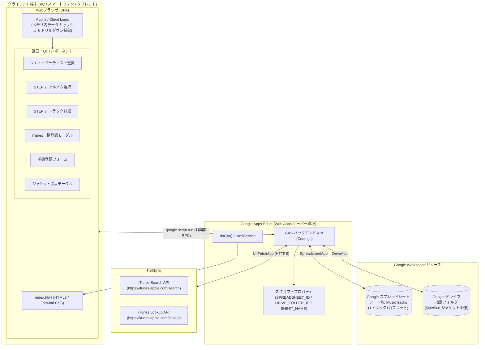
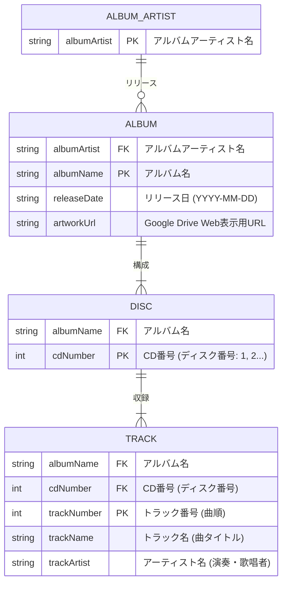
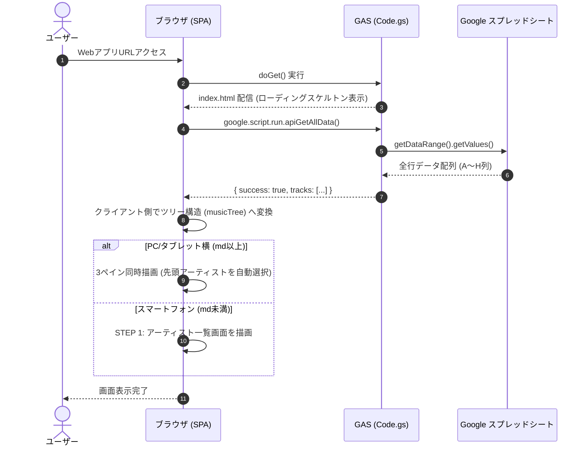
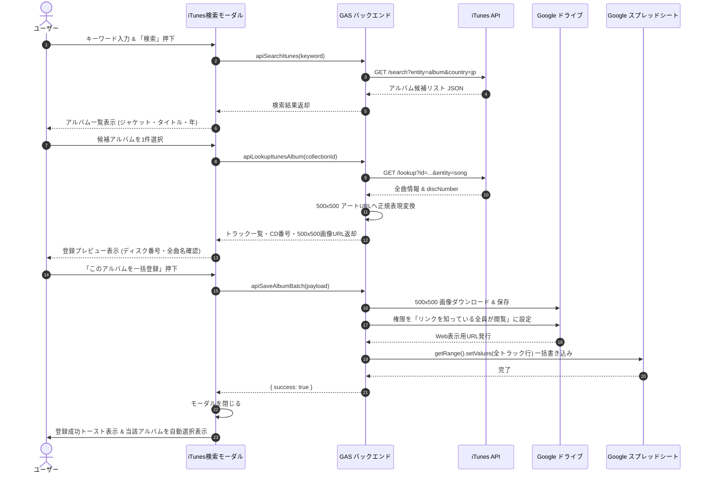
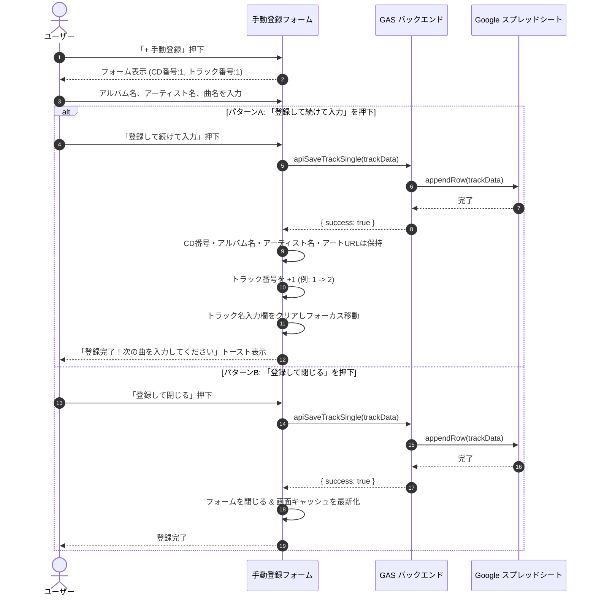

# 音楽管理Webアプリケーション 基本設計書

- **文書バージョン**: 1.0.0
- **作成日**: 2026年10月17日
- **作成ロール**: システムアーキテクト／基本設計者 (`basic_designer`)
- **準拠要件定義書**: `docs/REQUIREMENTS.md` (v1.2.0)
- **ステータス**: 初版完成（Gate 2 レビュー対象）

---

## 目次

1. [システム基本方針・全体アーキテクチャ設計](#1-システム基本方針全体アーキテクチャ設計)
   - 1.1 システム設計方針
   - 1.2 技術スタック選定
   - 1.3 全体システム構成図
   - 1.4 コンポーネント構成と責務
   - 1.5 ディレクトリ・ファイル構成
2. [画面・UI/UX詳細設計](#2-画面uiux詳細設計)
   - 2.1 レスポンシブ方針とブレークポイント定義
   - 2.2 画面状態遷移設計
   - 2.3 PC / タブレット横画面レイアウト（3ペイン横並び）
   - 2.4 スマートフォン画面レイアウト（ステップドリルダウン遷移方式）
   - 2.5 iTunes検索・一括登録モーダル設計
   - 2.6 手動楽曲登録フォーム設計
   - 2.7 アルバムアート拡大モーダル設計
3. [データモデル・ストレージ設計](#3-データモデルストレージ設計)
   - 3.1 概念データモデル・ER図
   - 3.2 スプレッドシートテーブル定義（案A: 1トラック1行フラット方式）
   - 3.3 クライアント内部データ構造（メモリキャッシュ）
   - 3.4 Google Drive ストレージ設計（ファイル規約・権限・Web表示URL）
4. [外部システム・API連携設計](#4-外部システムapi連携設計)
   - 4.1 iTunes Search API 連携仕様
   - 4.2 iTunes Lookup API 連携仕様
   - 4.3 アルバムアート高精細化（500×500）仕様
   - 4.4 Google Drive 画像保存・URL発行仕様
   - 4.5 フロントエンド・バックエンド間 RPC 通信インターフェース仕様
5. [主要処理フロー・シーケンス設計](#5-主要処理フローシーケンス設計)
   - 5.1 アプリ起動・全データ初期ロード シーケンス
   - 5.2 3段階ドリルダウン表示制御フロー
   - 5.3 iTunes検索 〜 プレビュー 〜 一括登録 シーケンス
   - 5.4 手動楽曲登録（連続登録アシスト）シーケンス
   - 5.5 全体クイック検索・インクリメンタルフィルタリング処理フロー
6. [非機能・セキュリティ・例外設計](#6-非機能セキュリティ例外設計)
   - 6.1 セキュリティ設計（XSS対策、権限境界）
   - 6.2 パフォーマンス設計（キャッシュ、バッチ入出力、遅延読込）
   - 6.3 モバイル・タッチ操作性設計（44pxターゲット、仮想キーボード）
   - 6.4 エラーハンドリング・例外設計
   - 6.5 スクリプトプロパティ構成と初期セットアップ設計

---

## 1. システム基本方針・全体アーキテクチャ設計

### 1.1 システム設計方針
1. **Google Apps Script（GAS）サーバーレスアーキテクチャ**:
   - サーバー維持費ゼロ、常時稼働不要。Google アカウントに紐づく Google Workspace（Spreadsheet, Drive）を最大限活用。
2. **高速レスポンス（クライアントサイド・キャッシング）**:
   - 起動時にスプレッドシート全行を1回のRPC通信で一括取得し、ブラウザ（JavaScript）内のメモリ上でツリー構造化して保持。
   - 検索・絞り込み・階層ドリルダウンはクライアント側でミリ秒単位（100ms未満）で完結させ、GAS特有の通信遅延をユーザーに感じさせない。
3. **デバイス最適化（完全レスポンシブ・アダプティブUI）**:
   - **PC / タブレット横（幅 768px以上）**: 3ペイン横並びでコレクション全体を俯瞰。
   - **スマートフォン（幅 768px未満）**: 1画面1ステップのステップドリルダウン遷移方式。上部に「< 戻る」ナビゲーションとパンくずを常備。最小タップターゲット 44px の確保。
4. **外部音源データの自動化と手動登録の両立**:
   - iTunes APIによる高解像度（500×500）ジャケット・ディスク番号（CD番号）・全トラックの自動取得＆Google Drive永続化。
   - 同人・自主制作・限定盤のための手動登録フォーム（連続登録アシスト付き）を初期標準搭載。

### 1.2 技術スタック選定

| 分類 | 技術・ライブラリ | バージョン/規約 | 選定理由 |
| :--- | :--- | :--- | :--- |
| **実行環境** | Google Apps Script (V8 Runtime) | V8 | ES6+（アロー関数、Promise、async/await等）を利用したモダンなコードベース。 |
| **フロントエンド構文** | HTML5 / Vanilla JavaScript (ES2020+) | ネイティブ | React/Vue等の重量フレームワークを排し、バンドル不要でGAS HTMLServiceと親和性の高い高速描画を実現。 |
| **CSS フレームワーク** | Tailwind CSS (CDN版) | 3.x (Play CDN) | ユーティリティファーストによる柔軟かつ保守性の高いレスポンシブ設計（`sm:`, `md:`, `lg:`）。 |
| **アイコン** | Lucide Icons / Heroicons (SVG埋め込み) | - | 外部フォント依存を排除し、SVGインライン展開により軽量かつオフライン/通信遮断時にも安定表示。 |
| **データベース** | Google スプレッドシート | - | 案A（1トラック1行フラット方式）の採用により、スプレッドシート直接の閲覧・編集が容易。 |
| **ファイルストレージ** | Google ドライブ | - | 高解像度（500×500）アルバムアートの永続保存と公開Web表示URLの自動生成。 |
| **外部通信** | `UrlFetchApp` (GAS標準) | - | iTunes APIへのHTTPS GET通信および画像バイナリ（Blob）のダウンロード。 |

### 1.3 全体システム構成図



### 1.4 コンポーネント構成と責務

#### ① クライアント層（フロントエンド SPA）
- **状態管理（`AppState`）**:
  - 全楽曲フラットデータ配列（`allTracks`）
  - アーティスト別階層ツリーキャッシュ（`musicTree`）
  - 現在のUI状態（選択中アーティスト、選択中アルバム、スマホの現在ステップ、モーダル表示状態）
- **UIレンダラー（`ViewRenderer`）**:
  - PC用3ペイン描画 / スマホ用ステップドリルダウン描画の切り替え制御
  - トラック一覧（Disc番号ごとのグルーピング、スマホ用縦積みレイアウト）のDOM生成
  - XSS防止サニタイズ（`escapeHtml`）

#### ② バックエンド層（GAS: `Code.gs`）
- **コントローラー / エントリポイント**:
  - `doGet()`: `HtmlService.createTemplateFromFile('index').evaluate()` によりWebページを配信。
- **データアクセス層（DAO）**:
  - `getAllTracks()`: スプレッドシートから全行取得しJSON形式に変換して返却。
  - `saveTracksBatch(tracks)`: iTunes検索からの全トラック＋ジャケットDrive保存を一括実行。
  - `saveTrackSingle(track)`: 手動登録フォームからの1トラック追記実行。
- **外部サービス連携層**:
  - `searchItunesAlbums(keyword)`: iTunes Search API へのプロキシ検索。
  - `lookupItunesAlbumTracks(collectionId)`: iTunes Lookup API より全楽曲および `discNumber`（CD番号）を取得。
  - `downloadAndSaveArtwork(url, albumName)`: 500×500画像をDriveへ保存しWeb表示URLを生成。

### 1.5 ディレクトリ・ファイル構成
GASおよびClasp環境での管理を想定したファイル構成とする。

```
MusicInfo-app/
├── docs/
│   ├── REQUIREMENTS.md     # 要件定義書 (v1.2.0)
│   └── BASIC_DESIGN.md     # 基本設計書 (本書)
├── src/
│   ├── appsscript.json     # GAS プロジェクトマニフェスト (OAuthスコープ定義等)
│   ├── Code.js             # GAS サーバーサイドメインロジック (doGet, API関数群)
│   ├── SheetsDao.js        # スプレッドシート読み書き処理モジュール
│   ├── DriveDao.js         # Google ドライブ画像保存・URL生成モジュール
│   ├── ItunesService.js    # iTunes API通信・高解像度URL変換・トラック抽出モジュール
│   ├── index.html          # WebアプリメインHTML (SPA骨格)
│   ├── css.html            # Tailwind CSS 読み込み・カスタムスタイル
│   └── js.html             # フロントエンドJavaScript (状態管理、イベント、DOM制御)
└── README.md
```

---

## 2. 画面・UI/UX詳細設計

### 2.1 レスポンシブ方針とブレークポイント定義

Tailwind CSS標準ブレークポイントに準拠し、CSSメディアクエリとJavaScriptの画面リサイズ検知を組み合わせる。

| ブレークポイント | 画面幅 | 対象デバイス例 | 画面構成方針 |
| :--- | :--- | :--- | :--- |
| **`mobile` (base)** | 320px 〜 767px | iPhone SE, 13/14/15, Galaxy, Pixel | **ステップドリルダウン方式（1画面1ステップ）**。<br>上部ナビゲーション（戻るボタン、パンくず）。トラックは縦積み。モーダルはフルスクリーン/ボトムシート。 |
| **`tablet` / `pc` (`md:`〜)** | 768px 以上 | iPad (横), ノートPC, デスクトップ | **3ペイン横並び同時表示**。<br>左: アーティスト一覧(250px〜300px)、中央: アルバム一覧(300px〜350px)、右: トラック詳細(残り全幅)。モーダルは中央ダイアログ。 |

### 2.2 画面状態遷移設計

#### スマートフォンにおけるステップドリルダウン遷移図

```mermaid
stateDiagram-v2
    [*] --> Step1_Artists: アプリ初期ロード完了

    state Step1_Artists {
        description: アーティスト一覧 (五十音/英数ソート + 検索フィルター)
    }

    state Step2_Albums {
        description: 選択アーティストのアルバムカード一覧 (< 戻るボタン)
    }

    state Step3_Tracks {
        description: アルバム詳細ヘッダー + ディスク別トラック一覧 (< 戻るボタン + パンくず)
    }

    state Modal_iTunes {
        description: iTunes検索一括登録 (フルスクリーン/ボトムシート)
    }

    state Modal_Manual {
        description: 手動1曲登録フォーム (連続入力アシスト / テンキー対応)
    }

    state Modal_ImageZoom {
        description: 500x500 ジャケット拡大表示 (タップで閉じる)
    }

    Step1_Artists --> Step2_Albums: アーティストタップ
    Step2_Albums --> Step1_Artists: 「< アーティスト一覧に戻る」タップ

    Step2_Albums --> Step3_Tracks: アルバムタップ
    Step3_Tracks --> Step2_Albums: 「< アルバム一覧に戻る」タップ
    Step3_Tracks --> Step1_Artists: パンくずの「アーティスト」タップ

    Step1_Artists --> Modal_iTunes: 「+ iTunes」タップ
    Step2_Albums --> Modal_iTunes: 「+ iTunes」タップ
    Step3_Tracks --> Modal_iTunes: 「+ iTunes」タップ

    Step1_Artists --> Modal_Manual: 「+ 手動」タップ
    Step2_Albums --> Modal_Manual: 「+ 手動」タップ
    Step3_Tracks --> Modal_Manual: 「このアルバムに曲を追加」タップ (情報引き継ぎ)

    Step3_Tracks --> Modal_ImageZoom: ジャケット画像タップ

    Modal_iTunes --> Step3_Tracks: 一括登録完了 (自動で登録アルバムを表示)
    Modal_Manual --> Step3_Tracks: 登録して閉じる (自動更新)
```

### 2.3 PC / タブレット横画面レイアウト（3ペイン横並び）

PC表示（`md:` 以上）では画面を3ペインに分割し、ブラウジングと詳細確認をスムーズに行える構成とする。

```
+--------------------------------------------------------------------------------------------------------------------+
| [Logo] MusicInfo Manager    [Q アーティスト/アルバム/曲名/CD番号で検索...]        [+ 手動登録]   [+ iTunes検索で登録]  |
+--------------------------------------------------------------------------------------------------------------------+
| [STEP 1: アーティスト]       | [STEP 2: アルバム選択]                   | [STEP 3: トラック詳細]                   |
| 絞り込み: [__________]       | 宇多田ヒカル (3 アルバム)                | [Jacket 140x140] First Love             |
|------------------------------+------------------------------------------|                  宇多田ヒカル           |
| > 宇多田ヒカル          (3)  | +------------------+ +------------------+|                  1999-03-10 / 12曲      |
|   椎名林檎              (5)  | | [Jacket]         | | [Jacket]         ||                  [このアルバムに曲を追加]|
|   BUMP OF CHICKEN       (4)  | | First Love       | | Distance         ||-----------------------------------------|
|   YOASOBI               (2)  | | 1999 (12曲)      | | 2001 (13曲)      || [Disc 1 (CD番号: 1)]                    |
|   RADWIMPS              (6)  | +------------------+ +------------------+|  #   曲名               アーティスト    |
|   米津玄師              (5)  | +------------------+                     |  1   Automatic          宇多田ヒカル    |
|                              | | [Jacket]         |                     |  2   Movin' on without  宇多田ヒカル    |
|                              | | BADモード        |                     |  3   In My Room         宇多田ヒカル    |
|                              | | 2022 (14曲)      |                     |  4   First Love         宇多田ヒカル    |
|                              | +------------------+                     |  ...                                    |
+------------------------------+------------------------------------------+-----------------------------------------+
| ステータス: 全 42 アーティスト / 118 アルバム / 1,420 トラック 読み込み完了 (0.4s)                                |
+--------------------------------------------------------------------------------------------------------------------+
```

### 2.4 スマートフォン画面レイアウト（ステップドリルダウン遷移方式）

スマホ表示（`md:` 未満）では画面全体を1ステップに割り当て、片手親指で自然に操作できるタッチUIを提供する。

#### ① STEP 1: アーティスト一覧画面
```
+------------------------------------------+
| [Logo] MusicInfo       [+ 手動]  [+ iTunes] |
+------------------------------------------+
| [Q 全体クイック検索 (曲名/アルバム)...]   |
+------------------------------------------+
| アーティスト一覧 (42組)                   |
| [アーティスト絞り込み...              ]   |
+------------------------------------------+
| 宇多田ヒカル                         (3) >|  <- 最小高さ 48px
|------------------------------------------|
| 椎名林檎                             (5) >|  <- タップ領域 44px以上確保
|------------------------------------------|
| BUMP OF CHICKEN                      (4) >|
|------------------------------------------|
| YOASOBI                              (2) >|
|------------------------------------------|
| RADWIMPS                             (6) >|
|------------------------------------------|
| 米津玄師                             (5) >|
+------------------------------------------+
```

#### ② STEP 2: アルバム選択画面
```
+------------------------------------------+
| [< アーティスト一覧に戻る]               |  <- 戻るナビゲーションバー (常時固定)
+------------------------------------------+
| 宇多田ヒカル (3 アルバム)                |
+------------------------------------------+
| +--------------------------------------+ |
| | [Jacket 80x80]  First Love           | |  <- リスト/カード形式
| |                 1999-03-10           | |  <- タップでSTEP 3へ遷移
| |                 12 Tracks          > | |
| +--------------------------------------+ |
| +--------------------------------------+ |
| | [Jacket 80x80]  Distance             | |
| |                 2001-03-28           | |
| |                 13 Tracks          > | |
| +--------------------------------------+ |
| +--------------------------------------+ |
| | [Jacket 80x80]  BADモード            | |
| |                 2022-01-19           | |
| |                 14 Tracks          > | |
| +--------------------------------------+ |
+------------------------------------------+
```

#### ③ STEP 3: トラック詳細画面（モバイル縦積みレイアウト）
```
+------------------------------------------+
| [< アルバム一覧に戻る]                   |  <- 戻るナビゲーション
+------------------------------------------+
| 宇多田ヒカル  >  First Love              |  <- パンくずリンク
+------------------------------------------+
| [Jacket 120x120]  First Love             |
| (タップで拡大)     宇多田ヒカル           |
|                   1999-03-10 / 全12曲    |
|                   [+ このアルバムに曲追加]|
+------------------------------------------+
| ■ Disc 1 (CD番号: 1)                     |  <- ディスク別ヘッダー
+------------------------------------------+
| [#1] Automatic                           |  <- 横スクロールなし・縦積み表示
|      宇多田ヒカル                        |
|------------------------------------------|
| [#2] Movin' on without you               |
|      宇多田ヒカル                        |
|------------------------------------------|
| [#3] In My Room                          |
|      宇多田ヒカル                        |
|------------------------------------------|
| [#4] First Love                          |
|      宇多田ヒカル                        |
+------------------------------------------+
```

### 2.5 iTunes検索・一括登録モーダル設計

スマートフォン表示時はフルスクリーンモーダル（画面全域表示）とし、キーボード表示領域を確保する。

```
+-------------------------------------------------------------+
| [モーダル] iTunesからアルバムを一括登録                 [✕] |
+-------------------------------------------------------------+
| 検索キーワード:                                             |
| [ アルバム名またはアーティスト名を入力...             ] [検索] |
+-------------------------------------------------------------+
| 検索結果 (候補アルバムを選択してください):                  |
| +---------------------------------------------------------+ |
| | [Jacket 60x60]  orbital period                          | |
| |                 BUMP OF CHICKEN / 2007-12-19 / 28曲     | |
| +---------------------------------------------------------+ |
+-------------------------------------------------------------+
| 選択中アルバムのプレビュー:                                 |
| [Jacket 500x500] orbital period / BUMP OF CHICKEN           |
| リリース日: 2007-12-19                                      |
|                                                             |
| トラック一覧プレビュー (自動取得):                          |
|   Disc 1 (CD番号: 1)                                        |
|     1. voyager (BUMP OF CHICKEN)                            |
|     2. 星の鳥 (BUMP OF CHICKEN)                             |
|   Disc 2 (CD番号: 2)                                        |
|     1. ...                                                  |
+-------------------------------------------------------------+
| [ キャンセル ]                     [ このアルバムを一括登録 ] |
+-------------------------------------------------------------+
```

### 2.6 手動楽曲登録フォーム設計

自主制作盤・同人音源の連続入力に対応し、スマートフォンではテンキーが自動起動する `inputmode="numeric"` を設定。

```
+-------------------------------------------------------------+
| [モーダル] 手動楽曲登録 (自主制作・未配信音源)          [✕] |
+-------------------------------------------------------------+
| CD番号 (ディスク番号) *         トラック番号 *             |
| [ 1            ] (テンキー)     [ 1            ] (テンキー) |
|                                                             |
| アルバムアーティスト名 *                                    |
| [ 例: 上海アリス幻樂団                                    ] |
|                                                             |
| アルバム名 *                                                |
| [ 例: 蓬莱人形 ~ Dolls in Pseudo Paradise                 ] |
|                                                             |
| アーティスト名 (トラック歌唱・演奏者) *                     |
| [ 例: ZUN (アルバムアーティストから自動補完)              ] |
|                                                             |
| トラック名 (楽曲タイトル) *                                 |
| [ 例: 蓬莱伝説                                            ] |
|                                                             |
| リリース日 (任意)               アルバムアートURL (任意)    |
| [ YYYY-MM-DD ] (日付ピッカー)   [ https://... (空欄可)    ] |
+-------------------------------------------------------------+
| [ 閉じる ]         [ 登録して閉じる ]   [ ★ 登録して続けて入力 ]|
+-------------------------------------------------------------+
  ※「登録して続けて入力」を押すと、CD番号・アルバム名・アーティスト名
    ・アートURLを保持したままトラック番号が自動で +1 され、
    トラック名にフォーカスが当たります。
```

### 2.7 アルバムアート拡大モーダル設計
- サムネイル画像をタップ/クリックすると、背景が黒半透明（`bg-black/80`）のオーバーレイを表示。
- 中央に 500×500 ピクセルのオリジナル画像をレスポンシブに最大表示（`max-w-[90vw] max-h-[85vh]`）。
- 画面上のどこをタップしても即座に閉じる。

---

## 3. データモデル・ストレージ設計

### 3.1 概念データモデル・ER図



### 3.2 スプレッドシートテーブル定義（案A: 1トラック1行フラット方式）

ユーザー承認に基づく正式採用方式。スプレッドシート上のシート名: `MusicTracks`。
全8項目を1行1トラックとしてフラットに格納。

| 列 | ヘッダー名（1行目） | 物理キー名 | 型 | 必須 | 制約・検証ルール | 具体例 |
| :---: | :--- | :--- | :---: | :---: | :--- | :--- |
| **A** | **CD番号** | `cdNumber` | 数値 / 文字列 | **Yes** | 1以上の整数（1枚組: `1`、複数枚組: `1`, `2`...） | `1` |
| **B** | **アルバムアーティスト名** | `albumArtist` | 文字列 | **Yes** | 最大255文字。空文字不可。 | `宇多田ヒカル` |
| **C** | **アルバム名** | `albumName` | 文字列 | **Yes** | 最大255文字。空文字不可。 | `First Love` |
| **D** | **アーティスト名** | `trackArtist` | 文字列 | **Yes** | 最大255文字。各トラックの歌唱者。 | `宇多田ヒカル` |
| **E** | **トラック番号** | `trackNumber` | 数値 | **Yes** | 1以上の整数。同一CD番号内で一意推奨。 | `1` |
| **F** | **トラック名** | `trackName` | 文字列 | **Yes** | 最大255文字。空文字不可。 | `Automatic` |
| **G** | **リリース日** | `releaseDate` | 文字列 | No | `YYYY-MM-DD` 形式（正規表現: `^\d{4}-\d{2}-\d{2}$`） | `1999-03-10` |
| **H** | **アルバムアートURL** | `artworkUrl` | 文字列 (URL) | No | Google DriveのWeb表示URLまたはHTTP(S)形式URL | `https://drive.google.com/uc?id=...` |

> [!NOTE]
> **複合一意キーの考え方**:
> 業務上の論理ユニークキーは `アルバム名` + `CD番号` + `トラック番号` の組み合わせとする。一括登録時や手動登録時に既存行との重複検知を行う。

### 3.3 クライアント内部データ構造（メモリキャッシュ）

スプレッドシートから読み込んだフラット行配列を、クライアント側で高速参照できるように以下の階層ツリー構造へパース・インデックス化する。

```typescript
// クライアント側 TypeScript型定義イメージ

interface RawTrackRow {
  cdNumber: number | string;
  albumArtist: string;
  albumName: string;
  trackArtist: string;
  trackNumber: number;
  trackName: string;
  releaseDate: string;
  artworkUrl: string;
}

interface TrackDetail {
  cdNumber: number | string;
  trackNumber: number;
  trackName: string;
  trackArtist: string;
}

interface DiscGroup {
  cdNumber: number | string;
  tracks: TrackDetail[];
}

interface AlbumData {
  albumName: string;
  albumArtist: string;
  releaseDate: string;
  artworkUrl: string;
  totalTracks: number;
  discs: Record<string | number, DiscGroup>; // CD番号キー
}

interface ArtistData {
  artistName: string;
  albumCount: number;
  albums: Record<string, AlbumData>; // アルバム名キー
}

// アプリケーション全体キャッシュルート
type MusicCatalog = Record<string, ArtistData>; // アーティスト名キー
```

### 3.4 Google Drive ストレージ設計

#### ① 格納フォルダ
- スクリプトプロパティ `DRIVE_FOLDER_ID` で指定されたフォルダ配下に全アルバムアート画像をフラットに保存する。

#### ② ファイル命名規約
- ファイル名の衝突を防止し、Drive上で管理しやすくするため以下の規約とする：
  ```
  artwork_{サニタイズ済みアルバム名}_{タイムスタンプ}.jpg
  ```
  - 例: `artwork_First_Love_1718000000000.jpg`
  - サニタイズ処理: ファイル名禁止文字（`\ / : * ? " < > |`）および空白をアンダースコア `_` に置換。

#### ③ 権限設定およびWeb表示用URL
- 保存時に当該画像ファイルの共有設定を自動で設定する：
  ```javascript
  file.setSharing(DriveApp.Access.ANYONE_WITH_LINK, DriveApp.Permission.VIEW);
  ```
- **Web表示用URLの生成**:
  - Google Driveの公式Web配信URL形式を採用：
    `https://drive.google.com/uc?export=view&id=${file.getId()}`
  - サムネイル用（別形式）:
    `https://lh3.googleusercontent.com/d/${file.getId()}`
  - このURLをスプレッドシート H列（`artworkUrl`）に記録する。

---

## 4. 外部システム・API連携設計

### 4.1 iTunes Search API 連携仕様

- **エンドポイント**: `https://itunes.apple.com/search`
- **通信方式**: `UrlFetchApp.fetch(url, { muteHttpExceptions: true })`
- **リクエストパラメータ**:
  - `term`: ユーザー入力キーワード（encodeURIComponent 必須）
  - `country`: `jp`（日本国内ストア優先）
  - `media`: `music`
  - `entity`: `album`
  - `limit`: `25`
- **レスポンスマッピング**:
  ```json
  {
    "resultCount": 25,
    "results": [
      {
        "wrapperType": "collection",
        "collectionId": 1440783617,
        "artistName": "宇多田ヒカル",
        "collectionName": "First Love",
        "artworkUrl100": "https://is1-ssl.mzstatic.com/image/thumb/Music115/v4/.../100x100bb.jpg",
        "releaseDate": "1999-03-10T08:00:00Z",
        "trackCount": 12
      }
    ]
  }
  ```

### 4.2 iTunes Lookup API 連携仕様

- **エンドポイント**: `https://itunes.apple.com/lookup`
- **リクエストパラメータ**:
  - `id`: アルバムの `collectionId`
  - `entity`: `song`
  - `country`: `jp`
- **レスポンス構造と抽出ロジック**:
  - `results[0]`: `wrapperType == "collection"`（アルバム共通情報）
  - `results[1..N]`: `wrapperType == "track"`（トラック情報）
- **マッピングルール**:
  | iTunes API レスポンス項目 | スプレッドシート項目 | 変換・補正仕様 |
  | :--- | :--- | :--- |
  | `discNumber` | **CD番号** | **確定仕様**: ディスク番号（1, 2...）をそのまま設定。存在しない場合は `1`。 |
  | `collectionArtistName` または `artistName` | **アルバムアーティスト名** | アルバム全体のアーティスト |
  | `collectionName` | **アルバム名** | アルバム名 |
  | `artistName` | **アーティスト名** | 各トラックの歌唱者（客演時は固有アーティスト名） |
  | `trackNumber` | **トラック番号** | 当該ディスク内の曲順番号 |
  | `trackName` | **トラック名** | 楽曲タイトル |
  | `releaseDate` | **リリース日** | ISO日付 `YYYY-MM-DDTHH:mm:ssZ` の先頭10文字 `YYYY-MM-DD` |
  | `artworkUrl100` | **アルバムアートURL** | 500×500置換後、Drive保存したWeb表示URL |

### 4.3 アルバムアート高精細化（500×500）仕様

iTunes APIが提供するサムネイルURL（`100x100bb`）から、高精細な 500×500 画像URLを正規表現置換で生成する。

```javascript
/**
 * 100x100bb URL を 500x500bb URL へ変換
 * @param {string} url100 
 * @returns {string} url500
 */
function convertTo500x500ArtworkUrl(url100) {
  if (!url100) return '';
  return url100.replace(/100x100bb\.(jpg|png|webp)/i, '500x500bb.$1');
}
```

### 4.4 Google Drive 画像保存・URL発行仕様

```javascript
/**
 * 高精細アルバムアート画像をDriveに保存し、公開Web表示URLを発行
 * @param {string} imageUrl500 
 * @param {string} albumName 
 * @returns {string} driveWebUrl
 */
function saveArtworkToDrive(imageUrl500, albumName) {
  const folderId = PropertiesService.getScriptProperties().getProperty('DRIVE_FOLDER_ID');
  if (!folderId) throw new Error('DRIVE_FOLDER_ID がスクリプトプロパティに設定されていません。');

  const folder = DriveApp.getFolderById(folderId);
  const response = UrlFetchApp.fetch(imageUrl500);
  const blob = response.getBlob();

  const sanitizedName = albumName.replace(/[\/\\:\*\?"<>\| ]/g, '_').substring(0, 50);
  const fileName = `artwork_${sanitizedName}_${Date.now()}.jpg`;
  blob.setName(fileName);

  const file = folder.createFile(blob);
  file.setSharing(DriveApp.Access.ANYONE_WITH_LINK, DriveApp.Permission.VIEW);

  return `https://drive.google.com/uc?export=view&id=${file.getId()}`;
}
```

### 4.5 フロントエンド・バックエンド間 RPC 通信インターフェース仕様

GASの標準機能 `google.script.run` を通じて呼び出すサーバー側APIの一覧を定義する。
全ての結果は共通のレスポンスオブジェクト `{ success: boolean, data?: any, error?: string }` 形式で返却する。

| API関数名 | 引数 | 戻り値型 | 責務・概要 |
| :--- | :--- | :--- | :--- |
| `apiGetAllData()` | なし | `{ success: true, tracks: RawTrackRow[], meta: Object }` | スプレッドシートから全行取得し返却する。 |
| `apiSearchItunes(keyword)` | `keyword: string` | `{ success: true, albums: ItunesAlbumSummary[] }` | iTunes Search API へ問い合わせ、アルバム一覧を返却する。 |
| `apiLookupItunesAlbum(collectionId)` | `collectionId: number` | `{ success: true, albumDetail: ItunesAlbumDetail }` | iTunes Lookup API より全トラック情報（discNumber含む）と 500x500 アートURLを取得して返却する。 |
| `apiSaveAlbumBatch(payload)` | `payload: BatchSavePayload` | `{ success: true, count: number }` | 画像をDrive保存し、全トラック行をスプレッドシートへ一括書き込みする。 |
| `apiSaveTrackSingle(track)` | `track: RawTrackRow` | `{ success: true, row: RawTrackRow }` | 手動登録フォームから1行をスプレッドシートへ追記する。 |

---

## 5. 主要処理フロー・シーケンス設計

### 5.1 アプリ起動・全データ初期ロード シーケンス



### 5.2 3段階ドリルダウン表示制御フロー

#### PC表示時
- STEP 1 でアーティスト行をクリック → 選択状態（アクティブ色反転）にし、中央の STEP 2 にアルバムカード一覧を描画。先頭のアルバムを自動選択して STEP 3 にトラック詳細を展開。

#### スマートフォン表示時（ステップ切り替え）
- **STEP 1 → STEP 2**:
  - ユーザーがアーティスト項目（タップターゲット 44px 以上）をタップ。
  - `AppState.currentStep = 2` に更新。
  - 画面をアニメーションまたは即時切り替えで STEP 2 を全画面表示。
  - 最上部に「`< アーティスト一覧に戻る`」ボタンを表示。
- **STEP 2 → STEP 3**:
  - ユーザーがアルバムカードをタップ。
  - `AppState.currentStep = 3` に更新。
  - STEP 3 を全画面表示。最上部に「`< アルバム一覧に戻る`」および「`アーティスト名 > アルバム名`」パンくずを表示。
  - トラック一覧をディスク（CD番号）単位でグループ化し、スマホ向け縦積みリストとして描画。

### 5.3 iTunes検索 〜 プレビュー 〜 一括登録 シーケンス



### 5.4 手動楽曲登録（連続登録アシスト）シーケンス



### 5.5 全体クイック検索・インクリメンタルフィルタリング処理フロー

1. ユーザーがヘッダーの「全体クイック検索」に文字を入力（デバウンス 200ms）。
2. クライアント側メモリ内の `allTracks` 配列に対して以下の項目を大文字小文字無視でインクリメンタル検索：
   - アルバムアーティスト名
   - アルバム名
   - トラック名
   - アーティスト名
   - CD番号
3. 一致した楽曲群を抽出し、検索結果サジェストまたは一覧リストを瞬時にオーバーレイ表示。
4. サジェスト項目をタップ/クリックすると、直接そのアルバム（PCでは3ペイン、スマホではSTEP 3）へジャンプして対象楽曲をハイライト表示。

---

## 6. 非機能・セキュリティ・例外設計

### 6.1 セキュリティ設計

#### ① XSS（クロスサイトスクリプティング）対策
- スプレッドシートおよび iTunes API から取得した文字列を HTML に動的挿入する際、`innerHTML` による生文字埋め込みを禁止する。
- 以下のエスケープ関数を徹底するか、`textContent` プロパティを使用して DOM を生成する：
  ```javascript
  function escapeHtml(str) {
    if (str === null || str === undefined) return '';
    return String(str)
      .replace(/&/g, '&amp;')
      .replace(/</g, '&lt;')
      .replace(/>/g, '&gt;')
      .replace(/"/g, '&quot;')
      .replace(/'/g, '&#039;');
  }
  ```

#### ② 権限境界とスクリプトプロパティの秘匿
- スプレッドシートID、Google ドライブフォルダIDはクライアント側 JavaScript に渡さず、GAS サーバーサイド環境変数（`PropertiesService.getScriptProperties()`）内で安全に参照・完結する。
- Web Apps のデプロイ設定は「実行ユーザー: 自分（アクセス権限を持つアカウント）」とし、一般閲覧者に対してスプレッドシートやドライブの直接編集権限を付与することなく安全に読み書きを提供する。

### 6.2 パフォーマンス設計

#### ① クライアント側メモリキャッシュ
- 起動時にスプレッドシートの全データを1回の `apiGetAllData()` で一括ロード。
- アーティスト絞り込みやアルバム切り替え時の追加サーバー間通信（RPC）をゼロにし、即時応答を実現。

#### ② スプレッドシートへのバッチ一括書き込み
- 10〜20曲のトラック登録時、1行ずつの `appendRow` をループ実行すると GAS のオーバーヘッドが大きくなるため、iTunes一括登録時は `sheet.getRange(lastRow + 1, 1, rows.length, 8).setValues(rows)` による一括挿入（バッチ書き込み）を適用する。

#### ③ アルバムアート画像の遅延ロード
- カード一覧やリスト表示部では `loading="lazy"` 属性を付与し、画面スクロールに合わせて画像を遅延読み込みすることで初期表示速度を向上。

#### ④ 二重送信・連打抑止
- 登録ボタン、検索ボタン押下時は直ちにボタンを `disabled` 状態にし、ローディングスピナー（SVGアニメーション）を表示して重複リクエストを防止する。

### 6.3 モバイル・タッチ操作性設計

1. **タップターゲット基準の遵守**:
   - ボタン、戻るリンク、アーティスト一覧項目、アルバムカードのタップ可能エリアは、Apple iOS Human Interface Guidelines に準拠し、**最小 44px × 44px** を厳守。
2. **仮想キーボード最適化**:
   - CD番号およびトラック番号には `type="number" inputmode="numeric"` を明示し、スマートフォンで数字テンキーが自動表示されるようにする。
   - フォーム入力時にソフトウェアキーボードで入力欄が隠れないよう、フォーカス時に `scrollIntoView({ behavior: 'smooth', block: 'center' })` を適用。
3. **横スクロール完全抑止**:
   - スマホ画面幅（320px〜480px）において、横スクロール（水平スクロールバー）を発生させないため、すべてのテキスト要素に `break-words` を指定し、トラック表示は縦積みレイアウトを採用。

### 6.4 エラーハンドリング・例外設計

#### ① 共通エラーレスポンス規約
GASバックエンドからの戻り値は統一フォーマットとし、例外発生時は `catch` 節でハンドリングしてエラーメッセージをクライアントへ返却する。

```javascript
// 共通レスポンス形式
{
  success: false,
  error: "エラー詳細メッセージ（ユーザー向け）",
  code: "ERROR_CODE"
}
```

#### ② 想定エラーとリカバリ仕様

| エラー事象 | 検出契機 | エラーコード | クライアント表示・対応 |
| :--- | :--- | :--- | :--- |
| スクリプトプロパティ未設定 | API呼出時 | `CONFIG_NOT_FOUND` | 「初期設定が必要です。スプレッドシートIDまたはフォルダIDが設定されていません。」を表示し設定手順を案内。 |
| スプレッドシート/シート未存在 | データ読込時 | `SHEET_NOT_FOUND` | 自動的に新規シート（`MusicTracks`）を作成し初期ヘッダーを挿入してリカバリ。 |
| ドライブフォルダID不正/権限なし | 画像保存時 | `DRIVE_ACCESS_DENIED` | 「Google ドライブフォルダへのアクセス権がありません。フォルダIDを確認してください。」を表示。 |
| iTunes API タイムアウト/障害 | 検索・Lookup時 | `ITUNES_API_ERROR` | 「iTunes APIとの通信に失敗しました。時間をおいて再試行してください。」を表示。 |
| 入力バリデーションエラー | 手動登録時 | `VALIDATION_FAILED` | 未入力の必須項目（アルバム名・曲名等）を赤枠ハイライトし、ツールチップで警告。 |

### 6.5 スクリプトプロパティ構成と初期セットアップ設計

本システムを稼働させるために必要なスクリプトプロパティの一覧およびセットアップ手順を定義する。

| プロパティキー | 必須 | 設定値例 | 説明 |
| :--- | :---: | :--- | :--- |
| `SPREADSHEET_ID` | **必須** | `1BxiMVs0XRA5nFMdKvBdBZjgmUUqptlbs74OgvE2upms` | データを蓄積するGoogleスプレッドシートのID。 |
| `DRIVE_FOLDER_ID` | **必須** | `1y6O7kQd3aR...` | 500×500ジャケット画像を格納するGoogleドライブフォルダID。 |
| `SHEET_NAME` | 任意 | `MusicTracks` | データシート名。未設定時はデフォルト値 `MusicTracks` が適用される。 |

#### シート初期化（自動ヘッダー挿入）ロジック
初回起動時または対象シートが存在しない場合、バックエンドで以下のヘッダーを1行目に自動作成し固定表示（フリーズ）する：
- A1: `CD番号`
- B1: `アルバムアーティスト名`
- C1: `アルバム名`
- D1: `アーティスト名`
- E1: `トラック番号`
- F1: `トラック名`
- G1: `リリース日`
- H1: `アルバムアートURL`
- 行の固定: `sheet.setFrozenRows(1)`

---

## 7. まとめと実装フェーズへの引き継ぎ

本基本設計書は、要件定義書（`docs/REQUIREMENTS.md` v1.2.0）に定められた全機能要件・非機能要件、およびユーザー確定事項（8項目定義、CD番号＝ディスク番号、案Aフラット方式、案AドライブURL、手動登録機能、完全レスポンシブ・スマホ対応）を漏れなく網羅した設計仕様である。

次期フェーズ（Step 3: 詳細設計 / 実装設計）において、フロントエンドコンポーネントの実装、GASスクリプトモジュールの開発、およびテストケースの策定へ直ちに移行可能である。
