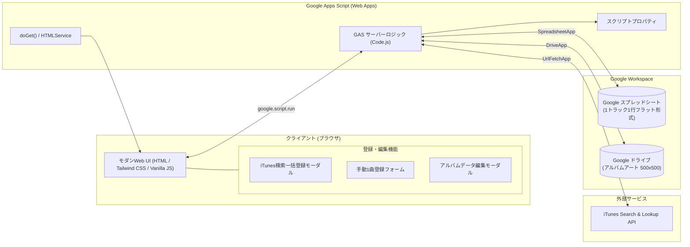
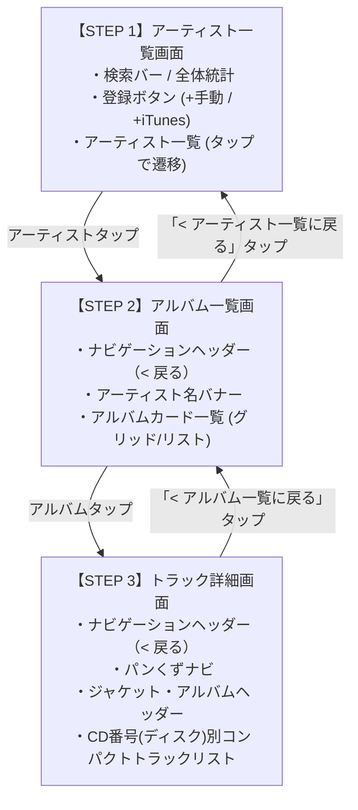

# 音楽管理Webアプリケーション 要件定義書

- **文書バージョン**: 1.3.0
- **作成日**: 2026年10月17日
- **最終更新日**: 2026年10月17日
- **作成ロール**: 要件定義エージェント (`requirements_analyst`)
- **ステータス**: 登録済みアルバムデータ編集機能追加・完全レスポンシブ確定反映版（Gate 1 承認準備完了）

---

## 目次

1. [システム概要と目的](#1-システム概要と目的)
   - 1.1 背景・目的
   - 1.2 システムの特徴（PC/スマホ完全レスポンシブ・編集機能対応）
   - 1.3 システム構成図
2. [利用ユーザー・運用想定](#2-利用ユーザー運用想定)
   - 2.1 利用ユーザー
   - 2.2 主なユースケース（PCおよびスマートフォン利用シナリオ・編集フロー）
3. [機能要件](#3-機能要件)
   - 3.1 閲覧・絞り込み機能（レスポンシブ3段階ナビゲーションUI）
   - 3.2 iTunes Search API 連携・データ自動取得機能
   - 3.3 データ登録・保存機能
   - 3.4 手動データ登録機能（自主制作・未配信音源対応・モバイル配慮）
   - 3.5 アルバムデータ編集・更新機能（登録済みアルバム・収録曲の完全編集対応）
   - 3.6 システム管理・初期設定機能
4. [データ項目要件・データ構造](#4-データ項目要件データ構造)
   - 4.1 業務データ項目一覧（CD番号＝ディスク番号の定義等）
   - 4.2 スプレッドシート設計方式（案A: 1トラック1行フラット方式採用・一括更新仕様）
   - 4.3 スクリプトプロパティ一覧
5. [外部システム連携要件](#5-外部システム連携要件)
   - 5.1 iTunes API 連携仕様（discNumber マッピング等）
   - 5.2 Google Drive 連携仕様（Web表示用URL生成）
   - 5.3 Google Sheets 連携仕様（一括書き込み・編集置換処理）
6. [非機能要件](#6-非機能要件)
   - 6.1 アーキテクチャ・技術スタック
   - 6.2 パフォーマンス・制約対策
   - 6.3 セキュリティ要件（式インジェクション防止・XSS対策）
   - 6.4 信頼性・例外ハンドリング（排他制御・二重送信防止）
   - 6.5 レスポンシブ・モバイル最適化要件（画面幅・タッチ対応）
   - 6.6 運用保守性
7. [画面構成・UI/UX要件](#7-画面構成uiux要件)
   - 7.1 画面レイアウト構成（PC 3ペイン vs スマホ ステップドリルダウン）
   - 7.2 画面各部の詳細仕様（編集ボタン配置・レスポンシブ切り替え）
   - 7.3 iTunes検索・一括登録モーダル（モバイル対応・ボトムシート）
   - 7.4 手動楽曲登録フォーム（モバイル最適化・仮想キーボード配慮）
   - 7.5 アルバム編集モーダル仕様（PC/スマホ完全レスポンシブ・収録曲インライン編集）
8. [仕様確定事項および確認事項（Q&Aサマリー）](#8-仕様確定事項および確認事項qaサマリー)
9. [承認および次のステップ](#9-承認および次のステップ)

---

## 1. システム概要と目的

### 1.1 背景・目的
本システムは、ユーザーが所有または管理する音楽CD・アルバムの情報を、Google スプレッドシートおよび Google ドライブをバックエンドとして一元管理・閲覧するための Web アプリケーションである。

市販CDや配信音源の登録において、手作業によるトラック情報の入力負荷を削減するため、**APIキー不要な iTunes Search API を活用してアルバム情報・ジャケット画像（高解像度 500×500）・全トラック情報・ディスク番号（CD番号）を自動取得し、1クリックでGoogle スプレッドシートおよびGoogle ドライブへ一括保存**する仕組みを提供する。

さらに、iTunesに登録されていない**自主制作CD、同人音楽、限定盤音源等のために、初期バージョンからWeb画面上で手動1曲ずつ入力・登録できるフォームも提供**し、あらゆる音楽コレクションの網羅的な管理を可能にする。

加えて、一度登録したアルバムや収録曲の誤字脱字修正、CD番号（ディスク番号）や曲順の変更、客演アーティスト情報の追記などを行うため、**Web UI上から登録済みアルバムデータおよび全トラック情報を直接編集・更新できるアルバムデータ編集機能**を完全装備し、コレクションの継続的なメンテナンスと高いデータ品質を保証する。

蓄積されたコレクションは、「**アルバムアーティスト選択 → アルバム選択 → トラック情報表示**」という3段階の洗練されたドリルダウンUIにより、直感的かつスピーディに閲覧・検索・編集できる。

### 1.2 システムの特徴
- **Google Apps Script（GAS）ベースのサーバーレス構成**: 追加のサーバーインフラ費用ゼロ、Googleアカウントがあれば即座に運用可能。
- **iTunes API 連携による完全自動入力**: キーワード検索からアルバム・全トラック・高解像度ジャケット画像（500×500）・ディスク番号（CD番号）を自動抽出・マッピング。
- **Google ドライブへのジャケット画像永続化**: iTunes側のURL変更・リンク切れを防ぐため、画像をGoogle ドライブの指定フォルダに保存し、Web表示可能な永続URLをスプレッドシートに保存（案A採用）。
- **自主制作・未配信音源の手動登録フォーム完備**: 初期バージョンよりWeb画面上で1曲ずつ柔軟に手動登録が可能。直前のアルバム情報の引き継ぎ等により連続入力も快適に支援。
- **登録済みアルバム・収録曲のWeb上での完全編集機能**: スプレッドシートを直接開くことなく、Web UI上でアルバム基本情報（アルバム名、アーティスト名、リリース日、画像URL）と収録曲（CD番号、トラック番号、曲名、アーティスト名）をまとめてインライン編集・追加・削除・一括更新可能。
- **直感的な「1トラック1行フラット方式」**: スプレッドシートを直接開いた際もフィルタ・並び替えが極めて容易（案A採用）。
- **3ステップドリルダウンUI（レスポンシブ対応）**: 
  - **PC / タブレット横（md以上）**: 左から「アルバムアーティスト ＞ アルバム ＞ トラック一覧」を横並び3ペインで俯瞰して軽快操作。
  - **スマートフォン（md未満）**: 画面幅に応じた**ステップドリルダウン（画面切り替え／スライド遷移）方式**を採用。1画面1ステップで迷わず操作でき、常備された「戻るナビゲーション」で片手でも快適に階層間を往復可能。
- **モバイルタッチ最適化**: 最小タップターゲット 44px の確保、フルスクリーン／ボトムシート形式のモーダル、仮想キーボード最適化など、スマートフォンからの快適な操作性を追求。

### 1.3 システム構成図



---

## 2. 利用ユーザー・運用想定

### 2.1 利用ユーザー
- **個人CDコレクター / 音楽ファン**: 
  - 所有する市販CDや自主制作CD・同人音源を美しく整理・検索したい個人ユーザー。
  - **PC利用**: 自宅のデスクで大画面（3ペイン）を使ってコレクション全体を一望し、iTunes検索から大量のCDを一括登録・整理する。
  - **スマートフォン利用**: CD棚の前や外出先・レコード店でスマホ片手に手持ちCDを即座に確認（重複買い防止）、あるいは買ったばかりのCDをその場で手動登録・iTunes検索登録する。
- **小規模音楽サークル / 事務所 / 店舗**: 
  - 音楽資産やライブラリをチーム・店舗内で共有・管理するユーザー。PCだけでなくタブレットやスマホ端末からも現場で即座に参照可能。

### 2.2 主なユースケース

```mermaid
flowchart TD
    User((ユーザー))

    subgraph UC_Browse ["UC-01: ライブラリ閲覧（レスポンシブ3段階ドリルダウン）"]
        direction TB
        A_PC["【PC / タブレット横】<br>3ペイン横並びで即時表示・高速切替"]
        A_SP["【スマートフォン】<br>1画面ステップ切替＋戻るナビゲーション"]
        A1["STEP 1: アルバムアーティスト一覧"]
        A2["STEP 2: アルバムカード一覧"]
        A3["STEP 3: トラック詳細・ジャケット(500x500)"]
        A1 -->|アーティスト選択| A2 -->|アルバム選択| A3
        A3 -.->|「< アルバム一覧に戻る」| A2
        A2 -.->|「< アーティスト一覧に戻る」| A1
    end

    subgraph UC_Register_iTunes ["UC-02: iTunes連携によるCD一括登録（PC/スマホ両対応）"]
        B1["iTunes一括登録モーダルを開く<br>(スマホはフルスクリーン/ボトムシート)"]
        B2["キーワード（アーティスト/アルバム名）で検索"]
        B3["候補アルバムを選択"]
        B4["全トラック・CD番号(discNumber)・ジャケットをプレビュー"]
        B5["「一括登録」を実行"]
        B6["Google Driveへ画像保存 ＆ Web表示用URL生成"]
        B7["スプレッドシートへ全トラック行を一括書き込み"]
        B1 --> B2 --> B3 --> B4 --> B5 --> B6 --> B7
    end

    subgraph UC_Register_Manual ["UC-03: 手動フォームによる楽曲登録（自主制作・未配信音源）"]
        C1["手動登録フォームを開く<br>(数値キーボード・スマホ入力配慮)"]
        C2["CD番号・アルバム名・トラック名等を入力"]
        C3["「登録する（続けて入力）」を実行"]
        C4["スプレッドシートへ1行書き込み完了"]
        C5["アルバム情報を保持したまま次トラックを入力"]
        C1 --> C2 --> C3 --> C4 --> C5
    end

    subgraph UC_Edit ["UC-04: 登録済みアルバムデータの編集（PC/スマホ両対応）"]
        D1["アルバム詳細(STEP 3)で「編集」ボタンを押下"]
        D2["編集モーダルを開く<br>(アルバム情報＋全収録曲インライン一覧)"]
        D3["アルバム基本情報（名称・アーティスト・発売日・アートURL）を修正"]
        D4["収録曲（CD番号・曲順・曲名・アーティスト）の修正・追加・削除"]
        D5["クライアント側バリデーション（必須/文字数/正整数/重複）"]
        D6["「変更を保存」実行（排他制御ロック＋二重送信抑止）"]
        D7["スプレッドシート上の旧アルバム全行を一括更新・置換"]
        D8["画面キャッシュを自動同期し最新アルバム詳細を再描画"]
        D1 --> D2 --> D3 --> D4 --> D5 --> D6 --> D7 --> D8
    end

    User --> UC_Browse
    User --> UC_Register_iTunes
    User --> UC_Register_Manual
    User --> UC_Edit
```



#### ユースケース詳細一覧

| ユースケースID | ユースケース名 | アクター | 概要・トリガー | 主な成果 |
| :--- | :--- | :--- | :--- | :--- |
| **UC-01** | ライブラリ閲覧 | ユーザー | アーティスト一覧からアルバム、トラック詳細へドリルダウン閲覧する。 | コレクション内の楽曲・アルバム情報・高解像度ジャケットを快適に閲覧・確認。 |
| **UC-02** | iTunes連携CD一括登録 | ユーザー | ヘッダーの「iTunes検索で登録」からキーワード検索し、アルバムを選択して一括保存する。 | アルバムアートのDrive保存、全トラック情報のスプレッドシートへのバッチ保存。 |
| **UC-03** | 手動楽曲登録 | ユーザー | ヘッダーまたはアルバム詳細の「曲追加」から自主制作盤等の情報を手動入力する。 | 1トラック単位での確実なデータ追記保存、連続入力アシスト。 |
| **UC-04** | 登録済みアルバムデータの編集 | ユーザー | アルバム詳細（STEP 3）の「編集」ボタンから編集モーダルを開き、登録済みデータを修正・保存する。 | スプレッドシート上の旧アルバム全行の完全置換更新、UIキャッシュの即時同期。 |

---

## 3. 機能要件

### 3.1 閲覧・絞り込み機能（レスポンシブ3段階ナビゲーションUI）
ユーザー指定要件「アルバムアーティストの選択 → アルバムの選択 → トラック情報表示」に完全準拠し、PCの大画面とスマートフォンの狭小画面の双方に最適化された閲覧体験を提供する。

| 機能ID | 機能名 | 詳細仕様 |
| :--- | :--- | :--- |
| **FN-BROWSE-001** | 全データ取得・初期化 | アプリ起動時にスプレッドシートから全登録データを一括取得し、クライアント側で高速に3段階構造（アルバムアーティスト ＞ アルバム ＞ トラック）へグループ化してキャッシュする。 |
| **FN-BROWSE-002** | STEP 1: アルバムアーティスト選択 | ・スプレッドシートに登録されている「アルバムアーティスト名」の一覧を一意（重複なし・昇順ソート）で表示する。<br>・アーティスト名絞り込み用のインクリメンタル検索フィルターを備える。<br>・各アーティストの保有アルバム数をバッジ表示する。<br>・モバイル時も押しやすいタップターゲット（高さ44px以上）を確保する。 |
| **FN-BROWSE-003** | STEP 2: アルバム選択 | ・STEP 1 で選択されたアルバムアーティストに紐づくアルバム一覧をカード形式で表示する。<br>・各アルバムカードにはアルバムアート画像サムネイル、アルバム名、リリース年、トラック数を表示する。<br>・アルバムをクリック/タップすると選択状態となり、STEP 3 へ遷移する。 |
| **FN-BROWSE-004** | STEP 3: トラック情報表示（レスポンシブ対応） | ・STEP 2 で選択されたアルバムの詳細ヘッダー（アルバムアート、アルバム名、アルバムアーティスト名、リリース日、総トラック数）を表示する。<br>・アルバムアート画像をクリック/タップすると拡大モーダルで 500×500 のオリジナル画像を確認できる。<br>・アルバムに属する全楽曲を一覧表示する。<br>・**2枚組・複数枚組の場合（異なるCD番号が存在する場合）**、「Disc 1 (CD番号: 1)」「Disc 2 (CD番号: 2)」のようにディスク単位でグループ分けヘッダーを表示し、各ディスク内でトラック番号順にソート表示する。<br>・**モバイル最適化**: スマホ画面幅（320px〜480px）でも横スクロールが発生しないよう、テーブルの折り返し対応や、トラック番号・曲名・アーティスト名をコンパクトに縦積みしたスマートなリストレイアウトを採用する。 |
| **FN-BROWSE-005** | 全体クイック検索 | アーティスト名・アルバム名・曲名・CD番号を横断してフリーワード検索し、該当するアルバムまたは楽曲へ直接ジャンプできる検索バーを提供する。 |
| **FN-BROWSE-006** | レスポンシブ画面レイアウト切替 | ・**PC / タブレット横（`md:` 以上、768px〜）**: 3ペイン横並びで同時表示し、画面全体を俯瞰してマウス操作可能。<br>・**スマートフォン（`md:` 未満、<768px）**: 画面幅制約を考慮し、**ステップドリルダウン（画面切り替え／スライド遷移）方式**を採用。STEP 1・STEP 2・STEP 3 の各画面を1画面いっぱいに表示し、視認性と操作性を最大化する。 |
| **FN-BROWSE-007** | モバイル階層ナビゲーション（戻る・パンくず） | ・スマホ表示時、STEP 2 では画面上部に「< アーティスト一覧に戻る」ボタンを常備。<br>・STEP 3 では画面上部に「< アルバム一覧に戻る」ボタンおよび「アーティスト名 > アルバム名」のパンくずナビゲーションを常備。<br>・ユーザーが迷わず1タップで直前の階層やトップへ戻れるようにする。 |

### 3.2 iTunes Search API 連携・データ自動取得機能
APIキー不要な Apple 公式 iTunes Search API をバックエンド（GASの `UrlFetchApp`）経由で呼び出し、CORS制約を回避して安全かつ安定してデータを取得する。

| 機能ID | 機能名 | 詳細仕様 |
| :--- | :--- | :--- |
| **FN-ITUNES-001** | キーワード検索 | ・キーワード（アルバム名、アーティスト名、またはその両方）を入力してiTunes APIへアルバム検索（`entity=album`）を実行する。<br>・日本の楽曲を正しくヒットさせるため、クエリパラメータに `country=jp` を標準設定する。<br>・最大検索取得件数は 25 件とする。 |
| **FN-ITUNES-002** | 検索結果アルバム一覧表示 | ・取得したアルバム一覧（ジャケット、アルバム名、アーティスト名、リリース日、収録トラック数等）をモーダル内に一覧表示する。<br>・モバイル時はフルスクリーンまたはボトムシート形式で画面いっぱいに見やすくリスト表示。 |
| **FN-ITUNES-003** | トラック情報・CD番号一括取得 (Lookup) | ・ユーザーが特定のアルバムを選択した際、iTunes Lookup API（`id={collectionId}&entity=song`）を呼び出し、当該アルバムの全トラック情報を取得する。<br>・**CD番号の自動取得**: 各トラックの `discNumber`（ディスク番号）を取得し、当システムの「CD番号」として自動マッピングする（1枚組なら全曲 `1`、2枚組ならDisc 1は `1`、Disc 2は `2` となる）。 |
| **FN-ITUNES-004** | アルバムアート高解像度化 (500×500) | ・iTunes APIから返却される標準画像URL（例: `.../100x100bb.jpg`）の解像度指定部分を正規表現置換により `500x500bb.jpg` に変換し、**確実に 500×500 解像度の画像URLを取得**する。 |
| **FN-ITUNES-005** | 登録前プレビュー＆確認 | ・登録前に、取得したアルバムアート（500×500）、アルバム名、アルバムアーティスト名、リリース日、CD番号（ディスク番号）付きの全トラックリストを一覧プレビューする。<br>・必要に応じてCD番号やトラック情報の手動修正・確認が可能。<br>・モバイル時は縦スクロールでプレビュー全体をストレスなく確認可能。 |

### 3.3 データ登録・更新・保存機能

| 機能ID | 機能名 | 詳細仕様 |
| :--- | :--- | :--- |
| **FN-SAVE-001** | アルバムアートのDrive保存＆Web表示URL発行 | ・iTunesの画像URL（500×500）からバイナリデータ（Blob）をバックエンドでダウンロードする。<br>・スクリプトプロパティ `DRIVE_FOLDER_ID` 配下に、一意なファイル名（例: `artwork_{アルバム名}_{タイムスタンプ}.jpg`）で保存する。<br>・**Web表示用URLの採用（案A確定）**: 保存ファイルの権限を閲覧可能に設定し、Google ドライブのWeb表示用URL（`https://drive.google.com/uc?id={FILE_ID}` またはサムネイルURL）を発行してスプレッドシートの「アルバムアートURL」列に書き込む。 |
| **FN-SAVE-002** | スプレッドシートへの一括書き込み（フラット方式） | ・**1トラック1行フラット方式（案A確定）** を採用。<br>・対象シート（`MusicTracks`）に対し、指定の全8項目（CD番号、アルバムアーティスト名、アルバム名、アーティスト名、トラック番号、トラック名、リリース日、アルバムアートURL）を1トラック＝1行として一括挿入（`setValues`）する。 |
| **FN-SAVE-003** | 重複チェック・検証 | ・登録対象の「アルバム名」かつ「CD番号（ディスク番号）」かつ「トラック番号」の組み合わせが既にスプレッドシートに存在する場合、警告を表示して上書きするかスキップするかを選択させる。<br>・必須項目（CD番号、アルバムアーティスト名、アルバム名、アーティスト名、トラック番号、トラック名）のバリデーションを実施。 |

### 3.4 手動データ登録機能（自主制作・未配信音源対応・モバイル最適化）
iTunes APIに登録されていない自主制作盤・同人CD・限定配布音源などのため、初期バージョンからWeb UI上で1曲ずつ直接登録できるフォームを提供する。スマートフォンからの入力にも最適化する。

| 機能ID | 機能名 | 詳細仕様 |
| :--- | :--- | :--- |
| **FN-MANUAL-001** | 手動登録フォーム（モバイル最適化） | ・Web画面上から直接開ける入力フォーム（PCではモーダル、スマホではフルスクリーンまたはボトムシート形式）。<br>・入力項目（全8項目準拠）：<br>  1. CD番号（ディスク番号。デフォルト値: `1`、数値キーボード指定 `type="number" inputmode="numeric"`）<br>  2. アルバムアーティスト名（必須）<br>  3. アルバム名（必須）<br>  4. アーティスト名（必須。デフォルトでアルバムアーティスト名を自動補完）<br>  5. トラック番号（必須。デフォルト値: `1`、数値キーボード指定 `type="number" inputmode="numeric"`）<br>  6. トラック名（必須）<br>  7. リリース日（任意。日付ピッカー `YYYY-MM-DD`）<br>  8. アルバムアートURL（任意。画像URLの直接入力、または空欄）<br>・スマホの仮想キーボード表示時に入力欄が隠れないよう自動スクロール配慮。 |
| **FN-MANUAL-002** | 連続入力アシスト（続けて登録） | ・アルバム内の複数曲をテンポよく登録できるよう、「登録して次を入力」ボタンを用意する。<br>・実行時、当該トラックの1行をスプレッドシートに書き込んだ後、**CD番号、アルバムアーティスト名、アルバム名、リリース日、アルバムアートURLをフォーム上にそのまま保持**し、**トラック番号を自動で +1 インクリメント**、トラック名入力欄に自動フォーカスを当てる。スマホでも連続タップで片手入力可能。 |
| **FN-MANUAL-003** | 既存アルバムからのトラック追記 | ・STEP 2 または STEP 3 でアルバムを選択している状態から「このアルバムに曲を追加」を押下した場合、既存のアルバム情報（CD番号、アルバム名、アーティスト名、アートURL等）をフォームに自動セットして手動登録画面を開くことができる。 |

### 3.5 アルバムデータ編集・更新機能（登録済みアルバム・収録曲の完全編集対応）
登録済みアルバムの誤記修正、曲順入れ替え、収録曲の追加・削除、客演アーティスト名やリリース日の更新等を行うため、Web UI上からアルバムおよび全収録曲情報を直接一括編集・保存する機能を提供する。

| 機能ID | 機能名 | 詳細仕様 |
| :--- | :--- | :--- |
| **FN-EDIT-001** | アルバム情報編集 | ・登録済みアルバムのメタ情報（アルバム名、アルバムアーティスト名、リリース日、アルバムアートURL）を編集可能とする。<br>・アルバム名またはアルバムアーティスト名を変更した場合、当該アルバムに紐づくスプレッドシート上の全トラック行の「アルバム名」「アルバムアーティスト名」列を一括置換する。<br>・アルバムアートURLの入力変更時、モーダル内で即座に画像プレビューを表示し、URLの間違いを視覚的に防止する。 |
| **FN-EDIT-002** | 収録曲情報編集 | ・アルバム内の全収録曲（トラック）について、以下の項目をインライン編集可能とする：<br>  - CD番号（ディスク番号、1以上の正整数）<br>  - トラック番号（曲順、1以上の正整数）<br>  - トラック名（必須文字列）<br>  - トラックアーティスト名（任意、空欄時はアルバムアーティストを自動補完）<br>・**トラック行追加**: 「+ トラック追加」ボタンにより、末尾に新規トラック入力行を追加可能。<br>・**トラック行削除**: 各行の「削除」ボタンにより、不要なトラック行を即座に除外可能（1曲以上の残存必須）。<br>・**トラック番号自動連番採番**: 「番号連番採番」ボタンにより、CD番号（ディスク番号）ごとにトラック番号を 1, 2, 3... と自動で連番再設定する入力支援機能を備える。 |
| **FN-EDIT-003** | スプレッドシート一括更新 | ・編集開始時の旧アルバム識別キー（`originalAlbumArtist` および `originalAlbumName`）に基づき、スプレッドシート上の対象行群を特定する。<br>・編集後の全トラック情報（メタ情報＋全トラック行）をもとに、スプレッドシート上の対象行群を原子的に一括置換する。<br>・収録曲数が増減した場合でも、行のずれや重複・ゴミデータを残さず、正確に行数を伸縮させて一括更新（`setValues`）する。 |
| **FN-EDIT-004** | 編集バリデーション・重複抑止・式インジェクション防止 | ・**必須チェック**: アルバム名、アルバムアーティスト名、全収録曲のトラック名、CD番号、トラック番号の未入力をブロック。<br>・**文字数制限**: アルバム名、アルバムアーティスト名、トラック名、アーティスト名はそれぞれ255文字以内であることを検証。<br>・**正整数チェック**: CD番号およびトラック番号が1以上の有限な整数であることを厳格に検証。<br>・**重複チェック**: 同一アルバムかつ同一CD番号内で「トラック番号」が重複している場合、警告を表示して保存を防止。<br>・**曲数チェック**: 収録曲が0件（全削除）の状態での保存を防止（最低1曲必須）。<br>・**式インジェクション無害化**: スプレッドシートの関数実行リスク（`=`, `+`, `-`, `@` で始まる文字列）をサーバー側（`escapeFormula_`）で確実にエスケープ無害化。 |
| **FN-EDIT-005** | 排他制御・二重送信防止 | ・**排他制御（ロック機構）**: サーバー側（GAS）で `LockService.getScriptLock()` を取得し、同時更新によるスプレッドシート行破壊やレースコンディションを防止する（タイムアウト: 10秒）。<br>・**二重送信抑止**: 「保存」ボタン押下時に即時ボタンを無効化（`disabled`）し、スピナーアニメーションと「更新中...」表示を行う。<br>・**障害時リカバリ**: サーバー通信エラー時や排他ロック獲得失敗時はエラートーストを表示し、**モーダル内の編集内容は破棄せず保持**してユーザーの再試行を可能にする。 |
| **FN-EDIT-006** | クライアント状態・選択中アルバム同期 | ・保存完了時、クライアント側キャッシュ（Store）を即時更新し、スプレッドシート全体の再読込を待つことなく高速にUIへ反映する。<br>・アルバム名やアーティスト名が改名された場合でも、選択中状態（`selectedArtist`, `selectedAlbum`）を新名称に自動追従させ、STEP 3（トラック詳細画面）の表示が外れないようシームレスに同期・再描画する。 |

### 3.6 システム管理・初期設定機能

| 機能ID | 機能名 | 詳細仕様 |
| :--- | :--- | :--- |
| **FN-ADMIN-001** | スクリプトプロパティ管理 | ・`SPREADSHEET_ID`: データ保存先のスプレッドシートID。<br>・`DRIVE_FOLDER_ID`: アルバムアート画像の保存先フォルダID。<br>・プロパティが未設定の場合、画面上に設定案内とエラーガイドを表示する。 |
| **FN-ADMIN-002** | シート自動初期化 | ・指定シート（`MusicTracks`）が存在しない場合、自動的に新規シートを作成し、1行目に規定のヘッダー列（8項目）を設定・固定する。 |
| **FN-ADMIN-003** | ドライブフォルダ接続検証 | ・保存先フォルダIDの存在確認および書き込み権限のバリデーションを登録処理時に行う。 |

---

## 4. データ項目要件・データ構造

### 4.1 業務データ項目一覧
ユーザー指定の8項目を厳密に定義する。特に「CD番号」および「アルバムアートURL」は確定仕様に準拠する。

| No | 項目名（表示名） | カラム物理名 (キー) | データ型 | 必須/任意 | 説明・書式例・確定仕様 |
| :---: | :--- | :--- | :---: | :---: | :--- |
| 1 | **CD番号** | `cdNumber` | 数値 / 文字列 | **必須** | **アルバム内のディスク番号（Disc Number）**。<br>1枚以上のディスクを識別するための項目（IDではない）。<br>・1枚組アルバムの場合: `1`<br>・2枚組以上のアルバムの場合: `1`, `2`, `3` ...（各ディスクの番号）<br>※iTunes APIの `discNumber` から自動取得・マッピング。手動入力も可能。 |
| 2 | **アルバムアーティスト名** | `albumArtist` | 文字列 | **必須** | アルバム全体のアーティストまたは編纂者名。<br>（例: `宇多田ヒカル`, `Various Artists`, `BUMP OF CHICKEN`） |
| 3 | **アルバム名** | `albumName` | 文字列 | **必須** | CDアルバムの正式名称。<br>（例: `First Love`, `orbital period`） |
| 4 | **アーティスト名** | `trackArtist` | 文字列 | **必須** | 当該トラックの歌唱・演奏アーティスト名。<br>（通常はアルバムアーティストと一致。客演時は `feat. xxx` 等） |
| 5 | **トラック番号** | `trackNumber` | 数値 | **必須** | 当該ディスク（CD番号）内での曲順（1以上の整数）。<br>（例: `1`, `2`, `3` ...） |
| 6 | **トラック名** | `trackName` | 文字列 | **必須** | 楽曲のタイトル。<br>（例: `Automatic`, `花の名`） |
| 7 | **リリース日** | `releaseDate` | 文字列 / 日付 | 任意 | アルバムの発売日または公開日。<br>（形式: `YYYY-MM-DD`、例: `1999-03-10`） |
| 8 | **アルバムアートURL** | `artworkUrl` | 文字列 (URL) | 任意 | **案A確定: Google ドライブのWeb表示用URL**。<br>Google ドライブの指定フォルダに保存された 500×500 ジャケット画像のWeb表示用URL（`https://drive.google.com/uc?id={fileId}` 等）。手動登録時は空欄または任意のWeb画像URLも可。 |

### 4.2 スプレッドシート設計方式（案A: 1トラック1行フラット方式 採用確定）

ユーザー合意に基づき、**「案A: 1トラック1行フラット方式」** を正式採用する。
要求された全8項目を単一シートにフラットに記録し、スプレッドシート上での直接確認・フィルタ・編集が最も容易な構成とする。

#### スプレッドシート列配置（左からA〜H列、シート名: `MusicTracks`）
| 列 | 列名（1行目ヘッダー） | 格納データ例 | 備考 |
| :---: | :--- | :--- | :--- |
| **A列** | CD番号 | `1` | ディスク番号（1枚組は1、2枚組は1または2） |
| **B列** | アルバムアーティスト名 | `宇多田ヒカル` | STEP 1 のグループキー |
| **C列** | アルバム名 | `First Love` | STEP 2 のグループキー |
| **D列** | アーティスト名 | `宇多田ヒカル` | トラック固有アーティスト |
| **E列** | トラック番号 | `1` | 各ディスク内での曲順 |
| **F列** | トラック名 | `Automatic` | 曲名 |
| **G列** | リリース日 | `1999-03-10` | 発売日 |
| **H列** | アルバムアートURL | `https://drive.google.com/uc?id=...` | Google ドライブ上のWeb表示用URL |

#### 複数枚組CDの記録イメージ（2枚組アルバムの場合の例）
```csv
A列(CD番号),B列(アルバムアーティスト),C列(アルバム名),D列(アーティスト),E列(トラック番号),F列(トラック名),G列(リリース日),H列(アルバムアートURL)
1,BUMP OF CHICKEN,orbital period,BUMP OF CHICKEN,1,voyager,2007-12-19,https://drive.google.com/...
1,BUMP OF CHICKEN,orbital period,BUMP OF CHICKEN,2,星の鳥,2007-12-19,https://drive.google.com/...
...
2,Special Artist,Live Compilation,Special Artist,1,Intro Live,2023-05-01,https://drive.google.com/...
2,Special Artist,Live Compilation,Special Artist,2,Encore Song,2023-05-01,https://drive.google.com/...
```

#### 4.2.1 アルバムデータ編集・更新時のデータ操作方式
- **対象アルバムの特定キー**:
  - 本設計（1トラック1行フラット方式）ではレコード個別のID列を持たないため、編集対象の特定には編集開始時の**旧「アルバムアーティスト名（B列）」＋旧「アルバム名（C列）」の複合キー**（`originalAlbumArtist` / `originalAlbumName`）を用いる。
- **行数増減・改名への原子的対応（アトミック更新）**:
  - トラックの追加・削除によって当該アルバムの行数が増減した場合、またはアルバム名・アルバムアーティスト名が改名された場合でも、以下の手順によりシートの整合性を完全維持する：
    1. 既存スプレッドシートの全行（2行目以降）を読み込む。
    2. 旧複合キーに一致する既存行をすべて除外（フィルタリング）する。
    3. 編集後の新メタデータ（新アルバムアーティスト名、新アルバム名、新リリース日、新アルバムアートURL）および新トラック一覧（CD番号、トラック番号、曲名、トラックアーティスト名）から構成される新規行データを生成する。
    4. 「旧キー一致外の全行」＋「編集後の新規行群」を結合し、スプレッドシートのデータ領域全体へ一括書き戻し（`clearContents` ＋ `setValues`）を行う。
    5. この一連の処理を後述の排他制御（`LockService`）下で実行することで、同時更新衝突や行ズレ・ゴミデータの残留を100%防止する。

### 4.3 スクリプトプロパティ一覧
機密情報や環境依存値はハードコードせず、GASのスクリプトプロパティ（`PropertiesService.getScriptProperties()`）から取得する。

| プロパティ名 | 型 | 必須 | 設定内容・説明 |
| :--- | :---: | :---: | :--- |
| `SPREADSHEET_ID` | 文字列 | **必須** | データ保存先の Google スプレッドシート ID。<br>（URL `https://docs.google.com/spreadsheets/d/{ID}/edit` のID部分） |
| `DRIVE_FOLDER_ID` | 文字列 | **必須** | ダウンロードしたアルバムアート画像（500×500）を格納する Google ドライブのフォルダ ID。<br>（URL `https://drive.google.com/drive/folders/{ID}` のID部分） |
| `SHEET_NAME` | 文字列 | 任意 | 対象シート名（デフォルト: `MusicTracks`）。未設定時は `MusicTracks` を使用。 |

---

## 5. 外部システム連携要件

### 5.1 iTunes API 連携仕様
iTunes Search API は認証・APIキー不要で利用可能である。ブラウザからの直接呼出はCORS制限やプロキシ要件が絡むため、**GASバックエンド（UrlFetchApp）を介して取得する**。

#### ① アルバム検索
- **エンドポイント**: `https://itunes.apple.com/search`
- **メソッド**: `GET`
- **パラメータ**:
  - `term`: 検索キーワード（URIエンコード済み文字列）
  - `country`: `jp`（日本国内ストア）
  - `media`: `music`
  - `entity`: `album`
  - `limit`: `25`
- **抽出項目**:
  - `collectionId`: アルバム固有ID（トラック取得に使用）
  - `collectionName`: アルバム名
  - `artistName`: アルバムアーティスト名
  - `artworkUrl100`: ジャケット画像URL
  - `releaseDate`: リリース日時（ISO 8601形式 → `YYYY-MM-DD` に整形）
  - `trackCount`: 収録曲数

#### ② アルバムアート高解像度化（500×500）
- iTunes APIが返却する `artworkUrl100` は `.../100x100bb.jpg`（または `.png`）となっている。
- **変換仕様**: 正規表現または文字列置換により、`100x100bb` を `500x500bb` へ置換する。
  ```javascript
  const artworkUrl500 = artworkUrl100.replace(/100x100bb\.(jpg|png|webp)/i, '500x500bb.$1');
  ```
- これにより、500×500ピクセルの高精細ジャケット画像URLを確実に生成する。

#### ③ トラック一覧・CD番号取得 (Lookup API)
- **エンドポイント**: `https://itunes.apple.com/lookup`
- **メソッド**: `GET`
- **パラメータ**:
  - `id`: アルバムの `collectionId`
  - `entity`: `song`
  - `country`: `jp`
- **レスポンス構造**:
  - `results[0]`: `wrapperType == "collection"`（アルバム自体の情報）
  - `results[1..N]`: `wrapperType == "track"`（各トラックの情報）
- **各トラック抽出項目とマッピング**:
  - `discNumber`: **CD番号**（ディスク番号。1枚組は `1`、複数枚組は `1`, `2` 等）★確定
  - `trackNumber`: **トラック番号**
  - `trackName`: **トラック名**
  - `artistName`: **アーティスト名**（客演・フィーチャリング等、各曲固有のアーティスト名）

### 5.2 Google Drive 連携仕様（案A確定）
- **画像取得と保存**:
  - バックエンドで `UrlFetchApp.fetch(artworkUrl500)` を実行し、画像Blobを取得。
  - `DriveApp.getFolderById(DRIVE_FOLDER_ID)` を取得。
  - ファイル名規則: `artwork_{アルバム名}_{タイムスタンプ}.jpg`（ファイル名に使えない特殊文字をサニタイズ）として保存。
- **Web表示用URLの生成（案A採用）**:
  - 保存された画像ファイルの共有アクセス権限を「リンクを知っている全員が閲覧可能」に設定。
  - Web表示用URL形式: `https://drive.google.com/uc?export=view&id={FILE_ID}` またはサムネイル配信URL `https://lh3.googleusercontent.com/d/{FILE_ID}` を生成。
  - この生成したWeb表示用URLをスプレッドシートの「アルバムアートURL」列（H列）に書き込む。

### 5.3 Google Sheets 連携仕様（案A確定）
- `SpreadsheetApp.openById(SPREADSHEET_ID).getSheetByName(SHEET_NAME)` を利用。
- **全データ取得時**:
  - `sheet.getDataRange().getValues()` による1回の一括読み込み。
- **iTunes一括登録時**:
  - `sheet.getRange(lastRow + 1, 1, newRows.length, 8).setValues(newRows)` による1アルバム全トラックのバッチ一括書き込み。
- **手動1曲登録時**:
  - `sheet.appendRow([cdNumber, albumArtist, albumName, trackArtist, trackNumber, trackName, releaseDate, artworkUrl])` による1行追加書き込み。
- **アルバム編集・一括更新時**:
  - `LockService.getScriptLock()` による排他スクリプトロックを取得（最大10秒待機、タイムアウト時はエラー返却）。
  - `sheet.getDataRange().getValues()` でシート全行を1回で読み込み。
  - メモリ上で、旧識別キー（`originalAlbumArtist` ＋ `originalAlbumName`）に一致する行を除外した行リストと、編集後の新トラック行リストを結合。
  - データ行領域（2行目〜最終行）をクリアし、再構築した全行配列を `sheet.getRange(2, 1, combinedRows.length, 8).setValues(combinedRows)` によりアトミックに一括書き戻し。
  - 処理完了後に `lock.releaseLock()` を呼出しロックを解放。

---

## 6. 非機能要件

### 6.1 アーキテクチャ・技術スタック
| レイヤー | 採用技術・コンポーネント | 選定理由 |
| :--- | :--- | :--- |
| **実行基盤** | Google Apps Script (Web Apps) | サーバーレス、運用費用無料、Google Workspace統合。 |
| **フロントエンド** | HTML5, Tailwind CSS (CDN), Vanilla JavaScript | GAS環境での最速初期描画、軽量かつモダンなデザイン。Tailwind CSS のブレークポイント（`sm:`, `md:`, `lg:`）を活用した柔軟な完全レスポンシブ対応。 |
| **データベース** | Google スプレッドシート | 1トラック1行フラット方式により直接閲覧・編集が容易。 |
| **ストレージ** | Google ドライブ | 高解像度ジャケット画像（500×500）の安全かつ永続的な保存。 |
| **外部通信** | `UrlFetchApp` (GAS) | iTunes APIへの安定した通信、画像ダウンロード。 |

### 6.2 パフォーマンス・制約対策
- **GAS実行時間制限（最大6分）への対策**:
  - 1アルバムあたりのトラック登録（通常10〜20曲）＋画像ダウンロード（1枚）は数秒〜十数秒以内で完了。
  - **アルバム編集・更新時の実行性能**: メモリ上での行フィルタリングおよび `setValues` による一括書き込みは通常1〜2秒以内で完了し、GASの実行時間上限（6分）に対して極めて十分なマージンを確保。
- **フロントエンドの高速化**:
  - 初回ロード時にスプレッドシート全行を取得後、アーティスト絞り込みやアルバム・トラックのドリルダウンはクライアント側JavaScriptのメモリ内で実行し、画面遷移の待ち時間をゼロ（体感100ms以内）にする。
  - アルバム編集完了後も、更新されたアルバムデータのみをクライアント側の Store に即時反映し、全行再フェッチのオーバーヘッドを削減可能とする。
- **iTunes API レートリミット対策**:
  - 検索ボタンの連打防止（デバウンス処理 / 二重送信抑止）を実装。

### 6.3 セキュリティ要件
- **XSS（クロスサイトスクリプティング）対策**:
  - スプレッドシートおよびiTunes APIから取得した文字列（曲名、アーティスト名等）をHTMLに描画する際は、必ずサニタイズ（`textContent` 等）を徹底する。
- **スプレッドシート式インジェクション（CSV/Formula Injection）対策**:
  - ユーザーがフォームや編集モーダルから入力した全文字列（アルバム名、アルバムアーティスト名、トラック名、トラックアーティスト名、リリース日）に対し、先頭文字が `=`, `+`, `-`, `@` の場合に `'` を付加して無効化する `escapeFormula_` サニタイズ処理をサーバー側で厳格に実施。
- **プロパティ情報の隠蔽**:
  - スプレッドシートIDやフォルダIDはクライアントJS側には直接公開せず、GASスクリプトプロパティで安全に管理する。

### 6.4 信頼性・例外ハンドリング
- **排他制御（同時実行制御）**:
  - 複数ユーザーまたは同一ユーザーの並行操作によるスプレッドシートデータの不整合・消失を防ぐため、アルバム編集・更新処理には `LockService.getScriptLock()` による排他ロックを必須とする。
- **二重送信防止**:
  - 登録および編集モーダルの送信ボタン押下時に、即座にボタンを無効化（`disabled`）し、スピナーを表示して多重サブミットを完全に遮断する。
- **入力内容保持とエラーリカバリ**:
  - バリデーションエラーやサーバー更新エラー発生時、編集モーダルを閉じずに入力内容を保持し、ユーザーが手作業で再入力する手間を排除する。
- **フォルダ・シート未存在時の明示的エラー**:
  - スクリプトプロパティのIDが不正、またはフォルダやシートが存在しない場合、具体的なエラーメッセージと設定手順を表示する。
- **手動登録・編集時の入力チェック**:
  - 必須項目（アルバムアーティスト、アルバム名、アーティスト名、トラック番号、トラック名）の未入力チェック、および数値の正整数検証を実施。

### 6.5 レスポンシブ・モバイル最適化要件
- **対応端末・画面幅ブレークポイント**:
  - **スマートフォン**: 画面幅 320px〜480px（iPhone SE, 13/14/15, 各種Android端末）。
  - **タブレット**: 画面幅 768px〜1023px（iPad等、縦向き/横向き）。
  - **PC（デスクトップ・ノート）**: 画面幅 1024px〜（Full HD, 4Kまで対応）。
  - Tailwind CSS のブレークポイント（`sm: 640px`, `md: 768px`, `lg: 1024px`, `xl: 1280px`）を活用し、メディアクエリによるCSS肥大化を防ぎつつ保守性の高い実装を行う。
- **タッチ操作性（モバイル最適化）**:
  - **タップターゲットの確保**: ボタン、リンク、リスト選択項目の最小高さを 44px（Apple iOS HIG推奨サイズ）以上とし、誤タップを防止。
  - **タッチフィードバック**: タップ時のアクティブ状態（`:active`、Tailwind `active:bg-...`）を明示し、良好な操作レスポンスを提供。
  - **仮想キーボード配慮**:
    - CD番号・トラック番号入力欄に `type="number"` および `inputmode="numeric"` を設定し、テンキー／数字キーボードを自動起動。
    - フォーカス時に入力欄がソフトウェアキーボードで隠れないよう、自動スクロール（`scrollIntoView`）を考慮。
- **モーダル・オーバーレイのモバイル最適化**:
  - モバイル画面（`md:` 未満）では、iTunes検索モーダル・手動登録モーダル・**アルバム編集モーダル**のすべてを「フルスクリーン」または「画面下部から引き出すボトムシート」形式で表示し、狭い画面でもスクロールやボタン押下をストレスなく行えるようにする。
- **横スクロールの抑止**:
  - トラック一覧テーブルや長いテキストはみ出しによるページ全体の不要な横揺れ・横スクロールを厳禁とし、折り返し（`break-words`）およびレイアウト自動切り替えを徹底。

### 6.6 運用保守性
- 単一のGASプロジェクト内で完結し、外部ビルドツール（Webpack/Vite等）を必須とせず、標準のGASエディタおよびClasp環境のどちらでも保守・デプロイが容易な構造とする。

---

## 7. 画面構成・UI/UX要件

### 7.1 画面レイアウト構成
シングルページアプリケーション（SPA）として構成。
直感的でスタイリッシュな音楽プレイヤーライクなダーク/モダンテーマを採用し、**PC（大画面）とスマートフォン（狭小画面）で最適な表示・操作方式を自動的に切り替える**。

#### A. PC / タブレット横画面（`md:` 以上: 768px〜）: 3ペイン横並びレイアウト
画面全体を1画面で俯瞰でき、クリックによる高速な選択・確認が可能な3カラム構造。

```
+---------------------------------------------------------------------------------------------------+
|  [Logo] MusicInfo Manager        [クイック検索: ________]     [+ 手動登録]  [+ iTunes検索で登録]  |
+---------------------------------------------------------------------------------------------------+
|                                                                                                   |
|  +--------------------+  +--------------------------+  +----------------------------------------+ |
|  | STEP 1: アーティスト |  | STEP 2: アルバム選択     |  | STEP 3: トラック詳細情報               | |
|  | [絞り込み検索: ...] |  | (カードグリッド表示)     |  |                                        | |
|  |--------------------|  |--------------------------|  | [ジャケット] [アルバム名]              | |
|  | > 宇多田ヒカル (3) |  | [Jacket] First Love      |  |              [アルバムアーティスト名]   | |
|  |   椎名林檎     (5) |  |          1999 (12曲)     |  |              [リリース日] [総曲数]      | |
|  |   BUMP OF CH.. (4) |  |--------------------------|  |----------------------------------------| |
|  |   YOASOBI      (2) |  | [Jacket] orbital period  |  | [Disc 1] (CD番号: 1)                   | |
|  |   ...              |  |          2007 (28曲/2枚組|  |   #  曲名              アーティスト     | |
|  |                    |  |--------------------------|  |   1  voyager           BUMP OF CHICKEN  | |
|  |                    |  | [Jacket] BADモード       |  |   2  星の鳥            BUMP OF CHICKEN  | |
|  |                    |  |          2022 (14曲)     |  | [Disc 2] (CD番号: 2)                   | |
|  |                    |  |                          |  |   1  ...                               | |
|  +--------------------+  +--------------------------+  +----------------------------------------+ |
|                                                                                                   |
+---------------------------------------------------------------------------------------------------+
```

#### B. スマートフォン画面（`md:` 未満: 320px〜480px）: ステップドリルダウン遷移方式
画面幅が狭いスマートフォンでは、3ペインを並べると視認性・操作性が損なわれるため、**1画面に1ステップずつ表示する「ステップドリルダウン（画面切り替え／スライド遷移）方式」** を採用する。

```
【STEP 1: アーティスト一覧】      【STEP 2: アルバム一覧】          【STEP 3: トラック詳細】
+--------------------------+    +--------------------------+    +--------------------------+
| [Logo] Music [手動] [iT] |    | [< アーティスト一覧に戻る] |    | [< アルバム一覧に戻る]   |
+--------------------------+    +--------------------------+    +--------------------------+
| [Q 全体クイック検索...]  |    | 宇多田ヒカル (3アルバム) |    | 宇多田ヒカル > First Love|
+--------------------------+    +--------------------------+    +--------------------------+
| アーティスト一覧 (142組) |    | +-------------+          |    | [大判ジャケット] (500x500)|
| [絞り込み検索: _______]  |    | | [Jacket]    |          |    | First Love               |
+--------------------------+    | | First Love  |          |    | 1999-03-10 / 12曲        |
| > 宇多田ヒカル       (3) |    | | 1999 (12曲) |          |    +--------------------------+
| > 椎名林檎           (5) |    | +-------------+          |    | [Disc 1] (CD番号: 1)     |
| > BUMP OF CHICKEN    (4) |    | +-------------+          |    |  1. Automatic            |
| > YOASOBI            (2) |    | | [Jacket]    |          |    |     宇多田ヒカル         |
| > RADWIMPS           (6) |    | | BADモード   |          |    |  2. Movin' on without you|
| > 米津玄師           (5) |    | | 2022 (14曲) |          |    |     宇多田ヒカル         |
| ...                      |    | +-------------+          |    |  3. First Love           |
+--------------------------+    +--------------------------+    +--------------------------+
  (アーティストをタップ) ───>      (アルバムをタップ) ─────>
```

#### C. スマートフォン画面遷移フロー



---

### 7.2 画面各部の詳細仕様

#### ① ヘッダー部
- **PC表示**:
  - アプリタイトル・ロゴ、全体クイック検索バー、登録状況バッジ、「+ 手動登録」ボタン、「+ iTunes検索で登録」ボタンを横一列に配置。
- **スマホ表示**:
  - タイトルロゴをコンパクト化、登録ボタンはアイコン＋短縮テキスト（例: `[+ 手動]`, `[+ iTunes]`）で上部に常時配置。
  - クイック検索バーはヘッダー直下に配置し、片手でも即座に指が届く位置を確保。

#### ② STEP 1: アルバムアーティスト選択ペイン
- アーティスト一覧を五十音・アルファベット順にリスト表示。
- **モバイルタッチ最適化**:
  - 各行のタップターゲット高さを **44px 以上** 確保し、指先での誤タップを防止。
  - 行タップ時のハイライト・リップル表示。
  - 上部にアーティストインクリメンタル絞り込み入力欄を配置。
- **スマホ遷移挙動**:
  - 任意のアーティストをタップすると、スムーズに **STEP 2（アルバム一覧画面）** へ画面が切り替わる。

#### ③ STEP 2: アルバム選択ペイン
- 選択されたアーティストのアルバム一覧をサムネイル付きカードで表示。
- **スマホ専用ナビゲーションヘッダー**:
  - 画面最上部に「**< アーティスト一覧に戻る**」戻るボタンを常備（最小高さ 44px の大きなボタン）。
  - 現在選択中の「アルバムアーティスト名」と「アルバム総数」をわかりやすく表示。
- **アルバムカード表示**:
  - PCでは2〜3列グリッド。
  - スマホ（md未満）では画面幅に応じて1列または2列（`grid-cols-2`）の最適なカードサイズでジャケット画像とアルバム名・年・曲数を表示。
- **スマホ遷移挙動**:
  - 任意のアルバムをタップすると、スムーズに **STEP 3（トラック詳細画面）** へ画面が切り替わる。

#### ④ STEP 3: トラック詳細情報ペイン
- **スマホ専用ナビゲーションヘッダー ＆ パンくず**:
  - 画面最上部に「**< アルバム一覧に戻る**」戻るボタンを常備。
  - 「アーティスト名 ＞ アルバム名」のパンくずナビゲーションを表示し、現在の階層位置を直感的に把握可能。
- **アルバムヘッダー**:
  - アルバムアート画像（スマホ時は幅120px〜160pxで適度なサイズ、タップで 500×500 拡大表示）。
  - アルバム名、アーティスト名、リリース日、総トラック数。
  - **アルバム操作アクションボタン群**:
    - **「このアルバムを編集」ボタン（鉛筆アイコン）**: 押下時に「アルバム編集モーダル」を起動。PC/スマホ双方で容易にタップ可能なサイズ（44px）を確保。
    - **「このアルバムに曲を追加」ボタン（＋アイコン）**: 押下時に既存情報を保持した手動登録モーダルを起動。
- **ディスク別トラック一覧表示（モバイル完全対応）**:
  - 複数枚組アルバムは「Disc 1 (CD番号: 1)」「Disc 2 (CD番号: 2)」のセクション分けヘッダーを表示。
  - **幅狭画面でのリスト表示**:
    - PCではテーブル形式（トラック番号、トラック名、アーティスト名）。
    - スマホ画面（幅 320px〜480px）では、**横スクロールを一切発生させず**、各トラックを以下のコンパクトな縦積みレイアウトで表示：
      - 左: トラック番号バッジ（`#1`）
      - 中央/右: 曲名（太字、折り返し表示）、アーティスト名（小文字・薄いグレーで直下に表示）
    - 指でスムーズに縦スクロール可能。

---

### 7.3 iTunes検索・一括登録モーダル仕様
「+ iTunes検索で登録」ボタン押下時に表示。

1. **画面表示形式（レスポンシブ対応）**:
   - **PC（md以上）**: 画面中央のモーダルダイアログ（最大幅 640px〜768px、最大高さ 85vh）。
   - **スマホ（md未満）**: **フルスクリーンまたはボトムシート（全画面覆い）形式**。端末画面全体を有効活用し、仮想キーボード表示時も崩れずに操作可能。
2. **検索エリア**:
   - 検索ワード入力欄（アルバム名またはアーティスト名。`enterkeyhint="search"` 設定）。
   - 「検索」ボタン（タップターゲット 44px 以上、ローディングスピナー表示）。
3. **検索結果一覧**:
   - アルバムのジャケット、タイトル、アーティスト、曲数、発売年の一覧。
   - スマホ時はタップしやすいリスト行形式で表示。
4. **登録プレビュー・確認エリア**:
   - 選択アルバムの 500×500 ジャケット画像プレビュー。
   - トラック一覧プレビュー（トラック番号、曲名、自動マッピングされた **CD番号（discNumber）**）。
   - スマホ時はスクロールエリア内で一覧をプレビュー。
5. **アクションボタン**:
   - 「キャンセル」および「このアルバムを一括登録する」ボタンを画面下部に常時固定またはわかりやすく配置。

---

### 7.4 手動楽曲登録フォーム仕様（モバイル最適化）
「+ 手動登録」ボタン、またはアルバム詳細画面の「このアルバムに曲を追加」から開くモーダル（またはタブ）。

1. **画面表示形式（レスポンシブ対応）**:
   - **PC（md以上）**: 画面中央のモーダルダイアログ。
   - **スマホ（md未満）**: **フルスクリーンまたはボトムシート形式**。余白を詰めてスクロールしやすく構成。
2. **フォーム入力項目と仮想キーボード配慮**:
   - **CD番号（ディスク番号）**: 数値入力（デフォルト: `1`）。`type="number" inputmode="numeric"` を指定し、スマホでテンキーを優先起動。
   - **アルバムアーティスト名**: 文字列入力（必須）
   - **アルバム名**: 文字列入力（必須）
   - **アーティスト名**: 文字列入力（必須。アルバムアーティスト名から自動補完）
   - **トラック番号**: 数値入力（必須。デフォルト: `1`）。`type="number" inputmode="numeric"` を指定。
   - **トラック名**: 文字列入力（必須）
   - **リリース日**: 日付入力（任意、HTML5標準の `type="date"` によりスマホネイティブの日付ドラムロールピッカーを起動）
   - **アルバムアートURL**: 文字列URL入力（任意。Google ドライブのURLや外部画像URL、空欄でも可）
3. **操作ボタン（タップターゲット 44px 以上）**:
   - **「登録して続けて入力」**:
     - データをスプレッドシートに1行書き込む。
     - 成功後、CD番号・アルバムアーティスト名・アルバム名・リリース日・アルバムアートURLは保持したまま、**トラック番号を +1 し、トラック名を空にしてフォーカス**する。これにより、アルバム内の全曲を手動で次々と登録可能。
   - **「登録して閉じる」**: データを書き込み、フォームを閉じて画面を最新状態に更新する。
   - **「閉じる」**: 入力を破棄して閉じる。

---

### 7.5 アルバム編集モーダル仕様（PC/スマホ完全レスポンシブ・収録曲インライン編集）
アルバム詳細画面（STEP 3）の「このアルバムを編集」ボタン押下時に起動する。
登録済みアルバムの基本メタ情報および全収録曲情報を単一の画面上で網羅的にインライン編集し、スプレッドシートへ安全に一括反映できる。

#### 1. 画面表示形式（レスポンシブ対応）
- **PC / タブレット横（`md:` 以上: 768px〜）**:
  - 画面中央の大型モーダルウィンドウ（最大幅 `max-w-4xl`、最大高さ `90vh`、角丸、暗色半透明オーバーレイ `backdrop-blur-sm`）。
  - ヘッダー固定: タイトル「アルバム情報の編集」、右上に「✕」閉じるボタン。
  - スクロール本文エリア: 上部にアルバム基本情報フォーム、下部に収録曲インライン一覧テーブル。
  - フッター固定: 左側に補助案内、右側に「キャンセル」「変更を保存」ボタン。
- **スマートフォン（`md:` 未満: 320px〜480px）**:
  - **フルスクリーンモーダル（画面全域覆い）**: 端末画面サイズをフル活用し、横スクロールを発生させない。
  - 上部固定ヘッダー: 「✕ 閉じる」ボタン、タイトル「アルバム編集」、右上「保存」ボタン（片手親指でのタップが容易な配置）。
  - スクロール本文:
    - セクション1: アルバム共通メタ情報（縦積みフォーム、仮想キーボード最適化）。
    - セクション2: 収録曲一覧（各トラックをコンパクトな編集カード/行形式で縦に並べ、指先で容易に入力・操作可能）。
  - 最小タップターゲット **44px 以上** の確保、数値入力欄の `inputmode="numeric"` 指定。

#### 2. 入力・編集項目仕様
##### A. アルバムメタデータ編集エリア
1. **アルバム名** (必須): 文字列入力（最大255文字）。
   ※名称変更時、スプレッドシート上の全トラック行のアルバム名が一括更新される旨の注記を表示。
2. **アルバムアーティスト名** (必須): 文字列入力（最大255文字）。
   ※名称変更時、スプレッドシート上の全トラック行のアルバムアーティスト名が一括更新される旨の注記を表示。
3. **リリース日** (任意): 日付入力（`YYYY-MM-DD` 形式、HTML5 `type="date"` によるネイティブカレンダーピッカー起動）。
4. **アルバムアートURL** (任意): 文字列URL入力（Google ドライブのWeb表示URLまたは外部画像URL）。
   - URL入力変更時に、入力欄横または直下にリアルタイムで 80×80 サムネイル画像プレビューを表示し、URL間違いを視覚的に防止。

##### B. 収録曲（トラック）インライン編集エリア
- **操作ツールバー**:
  - 「**+ トラック追加**」ボタン: リスト末尾に新規トラック入力行を1行追加。デフォルト値として CD番号: 直前のCD番号、トラック番号: 直前のトラック番号+1、トラックアーティスト: アルバムアーティスト名を自動補完。
  - 「**番号自動連番採番**」ボタン: 現在の並び順およびCD番号（ディスク番号）ごとに、トラック番号を上から `1, 2, 3...` と連番で自動再設定（手動入れ替え時の番号重複や抜け漏れをワンクリックで修復）。
- **トラック行編集項目（PCはテーブル行、スマホはコンパクトカード）**:
  - **CD番号（ディスク番号）**: 数値入力（1以上の整数、幅狭 60px、`type="number" min="1" inputmode="numeric"`）。2枚組・複数枚組CDのディスク割り振りを自由に変更可能。
  - **トラック番号**: 数値入力（1以上の整数、幅狭 60px、`type="number" min="1" inputmode="numeric"`）。
  - **トラック名**: 文字列入力（必須、最大255文字）。
  - **トラックアーティスト名**: 文字列入力（任意、最大255文字、空欄時はアルバムアーティスト名を自動適用）。
  - **行削除ボタン**: ゴミ箱アイコン（赤系ホバー、タップターゲット 44px 確保）。押下時に対象トラックを行リストから即座に除外（※最後の1行は削除不可としてボタンを非活性化）。

#### 3. 操作・保存・バリデーションフロー
1. **クライアント側事前バリデーション**:
   - アルバム名・アルバムアーティスト名が未入力でないか。
   - 収録曲が最低1曲以上存在するか（全削除状態の防止）。
   - 全収録曲のトラック名が入力されているか。
   - 全収録曲のCD番号・トラック番号が1以上の正整数であるか。
   - 同一アルバム・同一CD番号内での「トラック番号」の重複がないか（重複がある場合は該当行を赤枠強調し警告を表示）。
2. **保存実行（二重送信抑止）**:
   - 「変更を保存」ボタン押下時、即座にボタンを `disabled` にし、スピナーアニメーションと「更新中...」を表示。
   - バックエンド API `apiUpdateAlbumBatch(payload)` を呼び出し。
     - ペイロード構造:
       - `targetKey`: `{ originalAlbumArtist: string, originalAlbumName: string }`
       - `album`: `{ albumArtist: string, albumName: string, releaseDate: string, artworkUrl: string }`
       - `tracks`: `Array<{ cdNumber: number, trackNumber: number, trackName: string, trackArtist: string }>`
3. **サーバー処理（原子的更新・排他ロック）**:
   - `LockService.getScriptLock()` により最大10秒待機で排他ロックを取得。
   - サーバー側での厳格なバリデーション（文字数255文字、正整数チェック）。
   - スプレッドシート式インジェクション防止エスケープ（`escapeFormula_`）を全文字列項目に適用。
   - 旧キーに合致する既存行を全削除し、編集後の全トラック行を一括書き戻し（`clearContents` ＋ `setValues`）。
   - ロックを解放。
4. **完了・状態同期**:
   - サーバーから更新成功レスポンスを受信。
   - クライアント側 Store 内のトラックキャッシュ（`store.state.allTracks`）を即時更新し、カタログツリーを再構築。
   - アルバム名やアーティスト名が変更された場合でも、`store.state.selectedArtist` および `store.state.selectedAlbum` を新名称に自動追従。
   - 編集モーダルを閉じ、「アルバム「○○」を更新しました」の成功トーストを表示。
   - STEP 3（トラック詳細）を更新後の最新データでシームレスに再描画。
5. **例外・エラーハンドリング**:
   - 排他ロック取得タイムアウト、ネットワーク切断、バリデーションエラー等の例外時は、トーストで具体的なエラー理由を表示。
   - **モーダルは閉じず、入力内容はそのまま保持**されるため、ユーザーは修正や再送信をストレスなく行える。

---

## 8. 仕様確定事項および確認事項（Q&Aサマリー）

ユーザーからの回答および仕様決定内容を以下のように確定・記録する。

| No | 項目・論点 | ユーザー決定内容・確定仕様 | ステータス |
| :---: | :--- | :--- | :---: |
| **Q1** | **CD番号の定義** | **アルバム内の「ディスク番号（Disc Number）」として確定**。<br>・1枚組CDの場合は `1`<br>・2枚組以上の場合は各ディスクの番号 `1`, `2`... が入る（IDではない）。<br>・iTunes連携時は `discNumber` を自動取得・マッピング。<br>・手動登録時はユーザーがディスク番号を入力・選択可能。 | **【確定】** |
| **Q2** | **スプレッドシートの構造** | **「案A: 1トラック1行フラット方式」を採用確定**。<br>指定の8項目（CD番号、アルバムアーティスト名、アルバム名、アーティスト名、トラック番号、トラック名、リリース日、アルバムアートURL）を1行1トラックで管理。 | **【確定】** |
| **Q3** | **アルバムアートURL** | **「案A: GoogleドライブのWeb表示用URL」を採用確定**。<br>Google ドライブの指定フォルダに保存後、Web表示可能なURL（`https://drive.google.com/uc?id=...` 等）をスプレッドシートに保存。 | **【確定】** |
| **Q4** | **手動登録機能** | **初期バージョンからWeb画面上で手動1曲ずつ登録できるフォームを実装確定**。<br>自主制作CDや未配信音源も画面上から直接登録可能とする（連続入力アシスト機能付き）。 | **【確定】** |
| **Q5** | **データの編集・削除機能** | **【確定（v1.3.0）】ユーザーからの機能追加要望に基づき、Web UI上から登録済みアルバムデータ（アルバムメタ情報および全収録曲情報）の編集・一括更新機能を正式実装確定**。<br>・アルバム詳細画面（STEP 3）に「このアルバムを編集」ボタンを設置。<br>・専用のアルバム編集モーダル（PC 3ペインおよびスマホフルスクリーン完全レスポンシブ）から、アルバム名、アルバムアーティスト名、発売日、画像URL、および全収録曲のCD番号・トラック番号・曲名・アーティスト名をインライン編集・追加・削除可能。<br>・スプレッドシート上の旧アルバム全行を編集後のデータで原子的一括置換し、排他制御（LockService）および式インジェクション防止（escapeFormula_）を完備。 | **【確定】** |
| **Q6** | **Webアプリケーションの公開範囲** | GASデプロイ設定において「次のユーザーとして実行: 自分」「アクセスできるユーザー: 全員 / リンクを知っている全員（またはGoogleアカウント認証）」のいずれかを用途に応じて設定可能とする。 | **【整理済】** |
| **Q7** | **スマホ画面対応・完全レスポンシブ** | **スマートフォン（320px〜480px）、タブレット（768px〜）、PC（1024px〜）の完全レスポンシブ対応を実装確定**。<br>・PC/タブレット横: 3ペイン横並び俯瞰操作。<br>・スマホ: **ステップドリルダウン（画面切り替え／スライド遷移）方式**を採用し、上部に「戻るナビゲーション（< 戻る、パンくず）」を常備。<br>・タップターゲット44px確保、モーダルのフルスクリーン/ボトムシート化、仮想キーボード最適化を実施。 | **【確定】** |

---

## 9. 承認および次のステップ

- **本フェーズ**: 要件定義（Step 1: `requirements_analyst`）- **アルバムデータ編集機能追加およびスマホ対応含む全仕様確定反映完了（v1.3.0）**
- **次フェーズ**: 基本設計（Step 2: `basic_designer` によるアーキテクチャ設計、編集モーダル詳細UI設計、API・データフロー設計）
- **Gate 1 チェック**: ユーザー要求（CD番号の定義、案Aフラット方式、案AドライブURL、手動登録機能、完全レスポンシブ対応、および登録済みアルバムデータ編集機能）を漏れなく網羅的に完全反映した本要件定義書（v1.3.0）をもって、基本設計フェーズへの移行準備が完了しました。
