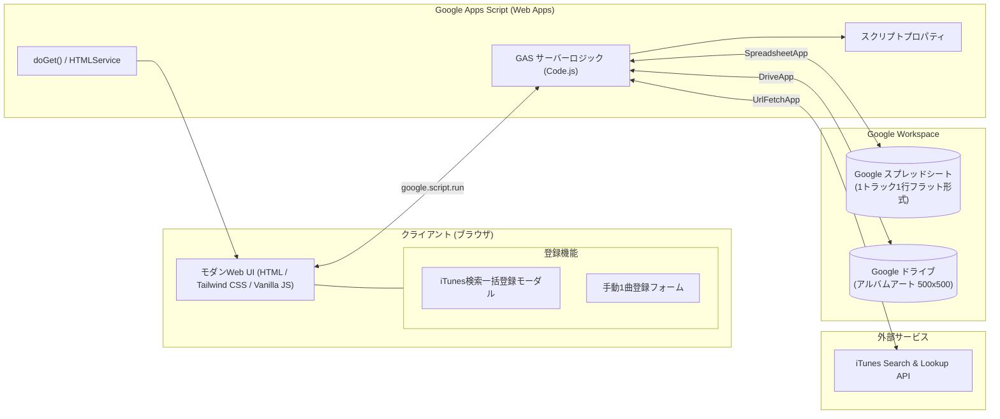

# 音楽管理Webアプリケーション 要件定義書

- **文書バージョン**: 1.1.0
- **作成日**: 2026年10月17日
- **最終更新日**: 2026年10月17日
- **作成ロール**: 要件定義エージェント (`requirements_analyst`)
- **ステータス**: ユーザー仕様確定反映版（Gate 1 承認準備完了）

---

## 目次

1. [システム概要と目的](#1-システム概要と目的)
   - 1.1 背景・目的
   - 1.2 システムの特徴
   - 1.3 システム構成図
2. [利用ユーザー・運用想定](#2-利用ユーザー運用想定)
   - 2.1 利用ユーザー
   - 2.2 主なユースケース
3. [機能要件](#3-機能要件)
   - 3.1 閲覧・絞り込み機能（3段階ナビゲーションUI）
   - 3.2 iTunes Search API 連携・データ自動取得機能
   - 3.3 データ登録・保存機能
   - 3.4 手動データ登録機能（自主制作・未配信音源対応）
   - 3.5 システム管理・初期設定機能
4. [データ項目要件・データ構造](#4-データ項目要件データ構造)
   - 4.1 業務データ項目一覧（CD番号＝ディスク番号の定義等）
   - 4.2 スプレッドシート設計方式（案A: 1トラック1行フラット方式採用）
   - 4.3 スクリプトプロパティ一覧
5. [外部システム連携要件](#5-外部システム連携要件)
   - 5.1 iTunes API 連携仕様（discNumber マッピング等）
   - 5.2 Google Drive 連携仕様（Web表示用URL生成）
   - 5.3 Google Sheets 連携仕様
6. [非機能要件](#6-非機能要件)
   - 6.1 アーキテクチャ・技術スタック
   - 6.2 パフォーマンス・制約対策
   - 6.3 セキュリティ要件
   - 6.4 信頼性・例外ハンドリング
   - 6.5 運用保守性
7. [画面構成・UI/UX要件](#7-画面構成uiux要件)
   - 7.1 画面レイアウト構成
   - 7.2 画面各部の詳細仕様
   - 7.3 iTunes検索・一括登録モーダル
   - 7.4 手動楽曲登録フォーム（モーダル／タブ）
8. [仕様確定事項および確認事項（Q&Aサマリー）](#8-仕様確定事項および確認事項qaサマリー)
9. [承認および次のステップ](#9-承認および次のステップ)

---

## 1. システム概要と目的

### 1.1 背景・目的
本システムは、ユーザーが所有または管理する音楽CD・アルバムの情報を、Google スプレッドシートおよび Google ドライブをバックエンドとして一元管理・閲覧するための Web アプリケーションである。

市販CDや配信音源の登録において、手作業によるトラック情報の入力負荷を削減するため、**APIキー不要な iTunes Search API を活用してアルバム情報・ジャケット画像（高解像度 500×500）・全トラック情報・ディスク番号（CD番号）を自動取得し、1クリックでGoogle スプレッドシートおよびGoogle ドライブへ一括保存**する仕組みを提供する。

さらに、iTunesに登録されていない**自主制作CD、同人音楽、限定盤音源等のために、初期バージョンからWeb画面上で手動1曲ずつ入力・登録できるフォームも提供**し、あらゆる音楽コレクションの網羅的な管理を可能にする。

蓄積されたコレクションは、「**アルバムアーティスト選択 → アルバム選択 → トラック情報表示**」という3段階の洗練されたドリルダウンUIにより、直感的かつスピーディに閲覧・検索できる。

### 1.2 システムの特徴
- **Google Apps Script（GAS）ベースのサーバーレス構成**: 追加のサーバーインフラ費用ゼロ、Googleアカウントがあれば即座に運用可能。
- **iTunes API 連携による完全自動入力**: キーワード検索からアルバム・全トラック・高解像度ジャケット画像（500×500）・ディスク番号（CD番号）を自動抽出・マッピング。
- **Google ドライブへのジャケット画像永続化**: iTunes側のURL変更・リンク切れを防ぐため、画像をGoogle ドライブの指定フォルダに保存し、Web表示可能な永続URLをスプレッドシートに保存（案A採用）。
- **自主制作・未配信音源の手動登録フォーム完備**: 初期バージョンよりWeb画面上で1曲ずつ柔軟に手動登録が可能。直前のアルバム情報の引き継ぎ等により連続入力も快適に支援。
- **直感的な「1トラック1行フラット方式」**: スプレッドシートを直接開いた際もフィルタ・並び替えが極めて容易（案A採用）。
- **3ステップドリルダウンUI**: 「アルバムアーティスト ＞ アルバム ＞ トラック一覧」のスムーズな閲覧体験。2枚組・複数枚組のアルバムもCD番号（ディスク番号）ごとに整理して表示。

### 1.3 システム構成図



---

## 2. 利用ユーザー・運用想定

### 2.1 利用ユーザー
- **個人CDコレクター / 音楽ファン**: 所有する市販CDや自主制作CD・同人音源を美しく整理・検索したい個人ユーザー。
- **小規模音楽サークル / 事務所 / 店舗**: 音楽資産やライブラリをチーム・店舗内で共有・管理するユーザー。

### 2.2 主なユースケース

```mermaid
flowchart TD
    User((ユーザー))

    subgraph UC_Browse ["UC-01: ライブラリ閲覧（3段階ドリルダウン）"]
        A1["アルバムアーティスト一覧を表示"]
        A2["アーティストを選択"]
        A3["アルバム一覧を表示 (ジャケット付き)"]
        A4["アルバムを選択"]
        A5["CD番号(ディスク)別トラック一覧・ジャケット(500x500)表示"]
        A1 --> A2 --> A3 --> A4 --> A5
    end

    subgraph UC_Register_iTunes ["UC-02: iTunes連携によるCD一括登録"]
        B1["iTunes一括登録モーダルを開く"]
        B2["キーワード（アーティスト/アルバム名）で検索"]
        B3["候補アルバムを選択"]
        B4["全トラック・CD番号(discNumber)・ジャケットをプレビュー"]
        B5["「一括登録」を実行"]
        B6["Google Driveへ画像保存 ＆ Web表示用URL生成"]
        B7["スプレッドシートへ全トラック行を一括書き込み"]
        B1 --> B2 --> B3 --> B4 --> B5 --> B6 --> B7
    end

    subgraph UC_Register_Manual ["UC-03: 手動フォームによる楽曲登録（自主制作・未配信音源）"]
        C1["手動登録フォームを開く"]
        C2["CD番号・アルバム名・トラック名等を入力"]
        C3["「登録する（続けて入力）」を実行"]
        C4["スプレッドシートへ1行書き込み完了"]
        C5["アルバム情報を保持したまま次トラックを入力"]
        C1 --> C2 --> C3 --> C4 --> C5
    end

    User --> UC_Browse
    User --> UC_Register_iTunes
    User --> UC_Register_Manual
```



---

## 3. 機能要件

### 3.1 閲覧・絞り込み機能（3段階ナビゲーションUI）
ユーザー指定要件「アルバムアーティストの選択 → アルバムの選択 → トラック情報表示」に完全準拠する。

| 機能ID | 機能名 | 詳細仕様 |
| :--- | :--- | :--- |
| **FN-BROWSE-001** | 全データ取得・初期化 | アプリ起動時にスプレッドシートから全登録データを一括取得し、クライアント側で高速に3段階構造（アルバムアーティスト ＞ アルバム ＞ トラック）へグループ化してキャッシュする。 |
| **FN-BROWSE-002** | STEP 1: アルバムアーティスト選択 | ・スプレッドシートに登録されている「アルバムアーティスト名」の一覧を一意（重複なし・昇順ソート）で表示する。<br>・アーティスト名絞り込み用のインクリメンタル検索フィルターを備える。<br>・各アーティストの保有アルバム数をバッジ表示する。 |
| **FN-BROWSE-003** | STEP 2: アルバム選択 | ・STEP 1 で選択されたアルバムアーティストに紐づくアルバム一覧をカード形式で表示する。<br>・各アルバムカードにはアルバムアート画像サムネイル、アルバム名、リリース年、トラック数を表示する。<br>・アルバムをクリックすると選択状態となり、STEP 3 へ遷移する。 |
| **FN-BROWSE-004** | STEP 3: トラック情報表示 | ・STEP 2 で選択されたアルバムの詳細ヘッダー（大判アルバムアート、アルバム名、アルバムアーティスト名、リリース日、総トラック数）を表示する。<br>・アルバムアート画像をクリックすると拡大モーダルで 500×500 のオリジナル画像を確認できる。<br>・アルバムに属する全楽曲を一覧表示する。<br>・**2枚組・複数枚組の場合（異なるCD番号が存在する場合）**、「Disc 1 (CD番号: 1)」「Disc 2 (CD番号: 2)」のようにディスク単位でグループ分けヘッダーを表示し、各ディスク内でトラック番号順に美しくソート表示する。 |
| **FN-BROWSE-005** | 全体クイック検索 | アーティスト名・アルバム名・曲名・CD番号を横断してフリーワード検索し、該当するアルバムまたは楽曲へ直接ジャンプできる検索バーを提供する。 |

### 3.2 iTunes Search API 連携・データ自動取得機能
APIキー不要な Apple 公式 iTunes Search API をバックエンド（GASの `UrlFetchApp`）経由で呼び出し、CORS制約を回避して安全かつ安定してデータを取得する。

| 機能ID | 機能名 | 詳細仕様 |
| :--- | :--- | :--- |
| **FN-ITUNES-001** | キーワード検索 | ・キーワード（アルバム名、アーティスト名、またはその両方）を入力してiTunes APIへアルバム検索（`entity=album`）を実行する。<br>・日本の楽曲を正しくヒットさせるため、クエリパラメータに `country=jp` を標準設定する。<br>・最大検索取得件数は 25 件とする。 |
| **FN-ITUNES-002** | 検索結果アルバム一覧表示 | ・取得したアルバム一覧（ジャケット、アルバム名、アーティスト名、リリース日、収録トラック数等）をモーダル内に一覧表示する。 |
| **FN-ITUNES-003** | トラック情報・CD番号一括取得 (Lookup) | ・ユーザーが特定のアルバムを選択した際、iTunes Lookup API（`id={collectionId}&entity=song`）を呼び出し、当該アルバムの全トラック情報を取得する。<br>・**CD番号の自動取得**: 各トラックの `discNumber`（ディスク番号）を取得し、当システムの「CD番号」として自動マッピングする（1枚組なら全曲 `1`、2枚組ならDisc 1は `1`、Disc 2は `2` となる）。 |
| **FN-ITUNES-004** | アルバムアート高解像度化 (500×500) | ・iTunes APIから返却される標準画像URL（例: `.../100x100bb.jpg`）の解像度指定部分を正規表現置換により `500x500bb.jpg` に変換し、**確実に 500×500 解像度の画像URLを取得**する。 |
| **FN-ITUNES-005** | 登録前プレビュー＆確認 | ・登録前に、取得したアルバムアート（500×500）、アルバム名、アルバムアーティスト名、リリース日、CD番号（ディスク番号）付きの全トラックリストを一覧プレビューする。<br>・必要に応じてCD番号やトラック情報の手動修正・確認が可能。 |

### 3.3 データ登録・更新・保存機能

| 機能ID | 機能名 | 詳細仕様 |
| :--- | :--- | :--- |
| **FN-SAVE-001** | アルバムアートのDrive保存＆Web表示URL発行 | ・iTunesの画像URL（500×500）からバイナリデータ（Blob）をバックエンドでダウンロードする。<br>・スクリプトプロパティ `DRIVE_FOLDER_ID` 配下に、一意なファイル名（例: `artwork_{アルバム名}_{タイムスタンプ}.jpg`）で保存する。<br>・**Web表示用URLの採用（案A確定）**: 保存ファイルの権限を閲覧可能に設定し、Google ドライブのWeb表示用URL（`https://drive.google.com/uc?id={FILE_ID}` またはサムネイルURL）を発行してスプレッドシートの「アルバムアートURL」列に書き込む。 |
| **FN-SAVE-002** | スプレッドシートへの一括書き込み（フラット方式） | ・**1トラック1行フラット方式（案A確定）** を採用。<br>・対象シート（`MusicTracks`）に対し、指定の全8項目（CD番号、アルバムアーティスト名、アルバム名、アーティスト名、トラック番号、トラック名、リリース日、アルバムアートURL）を1トラック＝1行として一括挿入（`setValues`）する。 |
| **FN-SAVE-003** | 重複チェック・検証 | ・登録対象の「アルバム名」かつ「CD番号（ディスク番号）」かつ「トラック番号」の組み合わせが既にスプレッドシートに存在する場合、警告を表示して上書きするかスキップするかを選択させる。<br>・必須項目（CD番号、アルバムアーティスト名、アルバム名、アーティスト名、トラック番号、トラック名）のバリデーションを実施。 |

### 3.4 手動データ登録機能（自主制作・未配信音源対応）
iTunes APIに登録されていない自主制作盤・同人CD・限定配布音源などのため、初期バージョンからWeb UI上で1曲ずつ直接登録できるフォームを提供する。

| 機能ID | 機能名 | 詳細仕様 |
| :--- | :--- | :--- |
| **FN-MANUAL-001** | 手動登録フォーム | ・Web画面上から直接開ける入力フォーム（モーダルまたはタブ）。<br>・入力項目（全8項目準拠）：<br>  1. CD番号（ディスク番号。デフォルト値: `1`）<br>  2. アルバムアーティスト名（必須）<br>  3. アルバム名（必須）<br>  4. アーティスト名（必須。デフォルトでアルバムアーティスト名を自動補完）<br>  5. トラック番号（必須。数値。デフォルト値: `1`）<br>  6. トラック名（必須）<br>  7. リリース日（任意。日付ピッカー `YYYY-MM-DD`）<br>  8. アルバムアートURL（任意。画像URLの直接入力、または空欄） |
| **FN-MANUAL-002** | 連続入力アシスト（続けて登録） | ・アルバム内の複数曲をテンポよく登録できるよう、「登録して次を入力」ボタンを用意する。<br>・実行時、当該トラックの1行をスプレッドシートに書き込んだ後、**CD番号、アルバムアーティスト名、アルバム名、リリース日、アルバムアートURLをフォーム上にそのまま保持**し、**トラック番号を自動で +1 インクリメント**、トラック名入力欄に自動フォーカスを当てる。 |
| **FN-MANUAL-003** | 既存アルバムからのトラック追記 | ・STEP 2 または STEP 3 でアルバムを選択している状態から「このアルバムに曲を追加」を押下した場合、既存のアルバム情報（CD番号、アルバム名、アーティスト名、アートURL等）をフォームに自動セットして手動登録画面を開くことができる。 |

### 3.5 システム管理・初期設定機能

| 機能ID | 機能名 | 詳細仕様 |
| :--- | :--- | :--- |
| **FN-ADMIN-001** | スクリプトプロパティ管理 | ・`SPREADSHEET_ID`: データ保存先のスプレッドシートID。<br>・`DRIVE_FOLDER_ID`: アルバムアート画像の保存先フォルダID。<br>・プロパティが未設定の場合、画面上に設定案内とエラーガイドを表示する。 |
| **FN-ADMIN-002** | シート自動初期化 | ・指定シート（`MusicTracks`）が存在しない場合、自動的に新規シートを作成し、1行目に規定のヘッダー列（8項目）を設定・固定する。 |
| **FN-ADMIN-003** | ドライブフォルダ接続検証 | ・保存先フォルダIDの存在確認および書き込み権限のバリデーションを登録処理時に行う。 |

---

## 4. データ項目要件・データ構造

### 4.1 業務データ項目一覧
ユーザー指定の8項目を厳密に定義する。特に「CD番号」および「アルバムアートURL」は確定仕様に準拠する。

| No | 項目名（表示名） | カラム物理名 (キー) | データ型 | 必須/任意 | 説明・書式例・確定仕様 |
| :---: | :--- | :--- | :---: | :---: | :--- |
| 1 | **CD番号** | `cdNumber` | 数値 / 文字列 | **必須** | **アルバム内のディスク番号（Disc Number）**。<br>1枚以上のディスクを識別するための項目（IDではない）。<br>・1枚組アルバムの場合: `1`<br>・2枚組以上のアルバムの場合: `1`, `2`, `3` ...（各ディスクの番号）<br>※iTunes APIの `discNumber` から自動取得・マッピング。手動入力も可能。 |
| 2 | **アルバムアーティスト名** | `albumArtist` | 文字列 | **必須** | アルバム全体のアーティストまたは編纂者名。<br>（例: `宇多田ヒカル`, `Various Artists`, `BUMP OF CHICKEN`） |
| 3 | **アルバム名** | `albumName` | 文字列 | **必須** | CDアルバムの正式名称。<br>（例: `First Love`, `orbital period`） |
| 4 | **アーティスト名** | `trackArtist` | 文字列 | **必須** | 当該トラックの歌唱・演奏アーティスト名。<br>（通常はアルバムアーティストと一致。客演時は `feat. xxx` 等） |
| 5 | **トラック番号** | `trackNumber` | 数値 | **必須** | 当該ディスク（CD番号）内での曲順（1以上の整数）。<br>（例: `1`, `2`, `3` ...） |
| 6 | **トラック名** | `trackName` | 文字列 | **必須** | 楽曲のタイトル。<br>（例: `Automatic`, `花の名`） |
| 7 | **リリース日** | `releaseDate` | 文字列 / 日付 | 任意 | アルバムの発売日または公開日。<br>（形式: `YYYY-MM-DD`、例: `1999-03-10`） |
| 8 | **アルバムアートURL** | `artworkUrl` | 文字列 (URL) | 任意 | **案A確定: Google ドライブのWeb表示用URL**。<br>Google ドライブの指定フォルダに保存された 500×500 ジャケット画像のWeb表示用URL（`https://drive.google.com/uc?id={fileId}` 等）。手動登録時は空欄または任意のWeb画像URLも可。 |

### 4.2 スプレッドシート設計方式（案A: 1トラック1行フラット方式 採用確定）

ユーザー合意に基づき、**「案A: 1トラック1行フラット方式」** を正式採用する。
要求された全8項目を単一シートにフラットに記録し、スプレッドシート上での直接確認・フィルタ・編集が最も容易な構成とする。

#### スプレッドシート列配置（左からA〜H列、シート名: `MusicTracks`）
| 列 | 列名（1行目ヘッダー） | 格納データ例 | 備考 |
| :---: | :--- | :--- | :--- |
| **A列** | CD番号 | `1` | ディスク番号（1枚組は1、2枚組は1または2） |
| **B列** | アルバムアーティスト名 | `宇多田ヒカル` | STEP 1 のグループキー |
| **C列** | アルバム名 | `First Love` | STEP 2 のグループキー |
| **D列** | アーティスト名 | `宇多田ヒカル` | トラック固有アーティスト |
| **E列** | トラック番号 | `1` | 各ディスク内での曲順 |
| **F列** | トラック名 | `Automatic` | 曲名 |
| **G列** | リリース日 | `1999-03-10` | 発売日 |
| **H列** | アルバムアートURL | `https://drive.google.com/uc?id=...` | Google ドライブ上のWeb表示用URL |

#### 複数枚組CDの記録イメージ（2枚組アルバムの場合の例）
```csv
A列(CD番号),B列(アルバムアーティスト),C列(アルバム名),D列(アーティスト),E列(トラック番号),F列(トラック名),G列(リリース日),H列(アルバムアートURL)
1,BUMP OF CHICKEN,orbital period,BUMP OF CHICKEN,1,voyager,2007-12-19,https://drive.google.com/...
1,BUMP OF CHICKEN,orbital period,BUMP OF CHICKEN,2,星の鳥,2007-12-19,https://drive.google.com/...
...
2,Special Artist,Live Compilation,Special Artist,1,Intro Live,2023-05-01,https://drive.google.com/...
2,Special Artist,Live Compilation,Special Artist,2,Encore Song,2023-05-01,https://drive.google.com/...
```

### 4.3 スクリプトプロパティ一覧
機密情報や環境依存値はハードコードせず、GASのスクリプトプロパティ（`PropertiesService.getScriptProperties()`）から取得する。

| プロパティ名 | 型 | 必須 | 設定内容・説明 |
| :--- | :---: | :---: | :--- |
| `SPREADSHEET_ID` | 文字列 | **必須** | データ保存先の Google スプレッドシート ID。<br>（URL `https://docs.google.com/spreadsheets/d/{ID}/edit` のID部分） |
| `DRIVE_FOLDER_ID` | 文字列 | **必須** | ダウンロードしたアルバムアート画像（500×500）を格納する Google ドライブのフォルダ ID。<br>（URL `https://drive.google.com/drive/folders/{ID}` のID部分） |
| `SHEET_NAME` | 文字列 | 任意 | 対象シート名（デフォルト: `MusicTracks`）。未設定時は `MusicTracks` を使用。 |

---

## 5. 外部システム連携要件

### 5.1 iTunes API 連携仕様
iTunes Search API は認証・APIキー不要で利用可能である。ブラウザからの直接呼出はCORS制限やプロキシ要件が絡むため、**GASバックエンド（UrlFetchApp）を介して取得する**。

#### ① アルバム検索
- **エンドポイント**: `https://itunes.apple.com/search`
- **メソッド**: `GET`
- **パラメータ**:
  - `term`: 検索キーワード（URIエンコード済み文字列）
  - `country`: `jp`（日本国内ストア）
  - `media`: `music`
  - `entity`: `album`
  - `limit`: `25`
- **抽出項目**:
  - `collectionId`: アルバム固有ID（トラック取得に使用）
  - `collectionName`: アルバム名
  - `artistName`: アルバムアーティスト名
  - `artworkUrl100`: ジャケット画像URL
  - `releaseDate`: リリース日時（ISO 8601形式 → `YYYY-MM-DD` に整形）
  - `trackCount`: 収録曲数

#### ② アルバムアート高解像度化（500×500）
- iTunes APIが返却する `artworkUrl100` は `.../100x100bb.jpg`（または `.png`）となっている。
- **変換仕様**: 正規表現または文字列置換により、`100x100bb` を `500x500bb` へ置換する。
  ```javascript
  const artworkUrl500 = artworkUrl100.replace(/100x100bb\.(jpg|png|webp)/i, '500x500bb.$1');
  ```
- これにより、500×500ピクセルの高精細ジャケット画像URLを確実に生成する。

#### ③ トラック一覧・CD番号取得 (Lookup API)
- **エンドポイント**: `https://itunes.apple.com/lookup`
- **メソッド**: `GET`
- **パラメータ**:
  - `id`: アルバムの `collectionId`
  - `entity`: `song`
  - `country`: `jp`
- **レスポンス構造**:
  - `results[0]`: `wrapperType == "collection"`（アルバム自体の情報）
  - `results[1..N]`: `wrapperType == "track"`（各トラックの情報）
- **各トラック抽出項目とマッピング**:
  - `discNumber`: **CD番号**（ディスク番号。1枚組は `1`、複数枚組は `1`, `2` 等）★確定
  - `trackNumber`: **トラック番号**
  - `trackName`: **トラック名**
  - `artistName`: **アーティスト名**（客演・フィーチャリング等、各曲固有のアーティスト名）

### 5.2 Google Drive 連携仕様（案A確定）
- **画像取得と保存**:
  - バックエンドで `UrlFetchApp.fetch(artworkUrl500)` を実行し、画像Blobを取得。
  - `DriveApp.getFolderById(DRIVE_FOLDER_ID)` を取得。
  - ファイル名規則: `artwork_{アルバム名}_{タイムスタンプ}.jpg`（ファイル名に使えない特殊文字をサニタイズ）として保存。
- **Web表示用URLの生成（案A採用）**:
  - 保存された画像ファイルの共有アクセス権限を「リンクを知っている全員が閲覧可能」に設定。
  - Web表示用URL形式: `https://drive.google.com/uc?export=view&id={FILE_ID}` またはサムネイル配信URL `https://lh3.googleusercontent.com/d/{FILE_ID}` を生成。
  - この生成したWeb表示用URLをスプレッドシートの「アルバムアートURL」列（H列）に書き込む。

### 5.3 Google Sheets 連携仕様（案A確定）
- `SpreadsheetApp.openById(SPREADSHEET_ID).getSheetByName(SHEET_NAME)` を利用。
- **全データ取得時**:
  - `sheet.getDataRange().getValues()` による1回の一括読み込み。
- **iTunes一括登録時**:
  - `sheet.getRange(lastRow + 1, 1, newRows.length, 8).setValues(newRows)` による1アルバム全トラックのバッチ一括書き込み。
- **手動1曲登録時**:
  - `sheet.appendRow([cdNumber, albumArtist, albumName, trackArtist, trackNumber, trackName, releaseDate, artworkUrl])` による1行追加書き込み。

---

## 6. 非機能要件

### 6.1 アーキテクチャ・技術スタック
| レイヤー | 採用技術・コンポーネント | 選定理由 |
| :--- | :--- | :--- |
| **実行基盤** | Google Apps Script (Web Apps) | サーバーレス、運用費用無料、Google Workspace統合。 |
| **フロントエンド** | HTML5, Tailwind CSS (CDN), Vanilla JavaScript | GAS環境での最速初期描画、軽量かつモダンなデザイン。 |
| **データベース** | Google スプレッドシート | 1トラック1行フラット方式により直接閲覧・編集が容易。 |
| **ストレージ** | Google ドライブ | 高解像度ジャケット画像（500×500）の安全かつ永続的な保存。 |
| **外部通信** | `UrlFetchApp` (GAS) | iTunes APIへの安定した通信、画像ダウンロード。 |

### 6.2 パフォーマンス・制約対策
- **GAS実行時間制限（最大6分）への対策**:
  - 1アルバムあたりのトラック登録（通常10〜20曲）＋画像ダウンロード（1枚）は数秒〜十数秒以内で完了するため、十分制限内に収まる。
- **フロントエンドの高速化**:
  - 初回ロード時にスプレッドシート全行を取得後、アーティスト絞り込みやアルバム・トラックのドリルダウンはクライアント側JavaScriptのメモリ内で実行し、画面遷移の待ち時間をゼロ（体感100ms以内）にする。
- **iTunes API レートリミット対策**:
  - 検索ボタンの連打防止（デバウンス処理 / 二重送信抑止）を実装。

### 6.3 セキュリティ要件
- **XSS（クロスサイトスクリプティング）対策**:
  - スプレッドシートおよびiTunes APIから取得した文字列（曲名、アーティスト名等）をHTMLに描画する際は、必ずサニタイズ（`textContent` 等）を徹底する。
- **プロパティ情報の隠蔽**:
  - スプレッドシートIDやフォルダIDはクライアントJS側には直接公開せず、GASスクリプトプロパティで安全に管理する。

### 6.4 信頼性・例外ハンドリング
- **フォルダ・シート未存在時の明示的エラー**:
  - スクリプトプロパティのIDが不正、またはフォルダやシートが存在しない場合、具体的なエラーメッセージと設定手順を表示する。
- **手動登録時の入力チェック**:
  - 必須項目（アルバムアーティスト、アルバム名、アーティスト名、トラック番号、トラック名）の未入力チェックを実施。

---

## 7. 画面構成・UI/UX要件

### 7.1 画面レイアウト構成
シングルページアプリケーション（SPA）として構成。
直感的でスタイリッシュな音楽プレイヤーライクなダーク/モダンテーマを採用する。

```
+---------------------------------------------------------------------------------------------------+
|  [Logo] MusicInfo Manager        [クイック検索: ________]     [+ 手動登録]  [+ iTunes検索で登録]  |
+---------------------------------------------------------------------------------------------------+
|                                                                                                   |
|  +--------------------+  +--------------------------+  +----------------------------------------+ |
|  | STEP 1: アーティスト |  | STEP 2: アルバム選択     |  | STEP 3: トラック詳細情報               | |
|  | [絞り込み検索: ...] |  | (カードグリッド表示)     |  |                                        | |
|  |--------------------|  |--------------------------|  | [ジャケット] [アルバム名]              | |
|  | > 宇多田ヒカル (3) |  | [Jacket] First Love      |  |              [アルバムアーティスト名]   | |
|  |   椎名林檎     (5) |  |          1999 (12曲)     |  |              [リリース日] [総曲数]      | |
|  |   BUMP OF CH.. (4) |  |--------------------------|  |----------------------------------------| |
|  |   YOASOBI      (2) |  | [Jacket] orbital period  |  | [Disc 1] (CD番号: 1)                   | |
|  |   ...              |  |          2007 (28曲/2枚組|  |   #  曲名              アーティスト     | |
|  |                    |  |--------------------------|  |   1  voyager           BUMP OF CHICKEN  | |
|  |                    |  | [Jacket] BADモード       |  |   2  星の鳥            BUMP OF CHICKEN  | |
|  |                    |  |          2022 (14曲)     |  | [Disc 2] (CD番号: 2)                   | |
|  |                    |  |                          |  |   1  ...                               | |
|  +--------------------+  +--------------------------+  +----------------------------------------+ |
|                                                                                                   |
+---------------------------------------------------------------------------------------------------+
```

### 7.2 画面各部の詳細仕様

#### ① ヘッダー部
- アプリタイトル・ロゴ
- 全体フリーワード検索バー（インクリメンタル検索）
- **「+ 手動登録」ボタン**: 自主制作盤等の1曲登録フォームを開く。
- **「+ iTunes検索で登録」ボタン**: iTunes API一括検索モーダルを開く。
- 登録状況ステータスバッジ（総アーティスト数、アルバム数、曲数）

#### ② STEP 1: アルバムアーティスト選択ペイン
- アーティスト一覧を五十音・アルファベット順に表示。
- アーティスト名横に「アルバム所持数（バッジ）」を表示。
- 上部にアーティスト一覧絞り込み用検索入力欄。

#### ③ STEP 2: アルバム選択ペイン
- 選択されたアーティストのアルバム一覧をサムネイル付きカードで表示。
- アルバムアートサムネイル、アルバム名、リリース年、曲数（複数枚組の場合はディスク数）を表示。

#### ④ STEP 3: トラック詳細情報ペイン
- **アルバムヘッダー**:
  - アルバムアート画像（クリックで500×500のオリジナル画像をモーダル拡大表示）
  - アルバム名（大見出し）
  - アルバムアーティスト名、リリース日、総トラック数
- **ディスク別トラック一覧表示**:
  - 複数枚組アルバム（CD番号が2以上ある場合）は、「Disc 1」「Disc 2」の小見出しでブロックを分けて一覧表示。
  - 各行: トラック番号、トラック名（太字）、アーティスト名。

---

### 7.3 iTunes検索・一括登録モーダル仕様
「+ iTunes検索で登録」ボタン押下時に表示。

1. **検索エリア**:
   - 検索ワード入力欄（アルバム名またはアーティスト名）
   - 「検索」ボタン（ローディングスピナー表示）
2. **検索結果一覧**:
   - アルバムのジャケット、タイトル、アーティスト、曲数、発売年の一覧。
   - 目的のアルバムをクリックして選択。
3. **登録プレビュー・確認エリア**:
   - 選択アルバムの 500×500 ジャケット画像プレビュー。
   - トラック一覧プレビュー（トラック番号、曲名、アーティスト名、および自動取得された **CD番号（discNumber）** を一覧表示）。
4. **アクションボタン**:
   - 「キャンセル」
   - 「このアルバムを一括登録する」（押下で画像Drive保存＆スプレッドシート一括書き込みを実行。プログレス表示）

---

### 7.4 手動楽曲登録フォーム仕様（初期バージョン対応）
「+ 手動登録」ボタン、またはアルバム詳細画面の「このアルバムに曲を追加」から開くモーダル（またはタブ）。

1. **フォーム入力項目**:
   - **CD番号（ディスク番号）**: 数値入力（デフォルト: `1`、2枚組等の場合は `2` などを入力可能）
   - **アルバムアーティスト名**: 文字列入力（必須）
   - **アルバム名**: 文字列入力（必須）
   - **アーティスト名**: 文字列入力（必須。アルバムアーティスト名を入力すると初期値として自動コピー）
   - **トラック番号**: 数値入力（必須。デフォルト: `1`）
   - **トラック名**: 文字列入力（必須）
   - **リリース日**: 日付入力（任意、カレンダー選択 `YYYY-MM-DD`）
   - **アルバムアートURL**: 文字列URL入力（任意。Google ドライブのURLや外部画像URL、空欄でも可）
2. **操作ボタン**:
   - **「登録して続けて入力」**:
     - データをスプレッドシートに1行書き込む。
     - 成功後、CD番号・アルバムアーティスト名・アルバム名・リリース日・アルバムアートURLは保持したまま、**トラック番号を +1 し、トラック名を空にしてフォーカス**する。これにより、アルバム内の全曲を手動で次々と登録可能。
   - **「登録して閉じる」**: データを書き込み、フォームを閉じて画面を最新状態に更新する。
   - **「閉じる」**: 入力を破棄して閉じる。

---

## 8. 仕様確定事項および確認事項（Q&Aサマリー）

ユーザーからの回答および仕様決定内容を以下のように確定・記録する。

| No | 項目・論点 | ユーザー決定内容・確定仕様 | ステータス |
| :---: | :--- | :--- | :---: |
| **Q1** | **CD番号の定義** | **アルバム内の「ディスク番号（Disc Number）」として確定**。<br>・1枚組CDの場合は `1`<br>・2枚組以上の場合は各ディスクの番号 `1`, `2`... が入る（IDではない）。<br>・iTunes連携時は `discNumber` を自動取得・マッピング。<br>・手動登録時はユーザーがディスク番号を入力・選択可能。 | **【確定】** |
| **Q2** | **スプレッドシートの構造** | **「案A: 1トラック1行フラット方式」を採用確定**。<br>指定の8項目（CD番号、アルバムアーティスト名、アルバム名、アーティスト名、トラック番号、トラック名、リリース日、アルバムアートURL）を1行1トラックで管理。 | **【確定】** |
| **Q3** | **アルバムアートURL** | **「案A: GoogleドライブのWeb表示用URL」を採用確定**。<br>Google ドライブの指定フォルダに保存後、Web表示可能なURL（`https://drive.google.com/uc?id=...` 等）をスプレッドシートに保存。 | **【確定】** |
| **Q4** | **手動登録機能** | **初期バージョンからWeb画面上で手動1曲ずつ登録できるフォームを実装確定**。<br>自主制作CDや未配信音源も画面上から直接登録可能とする（連続入力アシスト機能付き）。 | **【確定】** |
| **Q5** | **データの編集・削除機能** | 初期バージョンでは「スプレッドシートを直接編集・削除」することを基本とし、Web UI側の編集・削除機能は今後の拡張要件として整理する。 | **【合意】** |
| **Q6** | **Webアプリケーションの公開範囲** | GASデプロイ設定において「次のユーザーとして実行: 自分」「アクセスできるユーザー: 全員 / リンクを知っている全員（またはGoogleアカウント認証）」のいずれかを用途に応じて設定可能とする。 | **【整理済】** |

---

## 9. 承認および次のステップ

- **本フェーズ**: 要件定義（Step 1: `requirements_analyst`）- **仕様確定反映完了**
- **次フェーズ**: 基本設計（Step 2: `basic_designer` によるアーキテクチャ設計、詳細UI設計、データフロー設計）
- **Gate 1 チェック**: ユーザー回答（CD番号の定義、案Aフラット方式、案AドライブURL、手動登録機能の実装）を完全反映した本要件定義書をもって、基本設計フェーズへの移行準備が整いました。
