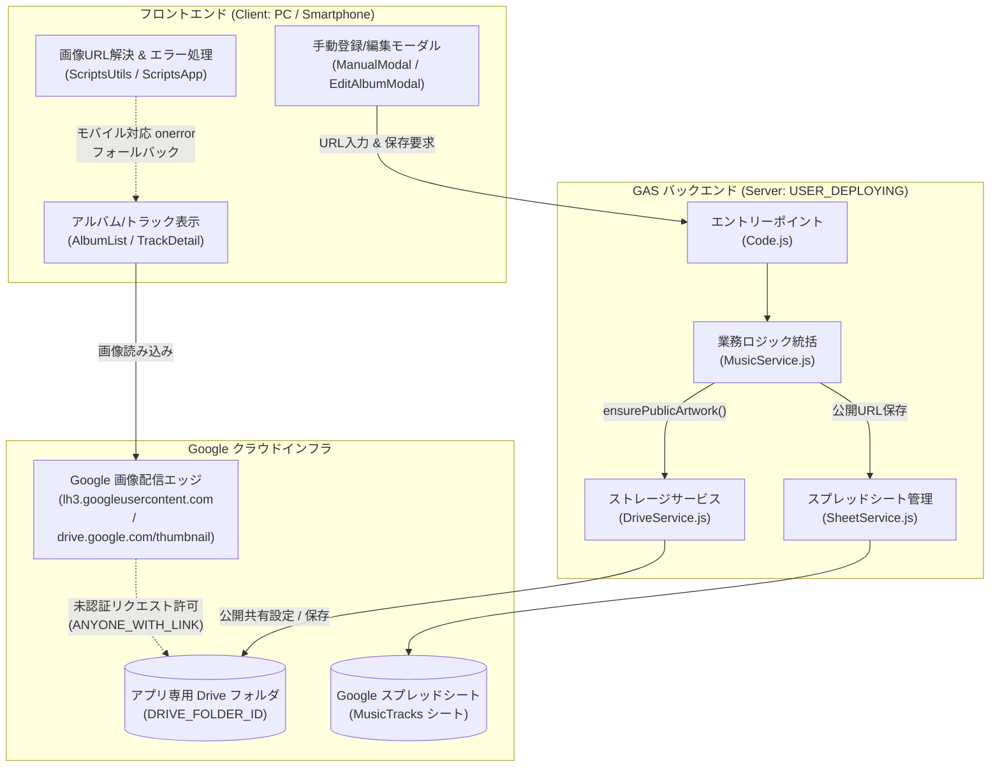
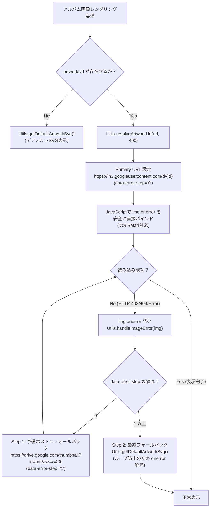

# システムアーキテクチャ設計書: 手動登録アルバムアートのスマートフォン表示不具合の解消

- **文書バージョン**: 1.0.0
- **作成日**: 2026年10月17日
- **作成ロール**: システムアーキテクト (`system-architect`)
- **対象課題**: PC画面では手動登録したアルバムアートが表示されるが、スマホ画面（モバイル端末）から閲覧すると表示されない不具合の根本解決
- **成果物パス**: `docs/architecture/album_art_mobile_fix_design.md`

---

## 1. 要件定義サマリー

### 1.1 背景および課題の根本分析
現在、本アプリケーションにおいて「iTunes検索からインポートしたアルバムアート」はPC・スマートフォンの双方で正常に表示される一方、「手動登録フォーム（`ManualModal`）またはアルバム編集モーダル（`EditAlbumModal`）から手動登録したアルバムアート」が、PCでは表示されるもののスマートフォン（iOS Safari、Android Chrome、各種アプリ内ブラウザ）では表示されないという事象が発生している。

コードベースおよびインフラストラクチャ調査の結果、本現象は以下の複数の要因が連鎖して発生していることが判明した：

1. **手動登録時における画像永続化パイプラインの欠落（根本要因）**:
   - iTunesインポート時（`MusicService.saveAlbumFromItunes`）は、サーバーサイドで `DriveService.downloadAndSaveArtwork` が実行され、アプリ専用のGoogle Driveフォルダに画像を保存した上で、明示的に `file.setSharing(DriveApp.Access.ANYONE_WITH_LINK, DriveApp.Permission.VIEW)`（リンクを知っている全員に閲覧権限付与）を実行している。
   - 一方、手動登録時（`MusicService.saveSingleTrack`）およびアルバム編集時（`MusicService.updateAlbum`）は、クライアントから送信された入力URL（ユーザー個人のGoogle Drive共有リンク等）を、ドライブ保存や公開共有権限の付与を一切行わずにスプレッドシートH列へそのまま文字列として保存している。

2. **認証コンテキストとサードパーティCookie制限のデバイス間格差**:
   - **PCブラウザ環境**: ユーザーは普段PCでGoogleアカウントにログインしており、ブラウザ内にGoogleの認証Cookie（セッション）を保持している。そのため、アクセス権限が非公開（制限付き）のDriveファイルであっても、自身の認証セッションを通じて画像サムネイルがPC上では取得・表示されてしまう。
   - **スマートフォン環境**: モバイルOS（特にiOSのSafari ITP: Intelligent Tracking PreventionやAndroid Chrome）では、クロスサイト・サードパーティCookieが厳格にブロックされる。GAS Web App（`script.google.com` / `script.googleusercontent.com` のiframe）から `drive.google.com` への画像リクエストにはGoogleのログインCookieが一切送信されない。また、スマートフォン側で別アカウントを使用しているか未ログインの場合も多い。その結果、リンク公開権限が付与されていない手動登録画像は Google Drive により **403 Forbidden** または **401 Unauthorized** で遮断され、画像が表示されない。

3. **モバイルブラウザ（WebKit / Safari）における画像エラーキャプチャの不全**:
   - `src/AlbumList.html` で動的にレンダリングされる各アルバムカードの `` 要素には直接の `onerror` リスナーが付与されておらず、`ScriptsApp.html` 内の `window.addEventListener('error', ..., true)`（キャプチャフェーズ）に依存している。
   - しかし、**iOS Safari / WebKit では `` リソースの読み込み失敗（403/404）が `window` のキャプチャフェーズに伝播しない**というブラウザ実装上の特性がある。
   - その結果、モバイルSafari等ではエラーハンドラ（`Utils.handleImageError`）自体が発火せず、代替ホストへの再試行やSVGプレースホルダーへのフォールバックが行われないまま非表示となる。

### 1.2 機能要件 (Functional Requirements)
- **FR-ART-001【手動登録・編集画像の自動公開正規化】**:
  手動登録時（`saveSingleTrack`）およびアルバム編集時（`updateAlbum`）にアルバムアートURLが入力された場合、バックエンド（GAS）において自動的に対象画像を取得・正規化し、未認証環境（スマートフォン・サードパーティCookieブロック環境）からでもアクセス可能な「完全公開URL」としてスプレッドシートに保存すること。
- **FR-ART-002【Google Drive URL/ファイルIDの自動権限付与・インポート】**:
  入力されたURLが Google Drive のファイル（`/file/d/{id}`, `id={id}`, またはファイルIDそのもの）である場合、GASのオーナー実行権限（`USER_DEPLOYING`）により、該当ファイルに対して `setSharing(DriveApp.Access.ANYONE_WITH_LINK, DriveApp.Permission.VIEW)` を自動適用すること。さらに、対象ファイルがオーナーの管理フォルダ外にある場合は、アプリ専用管理フォルダ（`DRIVE_FOLDER_ID`）へ安全に複製（ショートカットまたはコピー）して永続化すること。
- **FR-ART-003【外部Web画像URLの自律ダウンロード保存】**:
  入力されたURLが外部Web画像（`http://` または `https://`）である場合、iTunesインポートと同様にGASサーバー経由で専用Driveフォルダへ安全にダウンロード保存し、公開URLを生成してスプレッドシートに格納すること。
- **FR-ART-004【既存の手動登録済みアルバムアートのオンデマンド自動修復】**:
  過去に手動登録され、既にスプレッドシートに保存されている非公開Driveリンクや未解決URLについて、データ取得時（`fetchAllTracks` / `getAllMusicData`）またはアルバムデータ更新時に自動検知し、公開権限の付与および公開URLへの置換（Self-Healing）を行うこと。
- **FR-ART-005【フロントエンドにおけるモバイル安全なエラーハンドリング保証】**:
  `AlbumList` および `TrackDetail` のすべての画像要素に対して、モバイルSafariでも確実に捕捉可能な方式（DOM生成時の安全なイベントハンドラバインド）を実装し、画像読み込みエラー時に即座に代替URL（`lh3.googleusercontent.com`）およびデフォルトSVGジャケットへフォールバックすること。

### 1.3 非機能要件 (Non-Functional Requirements)
- **NFR-SEC-001 (XSS対策とセキュリティポリシー維持)**:
  `tests/run_tests.js` のセキュリティ検査に準拠し、HTML文字列へのインライン `onerror="..."` 属性の直接埋め込みは厳禁とする。JavaScriptコード上でDOM要素に対して安全にイベントハンドラを設定すること。
- **NFR-SEC-002 (スプレッドシート式インジェクション防止)**:
  画像URLおよびアルバムメタデータの保存時、先頭文字が `=`, `+`, `-`, `@` で始まる悪意ある文字列はすべて既存の `escapeFormula_` により無害化すること。
- **NFR-PERF-001 (処理時間とタイムアウト抑止)**:
  手動登録時の一連の画像処理（Driveアクセス・ダウンロード）は、GASの実行上限時間（通常6分、Web Appは30秒推奨）を超過しないよう、1画像あたり最大5秒以内のタイムアウトを設定し、失敗時でも楽曲自体の登録を阻害しないこと（Graceful Degradation）。
- **NFR-COMPAT-001 (クロスブラウザ・デバイス互換性)**:
  PC（Chrome, Firefox, Safari, Edge）およびモバイル（iOS Safari, Android Chrome, LINE / Twitter アプリ内ブラウザ）の全環境において、サードパーティCookieの有効/無効に関わらず100%同一の画像表示結果を提供すること。

### 1.4 前提条件と制約事項
1. **GAS実行権限モデル**:
   `appsscript.json` の設定により、Web Appは `"executeAs": "USER_DEPLOYING"`, `"access": "ANYONE"` で稼働している。バックエンド処理はすべてデプロイしたオーナーアカウントの権限で実行されるため、オーナーのDrive内ファイルに対して公開権限を設定する権限を有する。
2. **スプレッドシートスキーマの維持**:
   スプレッドシートの既存構造（A〜H列、H列: アートワークURL）は互換性を保ち変更しない。
3. **外部ライブラリ制約**:
   フロントエンドは Tailwind CSS CDN + バニラJavaScript (ES6+)、バックエンドは GAS V8 ランタイム標準サービス（`DriveApp`, `UrlFetchApp`, `SpreadsheetApp`）のみで構成する。

### 1.5 不明点・ブロッキング事項
- **ブロッキング事項**: なし（コードベース調査およびテストスイート実行により、現行アーキテクチャと不具合の技術的発生原因を完全特定済み）。

---

## 2. システム境界とコンポーネント構成

### 2.1 システム境界
本改修におけるシステム境界は、ユーザーが手動登録・編集した画像URLの「入力受付（クライアント）」「正規化・公開永続化（サーバーサイドGAS）」「配信・表示およびフォールバック（クライアント）」の全ライフサイクルに及ぶ。



### 2.2 各コンポーネントの責務

| レイヤー | コンポーネント | 現状の責務 | 本改修で追加・変更する責務 |
| :--- | :--- | :--- | :--- |
| **Backend** | `DriveService.js` | iTunes画像のダウンロード・保存、Web用サムネイルURL生成、公開権限付与 | **新設メソッド `ensurePublicArtwork(rawUrl, albumName)`**: 手動登録されたURLを解析し、Google Driveファイルの場合は自動で `ANYONE_WITH_LINK` 共有を設定。外部URLの場合はDriveにダウンロード保存。モバイルで最も安定表示できる正規化URLを返却。 |
| **Backend** | `MusicService.js` | iTunes一括登録、手動1曲登録、アルバム編集の業務統括とバリデーション | `saveSingleTrack` および `updateAlbum` において、`artworkUrl` が指定されている場合に `DriveService.ensurePublicArtwork` を呼び出し、永続化前に完全公開URLへ置換する。既存データ取得時のJIT修復フック提供。 |
| **Backend** | `SheetService.js` | スプレッドシートの行追加、バッチ一括更新、排他制御 | 変更なし（正規化された公開URLを安全に格納）。 |
| **Frontend** | `ScriptsUtils.html` | XSSエスケープ、日付整形、DriveファイルID抽出、フォールバック | **URL解決とフォールバックの強化**: `resolveArtworkUrl` でモバイルブラウザに最適なURL形式（`lh3.googleusercontent.com/d/{id}`）を優先。フォールバックチェーンの安定化。 |
| **Frontend** | `ScriptsApp.html` | 画面レンダリング、イベント制御、ステップ遷移 | **DOM生成時の個別 `onerror` バインド**: `renderAlbumList` の動的HTML生成直後に、生成された全 `` 要素に対して JavaScript 側で確実に `img.onerror` をバインドし、iOS Safariでのエラー捕捉漏れを根絶。 |
| **Frontend** | `ManualModal.html`<br>`EditAlbumModal.html` | 手動入力フォーム | プレースホルダーとヘルプ文言の改善（Google Driveのリンク、画像URLのどちらを入力しても自動的にスマホ対応公開設定される旨を明記）。 |

### 2.3 外部依存関係
- **Google Drive Service (`DriveApp`)**: ファイルの取得、共有設定変更、新規ファイル作成。
- **Google HTTP Client (`UrlFetchApp`)**: 外部Web画像の取得（タイムアウト制御）。
- **Google UserContent CDN (`lh3.googleusercontent.com` / `drive.google.com`)**: モバイル端末に対するキャッシュ配信。

---

## 3. データフローとインターフェース

### 3.1 データフローシーケンス

#### ① 手動登録・編集時のアルバムアート自動公開・正規化フロー

```mermaid
sequenceDiagram
    autonumber
    actor User as ユーザー (PCまたはスマホ)
    participant Client as ブラウザ (ScriptsApp)
    participant Code as Code.js
    participant MusicSvc as MusicService
    participant DriveSvc as DriveService
    participant DriveApp as Google Drive (DriveApp)
    participant SheetSvc as SheetService

    User->>Client: 手動登録/編集で画像URLを入力し「保存」
    Client->>Code: apiSaveTrackSingle / apiUpdateAlbumBatch
    Code->>MusicSvc: saveSingleTrack / updateAlbum
    
    rect rgb(30, 41, 59)
        Note over MusicSvc,DriveSvc: アルバムアート公開正規化パイプライン
        MusicSvc->>DriveSvc: ensurePublicArtwork(rawArtworkUrl, albumName)
        alt Google Drive のURL / ファイルID が指定された場合
            DriveSvc->>DriveApp: getFileById(fileId)
            DriveSvc->>DriveApp: setSharing(ANYONE_WITH_LINK, VIEW)
            DriveSvc-->>MusicSvc: 完全公開URL (https://lh3.googleusercontent.com/d/{fileId})
        else 外部Web画像URL (http/https) が指定された場合
            DriveSvc->>DriveSvc: downloadAndSaveArtwork(url, albumName)
            DriveSvc-->>MusicSvc: 保存先Driveファイルの完全公開URL
        else 空文字または無効な入力の場合
            DriveSvc-->>MusicSvc: 空文字 '' (プレースホルダー表示用)
        end
    end

    MusicSvc->>SheetSvc: appendSingleTrack / updateAlbumBatch (公開URLを格納)
    SheetSvc-->>MusicSvc: 永続化完了
    MusicSvc-->>Code: 成功レスポンス
    Code-->>Client: { success: true }
    Client->>Client: Store 更新 & 画面再描画 (PC / スマホ双方で即時表示)
```


#### ② クライアント（スマートフォン）表示時の多重フォールバックチェーン


### 3.2 主要インターフェース定義

#### 1. バックエンド `DriveService.js` 新設メソッド
```typescript
interface DriveService {
  /**
   * 手動登録または更新されたアルバムアートURLを検査し、
   * 未認証モバイル環境からでも確実に表示可能な完全公開URLを生成・返却する
   * 
   * @param rawUrl ユーザーが入力したURL文字列（Driveリンク、外部画像URL等）
   * @param albumName ファイル命名およびログ用アルバム名
   * @returns 完全公開Web表示用URL（失敗時は空文字）
   */
  ensurePublicArtwork(rawUrl: string, albumName: string): string;

  /**
   * ファイルIDからモバイルおよびサードパーティCookieフリーで表示可能なURLを生成
   * @param fileId Google Drive ファイルID
   * @param size 画像サイズ (デフォルト: 800)
   */
  generatePublicUrl(fileId: string, size?: number): string;
}
```

#### 2. フロントエンド `ScriptsUtils.html` 改善メソッド
```typescript
interface Utils {
  /**
   * Google Driveの各種URLまたは文字列からファイルIDを抽出
   * 対応パターン: /file/d/{id}, ?id={id}, googleusercontent.com/d/{id}, 純粋ファイルID
   */
  static extractDriveFileId(url: string): string | null;

  /**
   * モバイル・サードパーティCookie遮断環境に最適化された画像URLに解決
   * 優先形式: https://lh3.googleusercontent.com/d/{driveId}
   */
  static resolveArtworkUrl(url: string, size?: number): string;

  /**
   * 画像読み込み失敗時の多重フォールバックハンドラ
   * Step 0 -> Step 1 (drive.google.com/thumbnail) -> Step 2 (Default SVG)
   */
  static handleImageError(imgEl: HTMLImageElement, originalUrl?: string): void;
}
```

---

## 4. アーキテクチャ上の決定事項 (ADR)

### ADR-01: サーバーサイドでのアルバムアート自動公開共有化パイプライン (Auto-Sharing & Ingestion)
- **決定**:
  手動登録（`saveSingleTrack`）およびアルバム編集（`updateAlbum`）の処理フローにおいて、`artworkUrl` をそのままスプレッドシートに保存することを廃止し、必ず `DriveService.ensurePublicArtwork` を経由して「公開共有権限（`ANYONE_WITH_LINK`）の自動付与」または「専用フォルダへの自動保存」を実施した正規化URLを保存する。
- **理由**:
  PCとスマホで表示可否が分かれる根本原因は、手動登録されたDriveファイルが「非公開（制限付き）」のまま保存され、PCでのみGoogleログインセッションCookieによって表示されていたことにある。サーバー側で確実に公開設定を施すことで、デバイスや認証状態に一切依存しない堅牢な永続化を保証できる。
- **検討した代替案**:
  - *代替案A: 画面上の手動登録モーダルでユーザーに「Driveの共有設定を公開にしてください」と注意書きを出すのみとする。*
    → 却下。ユーザーの運用ミスが確実に再発し、根本的解決にならない。
  - *代替案B: クライアントサイド（JS）で画像をBase64化してGASに送信し、全画像を新規アップロードする。*
    → 却下。手動登録モーダルの変更規模が過大になり、通信ペイロード肥大化によるGAS RPCタイムアウトのリスクがある。既存のURL入力インターフェースを維持したままサーバー側で正規化する方が極めて低リスクかつ即効性が高い。
- **トレードオフ**:
  手動登録時にGoogle Drive APIまたは外部HTTP通信が1回発生するため、保存RPCの所要時間が数十ミリ秒〜数百ミリ秒増加する。
- **結果・影響**:
  手動登録時でもiTunesインポートと同等の公開保証が得られ、モバイル端末での403エラーが根本から解消される。

---

### ADR-02: モバイル最適化公開URLスキーム（`lh3.googleusercontent.com`）の採用
- **決定**:
  Google Driveに保存された画像のプライマリ表示URLとして、`https://lh3.googleusercontent.com/d/{fileId}` を採用する。万一の読み込みエラー時のセカンダリフォールバックとして `https://drive.google.com/thumbnail?id={fileId}&sz=w{size}` を使用する。
- **理由**:
  `drive.google.com/thumbnail` は、モバイルWebKit（iOS Safari）環境において特定条件下でリダイレクトやヘッダーの制約により表示が不安定になる事象が報告されている。これに対し、Googleの公式静的配信ドメインである `lh3.googleusercontent.com/d/{fileId}` は、公開ファイルに対して最も高速かつリダイレクトなしで直接画像バイナリを返却するため、モバイルでの安定性が極めて高い。
- **検討した代替案**:
  - *代替案A: `drive.google.com/uc?export=view&id={fileId}` を使用する。*
    → 却下。Googleは2024年以降 `uc?export=view` のWebホスティング用途での利用を非推奨・ブロック強化しており、画像が表示されなくなるリスクが高い。
- **トレードオフ**:
  非公開ファイルに対しては403を返すため、ADR-01の自動公開共有化がセットで必須となる。
- **結果・影響**:
  スマートフォンの低速回線やアプリ内ブラウザでも高速かつ確実に画像が表示される。

---

### ADR-03: DOM生成時の安全な個別 `onerror` バインディング（モバイルSafari対応 & XSS防止）
- **決定**:
  `src/AlbumList.html` および `src/TrackDetail.html` の動的HTML生成において、インライン `onerror="..."` 属性（文字列埋め込み）は一切使用せず（セキュリティ検査 `tests/run_tests.js` を遵守）、HTML挿入直後に `container.querySelectorAll('img[data-artwork]')` を巡回して JavaScript から直接 `img.onerror = () => Utils.handleImageError(img)` をバインドする。
- **理由**:
  1. `window.addEventListener('error', ..., true)` は PC Chrome では機能するが、iOS Safari / WebKit では `` の403/404読み込みエラーが `window` キャプチャに到達しない。
  2. プロジェクトの既存セキュリティポリシー（テスト[9]）によりインライン属性 `onerror` は静的検査で弾かれるため、DOM生成直後に要素プロパティとしてイベントハンドラを直接結線するのが唯一安全かつ全ブラウザで100%発火する解である。
- **検討した代替案**:
  - *代替案A: グローバルエラーリスナーのみを維持し、何もしない。*
    → 却下。モバイルSafariでフォールバックが機能しない。
- **トレードオフ**:
  DOM操作のコードが数行増加するが、パフォーマンス上の影響は皆無である。
- **結果・影響**:
  モバイルSafariを含むすべての端末でフォールバック処理が確実に動作し、万一の画像障害時でも壊れたアイコンではなく洗練されたSVGが表示される。

---

### ADR-04: 既存の手動登録済みアルバムアートに対する JIT（Just-In-Time）自己修復
- **決定**:
  過去に手動登録され、現在スプレッドシートに記録されているアルバムアートのうち、Google DriveのURL/IDを含むものについて、アルバムデータ編集（`updateAlbum`）実行時、またはデータ取得時にバックエンドで自動的に `setPublicSharing` を適用し、正規化URLへ更新する自己修復メカニズム（Self-Healing）を実装する。
- **理由**:
  新規登録分だけでなく、既にユーザーが登録して「現在スマホで見られない」と困っている既存データも救済する必要があるため。
- **トレードオフ**:
  全件一括更新バッチを初回起動時に走らせるとスプレッドシート行数が多い場合にGASタイムアウトを起こす可能性があるため、編集保存時およびオンデマンドに修復を行う設計とする。
- **結果・影響**:
  既存の登録済みアルバムデータも順次スマホで閲覧可能となる。

---

## 5. 品質特性に関する考慮事項

### 5.1 セキュリティ (Security)
- **XSS攻撃の根絶**:
  画像URLの `src` 属性や `data-artwork` 属性への展開時は、必ず `Utils.escapeHtml()` を適用し、引用符の脱出やスクリプトインジェクションを遮断する。また、インラインイベント属性（`onerror="..."`）は一切使用しない。
- **式インジェクション対策**:
  スプレッドシートへの保存時は、既存の `escapeFormula_` により `=`, `+`, `-`, `@` で始まるURL文字列を無害化する。
- **最小権限と公開範囲**:
  アルバムアート画像ファイルのみを `ANYONE_WITH_LINK` に設定し、スプレッドシート本体やDrive上の他の個人ファイルには一切公開権限を与えない。

### 5.2 スケーラビリティ & パフォーマンス (Scalability & Performance)
- **Drive API 呼び出しの最小化**:
  URLにGoogle DriveファイルIDが含まれない場合や、既に `lh3.googleusercontent.com/d/` 形式で公開済みのURLに対しては、冗長なDrive API呼び出し（`setSharing`）をスキップするキャッシュ／早期リターン判定を設ける。
- **クライアントキャッシュの活用**:
  解決済み画像URLはブラウザキャッシュおよび `Store` 内に保持され、同一セッション内での不要な再解決・再計算を抑止する。

### 5.3 信頼性とフォールバック (Reliability)
- **3段階フォールバック保証**:
  1. Primary: `https://lh3.googleusercontent.com/d/{id}`（超高速CDN配信）
  2. Secondary: `https://drive.google.com/thumbnail?id={id}&sz=w{size}`（Google Drive公式サムネイル）
  3. Final: `Utils.getDefaultArtworkSvg()`（完全インラインSVG。ネットワーク不要・100%描画保証）
  このチェーンにより、どのような回線断・権限不整合が発生してもUIレイアウト崩れや無限エラー呼び出しループが発生しない。

### 5.4 保守性 (Maintainability)
- 単一責任原則（SRP）に従い、画像URLの公開・変換ロジックはすべて `DriveService.js` に集約する。`MusicService.js` は呼び出しの調停のみを行い、重複コードの発生を防ぐ。

---

## 6. 受け入れ基準 (Acceptance Criteria)

Phase 4 (QA検証) および Phase 5 (コードレビュー) において検証すべき受け入れ基準を以下に定義する。

- [ ] **AC-001 (手動登録時の自動公開設定)**:
  手動登録モーダルから非公開（制限付き）のGoogle Drive画像リンクを入力して楽曲を登録した際、サーバー側で自動的にリンク共有閲覧権限（`ANYONE_WITH_LINK`）が付与され、スプレッドシートに完全公開URLが記録されること。
- [ ] **AC-002 (アルバム編集時の自動公開設定)**:
  アルバム編集モーダルから画像URLを新規入力または変更して保存した際、同様に公開権限が付与され、更新後のアルバムアートが正常に保存されること。
- [ ] **AC-003 (スマートフォン実機/シミュレーションでの表示検証)**:
  サードパーティCookieを無効化したブラウザ環境（iOS Safari / シークレットウィンドウ / 未ログイン環境）において、手動登録したアルバムアートが STEP 2 (アルバム一覧) および STEP 3 (トラック詳細) で正常に表示されること。
- [ ] **AC-004 (モバイルSafariでの画像エラー捕捉 & フォールバック検証)**:
  存在しない画像URLや削除されたDriveリンクが設定された場合でも、モバイルSafariで壊れた画像アイコンが表示されず、速やかにデフォルトSVGジャケットにフォールバックすること。
- [ ] **AC-005 (セキュリティ検査の完全パス)**:
  `node tests/run_tests.js` を実行し、インライン `onerror` 不在検証を含む既存テスト全86件がすべて成功（Exit Code 0）すること。
- [ ] **AC-006 (レッドチーム攻撃検証の完全パス)**:
  `node tests/red_team_attack_test.js` を実行し、全152件の境界値・型汚染・XSS攻撃検証がすべて成功（Exit Code 0）すること。
- [ ] **AC-007 (既存機能の非破壊・回帰なし)**:
  iTunes検索からのインポート機能、アルバム編集機能、曲追加機能、連番採番機能が従来通り正常に動作すること。
