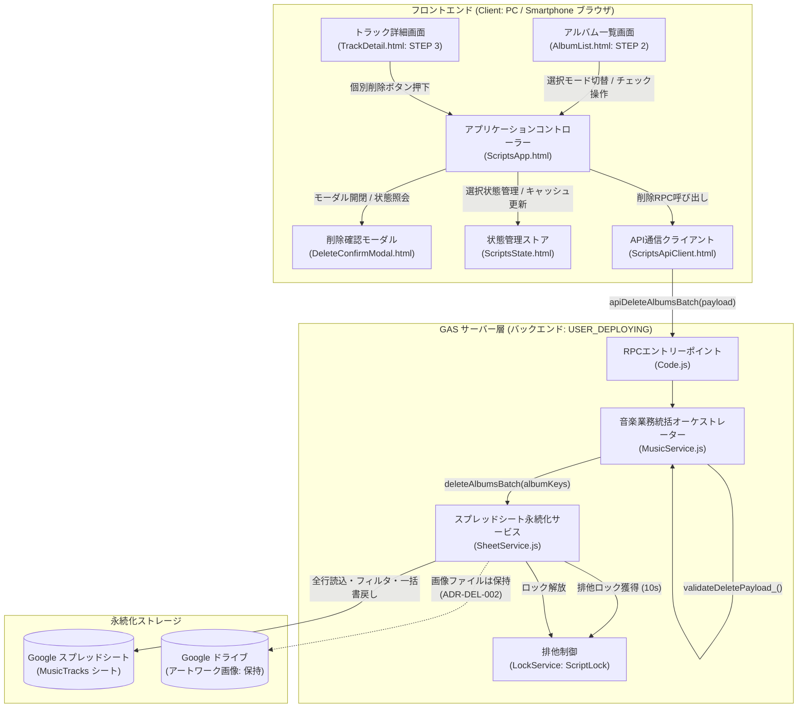
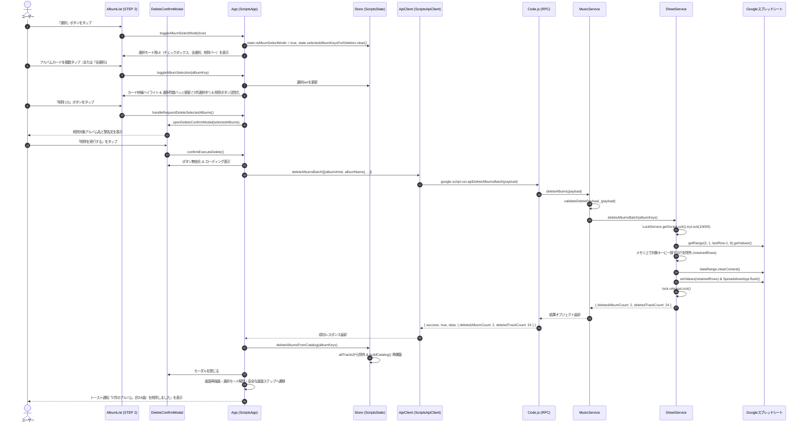

# システムアーキテクチャ設計書: アルバム削除機能（複数選択・一括削除および個別削除）

- **文書バージョン**: 1.0.0
- **作成日**: 2026年10月19日
- **作成ロール**: システムアーキテクト (`system-architect`)
- **対象要望**: 
  1. 削除機能を追加して欲しい
  2. アルバムの削除機能
  3. アルバムは複数選択とし、まとめて削除にも対応する
- **成果物パス**: `docs/architecture/album_bulk_delete_design.md`

---

## 1. 要件定義サマリー

### 1.1 背景および目的
現在、本アプリケーション（`MusicInfo-app`）には「アルバム一括インポート（iTunes / MusicBrainz連携）」「手動楽曲追加」「アルバム情報一括編集（更新）」が実装されているが、不要となったアルバムや誤って登録したアルバムを削除する機能が存在しない。

現状でアルバムを削除するには、ユーザーが直接Googleスプレッドシートを開き、該当行を手動で特定・削除するしかなく、以下の課題が存在する：
1. **誤削除・データ破損リスク**: スプレッドシートを直接手動編集することで、ヘッダー行の消失、数式の破損、行ズレなどの人為的事故が発生しやすい。
2. **操作性の著しい低下**: モバイル端末等からWebアプリ単体でアルバムコレクションを整理・メンテナンスすることができない。
3. **複数アルバム整理の手間**: 登録ミス等で複数のアルバムを整理したい場合、手作業で行を1行ずつ探して削除するのは多大な労力を要する。

本設計では、アルバム一覧画面（STEP 2）における**「複数選択・一括削除機能」**、および個別アルバム詳細画面（STEP 3）における**「個別アルバム削除機能」**を導入し、誤操作防止の安全設計（確認ダイアログ）、排他制御（LockService）、高速なアトミック一括削除、およびクライアントキャッシュ即時同期を実現する一貫したアーキテクチャを定義する。

---

### 1.2 機能要件 (Functional Requirements)

- **FR-DEL-001【アルバム複数選択モード（STEP 2）】**:
  - アルバム一覧画面（STEP 2: `AlbumList.html`）のヘッダー部に、通常閲覧モードと「選択モード（削除モード）」を切り替えるトグルボタンを新設すること。
  - 選択モード有効時、各アルバムカードの左上（または右上）に視認性の高いチェックボックスUIを表示し、カード全体のタップまたはチェックボックスタップにより選択/解除をトグル可能とすること。
  - 選択されたアルバムカードは視覚的なハイライト（枠線のアクティブ色変化、背景色変化、チェックマーク点灯）を付与すること。
  - 選択モード中は、カードタップによるSTEP 3（トラック一覧）へのドリルダウン遷移を抑止し、選択トグル処理を最優先すること。

- **FR-DEL-002【全選択 / 全解除および選択件数表示】**:
  - 選択モード中、現在選択されているアーティストに属する全アルバムを一括で「全選択」および「全選択解除」できるコントロールボタンを提供すること。
  - 現在選択中のアルバム件数をリアルタイムにバッジ等（例: `3件選択中`）で明示すること。

- **FR-DEL-003【アルバム一括削除実行と確認ダイアログ】**:
  - 選択モード中、1件以上のアルバムが選択されている場合に「削除 ({N})」ボタンを活性化（enabled）し、0件時は非活性（disabled）とすること。
  - 「削除 ({N})」ボタン押下時、不可逆な破壊的操作に対する誤操作を確実に防ぐため、専用の確認モーダル（`DeleteConfirmModal.html`）を表示すること。
  - 確認ダイアログ内には、削除対象となるアルバム名一覧、および「選択したアルバムに属するすべての収録曲データ（計 X 曲）が完全に削除されます。この操作は取り消せません。」という明確な警告文を表示すること。
  - モーダル内の「削除を実行する」確定ボタン押下により、バックエンドの一括削除API（`apiDeleteAlbumsBatch`）を呼び出すこと。

- **FR-DEL-004【単一アルバム個別削除機能（STEP 3）】**:
  - 個別アルバム詳細画面（STEP 3: `TrackDetail.html`）のアルバムヘッダー操作領域（「編集」「曲追加」ボタンの並び）に、「アルバム削除」ボタンを配置すること。
  - 単一アルバム削除ボタン押下時も同一の確認ダイアログを表示し、バックエンドへは要素数1の配列として同一の一括削除APIを呼び出すことで、処理系を統一すること。

- **FR-DEL-005【バックエンド一括削除処理（カスケード削除・アトミック実行）】**:
  - GASバックエンド（`MusicService`, `SheetService`）は、指定されたアルバム識別キー（`albumArtist` と `albumName` のペア）のリストを受け取り、スプレッドシートから該当する全トラック行を漏れなく一括削除（カスケード削除）すること。
  - `LockService` を用いた排他ロックを獲得し、同時実行時のデータ破損・ロストアップデートを防止すること。
  - 全行一括読み込み・メモリフィルタリング・一括書き戻し（`clearContent` & `setValues`）によるアトミック一括置換方式により、API呼び出し回数を最少化し高速に処理を完了すること（ADR-DEL-001参照）。

- **FR-DEL-006【クライアントキャッシュ即時同期と安全な画面フォールバック】**:
  - 削除成功時、クライアント側（`Store`）のメモリキャッシュ（`allTracks`）から削除対象アルバムのトラックを除外し、`buildCatalog()` によりカタログツリーを即時再構築すること（全件再取得 `apiGetAllData` の通信オーバーヘッドを排除）。
  - 画面状態の自動フォールバック制御：
    1. 選択中アーティストに他のアルバムが残っている場合: アルバム一覧（STEP 2）を再描画し、選択モードを自動終了する。
    2. 選択中アーティストの全アルバムが削除された場合: アーティスト一覧（STEP 1）から当該アーティストが自動消滅するため、STEP 1 に自動復帰するか、カタログ内の先頭アーティストへ選択を安全に切り替える。
    3. 削除されたアルバムが STEP 3（トラック詳細）で表示中であった場合: STEP 3 の表示をクリア（空状態）にし、モバイル環境では STEP 2（または STEP 1）に自動復帰する。
  - 削除完了後、トースト通知（例: `「〇〇」など2件のアルバム（計24曲）を削除しました`）を画面右下に表示すること。

---

### 1.3 非機能要件 (Non-Functional Requirements)

- **NFR-SEC-001【厳格なリクエストペイロード検証】**:
  - サーバー側（`MusicService`）において、削除対象キー配列の型（配列であること、要素数が1以上であること、各要素が空文字でない `albumArtist` および `albumName` を保持していること）を厳格にバリデーションし、不正なリクエストは即座に例外を送出すること。
- **NFR-PERF-001【処理時間の短縮とタイムアウト抑止】**:
  - スプレッドシート操作は全行取得＋メモリフィルタ＋一括書き戻し（1回の `setValues`）で実行し、削除件数（例: 20アルバム、300トラック）に関わらずGAS実行時間を3秒以内に抑えること。
- **NFR-PERF-002【通信量最少化とミリ秒応答】**:
  - 削除完了後の画面更新はクライアント内部キャッシュの差分除外により100ms未満で完了させ、ネットワーク再取得（`apiGetAllData`）による描画遅延や帯域浪費を発生させないこと。
- **NFR-ROBUST-001【排他制御とAll-or-Nothingの整合性】**:
  - `LockService.tryLock(10000)` により他ユーザーの更新・登録との衝突を防止すること。ロック取得失敗時は `LOCK_TIMEOUT` エラーを返却すること。
  - 処理途中の失敗によって一部の行のみが削除される不整合を排除し、完全なアトミック性を保証すること。
- **NFR-UX-001【二重送信抑止と視覚的フィードバック】**:
  - 削除実行中は確認モーダル内のボタンを即時 disabled 化し、ローディングスピナーを表示して多重実行を防止すること。
  - 削除アクションには危険色（赤系 `bg-rose-600` / `hover:bg-rose-700`）を適用し、通常の安全なアクションと明確に区別させること。
- **NFR-MOBILE-001【モバイル操作性 (WCAG 44pxタップ領域保証)】**:
  - チェックボックスおよび操作ボタンはすべて 44px × 44px 以上のタップ領域を確保し、スマートフォンの狭小画面（幅375px〜430px）でも親指で快適に操作可能とすること。

---

### 1.4 前提条件と制約事項

1. **データ構造の制約（1トラック1行フラット構造）**:
   スプレッドシート `MusicTracks` はアルバム単体のエンティティ行を持たず、各トラック行に `albumArtist` および `albumName` が保持されている。したがって、アルバムの削除は「該当する `albumArtist` かつ `albumName` を持つ全トラック行の削除」と同義である。
2. **アルバム識別キーの仕様**:
   アルバムを一意に特定する主キーは、`albumArtist` と `albumName` の組み合わせ（複合キー）である（既存のアルバム編集機能 `updateAlbumBatch` と同一規約）。
3. **Google Drive上のアートワーク画像ファイル**:
   誤削除時のデータ復元性および同一画像URLの他アルバム共有破壊防止の観点から、Google Drive上の画像ファイルは即時削除せず、スプレッドシートの行削除（参照解除）のみにとどめる（詳細は ADR-DEL-002 参照）。
4. **外部依存関係の制約**:
   追加の外部ライブラリは導入せず、既存の Tailwind CSS CDN、バニラJavaScript (ES6+)、および GAS 標準サービス（`SpreadsheetApp`, `LockService`）のみで完結させる。

---

### 1.5 不明点・ブロッキング事項
- **ブロッキング事項**: なし（既存コードベースおよびユーザー要件の調査により、すべての仕様が確定可能）。
- **設計上の前提事項**:
  - 個別アルバム詳細画面（STEP 3）からの削除も、同一の一括削除バックエンドAPI（要素数1の配列）を利用して処理する。
  - 選択モードは同一アーティスト配下のアルバム複数選択を主対象とする（現在の3ペインUI階層構造に自然に適合するため）。

---

## 2. システム境界とコンポーネント構成

### 2.1 システム境界



---

### 2.2 各コンポーネントの責務

| レイヤー | コンポーネント | 責務・変更点 |
| :--- | :--- | :--- |
| **View (UI)** | `src/AlbumList.html` | - 選択モード切替ボタン（「選択」/「キャンセル」）の配置<br>- 選択中ツールバー（全選択、全解除、選択件数バッジ、削除ボタン）の追加<br>- アルバムカード内チェックボックスUIの追加 |
| **View (UI)** | `src/TrackDetail.html` | - アルバムヘッダーカードの操作ボタングループに「削除」ボタンを追加（WCAG 44px対応） |
| **View (Modal)** | `src/DeleteConfirmModal.html`<br>*(新規コンポーネント)* | - 削除確認モーダル（対象アルバム名一覧、削除楽曲総数の警告、赤色実行ボタン、キャンセルボタン） |
| **Controller** | `src/ScriptsApp.html` | - 選択モードのトグル制御（`toggleAlbumSelectMode`）<br>- アルバムカード選択/解除トグル（`toggleAlbumSelection`）<br>- 全選択 / 全解除ハンドリング（`selectAllAlbums`, `deselectAllAlbums`）<br>- 削除確認モーダル開閉制御（`openDeleteConfirmModal`, `closeDeleteConfirmModal`）<br>- 削除RPC呼び出し、ローディング制御、エラーハンドリング、トースト通知表示<br>- 削除後の画面ステップ自動フォールバック制御 |
| **Model (State)** | `src/ScriptsState.html` | - `selectedAlbumKeysForDeletion: Set<string>` による選択中アルバムの追跡管理<br>- `isAlbumSelectMode: boolean` による選択モード状態の保持<br>- `deleteAlbumsFromCatalog(albumKeys)` メソッド新設（メモリキャッシュからの即時除外とツリー再構築） |
| **Client Service** | `src/ScriptsApiClient.html` | - `deleteAlbumsBatch(albumKeys)` メソッド新設（GAS `apiDeleteAlbumsBatch` 呼び出しのPromise化） |
| **Facade (RPC)** | `src/Code.js` | - 公開RPC関数 `apiDeleteAlbumsBatch(payload)` の新設と例外ハンドリング・レスポンスラッピング |
| **Domain Service** | `src/MusicService.js` | - `deleteAlbums(payload)` メソッド新設<br>- `validateDeletePayload_(payload)` による入力値検証（必須キー・配列形式・空文字排除） |
| **Persistence** | `src/SheetService.js` | - `deleteAlbumsBatch(albumKeys)` メソッド新設<br>- `LockService` 排他ロック獲得（10秒）<br>- スプレッドシート全行一括取得、メモリ上での対象行除外、`clearContent` & `setValues` によるアトミック置換<br>- 削除件数（アルバム数・トラック行数）の集計返却 |
| **Build & Template** | `src/index.template.html`<br>`build.js` | - `DeleteConfirmModal` の include 定義追加およびビルド対象リストへの登録 |

---

### 2.3 外部依存関係

- **Google スプレッドシート (`SpreadsheetApp`)**:
  - 対象シート: スクリプトプロパティ `SHEET_NAME`（デフォルト: `MusicTracks`）。
  - 1トラック1行のテーブル構成。
- **Google Apps Script 排他ロック (`LockService`)**:
  - `LockService.getScriptLock()` を使用し、一括更新（`updateAlbumBatch`）および一括削除（`deleteAlbumsBatch`）におけるクリティカルセクションを保護。
- **Google Drive (`DriveApp`)**:
  - 削除時はDriveAppに対する削除API呼び出しを行わない（ADR-DEL-002により画像は保持）。

---

## 3. データフローとインターフェース

### 3.1 データフローシーケンス

#### 複数アルバム選択 〜 一括削除シーケンス



---

### 3.2 主要インターフェース定義

#### 1. RPC リクエスト / レスポンス ペイロード (GAS サーバー & クライアント)

```typescript
/**
 * アルバム削除対象の識別キー
 */
interface AlbumIdentityKey {
  albumArtist: string; // アルバムアーティスト名 (必須・トリム済み)
  albumName: string;   // アルバム名 (必須・トリム済み)
}

/**
 * apiDeleteAlbumsBatch リクエストペイロード
 */
interface DeleteAlbumsPayload {
  albums: Array<AlbumIdentityKey>; // 削除対象アルバムリスト (1件以上)
}

/**
 * apiDeleteAlbumsBatch 成功時レスポンスデータ
 */
interface DeleteAlbumsResult {
  deletedAlbumCount: number;       // 削除されたアルバム総数
  deletedTrackCount: number;       // スプレッドシートから削除されたトラック行数
  deletedAlbums: Array<AlbumIdentityKey>; // 実際に削除されたアルバム一覧
  remainingRowCount: number;      // 削除後のスプレッドシート残存トラック総行数
}

/**
 * 共通 API レスポンスエンベロープ
 */
interface ApiResponse<T> {
  success: boolean;
  data?: T;
  error?: string;
  code?: string;
  timestamp: string;
}
```

#### 2. クライアント側 Store 状態拡張 (`ScriptsState.html`)

```javascript
// Store.state に追加されるプロパティ
this.state = {
  // ... 既存プロパティ ...
  isAlbumSelectMode: false,                     // 選択（削除）モード中か否か
  selectedAlbumKeysForDeletion: new Set(),       // 選択中アルバムキーのSet ("albumArtist:::albumName")
};

// Store に追加されるメソッド
/**
 * 削除されたアルバム群をキャッシュから一括除外し、カタログツリーを再構築
 * @param {Array<{ albumArtist: string, albumName: string }>} deletedKeys
 */
deleteAlbumsFromCatalog(deletedKeys) {
  const targetKeySet = new Set(
    deletedKeys.map(k => `${String(k.albumArtist || '').trim()}:::${String(k.albumName || '').trim()}`)
  );

  // 1. 全トラック配列から該当アルバムの行を除外
  this.state.allTracks = this.state.allTracks.filter(t => {
    if (!t || typeof t !== 'object') return false;
    const key = `${String(t.albumArtist || '').trim()}:::${String(t.albumName || '').trim()}`;
    return !targetKeySet.has(key);
  });

  // 2. カタログツリーの再構築（アーティスト一覧・ソート順・検索インデックスの完全更新）
  this.buildCatalog();

  // 3. 選択状態のクリア
  this.state.selectedAlbumKeysForDeletion.clear();
  this.state.isAlbumSelectMode = false;
}
```

#### 3. クライアント側 ApiClient メソッド (`ScriptsApiClient.html`)

```javascript
/**
 * アルバム一括削除 API の呼び出し
 * @param {Array<{ albumArtist: string, albumName: string }>} albums
 * @returns {Promise<DeleteAlbumsResult>}
 */
deleteAlbumsBatch(albums) {
  return this.callGAS('apiDeleteAlbumsBatch', { albums: albums });
}
```

#### 4. バックエンド エントリーポイント & サービスシグネチャ

```javascript
// Code.js
function apiDeleteAlbumsBatch(payload) {
  try {
    const data = getMusicService().deleteAlbums(payload);
    return { success: true, data: data, timestamp: new Date().toISOString() };
  } catch (err) {
    console.error('apiDeleteAlbumsBatch エラー:', err);
    return {
      success: false,
      error: err.message,
      code: err.code || 'ALBUM_DELETE_ERROR',
      timestamp: new Date().toISOString()
    };
  }
}

// MusicService.js
deleteAlbums(payload) {
  this.validateDeletePayload_(payload);
  return this.sheetService.deleteAlbumsBatch(payload.albums);
}

// SheetService.js
deleteAlbumsBatch(albumKeys) {
  // LockService 排他ロック -> 全行取得 -> メモリフィルタ -> clearContent & setValues -> ロック解放
}
```

---

## 4. アーキテクチャ上の決定事項 (ADR)

### ADR-DEL-001: アルバム削除に伴うスプレッドシート行削除方式（一括置換 vs 個別行削除）

- **決定**:
  スプレッドシート全行を取得し、メモリ上で対象アルバムのトラック行を一括除外後、データ領域をクリアして残存行を一括書き戻す**「アトミック一括置換方式」**を採用する。
- **理由**:
  1. `sheet.deleteRow(rowIndex)` を1行ずつループ実行する方式は、削除する行数に比例してGASの同期API呼び出しが発生し、極めて低速（10曲の削除でも数秒、複数アルバム・数十曲の削除ではGAS実行時間制限やブラウザ側タイムアウトを招く）。
  2. 行番号に基づく削除は、1行削除するたびに後続行のインデックスが変動するため、インデックス計算ミスによる誤削除リスクが高い。
  3. 一括置換方式であれば、API通信は「全行読込（1回）」「クリア（1回）」「一括書き戻し（1回）」の計3回で完結し、対象行数が数百行に及んでも1秒以内で高速に処理が完了する。既存の `updateAlbumBatch` でも実績があり、コードベースの設計方針と完全に一致する。
- **検討した代替案**:
  - *代替案A: `deleteRow()` を下行から上方向（逆順）に実行する*: 呼び出し回数が多くパフォーマンス要件を満たさないため却下。
  - *代替案B: 一致行に削除フラグを立てて論理削除する*: スプレッドシートを直接閲覧・管理する本システムの要件に反し、シートが肥大化するため却下。
- **トレードオフ**:
  シート全行をメモリ（JavaScript配列）に展開するためメモリを消費するが、現在の数千行規模の音楽カタログでは数十KB〜数百KB程度であり、GASのメモリ上限（数百MB）に対して極めて安全なマージンがある。全行削除（データが0行になるケース）におけるヘッダー保護の境界値処理が必要。
- **結果・影響**:
  一括削除の高速性とトランザクション整合性を両立。

---

### ADR-DEL-002: Google Drive 上のアートワーク画像ファイルの保持方針（即時削除 vs 保持・孤立許容）

- **決定**:
  アルバム削除時、Google Drive 内に保存されているアートワーク画像ファイル（JPEG等）は**即時削除せず、保持（孤立ファイル許容）**とする。
- **理由**:
  1. **誤削除時の完全復元性の担保**: ユーザーが誤ってアルバムを削除した場合でも、Googleスプレッドシートの標準機能である「版の履歴（バージョン履歴）」から行を復元すれば、同一の画像URLからアルバムアートが即座に完全復元できる。画像をDriveから完全削除してしまうと、スプレッドシートを復元してもジャケット写真が二度と表示できなくなる。
  2. **画像共有破壊の防止**: ユーザーが同一の画像URLを別のアルバムや手動登録楽曲で共有（再利用）している場合、画像ファイルを削除すると他の健全なアルバムのジャケットまでリンク切れを起こす重大な副作用（巻き込み事故）が発生する。
  3. **GAS実行時間とパフォーマンス**: DriveApp API呼び出し（ファイル検索やゴミ箱移動）はHTTPオーバーヘッドが大きく低速である。複数アルバム一括削除時にDriveファイルを順次削除すると処理時間が肥大化し、タイムアウトのリスクが高まる。
  4. **ストレージコストの微小性**: Web表示用画像は最適化されており1枚あたり数十KB〜数百KB程度であるため、通常の個人利用においてDrive容量を圧迫する懸念は極めて低い。
- **検討した代替案**:
  - *代替案A: Driveファイルを即時ゴミ箱（Trash）へ移動する*: スプレッドシート上の他全行を走査して同一ファイルIDが使われていないか検証する必要があり、処理が重くなる割にメリットが薄い。
  - *代替案B: 削除モーダルに「Drive上の画像も削除する」チェックボックスを設ける*: UIが煩雑化し、一般ユーザーにとって他アルバムでの重複参照リスクを判断できないため却下。
- **トレードオフ**:
  削除されたアルバムの画像がDriveフォルダ内に残存する。将来的に容量整理が必要となった場合は、別途「未参照画像の孤立ファイル一括クリーンアップ機能（バッチ）」を管理機能として設けることが可能。
- **結果・影響**:
  削除処理の超高速化、高い耐障害性、および安全な復元性を獲得。

---

### ADR-DEL-003: UIにおける複数選択操作モデル（選択モードトグル方式 vs 常時チェックボックス表示）

- **決定**:
  STEP 2 ヘッダーの「選択」ボタンを押下して入る**「選択モードトグル方式」**を採用する。
- **理由**:
  1. **通常操作の保護**: 通常時はアルバムカードをタップして瞬時にトラック一覧（STEP 3）へドリルダウンすることが本アプリのコアUXである。カード上に常時チェックボックスが存在すると、誤タップによる意図しないチェックや、詳細への遷移失敗などのストレスを生む。
  2. **視覚的ノイズの低減**: モバイル等の限られた画面領域において、常時チェックボックスや削除ボタンが表示されていると、アルバムアートを美しく鑑賞・閲覧する体験を損なう。
  3. **操作の誤爆防止**: 選択モード中のみ削除ボタンや全選択ボタンが現れることで、不可逆な破壊的操作の誤実行リスクを構造的に低減できる。
  4. **親指操作性の最大化**: 選択モード中はカード全体がチェックボックストグルのタップターゲットとなるため、44px以上の領域が確保され、スマートフォン片手操作でも快適に複数選択が行える。
- **検討した代替案**:
  - *代替案: アルバムカードの長押し（Long Press）で選択モードに入る*: モバイルWeb（ブラウザ）ではテキスト選択やコンテキストメニューと衝突しやすく、PCでの操作が困難であるため却下。
- **トレードオフ**:
  削除操作を行う際に「選択」ボタンを1ステップ踏む必要があるが、安全性と閲覧体験の両立において圧倒的に優れる。
- **結果・影響**:
  明快なモード切り替えによる直感的で安全なUI/UXを実現。

---

### ADR-DEL-004: アルバム識別キーの複合キー仕様（`albumArtist` + `albumName`）

- **決定**:
  削除対象アルバムの識別キーとして、`albumArtist` と `albumName` の正規化文字列ペア（複合キー）を採用する。
- **理由**:
  1. スプレッドシートの既存テーブル定義（A〜H列）には独立したアルバムID列が存在せず、`albumArtist` と `albumName` が同一のトラック群を1つのアルバムとして認識している。
  2. 既存のアルバム編集機能（`updateAlbumBatch`）でも `originalAlbumArtist` と `originalAlbumName` のペアを識別キーとしており、システム全体で完全な設計の一貫性を保てる。
- **検討した代替案**:
  - *代替案: スプレッドシートに行IDまたはアルバムUUID列を新設する*: 既存のスプレッドシートデータ移行が必要となり、後方互換性を破壊するため不採用。
- **トレードオフ**:
  同一アーティストに同名のアルバムが複数存在する場合に同時に削除されるが、音楽管理の業務特性上、同一アーティストの同名アルバムは同一エンティティとみなすのが妥当であり問題とならない。
- **結果・影響**:
  既存スキーマの変更不要、互換性の完全維持。

---

### ADR-DEL-005: 削除後のクライアント画面遷移・フォールバック仕様

- **決定**:
  削除完了後、以下のフォールバック判定ロジックを順次実行し、破綻のない画面状態へ自動遷移する。
  1. **STEP 2（アルバム一覧）**:
     - 選択中アーティストに削除されなかったアルバムが1件以上残っている場合: 選択モードを解除し、アルバム一覧を再描画。
     - 選択中アーティストのアルバムがすべて削除された場合: 当該アーティストはカタログから消失するため、アーティスト一覧（STEP 1）を再描画し、モバイルでは STEP 1 へ自動遷移。PCでは先頭アーティストを選択するか未選択状態にする。
  2. **STEP 3（トラック詳細）**:
     - 現在表示中のアルバムが削除対象に含まれていた場合: STEP 3 の詳細表示領域をクリアし、「アルバムを選択してください」プレースホルダーを表示。モバイルでは STEP 2（または STEP 1）へ戻す。
     - 削除対象に含まれていないアルバムが表示されていた場合: そのまま表示を維持。
- **理由**:
  存在しなくなったアルバムの曲一覧が表示され続ける不整合や、空になった画面でユーザーが取り残されるUX崩壊を防ぐため。
- **結果・影響**:
  ユーザーが迷うことのない自然で洗練された画面遷移を実現。

---

## 5. 品質特性に関する考慮事項

### 5.1 セキュリティ (Security)
- **サーバーサイド二重バリデーション**:
  `MusicService.validateDeletePayload_` において、`payload.albums` が配列であること、要素数が1以上であること、各要素の `albumArtist` および `albumName` が有効な文字列であることを厳格に検証する。不正なデータや悪意ある空ペイロードは即座に拒絶する。
- **スプレッドシート式インジェクション（Formula Injection）防止の維持**:
  削除処理においては新たな文字列追記は発生しないが、残存行の書き戻し時においても既存のデータ整合性を破壊しない。
- **権限境界**:
  GAS実行コンテキスト（`USER_DEPLOYING`）を維持し、一般閲覧者に対する権限漏洩を起こさない。

### 5.2 スケーラビリティ & パフォーマンス (Scalability & Performance)
- **API通信回数の最小化**:
  GASからスプレッドシートへのアクセスは非常に重いため、一括置換方式により1回の `setValues` で完結させる。これにより、数百曲の削除であってもGASの実行時間は1〜2秒で終了する。
- **クライアントキャッシュによる即時描画**:
  削除完了後に `apiGetAllData` を再呼び出しして全データをネットワーク取得するのではなく、`Store.deleteAlbumsFromCatalog` によりブラウザ内メモリ上で差分除外とカタログ再構築を行う。これにより、通信待ちなし（100ms以内）で画面が即座に切り替わる。

### 5.3 信頼性 & 排他制御 (Reliability & Concurrency)
- **LockService によるクリティカルセクション保護**:
  `SheetService.deleteAlbumsBatch` の開始時に `LockService.getScriptLock().tryLock(10000)` を実行し、更新処理（`updateAlbumBatch`）や追加処理（`saveAlbumBatch`, `saveSingleTrack`）との同時実行による競合・上書き消失（ロストアップデート）を完全に防止する。
- **All-or-Nothing の完全保証**:
  スプレッドシートの更新処理は単一トランザクション的な一括置換で行うため、「3件中1件だけ消えて残りが中途半端に残る」といった不整合を排除する。
- **二重送信防止**:
  削除実行ボタン押下時に即時ローディング状態（disabled）へ移行し、多重クリックによる重複リクエストを抑止する。

### 5.4 保守性 & テスタビリティ (Maintainability & Testability)
- **単一責任原則（SRP）の徹底**:
  UI（`AlbumList.html`, `DeleteConfirmModal.html`）、状態（`ScriptsState.html`）、通信（`ScriptsApiClient.html`）、業務検証（`MusicService.js`）、データ永続化（`SheetService.js`）に責任を分離。
- **ユニットテスト容易性**:
  `SheetService` や `MusicService`、`Store` は引数と戻り値が明確に型付けされており、Node.js環境（`tests/`）でのモックを用いた単体テストが容易に作成可能。

### 5.5 ユーザビリティ & アクセシビリティ (Usability & Accessibility)
- **破壊的操作に対する明確な警告**:
  専用確認モーダルにて「削除対象アルバム名」「削除される曲数」「取り消し不可である旨」を明記し、危険色（ローズ/レッド）を用いてユーザーに注意喚起を行う。
- **WCAG 44px タップ領域**:
  チェックボックス、全選択ボタン、削除ボタンはすべてモバイル環境で快適にタップできる最小44px × 44pxのタップ領域を確保する。

---

## 6. 受け入れ基準 (Acceptance Criteria)

### 6.1 アルバム複数選択・UI操作
- [ ] **AC-UI-001**: アルバム一覧（STEP 2）のヘッダーに「選択」ボタンが表示されており、タップすると選択モードに切り替わること。
- [ ] **AC-UI-002**: 選択モード中、各アルバムカードにチェックボックスが表示され、カードタップまたはチェックボックスタップで選択状態がトグルすること。
- [ ] **AC-UI-003**: 選択中のアルバムカードは枠線がアクティブ色（インディゴ等）でハイライトされ、チェックマークが点灯すること。
- [ ] **AC-UI-004**: 選択モード中は、アルバムカードをタップしても STEP 3（トラック一覧）へ遷移しないこと。
- [ ] **AC-UI-005**: 選択モード中、「全選択」ボタンを押すと表示中の全アルバムが選択され、「全解除」ボタンを押すとすべての選択が解除されること。
- [ ] **AC-UI-006**: 選択モード中、選択中のアルバム件数がリアルタイムに「{N}件選択中」と正しく表示されること。
- [ ] **AC-UI-007**: 選択中のアルバムが0件の場合、「削除」ボタンは非活性（disabled）となり、1件以上選択されると活性化（enabled）すること。
- [ ] **AC-UI-008**: 「キャンセル」ボタンを押すと選択モードが終了し、選択状態がクリアされ通常モードに復帰すること。

### 6.2 個別アルバム削除（STEP 3）
- [ ] **AC-IND-001**: 個別アルバム詳細（STEP 3）のアルバムヘッダー部に「削除」ボタンが配置されていること。
- [ ] **AC-IND-002**: 個別削除ボタンを押下した際、対象アルバム単体の削除確認モーダルが表示されること。

### 6.3 削除確認ダイアログ
- [ ] **AC-MOD-001**: 削除ボタン押下時、専用の削除確認モーダルが表示されること。
- [ ] **AC-MOD-002**: モーダル内に削除対象のアルバム名一覧と警告文（取り消し不可、収録曲も全削除される旨）が表示されること。
- [ ] **AC-MOD-003**: モーダルの「キャンセル」ボタン、または背景クリック/Escキーでモーダルが閉じ、削除は実行されないこと。
- [ ] **AC-MOD-004**: モーダルの「削除を実行する」ボタン押下時、二重送信防止のためボタンが無効化され、ローディングスピナーが表示されること。

### 6.4 バックエンド処理・永続化
- [ ] **AC-SRV-001**: `apiDeleteAlbumsBatch` RPC が正常に呼び出され、スプレッドシートから対象アルバムに紐づくすべてのトラック行が完全に削除されること。
- [ ] **AC-SRV-002**: 削除対象外のアルバム・楽曲データは順序や内容を損なうことなく完全に保持されること。
- [ ] **AC-SRV-003**: 同時実行時、`LockService` による排他制御が正常に機能し、データ競合が発生しないこと。
- [ ] **AC-SRV-004**: 不正なペイロード（空配列、無効なキー）が送信された場合、適切なエラーコード（`VALIDATION_FAILED`）とともにエラーレスポンスが返却されること。
- [ ] **AC-SRV-005**: Google Drive上のアートワーク画像ファイルは削除されず保持されること（ADR-DEL-002準拠）。

### 6.5 クライアントキャッシュ同期・画面遷移
- [ ] **AC-SYNC-001**: 削除成功後、`apiGetAllData` を再呼び出しすることなく、クライアント側Storeのキャッシュが即座に同期され、画面が瞬時に更新されること。
- [ ] **AC-SYNC-002**: 削除完了後、右下に削除結果のトースト通知（削除件数表示）が表示されること。
- [ ] **AC-SYNC-003**: 削除対象のアルバムが STEP 3 に表示されていた場合、STEP 3 がクリアされ、モバイルでは STEP 2（または STEP 1）に自動復帰すること。
- [ ] **AC-SYNC-004**: 選択中アーティストの全アルバムが削除された場合、アーティスト一覧から当該アーティストが消去され、STEP 1 に安全に復帰すること。
