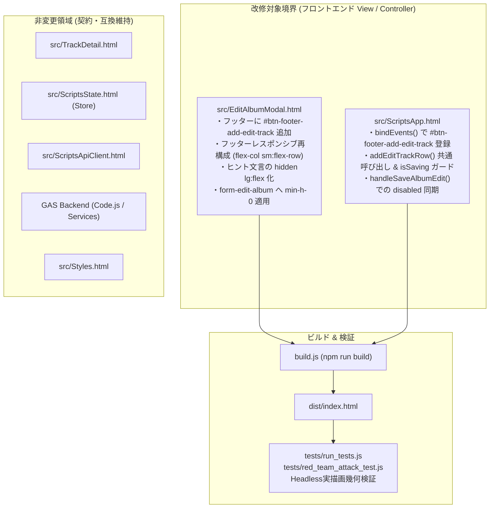
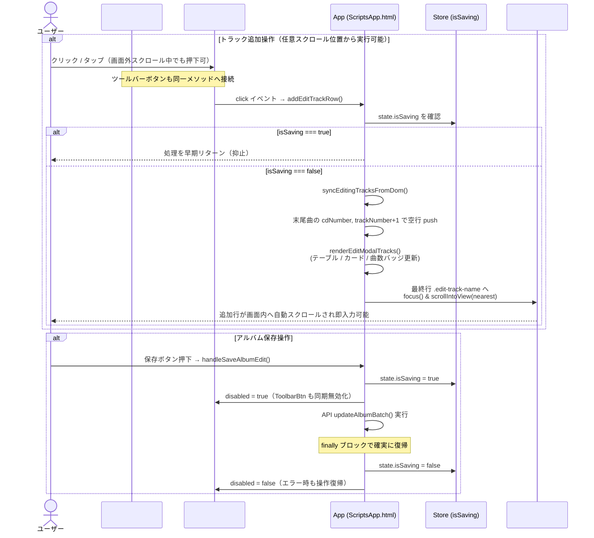

# システムアーキテクチャ設計書: アルバム編集モーダルにおけるトラック追加ボタンの常時アクセス性改善

- **文書バージョン**: 1.0.0
- **作成日**: 2026年11月21日
- **作成ロール**: システムアーキテクト (`system-architect`)
- **対象要望**: 「アルバム情報の編集画面にて、トラック追加ボタンを、画面外に出ても押せるようにして欲しい なお、フッター部にボタンを追加しても可」
- **成果物パス**: `docs/architecture/edit_album_add_track_access_design.md`

---

## 0. 記述区分ラベル定義

本設計書では、設計上の判断根拠と責務境界を明確にするため、情報の性質を以下の通り区別して記述する。

- **【事実】**: リポジトリ内の現行ソースコード・設定ファイル・テストコードから直接確認された事実。
- **【前提】**: 設計・運用・実行環境上の前提条件。
- **【決定】**: 本アーキテクチャ設計で採択・確定した方針、境界、および制約事項。
- **【推奨】**: 後続フェーズ（テックリード、シニアコーダー、QAエンジニア）への推奨設計・検証方針。
- **【要確認】**: ユーザー／プロダクトオーナーの最終判断・確認を仰ぐ論点（推測で埋めない）。

---

## 1. 要件定義サマリー

### 1.1 現行課題の根本原因分析

現行のアルバム編集画面（`src/EditAlbumModal.html`）における「トラック追加ボタンが画面外に出ると押せない」現象の原因は、以下のコンポーネント構造に起因する。

1. **トラック追加ボタンのスクロール領域内配置 【事実】**:
   - **対象ファイル**: `src/EditAlbumModal.html` (L32, L113-144)
   - モーダル本体枠（L2: `flex flex-col overflow-hidden`）は、上端の固定ヘッダー（L5-29: `flex-shrink-0`）、中央のスクロール本文エリア `<form id="form-edit-album">`（L32-176: `flex-1 overflow-y-auto`）、下端の固定フッター（L179-199: `flex-shrink-0`）の3段で構成されている。
   - 現行のトラック追加ボタン `#btn-add-edit-track`（L137-142）は、スクロール可能な `<form id="form-edit-album">` 内部の「セクション1：アルバム基本情報」（L35-110）より下位にある「セクション2：収録曲インライン編集エリア」のツールバー（L116-144）内にのみ配置されている。
   - そのため、以下の両方のケースで `#btn-add-edit-track` がビューポート外へ移動し、操作不能となる：
     - **下方スクロール時（中〜長尺アルバム・末尾編集時）**: モバイル（`<768px`）のトラックカードは縦積みであるため3〜4曲目以降を閲覧・入力する段階でツールバーが上端外へスクロールアウトする。PC（`md:` 以上）でも収録曲数が多いアルバム（例: 15〜30曲・複数ディスク）では下端確認時に同様の現象が発生する。
     - **初期表示／上方表示時（基本情報編集中・小画面・仮想キーボード表示時）**: スマートフォン狭幅や仮想キーボード展開時、セクション1（アルバム名・アーティスト・リリース日・アートワーク設定）が画面の大半を占有するため、セクション2のツールバーが下端外に出たままとなる。

2. **既存フッターおよびヘッダーの配置状況と幾何的余裕の不足リスク 【事実】**:
   - **モーダルヘッダー** (`src/EditAlbumModal.html` L5-29): 左側に閉じるボタン（`#btn-close-edit-album`）と見出し「アルバム情報の編集」、右側（`md:hidden`）にスマホ用上部保存ボタン（`#btn-mobile-submit-edit-album`）が配置されており、狭幅（`320px`）では横幅がすでにほぼ占有されている。
   - **モーダルフッター** (`src/EditAlbumModal.html` L179-199): HTMLコメントには「PC表示時固定・フッターアクション」と記載されているが、実装上は `hidden md:flex` ではなく**全幅帯で常時固定表示**（`flex-shrink-0`）されている。内部には左側ヒント文言コンテナ（L180-185: `hidden md:flex`）と右側ボタンコンテナ（L187-198: `#btn-cancel-edit-album` および `#btn-submit-edit-album`）が存在する。
   - フッターへそのまま「トラック追加」ボタンを単純追加した場合、以下の2箇所でレイアウト破綻が発生する構造にある：
     - **スマートフォン狭幅 (`320px`)**: `px-4`（左右計 `32px`）控除後のフッター内側幅は `288px` しかないため、「トラック追加」「キャンセル」「変更を保存」の3ボタンを1行に並べると幅超過による折り返し・ボタン縦割れ・誤タップが発生する。
     - **最小3ペイン境界幅・タブレット (`768px`, `md:`)**: モーダル幅 `736px`（`md:p-4` 控除）、フッター内側幅 `702px` に対し、既存ヒント文言「同一CD番号内でトラック番号が重複していないか確認して保存してください」（アイコン込約 `432px`）＋「トラック追加」（約 `120px`）＋「キャンセル」「変更を保存」（計約 `218px`）の合計が約 `794px` となり、**`768px` で約 `92px` 超過して折り返し・圧迫を引き起こす**。

3. **保存処理中の重ね順（`z-index`）と状態制御の留意点 【事実】**:
   - `src/index.template.html` において `#global-loading`（L16）と `<?!= include('EditAlbumModal'); ?>`（L39）はいずれも `z-50` であり、`EditAlbumModal` が DOM 上後置されている。
   - `src/ScriptsApp.html` の `handleSaveAlbumEdit()`（L2566-2627）は `this.store.state.isSaving = true` を設定して `#btn-submit-edit-album` と `#btn-mobile-submit-edit-album` を `disabled = true` にするが、同じモーダル内の `#btn-add-edit-track` 等には現在 `isSaving` ガードも `disabled` 同期も行われていない。

---

### 1.2 機能要件 (Functional Requirements)

- **FR-001【スクロール位置非依存のトラック追加アクセス】**:
  - 【決定】アルバム編集モーダル（`#modal-edit-album`）を開いている間、スクロール位置に関わらず（アルバム基本情報編集中、リスト中間、リスト最下部、あるいは小画面・キーボード展開時であっても）、ユーザーが常にトラック追加操作を実行できること。
- **FR-002【フッター常設ボタン追加とツールバーボタンとの併存】**:
  - 【決定】モーダルフッター（`flex-shrink-0` 固定領域）に常設のトラック追加ボタン（新設一意 ID: `#btn-footer-add-edit-track`）を配置し、収録曲ツールバー内の既存 `#btn-add-edit-track` は削除せず維持・併存させること（決定根拠は ADR-01）。
- **FR-003【既存トラック追加動作との完全一致】**:
  - 【決定】フッターのトラック追加ボタン押下時は、既存の `#btn-add-edit-track` と同一の処理（`App.prototype.addEditTrackRow()`）を実行し、以下を一貫して行うこと：
    1. 画面入力値を `this.editingTracks` へ同期（`syncEditingTracksFromDom()`）。
    2. 末尾行の CD番号・トラック番号（`+1`）を引き継いだ新規空トラック行を末尾に追加。
    3. PC テーブル・モバイルカード・`#edit-tracks-count-badge` の再描画（`renderEditModalTracks()`）。
    4. 追加された末尾トラックの曲名入力欄（`.edit-track-name`）へのフォーカス付与および `scrollIntoView` による自動スクロール。
- **FR-004【保存処理中（`isSaving`）の競合・二重操作防止】**:
  - 【決定】アルバム保存処理の実行中（`this.store.state.isSaving === true`）は、新規トラック追加による状態不整合や二重操作を防止するため、ロジック層（`addEditTrackRow()` 冒頭での `isSaving` ガード）および UI 層（`#btn-add-edit-track` / `#btn-footer-add-edit-track` の `disabled` 同期）の双方でトラック追加を抑止すること。
  - 【決定】一方、ローカル画像アップロード中（`handleImageUpload(event, 'editAlbum')`）はトラック配列と独立した処理であるため、既存の `relatedBtnIds`（保存ボタン・Drive追加ボタン）のみを無効化し、トラック追加ボタンは操作可能状態を維持すること。

---

### 1.3 非機能要件 (Non-Functional Requirements)

- **NFR-UX-001【WCAG 2.1 タッチターゲット 44px 基準の完全準拠】**:
  - 【決定】新設するフッターのトラック追加ボタンを含め、`EditAlbumModal` 内のすべての対話的ボタンは `min-h-[44px]`（正方形アイコンボタンは `min-w-[44px]` も）を個別の `class` 属性として厳密に確保すること。
- **NFR-UX-002【全ブレークポイント幾何保証（重なりゼロ・縦割れゼロ・横溢れゼロ）】**:
  - 【決定】代表ビューポート幅（`320px`, `375px`, `430px`, `640px`, `767px`, `768px`, `1024px`, `1280px`, `1536px`）のすべてにおいて、フッターのどのボタンもテキストの縦割れ折り返し（`whitespace-nowrap` 欠如による崩壊）、兄弟要素との重なり、親コンテナの水平オーバーフロー（`scrollWidth > clientWidth`）を起こさないこと。
  - 【決定】モバイル狭幅（`<640px`）において誤タップによる入力破棄を防ぐため、頻度高く押下する「トラック追加」ボタンと「キャンセル／変更を保存」ボタンは段を分離して誤操作耐性を確保すること（詳細は ADR-02）。
- **NFR-COMPAT-001【単一DOM原則（Duplicate ID 禁止）および既存テスト契約維持】**:
  - 【決定】すべての DOM ID は `src/EditAlbumModal.html` およびビルド後の `dist/index.html` 内で厳密に一意（1箇所のみ）であること。既存の `#btn-add-edit-track`、ツールバー、0件警告文言、および `tests/red_team_attack_test.js` / `tests/run_tests.js` / `tests/qa_comprehensive_test.js` の既存契約を破壊しないこと。
- **NFR-MAINT-001 / NFR-SEC-001【SSOT ビルド・セキュリティ規約の遵守】**:
  - 【決定】編集対象は `src/*.html`（およびテストファイル）に限定し、`npm run build`（`build.js`）によって `dist/index.html` を再生成する SSOT フローを遵守すること。
  - 【決定】新設ボタンに `type="button"` を明示して `<form>` 送信誤爆を防ぎ、インラインイベント属性（`onclick="..."` 等）は一切使用しないこと。

---

### 1.4 前提条件と制約事項

1. **【前提】フロントエンド技術スタック**:
   - Play CDN 版 Tailwind CSS（v3系）の標準ユーティリティクラスおよび既存の `src/Styles.html` を前提とし、ビルド時 CSS コンパイルや外部ライブラリの新規導入は行わない。
2. **【前提】モーダル全体レイアウト構造の維持**:
   - `src/EditAlbumModal.html` L2 のモーダル基本サイズ（モバイル `w-full h-full`、PC `md:h-[90vh] md:max-w-4xl`）およびヘッダー部の `#btn-mobile-submit-edit-album` は既存仕様として維持する。
3. **【制約】スクロール領域の伸縮保護**:
   - `<form id="form-edit-album">` が `flex-1 overflow-y-auto` としてフッターと共存する際、フッターの固定高さによってフォーム領域が潰れたり、子要素の最小高さ計算でスクロールが効かなくなることを防ぐため、`<form>` への `min-h-0` 適用を必須制約とする。
4. **【制約】対象スコープの限定**:
   - 本改修の対象は「トラック追加ボタン」の常時アクセス性確保に限定する。同ツールバーにある「番号自動連番採番」ボタン（`#btn-renumber-edit-tracks`）のフッター常設化は、フッター過密化と誤操作リスクを避けるため本スコープ外とする。

---

### 1.5 不明点・確認事項・ブロッキング事項

- **ブロッキング事項**: **なし**（現行 UI 構造、JS メソッド、テストスイートの仕様がすべて実コードより確定済みのため、後続のテックリード・実装フェーズへ支障なく進行可能）。
- **【要確認】プロダクトオーナー確認事項（設計上の判断確定方針）**:
  - **Q-01（既存ツールバーボタンの併存方針）**:
    - セクション2見出し横の既存 `#btn-add-edit-track` を残したままフッターにもボタンを追加する「併存構成（ADR-01）」を採用した。PC 等で画面内に同じ用途のボタンが2つ同時に見えることを避け、フッター1箇所のみへ完全移動したい場合は、代替案 A2 への切り替え可否を確認対象とする。
  - **Q-02（モバイル `<640px` フッターの2段構成による高さ増加）**:
    - 誤タップ防止・日本語ラベルの一貫性・`320px` 幅での確実な非破綻を優先し、`<640px` ではフッターを2段構成（高さ約 `111px`、ADR-02）とした。もし狭幅スマホでの縦方向表示領域を最大化するために「1行構成＋ラベル短縮（例：『曲追加』『保存』）」を優先したい場合は、ADR-02 代替案 B1 への再検討対象とする。

---

## 2. システム境界とコンポーネント構成

### 2.1 システム境界と変更影響範囲

本改修の影響範囲はフロントエンド UI 層（`src/EditAlbumModal.html`, `src/ScriptsApp.html`）およびテストコード（`tests/`）に限定される。バックエンド GAS サービス、API 通信仕様、Store 状態構造、他のモーダル（`ManualModal`, `ItunesModal` 等）への変更は発生しない。



### 2.2 各コンポーネントの責務

| コンポーネント | ファイル | 本設計における責務および変更方針 |
| :--- | :--- | :--- |
| **アルバム編集モーダル View** | `src/EditAlbumModal.html` | ・モーダルフッター（`flex-shrink-0`）を `<640px` 2段構成／`sm:` 以上1行構成（`flex-col sm:flex-row`）へ再構成し、トラック追加ボタン（`#btn-footer-add-edit-track`）を追加する。<br>・ヒント文言コンテナを `hidden lg:flex`（`1024px` 以上）へ変更し、`768px` 幅帯でのフッター圧迫を解消する。<br>・`#form-edit-album` に `min-h-0` を付与し、スクロール領域の確実な伸縮を保証する。<br>・既存 `#btn-add-edit-track` およびツールバー・0件警告は維持する。 |
| **UI コントローラー** | `src/ScriptsApp.html` | ・`bindEvents()` で `#btn-footer-add-edit-track` の `click` イベントを既存の `this.addEditTrackRow()` へバインドする。<br>・`addEditTrackRow()` 冒頭で `this.store.state.isSaving` による実行ガードを設け、保存中の状態改変を遮断する。<br>・`handleSaveAlbumEdit()` の開始・終了（`finally`）時に `#btn-add-edit-track` および `#btn-footer-add-edit-track` の `disabled` 状態を保存ボタンと同期させる。<br>・`handleImageUpload()` の既存 `relatedBtnIds`（5要素）および動作は変更しない。 |
| **状態管理・API・バックエンド** | `src/ScriptsState.html`, `src/ScriptsApiClient.html`, `src/*.js` | ・変更なし（既存の `this.store.state.isSaving` フラグ契約および `updateAlbumBatch` ペイロード契約をそのまま利用）。 |
| **テストスイート** | `tests/red_team_attack_test.js`, `tests/run_tests.js` | ・既存テスト契約を維持した上で、新設ボタン `#btn-footer-add-edit-track` の `min-h-[44px]`・`whitespace-nowrap`・`flex-shrink-0`・単一DOM（重複ID不在）検査および VM サンドボックスでのクリック連動・`isSaving` ガード検証を追加する。 |

### 2.3 外部依存関係

- **Tailwind CSS Play CDN (v3系)** (`src/index.template.html` L9): 標準ブレークポイント（`sm:` = `640px`, `md:` = `768px`, `lg:` = `1024px`）および標準ユーティリティのみを使用する。カスタム CSS の `src/Styles.html` への追加は不要である。
- **ブラウザ標準 DOM API**: `Element.scrollIntoView({ behavior: 'smooth', block: 'nearest' })` および `HTMLElement.focus()` は既存 `addEditTrackRow()`（`src/ScriptsApp.html` L2470-2471）のまま利用する。

---

## 3. データフローとインターフェース

### 3.1 操作フローと状態制御シーケンス

どちらのボタン（ツールバー `#btn-add-edit-track` またはフッター `#btn-footer-add-edit-track`）を押下しても、同一のデータフローおよび描画更新経路を通過する。



### 3.2 全ブレークポイント別 モーダルフッター幾何計算表

本設計では、フッター内側要素の所要幅（日本語 `text-xs` = `12px`, `font-semibold`/`font-medium`, ボタン内余白・ボーダー・アイコン幅・保存中「保存中...」＋スピナー幅込の保守的見積値）に基づき、全代表幅での幾何的収容性を確認する。

- **各要素の保守的所要幅見積**:
  - トラック追加ボタン（`#btn-footer-add-edit-track`, アイコン`16px` + `gap` + ラベル`+ トラック追加`または`トラック追加` + `px-3` + `border`）: 約 **`120px〜132px`**
  - キャンセルボタン（`#btn-cancel-edit-album`, ラベル`キャンセル` + `px-4` + `border`）: 約 **`94px`**
  - 変更を保存ボタン（`#btn-submit-edit-album`, 通常`変更を保存` / 保存中`保存中...` + スピナー`14px` + `px-5`）: 最大約 **`116px`**
  - 既存ヒント文言コンテナ（アイコン`16px` + `gap-2` + 34文字テキスト）: 約 **`432px`**

| ビューポート幅 | モーダル幅 | フッター左右 Padding | フッター内側幅 | フッター構成 | 上段/左ブロック占有幅 | 下段/右ブロック占有幅 | ヒント文言表示 (`hidden lg:flex`) | 残余余裕幅 | 判定 |
| :---: | :---: | :---: | :---: | :---: | :---: | :---: | :---: | :---: | :---: |
| **`320px`** (Mobile XS) | `320px` | `px-3` (`24px`) | **`296px`** | 2段 (`flex-col`) | 追加ボタン全幅 (`296px`) | キャンセル+保存 (`218px`) | 非表示 | 上段 `164px+` / 下段 `78px` | **安全** |
| **`375px`** (Mobile Std) | `375px` | `px-3` (`24px`) | **`351px`** | 2段 (`flex-col`) | 追加ボタン全幅 (`351px`) | キャンセル+保存 (`218px`) | 非表示 | 上段 `219px+` / 下段 `133px` | **安全** |
| **`430px`** (Mobile LG) | `430px` | `px-3` (`24px`) | **`406px`** | 2段 (`flex-col`) | 追加ボタン全幅 (`406px`) | キャンセル+保存 (`218px`) | 非表示 | 上段 `274px+` / 下段 `188px` | **安全** |
| **`640px`** (`sm:` 境界) | `640px` | `sm:px-4` (`32px`) | **`608px`** | 1行 (`sm:flex-row`) | 追加ボタン (`~132px`) | キャンセル+保存 (`218px`) | 非表示 | **`258px`** | **安全** |
| **`767px`** (`md:` 未満最大) | `767px` | `sm:px-4` (`32px`) | **`735px`** | 1行 (`sm:flex-row`) | 追加ボタン (`~132px`) | キャンセル+保存 (`218px`) | 非表示 | **`385px`** | **安全** |
| **`768px`** (`md:` 最小モーダル) | `736px`※1 | `sm:px-4` (`32px`) | **`702px`**※2 | 1行 (`sm:flex-row`) | 追加ボタン (`~132px`) | キャンセル+保存 (`218px`) | 非表示 | **`352px`** | **安全** |
| **`1024px`** (`lg:` 境界) | `896px`※3 | `sm:px-4` (`32px`) | **`862px`**※2 | 1行 (`sm:flex-row`) | 追加(`~132px`)+ヒント(`min-w-0 truncate`) | キャンセル+保存 (`218px`) | **表示** (`~432px`) | **`~80px`** | **安全** |
| **`1280px`** (`xl:` 標準PC) | `896px`※3 | `sm:px-4` (`32px`) | **`862px`**※2 | 1行 (`sm:flex-row`) | 追加(`~132px`)+ヒント(`~432px`) | キャンセル+保存 (`218px`) | **表示** | **`~80px`** | **安全** |
| **`1536px`** (`2xl:` 大画面) | `896px`※3 | `sm:px-4` (`32px`) | **`862px`**※2 | 1行 (`sm:flex-row`) | 追加(`~132px`)+ヒント(`~432px`) | キャンセル+保存 (`218px`) | **表示** | **`~80px`** | **安全** |

※1: `md:p-4`（左右各 `16px`）控除により `768 - 32 = 736px`。  
※2: モーダル枠の `md:border`（左右 `2px`）およびフッター `px-4`（`32px`）控除後の実効幅。  
※3: `md:max-w-4xl` (`56rem = 896px`) により上限固定。  
※注: `lg:` 以上（`>=1024px`）では、左側領域のヒント文言に `min-w-0` およびテキスト `truncate` を適用し、ボタン群の `flex-shrink-0 whitespace-nowrap` によりフォント差異が発生してもボタン幅が一切圧迫されないことを保証する。

---

### 3.3 主要インターフェース定義（DOM 契約仕様）

`EditAlbumModal.html` および `ScriptsApp.html` 間で遵守すべき DOM 契約を以下に定義する。

```typescript
/**
 * アルバム編集モーダル トラック追加アクセス改善に関する DOM 契約
 */
interface EditAlbumAddTrackDomContract {
  /** スクロール本文領域（min-h-0 により flex 配下での収縮・スクロール保証） */
  scrollForm: {
    id: 'form-edit-album';
    requiredClasses: ['flex-1', 'min-h-0', 'overflow-y-auto'];
    onsubmit: 'event.preventDefault();';
  };

  /** セクション2ツールバー内 既存トラック追加ボタン（契約維持・単一DOM） */
  toolbarAddButton: {
    id: 'btn-add-edit-track';
    type: 'button';
    requiredClasses: ['min-h-[44px]'];
  };

  /** モーダルフッター領域 */
  footer: {
    layoutClasses: ['flex', 'flex-col', 'sm:flex-row', 'flex-shrink-0'];
    hintVisibilityClasses: ['hidden', 'lg:flex', 'min-w-0'];
  };

  /** モーダルフッター内 新設トラック追加ボタン（単一DOM） */
  footerAddButton: {
    id: 'btn-footer-add-edit-track';
    type: 'button';
    requiredClasses: ['min-h-[44px]', 'w-full', 'sm:w-auto', 'whitespace-nowrap', 'flex-shrink-0'];
    /** id 属性を class 属性より前に配置（既存テスト正規表現規約に準拠） */
    attributeOrder: 'id-before-class';
  };

  /** 既存フッターアクションボタン群（保護・契約維持） */
  footerActionButtons: {
    cancelId: 'btn-cancel-edit-album';
    submitId: 'btn-submit-edit-album';
    requiredClasses: ['min-h-[44px]', 'whitespace-nowrap', 'flex-shrink-0'];
  };
}
```

---

## 4. アーキテクチャ上の決定事項 (ADR)

### ADR-01: スクロール外でのトラック追加アクセス方式の選定

- **ステータス**: 【決定】
- **決定**:
  モーダルフッター（`flex-shrink-0` 固定領域）へ常設のトラック追加ボタン（`#btn-footer-add-edit-track`）を**追加配置**し、収録曲ツールバー内の既存ボタン（`#btn-add-edit-track`）は削除せず**併存**させる。両ボタンは `ScriptsApp.html` の共通メソッド `this.addEditTrackRow()` を呼び出す。
- **理由**:
  1. **全スクロール位置での確実なアクセス性**: フッターはモーダルの最上位フレックス構造において `flex-shrink-0` で常時固定されており、リストを最下部へスクロールした状態だけでなく、上部のアルバム基本情報を編集している状態（ツールバーがビューポート下端外にある状態）でも即座に押下できる。
  2. **視覚的文脈と既存契約の保全**: 「収録曲一覧」見出し横の既存 `#btn-add-edit-track` を残すことで、収録曲数が少ない場合やリスト上部を見ている際の視線・ポインタ移動距離を最短に保ちつつ、0件警告メッセージ（「+ トラック追加」案内）および既存テスト（`tests/red_team_attack_test.js` L1013）との互換性を 100% 維持できる。
  3. **画面遮蔽・CSSレイアウト干渉の回避**: フッターは入力フォーム（`<form>`）と空間的に完全に分離されているため、コンテンツ上の入力フィールドや削除ボタンを覆い隠すことがない。
- **検討した代替案**:
  - **代替案 A2: 既存 `#btn-add-edit-track` をツールバーから削除し、フッターへ完全移動する**
    - *却下理由*: PC 大画面など一覧のスクロールが不要なケースにおいて、「収録曲一覧」セクションの近くで直感的に追加する動線が消え、目線とマウスを大きく下部フッターまで移動させる必要が生じるため。また、同ツールバーに残る「番号自動連番採番」ボタンとの機能グルーピングが分断される。
  - **代替案 C: 収録曲セクションのツールバーに `position: sticky` を適用して上部固定する**
    - *却下理由*:
      1. `sticky top-0` は上方向へのスクロールアウト時にのみ機能するため、初期表示時や基本情報入力中にツールバーが画面下端外にあるケースを解決できない（`sticky bottom-0` の場合はフッター直上に二重バーが生じ、狭画面での閲覧領域を著しく圧迫する）。
      2. 本アプリでは `<form>` にパディング（`p-3 md:p-5`）が、セクション2カードに半透明背景（`bg-slate-950/70`）と角丸（`rounded-xl`）が設定されているため、過去の `TrackDetail` 障害（`BUG-004`: `docs/architecture/mobile_track_list_layout_design.md` 参照）と同様に、スクロール時に上端隙間や背後テキストの透け・重なりが生じるリスクが高い。
      3. モバイル `320px` ではツールバー自体が2段折り返し（高さ約 `90px`）になり得るため、これを本文内に固定すると入力可能高さが極端に狭くなる。
  - **代替案 D: モーダル右下にフローティングアクションボタン（FAB）を浮かせる**
    - *却下理由*: 各トラック行の削除ボタン（`.btn-remove-edit-track` がPCテーブル右端・モバイルカード右上に配置されている）や末尾行の入力欄、さらには右下固定の `#toast-container`（`fixed bottom-4 right-4 z-50`）と物理的に重なり、誤タップと視認阻害を起こすため。
- **トレードオフ**:
  - トラック数が少なくスクロールが発生しない画面では、ツールバーとフッターの2箇所に同機能ボタンが同時に視界に入る。しかし、操作の冗長性は軽微（同一メソッドを呼ぶ非破壊的な追加ボタン）であり、長尺アルバム編集時・スマホ狭幅時の操作性劇的改善と既存テスト非破壊の利益が上回る。
- **結果・影響**:
  - `src/EditAlbumModal.html` のフッターへの新規ボタン要素追加と、`src/ScriptsApp.html` `bindEvents()` への 1 リスナー追加のみで実現でき、既存 DOM 構造・入力同期ロジックに破壊的変更を生じさせない。

---

### ADR-02: モーダルフッターのレスポンシブ幾何設計（`<640px` 2段配置と `hidden lg:flex` ヒント制御）

- **ステータス**: 【決定】
- **決定**:
  1. **モバイル狭幅（`<640px`）における2段構成化**: フッターコンテナを `flex-col sm:flex-row` 構成とし、`<640px` では上段に `#btn-footer-add-edit-track` を全幅（`w-full sm:w-auto`）で配置し、下段に `#btn-cancel-edit-album` と `#btn-submit-edit-album` を配置する。
  2. **ヒント文言の `lg:`（`1024px`）以上限定表示**: フッター左側の注意文言（「同一CD番号内でトラック番号が重複していないか確認して保存してください」）の表示クラスを現行の `hidden md:flex` から **`hidden lg:flex`** へ変更し、かつ `min-w-0`（テキスト要素へ `truncate`）を設定する。
  3. **全フッターボタンの非圧縮保護**: `#btn-footer-add-edit-track`, `#btn-cancel-edit-album`, `#btn-submit-edit-album` のすべてに `min-h-[44px] whitespace-nowrap flex-shrink-0` を適用する。
- **理由**:
  1. 幾何計算（3.2節）の通り、`320px` 幅（内側 `296px`）に「トラック追加」「キャンセル」「変更を保存（保存中スピナー込）」の3ボタンを1行で並べると合計幅が約 `318px` に達し、横溢れ・縦割れ崩壊が発生する。2段分離により `320px` でもボタン幅に十分な余裕を確保できる。
  2. 頻繁に連続押下する「トラック追加」ボタンを「キャンセル」ボタンから別の行へ物理分離することで、親指タップ時の誤キャンセル（未保存内容の喪失リスク）を防止できる。
  3. `768px`（`md:`）ではモーダル内側幅が `702px` しかないため、ヒント文言（約 `432px`）と3ボタン（計約 `350px`）が同一行に並ぶと合計 `794px > 702px` で破綻する。`hidden lg:flex`（`1024px` 以上・内側幅 `862px`）へ引き上げることで全解像度帯の溢れを防止できる。
- **検討した代替案**:
  - **代替案 B1: モバイル（`<640px`）でもフッターを1行に維持し、ボタンラベルを短縮する（例：『曲追加』『キャンセル』『保存』）**
    - *却下理由*:
      1. 合計幅が約 `244px〜272px` となり `320px` 内側幅（`296px`）に対する安全マージンが狭く、端末側のフォントサイズ拡大設定等により容易に折り返し破綻を招く。
      2. 隣接ボタン間隔が `6px` 程度になり、「曲追加」のつもりが「キャンセル」を誤タップするリスクが高い。
      3. `ScriptsApp.html` L2571, L2621 が `.edit-album-submit-btn-text` の文字列を `'変更を保存'` へ書き換える実装になっており、レスポンシブ文言切替のために既存 JS のテキスト制御ロジックへの追加変更が必要となる。
  - **代替案 B2: モバイル（`<768px`）のフッターでは「変更を保存」を非表示とし、ヘッダー右上 `#btn-mobile-submit-edit-album` のみで保存させる**
    - *却下理由*: リスト最下部までスクロールしてトラックを追加・入力した直後に、視線の先にあるフッターからそのまま保存できなくなり、上部ヘッダーまで戻る操作を強いるため UX が退行する。
- **トレードオフ**:
  - モバイル（`<640px`）ではフッターが2段（高さ約 `111px`）となるため、1段（約 `68px`）に比べスクロール領域の高さが約 `43px` 減少する。しかしモバイル表示時はモーダル自体が `h-full`（画面高さ 100%）で表示されるため、標準的な端末（`640px〜932px`）でも十分なスクロール表示領域（約 `460px〜750px`）が残存し、操作安定性と誤タップ防止の利点が大きく上回る。
- **結果・影響**:
  - `320px` から `1536px+` までの全幅帯でボタン縦割れ・テキスト消失・横溢れを確実に根絶する。

---

### ADR-03: DOM ID 一意性・共通ハンドラ集約・状態同期方針

- **ステータス**: 【決定】
- **決定**:
  1. **DOM ID 分離と単一 DOM 原則**: ツールバー側を既存の `#btn-add-edit-track`、フッター側を新規の一意 ID `#btn-footer-add-edit-track` とし、同一 ID の重複配置を行わない。
  2. **ロジック一元化**: 両ボタンのクリックイベントは同一の `App.prototype.addEditTrackRow()` を呼び出す構成とし、DOM 同期や行追加ロジックを複製しない。
  3. **`isSaving` ガードと無効化同期**: `addEditTrackRow()` 冒頭に `this.store.state.isSaving` ガードを設け、さらに `handleSaveAlbumEdit()` の開始時・`finally` 時に `#btn-add-edit-track` と `#btn-footer-add-edit-track` の `disabled` 状態を保存ボタンと同期させる。
  4. **画像アップロード時の独立性**: `handleImageUpload()`（`src/ScriptsApp.html` L2153-2197）の `relatedBtnIds` には追加ボタンを含めず、アップロード待機中もトラック追加を許容する。
- **理由**:
  1. `document.getElementById()` は文書内の最初の1要素しか取得できないため、重複 ID があると片方のボタンが動作不能となる。また本リポジトリのテスト規約（`tests/run_tests.js` セクション `[16]`）は単一 DOM 原則を基本としている。
  2. `src/index.template.html` 上で `#global-loading`（L16）より `#modal-edit-album`（L39）が後に記述され同一 `z-50` を持つため、保存通信中にモーダル内ボタンが押下可能となるリスクがある。ロジックガードと UI 無効化の二段構えにより、`this.editingTracks` の非同期競合・エラー時状態不整合を確実に防げる。
- **検討した代替案**:
  - **代替案 C1: ボタンの `class` セレクタ（例 `.btn-add-edit-track`）で一括登録し、フッターボタンに専用 ID を付与しない**
    - *却下理由*: `handleSaveAlbumEdit()` の `disabled` 制御、テストコードからの特定要素検証、将来のトラッキングやデバッグにおいて要素の識別性が落ちるため。`id` と共通イベント登録（配列ループまたは明示的登録）を併用する方が既存コードのスタイル（`btnSubmit` / `btnMobileSubmit` のペア制御等）と整合する。
- **トレードオフ**:
  - テストおよび DOM 定義に新規 ID が 1 つ増える。ただし `ScriptsApp.html` のイベント登録は null ガード付き（`if (el)`）で実装される規約であり、既存単体テストのモック環境（`tests/qa_comprehensive_test.js` 等）に新 ID が未登録でも既存テストを破壊しない。
- **結果・影響**:
  - どのボタンから追加しても完全に同一の挙動・バリデーション・状態保護が保証される。

---

## 5. 品質特性に関する考慮事項

- **セキュリティ**:
  - フッター新設ボタンには `type="button"` を指定し、`onsubmit="event.preventDefault();"` が設定された `#form-edit-album` を含め、Enter キーやボタンクリックによる意図しないフォーム送信・ページリロードを発生させない。
  - インラインイベントハンドラ（`onclick` 等）を使用せず、`addEventListener` 経由でバインドする。
  - トラック名・アーティスト名の `Utils.escapeHtml()` エスケープ処理およびバックエンド保存サニタイズ経路には一切影響を与えない。
- **スケーラビリティ / パフォーマンス**:
  - 既存の `renderEditModalTracks()` は追加ごとに全行を再描画する実装であるが、本改修によって描画回数や DOM 要素数（フッターボタン1要素の追加のみ）が増大することはない。50〜100曲規模のアルバム編集においても追加負荷は無視できる。
- **信頼性**:
  - `addEditTrackRow()` の `isSaving` ガードおよび `handleSaveAlbumEdit()` の `try / finally` による `disabled` 復帰制御により、保存通信の成功・失敗・例外発生のすべての経路でボタン状態が正しく復元される。
  - 既存の `addEditTrackRow()` 末尾にある `nameInput.focus()` と `nameInput.scrollIntoView({ behavior: 'smooth', block: 'nearest' })` により、画面のどの位置から追加ボタンを押しても見失うことなく新設入力欄へ誘導される。
- **保守性**:
  - `#btn-footer-add-edit-track` の HTML 属性順は本リポジトリのテスト規約（`tests/run_tests.js` `[16]`, `tests/red_team_attack_test.js` L1401 と同様の `id="..."` の後に `class="..."` を配置する規約）に統一し、正規表現テストとの整合性を高める。
  - `tests/red_team_attack_test.js` L1018-1020 の `44px` タッチターゲットチェックについては、現行のファイル単位包含チェックに加え、対象要素個別の `class` 属性に対する検証強化を推奨する。

---

## 6. 受け入れ基準 (Acceptance Criteria)

Phase 4（QA検証）および Phase 5（コードレビュー）において検証すべき受け入れ基準を以下に定義する。

- [ ] **AC-001 (スクロール外からのトラック追加操作性)**:
  `EditAlbumModal` でトラック数が多いアルバム（例: 15曲以上）を開き、最上部（基本情報入力中）、中間、最下部（ツールバー `#btn-add-edit-track` が画面外へ出た状態）のいずれのスクロール位置においても、フッターの `#btn-footer-add-edit-track` が常時表示されており、押下により末尾へ新トラック行が追加されること。
- [ ] **AC-002 (両ボタンの挙動一致・自動スクロール・フォーカス)**:
  ツールバーの `#btn-add-edit-track` とフッターの `#btn-footer-add-edit-track` のいずれを押下した場合も、`syncEditingTracksFromDom()` による入力値保持、CD/No 連番引き継ぎ、`#edit-tracks-count-badge` 更新、追加行 `.edit-track-name` へのフォーカス、および `scrollIntoView` による新規行表示が同様に動作すること。
- [ ] **AC-003 (モバイル狭幅 `320px〜430px` でのフッター幾何保証・誤操作防止)**:
  `320px`, `375px`, `430px` の実画面（Headless ブラウザ計測等）において、モーダルフッターが上段（`#btn-footer-add-edit-track` 全幅）と下段（`#btn-cancel-edit-album` ＋ `#btn-submit-edit-album`）に整然と配置され、テキスト縦割れ、兄弟要素の重なり、水平オーバーフロー（`scrollWidth > clientWidth`）が一切発生しないこと。
- [ ] **AC-004 (タブレット・PC幅 `640px〜1536px+` でのフッター非破壊とヒント文言共存)**:
  `640px`, `767px`, `768px`, `1024px`, `1280px`, `1536px` のすべてにおいて、フッターが1行構成で収まり、`768px` ではヒント文言が非表示（`hidden lg:flex`）となってボタン群と衝突せず、`1024px` 以上ではヒント文言と3ボタンが重なり・横溢れ・文字潰れなく共存すること。また `#form-edit-album` の縦スクロールが全解像度で正常に機能すること（`min-h-0` 適用）。
- [ ] **AC-005 (WCAG 2.1 タッチターゲット 44px および単一DOM契約)**:
  `#btn-footer-add-edit-track`、既存 `#btn-add-edit-track`、`#btn-cancel-edit-album`、`#btn-submit-edit-album` すべての実描画高さおよびクラス定義が `44px`（`min-h-[44px]`）以上であり、かつ `src/EditAlbumModal.html` および `dist/index.html` 内で各 DOM ID が厳密に 1 箇所のみ存在する（重複 ID なし）こと。
- [ ] **AC-006 (保存中 `isSaving` ガード・画像アップロード中の非阻害)**:
  `handleSaveAlbumEdit()` 実行中（`isSaving === true`）は `#btn-add-edit-track` と `#btn-footer-add-edit-track` が無効化（`disabled`）され、`addEditTrackRow()` を直接呼んでも行が追加されないこと（完了・エラー発生後は `finally` で操作可能へ復帰）。また、画像アップロード中（`handleImageUpload`）はトラック追加ボタンがブロックされず、既存の `relatedBtnIds` 制御も正常に維持されていること。
- [ ] **AC-007 (SSOT ビルドおよび全自動テスト・実ブラウザ検証の完全パス)**:
  `npm run build` により `dist/index.html` が更新され、`npm test`（`tests/run_tests.js`, `tests/red_team_attack_test.js`, `tests/qa_comprehensive_verification.js` および関連検証テスト）がエラー・失敗ゼロ（Exit Code 0）で完走すること。さらに代表幅帯での実描画レイアウト確認に不合格項目がないこと。
