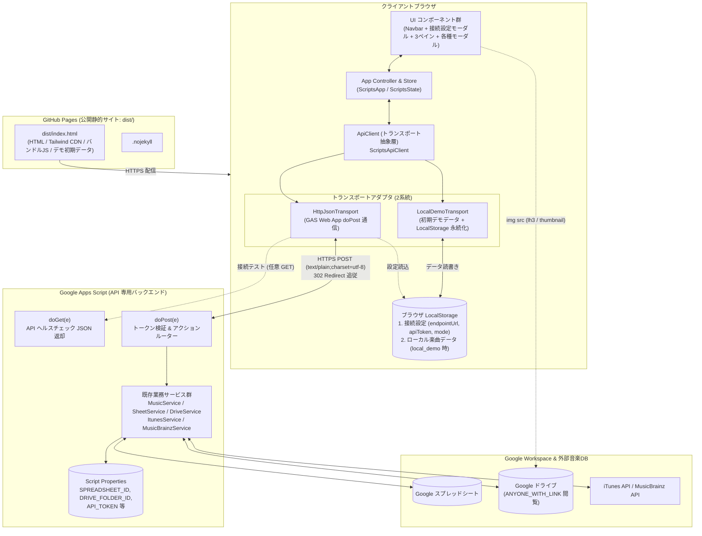
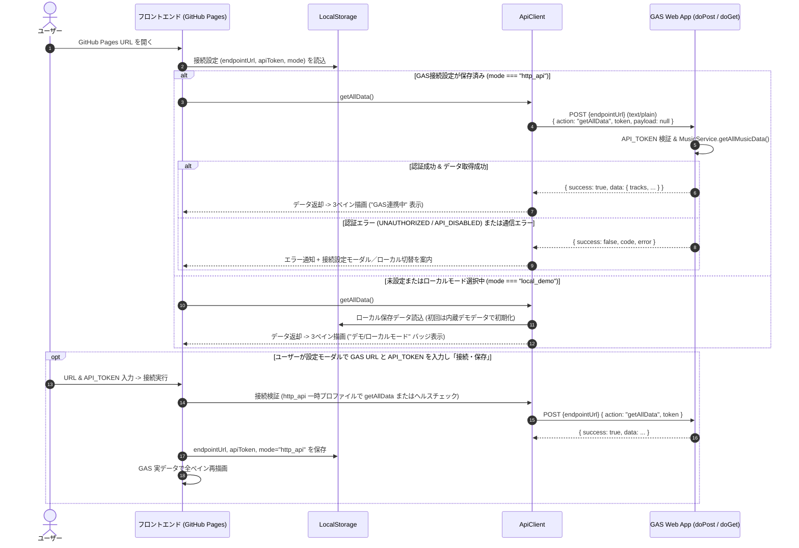

# システムアーキテクチャ設計書: フロントエンドの GitHub Pages リリース対応（確定版）

- **文書バージョン**: 2.0.0（Gate 1 確定版）
- **作成日**: 2026年11月14日
- **最終更新日**: 2026年11月14日
- **作成ロール**: システムアーキテクト (`system-architect`)
- **対象ユーザー要望**: 「フロントエンドを、GitHubPagesでリリース出来るようにして欲しい」
- **成果物パス**: `docs/architecture/github_pages_frontend_design.md`
- **ステータス**: Gate 1 ユーザー意思決定反映済み・確定版（ブロッキング事項解消済み → Phase 2 テックリードへ引き渡し可能）

---

## 0. 区分ラベル定義

本設計書における記述は、事実・前提・決定・推奨を厳密に区別するため以下のラベルを付与する。

- **【事実】**: リポジトリ内の既存ソースコード・設定ファイル・ドキュメントから直接確認した事項。
- **【前提】**: GitHub Pages および Google Apps Script (GAS) のプラットフォーム仕様に基づく技術的前提・運用手配条件。
- **【決定】**: ユーザーとの Gate 1 合意に基づき、本アーキテクチャ設計において確定した仕様・設計方針。
- **【推奨】**: 後続フェーズ（Phase 2 テックリード、Phase 3 シニアコーダー、Phase 4 QA）に対する設計上の推奨事項。

---

## 1. 要件定義サマリー

### 1.1 現状分析（移行前アーキテクチャの事実）

- **【事実】フロントエンドの GAS 密結合**:
  - 現行では `build.js` が `src/index.template.html` と 11 個の HTML コンポーネントおよび 4 個のスクリプト（`ScriptsUtils.html`, `ScriptsApiClient.html`, `ScriptsState.html`, `ScriptsApp.html`）を結合し、単一ファイル `src/index.html` を出力している。
  - `src/Code.js` の `doGet(e)` が `HtmlService.createHtmlOutputFromFile('index')` によりフロントエンド HTML を配信する構成となっている。
  - `src/ScriptsApiClient.html` の `ApiClient.callGAS()` は `google.script.run` を直接呼び出しており、`typeof google === 'undefined' || !google.script || !google.script.run` の場合は即座に `Promise.reject` する実装となっている。
  - `src/ScriptsApp.html` の `App.init()` は起動直後に `loadInitialData()`（`this.api.getAllData()`）を実行するため、GAS 外の環境では初期ロードが失敗する。
- **【事実】バックエンド API と公開設定**:
  - `src/Code.js` には RPC 関数群（`apiGetAllData`, `apiSearchAlbums`, `apiSearchItunes`, `apiLookupItunesAlbum`, `apiLookupMusicBrainzRelease`, `apiSaveAlbumBatch`, `apiSaveTrackSingle`, `apiUpdateAlbumBatch`, `apiUploadArtwork`, `apiResolveDriveArtwork`, `apiDeleteAlbumsBatch` の計 11 エンドポイント）が実装されているが、`doPost(e)` および JSON API ルーティングは存在しない。
  - `src/appsscript.json` の Web アプリ設定は `"executeAs": "USER_DEPLOYING"`, `"access": "ANYONE"` となっている。
- **【事実】ビルド・デプロイ・テストの現状**:
  - `package.json` には `"build": "node build.js"`, `"test": "node tests/run_tests.js && node tests/red_team_attack_test.js"`, `"push": "clasp push"`, `"deploy": "clasp deploy"` が定義されている。
  - `.clasp.json.sample` の `"rootDir"` は `"./src"` であり、`.claspignore` は `docs/**`, `tests/**`, `build.js`, `src/index.template.html` 等を除外している。
  - `tests/run_tests.js` は `src/index.html` の存在・構文・特定 DOM ID・冒頭警告バナー（セクション `[9]`, `[11.6]`, `[12.9]`）、および `Code.js` の `doGet` における `HtmlService` / `XFrameOptionsMode` 動作（セクション `[12.2]`）等を検証している。
  - リポジトリの `docs/` 配下は設計書・報告書等のドキュメント格納場所として使用されており、`.github/` ディレクトリは現時点で存在しない。
- **【事実】画像表示および外部 CSS**:
  - `src/index.template.html` は Tailwind CSS CDN（`https://cdn.tailwindcss.com`）を参照している。
  - `src/DriveService.js` の `setPublicSharing()` は保存したジャケット画像に `DriveApp.Access.ANYONE_WITH_LINK` / `DriveApp.Permission.VIEW` を付与し、`ScriptsUtils.html` は `https://lh3.googleusercontent.com/d/{fileId}`（失敗時は `drive.google.com/thumbnail`）で画像を描画する。

### 1.2 確定したユーザー意思決定（Gate 1 合意事項）

| 項目ID | 決定項目 | 確定内容 |
| :--- | :--- | :--- |
| **DEC-001** *(旧 BLOCK-001)* | **GitHub Pages 上の動作モード** | **ハイブリッド型**: 初期表示はバックエンド非接続の「デモ / ローカルストレージモード」で即座に起動・操作でき、設定画面から GAS Web App URL および `API_TOKEN` を登録・保存すると「GAS API 連携モード」へ切り替わる構成とする。 |
| **DEC-002** *(旧 BLOCK-002)* | **GAS 連携時の公開範囲・認証** | **`ANYONE_ANONYMOUS` + `API_TOKEN` 認証**: `src/appsscript.json` の公開範囲を `ANYONE_ANONYMOUS` とし、GAS Script Properties に設定した `API_TOKEN` を画面設定から入力して認証する方式を採用する。`API_TOKEN` 未設定時は外部 API を全面遮断する（Secure by Default）。認証通過後は読み書き全操作を許可する。 |
| **DEC-003** *(旧 BLOCK-003)* | **既存 GAS Web App 版の扱い** | **GitHub Pages へ一本化**: フロントエンド配信は GitHub Pages のみとし、GAS は純粋な JSON API バックエンド専用とする。GAS からの HTML 配信（`doGet` による `HtmlService` 返却および `src/index.html` の GAS デプロイ）は廃止する。 |
| **DEC-004** *(旧 BLOCK-004)* | **GitHub Pages デプロイ方式** | **GitHub Actions**: `.github/workflows/` に `actions/deploy-pages` を用いた自動テスト・ビルド・デプロイワークフローを構築する。 |

### 1.3 機能要件 (Functional Requirements)

- **FR-GH-001【GitHub Pages 一本化配信とハイブリッド初期起動】**:
  - 【決定】GitHub Pages の公開 URL 上で静的フロントエンド（`dist/index.html`）が単体起動し、初回アクセス時（GAS 接続設定未登録時）はエラー画面にせず**デモ / ローカルストレージモード（`local_demo`）**で初期データ表示およびブラウザ内ローカルの閲覧・登録・編集・削除操作を行えること。
- **FR-GH-002【GAS 接続設定 UI とモード切替】**:
  - 【決定】ヘッダー（ナビゲーションバー）等から接続設定モーダルを開き、GAS Web App URL（`/exec`）および `API_TOKEN` の入力、接続テスト（ヘルスチェック／データ取得確認）、設定保存（`localStorage`）、GAS 連携モード（`http_api`）への切替、および接続設定リセット（ローカルモード復帰）が行えること。
  - 【決定】現在どちらのモード（ローカル/デモ vs GAS 連携中）で動作しているかが UI 上で視覚的に判別できること。
- **FR-GH-003【トランスポート抽象化と `google.script.run` 廃止】**:
  - 【決定】フロントエンドの GAS コンテナ内配信廃止に伴い、`ApiClient`（`ScriptsApiClient.html`）における `google.script.run` 依存を廃止し、**`HttpJsonTransport`（GAS `doPost` JSON API 通信）** と **`LocalDemoTransport`（デモデータ＋ブラウザ `localStorage` 管理）** の 2 アダプタ構成とすること。
  - 【決定】`ApiClient` の既存 11 メソッドの公開インターフェース（メソッド名・引数・返却 Promise 構造）を維持し、`ScriptsApp.html` の業務・UI ロジックへの影響を最小限に抑えること。
- **FR-GH-004【GAS バックエンドの JSON API 専用化（`doPost` / `doGet`）】**:
  - 【決定】`src/Code.js` に外部からのリクエストを受け付ける `doPost(e)` JSON API ディスパッチャを実装し、既存 11 RPC 相当の業務アクションをトークン認証付きで実行できること。
  - 【決定】`doGet(e)` による `HtmlService` フロントエンド HTML 配信を廃止し、代わりに API 専用の軽量ヘルスチェック／メタ情報 JSON（機密情報・楽曲実データを含まない稼働ステータス JSON）を返却すること。
- **FR-GH-005【ビルド出力の一本化（`dist/`）と GAS デプロイ最適化】**:
  - 【決定】`build.js` のビルド出力先を GitHub Pages 公開専用の `dist/`（`dist/index.html` および `.nojekyll` 等）へ一本化する。
  - 【決定】`.claspignore` により `dist/**` およびフロントエンド用 HTML ファイル群を `clasp push` 対象から除外し、GAS プロジェクトへはバックエンド `.js` と `appsscript.json` のみをデプロイする構成とすること。
- **FR-GH-006【GitHub Actions による自動テスト・ビルド・デプロイ】**:
  - 【決定】`main` ブランチへのプッシュおよび手動トリガー時に、自動テスト（`npm test`）、GitHub Pages 用ビルド（`dist/` 生成）、および `actions/deploy-pages` によるデプロイを実行するワークフローを整備すること。

### 1.4 非機能要件 (Non-Functional Requirements)

- **NFR-GH-SEC-001【Secure by Default（`API_TOKEN` 未設定時の外部 API 全面遮断）】**:
  - GAS の Script Properties に `API_TOKEN` が未設定または空文字の場合、`doPost(e)` はすべてのアクションリクエストを拒否（エラーコード `API_DISABLED`）し、誤って無認証で外部公開されることを防止すること。
- **NFR-GH-SEC-002【トークン検証と情報漏洩防止】**:
  - `doPost(e)` のトークン比較はタイミング攻撃に耐性のある比較方式を用い、認証失敗時は `UNAUTHORIZED` を返却し、スプレッドシートや Google Drive へ一切アクセスしないこと。
  - `API_TOKEN` は必ず `POST` ボディ内に格納し、URL クエリパラメータ（`?token=...`）での送信を禁止すること（ブラウザ履歴・リファラ・アクセスログへの漏洩防止）。
  - 公開ビルド成果物（`dist/`）およびリポジトリ内に、スプレッドシート ID、Drive フォルダ ID、GAS Web App URL、`API_TOKEN` を一切ハードコードしないこと。
- **NFR-GH-SEC-003【XSS / 式インジェクション耐性の維持】**:
  - ハイブリッド動作（ローカルモードおよび GAS API 連携モード双方）において、既存の `Utils.escapeHtml` による XSS 防御、スプレッドシート式インジェクション対策、およびローカル保存データ読み込み時のスキーマ・型検証を維持すること。
- **NFR-GH-COMPAT-001【CORS 単純リクエストおよび GAS 302 リダイレクト互換性】**:
  - GitHub Pages（`https://<user>.github.io`）から GAS Web App への通信は、GAS が `OPTIONS` プリフライトに非対応であるため、**CORS 単純リクエスト（`POST` + `Content-Type: text/plain;charset=utf-8`、カスタムヘッダなし、`redirect: 'follow'`）** を使用し、Chrome / Safari / モバイルブラウザのサードパーティ Cookie 制限下でも安定動作すること。
- **NFR-GH-MAINT-001【単一情報源 (SSOT) とソース分離】**:
  - UI コンポーネント・フロントエンド JS は引き続き `src/index.template.html` および分割ファイルを SSOT とし、`build.js` によって決定論的に `dist/index.html` を生成すること。
  - `dist/` にバックエンドコード（`src/*.js`, `src/appsscript.json`）や設計書（`docs/`）を混入させないこと。
- **NFR-GH-TEST-001【テストスイートの整合更新と全件通過】**:
  - 既存のユニットテスト・セキュリティテスト（`tests/run_tests.js`, `tests/red_team_attack_test.js`）を新仕様（`dist/index.html` ビルド検証、API 専用 `doGet`、`doPost` 認証・ディスパッチ検証等）へ整合更新し、CI 上でも全件通過すること。

### 1.5 前提条件・技術的制約・ユーザー運用手配事項

1. **【前提】GitHub Pages プラットフォーム制約**:
   - 純粋な静的配信環境でありサーバーサイド処理を持たない。
   - **ユーザー運用手配（初回のみ）**: GitHub リポジトリ（`nankojin-ops/MusicInfo-app`）の `Settings > Pages > Build and deployment > Source` を **`GitHub Actions`** に設定すること（対象リポジトリが Private の場合、GitHub アカウントプランが Private リポジトリの GitHub Pages をサポートしていること）。
2. **【前提】GAS Web App のデプロイおよび運用手配**:
   - **ユーザー運用手配（初回および設定時）**:
     1. `clasp push` / GAS エディタから Web アプリとしてデプロイする際、「アクセスできるユーザー」を **`全員（匿名含む）` (`ANYONE_ANONYMOUS`)**、「次のユーザーとして実行」を **`自分` (`USER_DEPLOYING`)** としてデプロイし、発行された `/exec` URL を控えること。
     2. GAS プロジェクトの「スクリプトプロパティ」に **`API_TOKEN`**（推測困難なランダム文字列、例: 32 文字以上）を追加すること。
     3. GitHub Pages の設定モーダルから上記 Web App URL と `API_TOKEN` を入力して接続すること。
3. **【前提】ローカルモードの制約と Drive 画像表示**:
   - ローカル/デモモード（`local_demo`）ではブラウザの `localStorage` にデータを保持するため、保存データは端末・ブラウザ単位となる（またローカルでの画像ファイルアップロードはバックエンド保存不可のため、DataURL のサイズ制約や外部 URL 指定等の範囲内に留める、あるいはローカル制限の明示が必要）。
   - GAS 連携モード時の Google Drive アートワーク表示（`https://lh3.googleusercontent.com/d/{fileId}` 等）は、対象ファイルが `DriveService.setPublicSharing` により「リンクを知っている全員が閲覧可能」であることを前提とする。
4. **【前提】既存ファイル・CI 環境への配慮**:
   - `.gitignore` で `package-lock.json` が除外されており、`package.json` の `devDependencies` は `@google/clasp` のみである。GitHub Pages のビルドおよび Node.js 標準モジュールのみで動作するテスト実行においては、`npm ci` のロックファイル不在エラーを回避する CI ステップ構成とする必要がある。

### 1.6 不明点・ブロッキング事項

- **【解消済み】ブロッキング事項なし**: Gate 1 にて `BLOCK-001`〜`BLOCK-004` のすべてがユーザー承認により確定したため、Phase 2（テクニカルリードによるタスク分割・影響範囲特定・実装計画策定）へ進行可能。

---

## 2. システム境界とコンポーネント構成

### 2.1 システム境界図

### 2.2 各コンポーネントの責務

| コンポーネント | 配置先 | 責務 | 変更方針 |
| :--- | :--- | :--- | :--- |
| **`build.js`** | リポジトリルート | `src/index.template.html` と分割 HTML/JS から単一バンドルを生成し、`dist/index.html`（および `.nojekyll`）を出力する。GAS 向け `src/index.html` 生成は廃止する。 | 改修（出力先を `dist/` に一本化、`<base target="_top">` 等の見直しを含む環境適合） |
| **GitHub Actions ワークフロー** | `.github/workflows/` | テスト実行（`npm test`）、`dist/` ビルド、GitHub Pages へのアーティファクトアップロード＆デプロイを実行する。 | 新規作成 |
| **接続設定モーダル & モード表示 UI** | `src/*.html`（新規モーダル＋`Navbar.html` 等） | 現在の動作モード表示（デモ/ローカル vs GAS 連携）、GAS URL・`API_TOKEN` 入力・保存・接続テスト・設定クリアを提供する。 | 新規追加・UI 拡張 |
| **`ApiClient` (`ScriptsApiClient.html`)** | `src/` -> `dist/index.html` | 既存 11 API メソッドの契約を維持し、接続設定の有無・モードに応じて `HttpJsonTransport` または `LocalDemoTransport` に処理を委譲する。`google.script.run` 依存を廃止する。 | 改修（アダプタ切替＋`google.script.run` 廃止） |
| **`App` / `Store` / `Utils`** | `src/` -> `dist/index.html` | 3 ペイン描画、検索、登録・編集・削除フロー制御。初期起動時に接続設定状態に応じたロードとモード案内を行う。 | 最小限の改修（設定モーダル連携・モード切替時の再ロード・ローカルモード時の画像アップロード境界制御） |
| **`Code.js`** | `src/Code.js` -> GAS | `doGet(e)` で API ヘルスチェック JSON を返し、`doPost(e)` で JSON パース・サイズ上限検証・`API_TOKEN` 認証・11 アクションのディスパッチを行う。`HtmlService` 配信と `include()` を廃止する。 | 改修（API 専用エントリポイント化） |
| **`Config.js` / `appsscript.json`** | `src/` -> GAS | `Config.js` に `API_TOKEN` 取得・有効判定を追加（`ALLOW_EMBEDDING` は HTML 配信廃止に伴い整理）。`appsscript.json` の `webapp.access` を `"ANYONE_ANONYMOUS"` に更新する。 | 改修 |
| **業務サービス群** (`MusicService.js` 等) | `src/` -> GAS | スプレッドシート排他制御・読み書き、Drive 保存、iTunes / MusicBrainz 検索・レート制御を実行する。 | 原則変更なし（既存ロジック再利用） |
| **`.claspignore` / `.gitignore`** | リポジトリルート | `.gitignore` に `dist/` を追加。`.claspignore` に `dist/**` およびフロントエンド用 HTML ファイル群を追加し、GAS へバックエンド `.js` と `appsscript.json` のみをデプロイする。 | 改修 |
| **テストスイート (`tests/*.js`)** | `tests/` | `dist/index.html` バンドル検証、API 専用 `doGet`、および `doPost` 認証（`API_TOKEN` 未設定/不正/正常）・ルーティング・`ApiClient` トランスポート切替の検証を行う。 | 改修・テスト追加 |

### 2.3 外部依存関係

- **【事実】GitHub Pages / GitHub Actions**: 静的サイトホスティングおよび CI/CD デプロイ基盤。
- **【事実】Tailwind CSS CDN (`https://cdn.tailwindcss.com`)**: ブラウザ上でのユーティリティ CSS 適用。
- **【事実】Google Apps Script (Web Apps)**: サーバーサイド API ランタイム（`ContentService`, `PropertiesService`, `LockService`, `CacheService`, `SpreadsheetApp`, `DriveApp`, `UrlFetchApp`）。
- **【事実】Google Drive 画像 CDN / サムネイル URL**: `lh3.googleusercontent.com/d/{fileId}` および `drive.google.com/thumbnail`。
- **【事実】iTunes Search/Lookup API & MusicBrainz WS v2 / Cover Art Archive**: GAS バックエンド経由で検索・取得。

---

## 3. データフローとインターフェース

### 3.1 ハイブリッド起動・モード切替フロー

### 3.2 主要インターフェース定義

#### A. `ApiClient` 公開契約（フロントエンド内部・既存互換）

`src/ScriptsApp.html` に対して提供する以下の 11 メソッドのインターフェースを不変のまま維持し、内部でアクティブなトランスポートアダプタへ委譲する：

1. `getAllData()`
2. `searchAlbums(keyword)`
3. `searchItunes(keyword)`
4. `lookupItunesAlbum(collectionId)`
5. `lookupMusicBrainzRelease(mbid)`
6. `saveAlbumBatch(payload)`
7. `saveTrackSingle(track)`
8. `updateAlbumBatch(payload)`
9. `uploadArtwork(payload)`
10. `resolveDriveArtwork(payload)`
11. `deleteAlbumsBatch(albums)` *(内部では `{ albums }` としてバックエンド `apiDeleteAlbumsBatch` 相当へ渡す)*

※ 加えて、`ApiClient`（または設定管理コンポーネント）は接続設定の取得・更新・接続テスト・モード判定用インターフェースを提供する。

#### B. GAS Web App HTTP JSON API 契約

- **`GET /exec` (`doGet(e)`) — API ヘルスチェック**:
  - 用途: ブラウザでの直接アクセス確認やエンドポイント疎通確認用（HTML 画面は返却しない）。
  - レスポンス形式: `ContentService.MimeType.JSON`
  - ペイロード構造（機密情報・実データは含めない）:
    - `{ success: true, data: { service: "MusicInfo-app", role: "api-only", status: "ok", apiConfigured: <boolean> }, timestamp: "<ISO8601>" }`
    - ※ `apiConfigured` は `API_TOKEN` がスクリプトプロパティに設定済みか否かの真偽値のみ（トークン値自体は絶対に出力しない）。

- **`POST /exec` (`doPost(e)`) — 業務 API ディスパッチャ**:
  - **Method**: `POST`
  - **Content-Type**: `text/plain;charset=utf-8`（CORS プリフライト `OPTIONS` 回避のための単純リクエスト）
  - **Redirect**: `follow`
  - **Request Body (JSON 文字列)**:
    - `action` (string, 必須): 実行アクション名（以下 11 種の許可リストのみ受け付ける）
      - `"getAllData"`, `"searchAlbums"`, `"searchItunes"`, `"lookupItunesAlbum"`, `"lookupMusicBrainzRelease"`, `"saveAlbumBatch"`, `"saveTrackSingle"`, `"updateAlbumBatch"`, `"uploadArtwork"`, `"resolveDriveArtwork"`, `"deleteAlbumsBatch"`
    - `token` (string, 必須): GAS Script Properties の `API_TOKEN` と一致するシークレットトークン
    - `payload` (any, 任意): アクションに応じた引数（`getAllData` は `null`/省略、`searchAlbums` 等は `{ keyword }` または文字列等、既存 `api*` 引数仕様に整合させること。詳細マッピングは Phase 2 で定義）
  - **Response Body (JSON)**:
    - 正常時: `{ success: true, data: <result>, timestamp: "<ISO8601>" }`
    - エラー時: `{ success: false, error: "<message>", code: "<ERROR_CODE>", timestamp: "<ISO8601>" }`
  - **API エラーコード体系**:
    - `API_DISABLED`: サーバー側 `API_TOKEN` 未設定のため外部 API が無効化されている
    - `UNAUTHORIZED`: トークン未指定または不一致
    - `INVALID_REQUEST`: リクエストボディの JSON 破損、サイズ超過、または必須フィールド欠落
    - `UNKNOWN_ACTION`: 許可リスト外の `action` 指定
    - その他既存業務エラーコード（`LOCK_TIMEOUT`, `VALIDATION_FAILED`, `CONFIG_SPREADSHEET_ID_MISSING` 等）をそのまま継承

#### C. `LocalDemoTransport` の機能範囲と境界

- **サポート対象**:
  - 初期デモアルバムデータの提供（初回起動時またはリセット時）
  - `localStorage` 上での楽曲データ永続化（`getAllData`, `saveAlbumBatch`, `saveTrackSingle`, `updateAlbumBatch`, `deleteAlbumsBatch`）
  - 既存 UI の検索・絞り込み・3ペイン閲覧体験の完全動作
- **GAS バックエンド依存操作（検索・Drive 連携）のローカルモード時境界**:
  - `searchAlbums` / `searchItunes` / `lookupItunesAlbum` / `lookupMusicBrainzRelease`: MusicBrainz の `User-Agent` ヘッダ制限および CORS 制約がブラウザ上にあるため、ローカルモードでは「外部 DB 検索・Drive 保存を利用するには設定画面から GAS バックエンドを接続してください」等の明確な案内エラー（またはローカルモード限定の制限メッセージ）を返す（iTunes API の JSONP/CORS 可否に依存した複雑な分岐は避け、明確な責務境界を保つ）。
  - `uploadArtwork` / `resolveDriveArtwork`: ローカルモードでローカル画像を扱う場合は圧縮済み DataURL をそのまま `publicUrl` として扱う（またはサイズ制限付きローカル保持・Drive 連携不可の案内を行う）など、バックエンドなしでクラッシュしない境界を Phase 2 で定義する。

#### D. ブラウザ `localStorage` 保存スキーマ

1. **接続設定キー（例: `musicinfo_connection_config`）**:
   - `mode`: `"local_demo"` | `"http_api"`
   - `endpointUrl`: string（`https://script.google.com/macros/s/.../exec` 形式のみ許可）
   - `apiToken`: string（ユーザーが入力したトークン）
2. **ローカルデモデータキー（例: `musicinfo_local_tracks`）**:
   - `tracks`: `Array<RawTrackRow>`（既存 8 列相当のオブジェクト配列）

---

## 4. アーキテクチャ上の決定事項 (ADR)

### ADR-001: GitHub Pages 上の動作モードと GAS バックエンド連携方式（ハイブリッド + CORS 単純リクエスト + トークン認証）

- **決定**:
  1. フロントエンドは初期状態で **デモ / ローカルストレージモード（`local_demo`）** として即座に起動し、設定モーダルで GAS Web App URL と `API_TOKEN` を設定することで **GAS HTTP JSON API モード（`http_api`）** へ切り替わるハイブリッド構成を採用する。
  2. `ApiClient` から既存の `google.script.run` 呼び出しロジックを廃止し、`HttpJsonTransport` と `LocalDemoTransport` の 2 アダプタ構成へ刷新する。
  3. GAS との通信は CORS プリフライトを発生させない `POST`（`Content-Type: text/plain;charset=utf-8`、ボディ内 JSON に `action`, `token`, `payload` を格納）を採用し、GAS Web App は `ANYONE_ANONYMOUS` 公開＋Script Properties `API_TOKEN` による認証（未設定時は `API_DISABLED` で全拒否）を行う。
- **理由**:
  1. ユーザーが GitHub Pages URL を開いた瞬間に「接続設定がないためエラー画面」になるのを防ぎ、デモ体験・オフラインローカル利用と、実スプレッドシート/Drive 同期の双方を両立できるため。
  2. GAS Web App は `OPTIONS` プリフライトに応答できず、`ANYONE`（ログイン必須）設定では Cross-Origin `fetch()` が Google ログインリダイレクトやブラウザのサードパーティ Cookie 制限で遮断されるため、`ANYONE_ANONYMOUS` + 単純リクエスト `POST` + ボディ内トークン検証が GAS 標準機能のみで実現可能な唯一安定した構成であるため。
  3. フロントエンド配信を GitHub Pages に一本化する決定（DEC-003）により、`google.script.run` を維持する理由がなくなり、`ApiClient` の責務が明確化されるため。
- **検討した代替案**:
  1. **案A（GAS JSON API 必須・ローカルモードなし）**: 初回アクセス時にセットアップが必須となり試用性が低い。
  2. **案B（外部プロキシ / Cloudflare Workers 仲介）**: 標準 CORS ヘッダ付与が可能だが、GitHub Pages と GAS に加えて第 3 のインフラ維持が必要となるため不採用。
  3. **案C（`google.script.run` フォールバックの併用維持）**: GAS 側で HTML 配信を行わない方針（DEC-003）と矛盾し、デッドコードおよび二重テスト保守を生むため廃止。
- **トレードオフ**:
  - ユーザーが自身の端末ブラウザの `localStorage` に `API_TOKEN` を保持するため、XSS 脆弱性や共有端末での設定残留リスクに対する防御（`Utils.escapeHtml` 徹底、設定リセットボタン、共有端末向け注意喚起表示）が不可欠になる。
  - ローカルモードと GAS モードで機能差（Drive 保存や MusicBrainz 検索の可否）が生じるため、UI 上で現在のモードと制限を明確に伝達する必要がある。
- **結果・影響**:
  - `ScriptsApiClient.html` の全面整理、新規接続設定モーダルの追加、`src/Code.js` への `doPost(e)` 追加、`src/Config.js` への `API_TOKEN` 管理追加、`src/appsscript.json` の `"access": "ANYONE_ANONYMOUS"` 変更が発生する。

---

### ADR-002: フロントエンド配信の GitHub Pages 一本化とビルド・GAS デプロイ構成

- **決定**:
  1. フロントエンド配信を GitHub Pages へ一本化し、GAS は JSON API バックエンド専用とする。
  2. `build.js` の出力先を従来の `src/index.html` から GitHub Pages 公開専用の **`dist/index.html`**（および Jekyll 無効化用の `dist/.nojekyll`）へ変更・一本化する。
  3. `src/Code.js` の `doGet(e)` は `HtmlService` による HTML 配信および `include()` を廃止し、API 専用の軽量ヘルスチェック JSON を返す。
  4. `.claspignore` に `dist/**` およびフロントエンド HTML コンポーネント群を追加し、`clasp push` 時に GAS へはバックエンド `.js` と `appsscript.json` のみをデプロイする。
- **理由**:
  1. GAS 側と GitHub Pages 側の双方に HTML をデプロイする二重運用をなくすことで、バージョン不整合（「GAS 古い版 vs GitHub Pages 最新版」）を防ぎ、運用と保守を単純化できるため。
  2. `src/` 配下にはサーバーコード（`Code.js`, `Config.js` 等）が存在するため、`src/` を公開ルートにしてはならず、また `docs/` は既存の設計・監査ドキュメント格納庫であるため、独立した `dist/` を公開専用出力先とすることが最も安全かつ明確であるため。
  3. GAS プロジェクトから `index.html` やフロントエンド HTML 部品のアップロードを除外することで、`clasp push` の対象が純粋なバックエンドのみになり、コード見通しが向上するため。
- **検討した代替案**:
  1. **案1（`src/index.html` と `dist/index.html` のデュアルビルド並行維持）**: DEC-003 により GAS でのフロントエンド配信廃止が確定したため不採用。
  2. **案2（`docs/` ディレクトリをビルド出力先に使用）**: 既存設計書群との混在・Web 公開リスクのため却下。
  3. **案3（Vite / Webpack 等の新規フロントエンドビルド基盤導入）**: 既存の `build.js` + Tailwind CDN 構成で要件を満たせるため、過剰なツール導入を避け Node.js 標準構成を維持する。
- **トレードオフ**:
  - 既存の `tests/run_tests.js` が `src/index.html` の存在・内容や `doGet` の `XFrameOptionsMode` を直接テストしているため、Phase 2〜3 において既存テストを新仕様（`dist/index.html` 検証および API 専用 `doGet` 検証）へ計画的に移行する必要がある。
  - `src/index.html` がリポジトリから削除（または生成対象外化）されるため、ローカルで動作確認する場合は `npm run build` 後に `dist/index.html` を静的サーバー（例: `npx serve dist` 等）で開くワークフローへ切り替わる。
- **結果・影響**:
  - `build.js`、`.gitignore`（`dist/` 追加）、`.claspignore`（`dist/**` および `src/*.html` 追加）、`src/Code.js`、`src/Config.js`（`ALLOW_EMBEDDING` の整理要否確認）、`src/index.template.html`（`<base target="_top">` 等の見直し）、`tests/run_tests.js`、および `README.md` の更新が必要になる。

---

### ADR-003: GitHub Actions (`actions/deploy-pages`) による CI/CD 自動デプロイ

- **決定**: `.github/workflows/deploy-pages.yml`（仮称）を作成し、`main` ブランチへのプッシュおよび手動実行（`workflow_dispatch`）時に、依存インストール回避または安全な環境構築のうえで `npm run build`（`dist/` 生成）および `npm test` を実行し、`actions/upload-pages-artifact` と `actions/deploy-pages` により自動デプロイする。
- **理由**:
  1. `dist/` を Git リポジトリにコミットせず常にクリーンなソース管理を維持できる。
  2. テスト通過を必須ゲートとすることで、構文エラーやセキュリティ回帰を含むフロントエンドが公開されるリスクを防げる。
  3. `gh-pages` ブランチの運用・コンフリクト解消コストが不要になる。
- **検討した代替案**:
  1. **`gh-pages` ブランチへのプッシュ方式**: 不要なビルド専用ブランチ履歴が増えるため不採用。
  2. **手動ローカルビルド＋コミット方式**: ヒューマンエラーやビルド漏れが発生しやすいため不採用。
- **トレードオフ**:
  - リポジトリ管理者による初回 1 回の GitHub Pages 設定（`Source: GitHub Actions`）が必要。
  - `package-lock.json` が `.gitignore` で除外されている現状を前提に、CI 上で `npm ci` を使うと失敗する点に注意し、Node.js のセットアップのみで `node build.js`・`npm test` を実行する（あるいは lockfile 要否を整理する）必要がある。
- **結果・影響**:
  - `.github/workflows/` ディレクトリの新設およびワークフロー定義の追加。

---

## 5. 品質特性に関する考慮事項

### 5.1 セキュリティ

1. **API_TOKEN による境界防御と Secure by Default**:
   - GAS の Script Properties に `API_TOKEN` が未設定である初期状態や設定ミス時に外部公開されないよう、`API_TOKEN` が空の場合は `doPost` で全リクエストを拒否（`API_DISABLED`）する。
   - トークン比較には定数時間比較（文字長チェック後の XOR 累積比較等）を用い、タイミングサイドチャネルを緩和する。
2. **認証情報・環境情報の保護**:
   - `dist/index.html` に GAS URL や `API_TOKEN` を埋め込まない。
   - 接続設定モーダルのトークン入力欄は `type="password"`（必要時のみ表示トグル）とし、`localStorage` 保存について「共有端末では利用後に設定をリセットすること」を UI 上で案内する。
   - URL クエリへの `token` 付与を禁止し、必ず `POST` ボディ経由で送信する。
3. **入力検証・リクエストサイズ制限・XSS 防御**:
   - `doPost(e)` では `action` の許可リスト検証、不正 JSON の捕捉、および過剰ペイロードサイズに対する防御を行う。
   - ローカルモード時でも `localStorage` から読み込んだデータやユーザー入力をそのまま DOM 挿入せず、既存の `Utils.escapeHtml` を経由して描画する。
4. **GAS の `doGet` 情報露出最小化**:
   - HTML 配信廃止後の `doGet(e)` は稼働確認用の最小メタ情報 JSON のみを返し、スプレッドシート ID・Drive フォルダ ID・`API_TOKEN` 値・登録済み楽曲データを一切露出しない。

### 5.2 スケーラビリティ・パフォーマンス

- 3 ペイン UI・検索・ソート処理はクライアントメモリ上の `Store` で完結しているため、GitHub Pages の CDN 配信により初期ロード後の画面表示・検索レスポンス（100ms 未満）が向上する。
- ローカルモード時の `localStorage` 容量上限（一般的なブラウザで 5MB 程度）を考慮し、保存失敗（`QuotaExceededError`）時のエラーハンドリングおよびユーザー通知を担保すること。

### 5.3 信頼性・互換性

- **GAS 302 リダイレクト & サードパーティ Cookie 耐性**: `ANYONE_ANONYMOUS` + `POST (text/plain;charset=utf-8)` + ボディ内 `token` の組み合わせにより、Cookie ベースの Google 認証に依存せず、Safari やプライバシー強化ブラウザでも安定通信できる。
- **Google Drive 画像読み込み**: GitHub Pages（別オリジン）から `lh3.googleusercontent.com/d/{fileId}` へ `` リクエストする際、Referrer 制限や一時エラーに備え、`referrerpolicy="no-referrer"` の検討および既存のフォールバック処理（`Utils.handleImageError` -> `drive.google.com/thumbnail`）を維持する。
- **既存 GAS バックエンド排他制御**: `LockService.getScriptLock()` によるスプレッドシート排他制御および MusicBrainz レート制御は GAS 側に残るため、整合性保証は一切劣化しない。

### 5.4 保守性・テスト容易性

- **SSOT の徹底**: `src/index.template.html` と分割部品が唯一のソースであり、`build.js` が `dist/index.html` のみを生成する単線構成により、二重管理の余地を排除する。
- **テスト移行の明確化**: 従来の `src/index.html` 依存テストおよび `doGet` HTML 返却テストを、新アーキテクチャに合わせて計画的に移行・拡充する（Phase 2 テックリードにて影響箇所を網羅的に特定）。

---

## 6. 受け入れ基準 (Acceptance Criteria)

- [ ] **AC-GH-001 (ビルド成果物の独立出力と GAS 非混入)**:
  - `build.js` 実行により `dist/index.html`（および `dist/.nojekyll`）が生成され、`dist/` 配下にバックエンドコード（`*.js`, `appsscript.json`）や設計文書（`docs/`）が含まれないこと。
  - `.claspignore` により `dist/` およびフロントエンド HTML 部品が `clasp push` 対象から除外されていること。
- [ ] **AC-GH-002 (ハイブリッド起動とローカル/デモモード動作)**:
  - `google.script` が存在しない静的 HTTP 配信環境で `dist/index.html` を開いた際、未設定状態でも未捕捉エラーなく起動し、デモデータ表示および `localStorage` を用いたローカル閲覧・登録・編集・削除が動作すること。
  - 現在の動作モード（デモ/ローカル vs GAS 連携中）が画面上で識別でき、ローカルモードでバックエンド専用機能（外部 DB 検索等）を呼び出した場合は明確な案内が表示されること。
- [ ] **AC-GH-003 (接続設定 UI と GAS API 連携モード切替)**:
  - 設定モーダルから GAS Web App URL（`https://script.google.com/macros/s/.../exec` 形式）および `API_TOKEN` を入力・接続確認・保存でき、保存後は GAS バックエンドから実データを読み込んで全 11 アクション（一覧取得・検索・登録・更新・アップロード・Drive 解決・削除）が動作すること。
  - 設定クリア／リセット操作によりローカルモードへ安全に戻れ、`localStorage` から機密設定を削除できること。
- [ ] **AC-GH-004 (`ApiClient` の `google.script.run` 廃止とプロトコル遵守)**:
  - `ApiClient` から `google.script.run` 呼び出しが排除され、`HttpJsonTransport` と `LocalDemoTransport` により既存 11 メソッドのインターフェース契約が維持されていること。
  - `HttpJsonTransport` が `POST` + `Content-Type: text/plain;charset=utf-8`（カスタムヘッダなし、`token` はボディ内格納）で通信すること。
- [ ] **AC-GH-005 (GAS API 専用化とセキュリティ境界)**:
  - `src/appsscript.json` の `webapp.access` が `"ANYONE_ANONYMOUS"` に設定されていること。
  - `src/Code.js` の `doGet(e)` が HTML ではなく API ヘルスチェック JSON（機密・実データを含まない）を返すこと。
  - `src/Code.js` の `doPost(e)` が `API_TOKEN` 未設定時に `API_DISABLED`、トークン不一致時に `UNAUTHORIZED`、許可リスト外アクションに `UNKNOWN_ACTION` を返し、認証失敗時に Sheets / Drive へ一切アクセスしないこと。
  - `dist/` の生成物内に `API_TOKEN`、GAS URL、スプレッドシート ID、Drive フォルダ ID が埋め込まれていないこと。
- [ ] **AC-GH-006 (自動テスト・GitHub Actions デプロイ基盤)**:
  - 新仕様（`dist/index.html` 検証、API 専用 `doGet`、`doPost` 認証・ルーティング、`ApiClient` トランスポート切替）をカバーするテストが `npm test` に組み込まれ、全テストケースが 100% 通過すること。
  - `.github/workflows/` に `npm test` + `dist/` ビルド + `actions/deploy-pages` を実行する GitHub Actions ワークフローが定義されていること。
