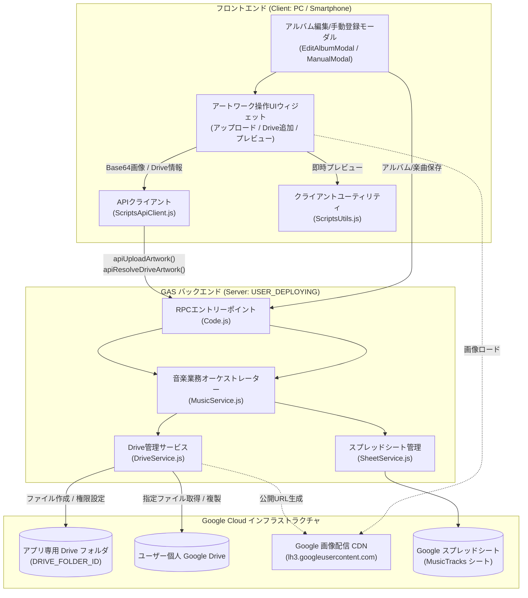
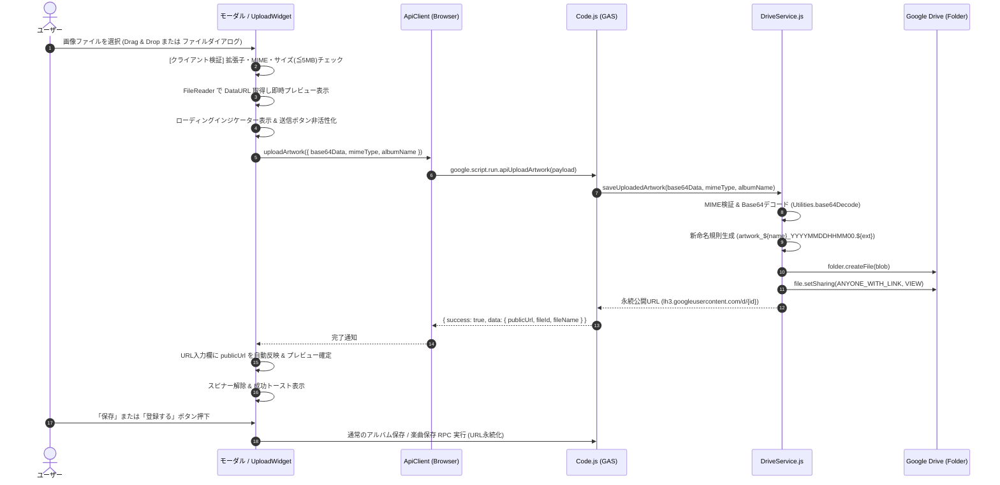
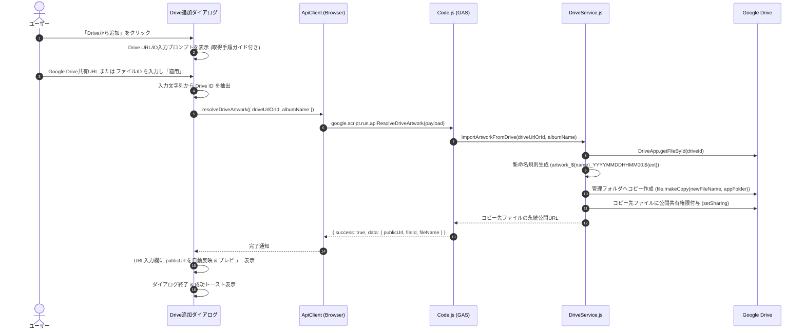

# システムアーキテクチャ設計書: アルバムアート画像アップロード・Googleドライブ連携およびファイル命名規則統一

- **文書バージョン**: 1.0.0
- **作成日**: 2026年10月19日
- **作成ロール**: システムアーキテクト (`system-architect`)
- **対象要望**: 
  1. 画像ファイルについて、アップロードボタンを追加してローカル環境やGoogleドライブから追加できるようにする
  2. ファイル名はiTunes APIで取得する画像と同じルールとし、最後の数値部分だけを `YYYYMMDDHHMM00` (JST基準) に変更する
- **成果物パス**: `docs/architecture/image_upload_feature_design.md`

---

## 1. 要件定義サマリー

### 1.1 背景および目的
現在、本アプリケーション（`MusicInfo-app`）において、アルバムアート画像を設定する手段は以下の2通りに限られている：
1. **iTunes / MusicBrainz 検索連携時**: 検索APIから返却された画像URLをサーバーサイド（`DriveService.downloadAndSaveArtwork`）で自動ダウンロード保存する。
2. **手動登録 / アルバム編集時**: ユーザーが事前にWeb上またはGoogleドライブ上で公開されている画像のURLを手作業でテキストボックス（`#edit-album-artwork-url`, `#manual-artwork-url`）に入力する。

しかし、手持ちのCDジャケット写真やスキャン画像（PC・スマートフォンのローカル環境にある画像）、あるいは自身のGoogleドライブに保存してある画像を登録したい場合、ユーザー自ら画像を外部にアップロードして公開リンクを取得・入力しなければならず、極めて煩雑であった。

本改修では、アルバム情報編集モーダル（`EditAlbumModal`）および楽曲手動登録モーダル（`ManualModal`）に画像追加ボタンおよびアップロードウィジェットを新設し、**「ローカル環境からの直接アップロード」** および **「Googleドライブからの画像追加」** を直感的なUIで可能とする。
併せて、保存される画像ファイル名について、従来のiTunes画像保存ルール（`artwork_${sanitizedName}_${Date.now()}.jpg`）を刷新し、**末尾の日時数値部分を厳格に `YYYYMMDDHHMM00`（JST基準・秒は固定00）とする共通命名規則** を確立・統一する。

---

### 1.2 機能要件 (Functional Requirements)

- **FR-IMG-001【ローカル画像アップロード機能】**:
  - `EditAlbumModal`（アルバム編集）および `ManualModal`（手動登録）のアートワーク入力エリアにおいて、PCやスマートフォンのローカルストレージから画像ファイル（JPEG, PNG, WebP）を選択・アップロードできること。
  - ファイル選択時、ドラッグ＆ドロップまたはタップによるファイルダイアログ起動に対応すること。
  - アップロード完了後、即座にGoogle Driveへ永続化され、生成された完全公開URLが入力欄に自動設定され、プレビュー画像が更新されること。

- **FR-IMG-002【Google ドライブからの画像追加機能】**:
  - ユーザーが自身のGoogleドライブ上にある画像の共有リンクまたはファイルIDを指定することで、簡単にアルバムアートとして登録できること。
  - 指定されたGoogleドライブファイルに対して、GASバックエンドが自動的に「リンクを知っている全員に閲覧権限（`setSharing`）」を付与し、モバイル環境や未認証端末でも閲覧可能な公開URL（`https://lh3.googleusercontent.com/d/{fileId}`）に正規化すること。
  - 指定された画像ファイルをアプリ専用管理フォルダ（`DRIVE_FOLDER_ID`）へ新命名規則で自動複製保存し、元のDriveファイルが削除・移動されてもリンク切れを起こさないこと（ADR-IMG-003参照）。

- **FR-IMG-003【厳格なファイル命名規則の共通化】**:
  - Google Driveに保存されるすべてのアルバムアート画像のファイル名は、以下のフォーマットに完全準拠すること：
    $$\text{artwork\_\{sanitizedAlbumName\}\_\{YYYYMMDDHHMM00\}.\{ext\}}$$
  - 接頭辞は `artwork_` 固定とする。
  - `{sanitizedAlbumName}` は、アルバム名からファイルシステム禁止文字・制御文字を除去し、最大60文字にサニタイズした文字列（未指定時は `album`）とする。
  - `{YYYYMMDDHHMM00}` は、日本標準時（JST / Asia/Tokyo, UTC+9）における実行日時の「年4桁 + 月2桁 + 日2桁 + 時2桁（24時間） + 分2桁 + 固定 '00'」とする。
  - `{ext}` は、画像のMIMEタイプに応じた適切な拡張子（JPEGは `jpg`, PNGは `png`, WebPは `webp`）とする。
  - iTunes APIからの自動取得時（`downloadAndSaveArtwork`）およびローカル/Drive追加時（`apiUploadArtwork`, `apiResolveDriveArtwork`）で、同一の命名ヘルパーロジックを使用すること。

- **FR-IMG-004【即時リアルタイムプレビューとUI連動】**:
  - ローカルファイル選択時、サーバーへのアップロード処理中であってもクライアント側で即座にDataURLプレビューを表示し、ユーザーに即時フィードバックを提供すること。
  - アップロード完了後、サーバーから返却された永続公開URLにシームレスに切り替わること。

- **FR-IMG-005【モバイル親指操作最適化 (Mobile First)】**:
  - スマートフォン画面（幅375px〜430px）において、すべてのボタン・タッチターゲットは最低44px × 44pxのタップ領域を確保すること。
  - ファイル選択・Drive追加ダイアログ・プレビューは縦スクロール内で破綻なくレイアウトされること。

---

### 1.3 非機能要件 (Non-Functional Requirements)

- **NFR-SEC-001【二重のMIMEタイプ・形式バリデーション】**:
  - クライアント側（ブラウザ）およびサーバー側（GAS）の双方で厳格にファイル形式を検証すること。
  - 許容MIMEタイプ: `image/jpeg`, `image/png`, `image/webp`。実行可能ファイル（`.exe`, `.sh` 等）やスクリプト（`.html`, `.svg` 内スクリプト）などの不正バイナリは拒絶すること。
- **NFR-SEC-002【スプレッドシート式インジェクション防止】**:
  - 返却・保存されるURLおよびファイル名は、先頭文字が `=`, `+`, `-`, `@` の場合に既存の `escapeFormula_` によりエスケープ処理されること。
- **NFR-SEC-003【ゼロ設定・安全なOAuthスコープ維持】**:
  - 追加のGCP APIキーや外部認証設定（Google Picker API等）を必要とせず、既存のGAS権限スコープ（`https://www.googleapis.com/auth/drive`）のみで完結すること。
- **NFR-PERF-001【ファイル容量制限とGAS RPC上限の考慮】**:
  - アップロード可能な画像サイズの上限は **5MB** とする（GASのRPC制限50MBに対し、Base64エンコード時の約6.7MBは十分安全なマージンを確保）。
  - クライアント側で5MB超過ファイルを即座に検知し、無駄な通信を防止すること。
- **NFR-PERF-002【処理時間・タイムアウト抑止】**:
  - 1回の画像アップロード・Drive保存処理は3秒〜5秒以内に完了すること。
  - 保存中はローディングスピナーを表示し、ボタンを二重押下防止（disabled化）すること。
- **NFR-COMPAT-001【マルチデバイス・クロスブラウザ完全互換】**:
  - iOS Safari (ITP環境)、Android Chrome、PC (Chrome/Firefox/Edge/Safari) の全環境で、サードパーティCookieに依存せず正常に表示・保存できること。
- **NFR-ROBUST-001【Graceful Degradation (耐障害性)】**:
  - 画像アップロードまたはDrive複製に万一失敗した場合でも、トースト通知で分かりやすいエラーメッセージを表示し、モーダル入力内容（入力済みの楽曲名やアーティスト名）が消失しないこと。

---

### 1.4 前提条件と制約事項

1. **GAS実行コンテキスト**:
   `src/appsscript.json` にて `"executeAs": "USER_DEPLOYING"`, `"access": "ANYONE"`, `"timeZone": "Asia/Tokyo"` が指定されている。サーバーサイド処理はデプロイオーナーの権限で実行され、タイムゾーンはJSTである。
2. **ストレージ構成**:
   画像ファイルはすべてスクリプトプロパティ `DRIVE_FOLDER_ID` で指定されたGoogle Driveフォルダ内に格納される。
3. **データスキーマ**:
   スプレッドシート `MusicTracks` の列構成（H列: アルバムアートURL）は一切変更せず、既存スキーマとの完全互換性を維持する。
4. **外部依存ライブラリの制限**:
   フロントエンドはTailwind CSS CDN + バニラJavaScript (ES6+)、バックエンドはGAS標準サービス（`DriveApp`, `Utilities`, `SpreadsheetApp`）のみで構成し、追加の外部npmパッケージやGCPアドバンストサービスへの依存は導入しない。

---

### 1.5 不明点・ブロッキング事項
- **ブロッキング事項**: なし（既存コードベースおよびユーザー要件を完全に特定済み）。
- **設計上の前提事項**:
  - 既存の `downloadAndSaveArtwork`（iTunes画像取得）におけるファイル名生成ロジックも、新規則（末尾 `YYYYMMDDHHMM00`）へ統一する（システム全体の一貫性を確保するため）。

---

## 2. システム境界とコンポーネント構成

### 2.1 システム境界



---

### 2.2 各コンポーネントの責務

| レイヤー | コンポーネント | 主な責務 |
| :--- | :--- | :--- |
| **UI** | `EditAlbumModal.html`<br>`ManualModal.html` | アートワーク操作ウィジェットの配置、アルバム編集および楽曲手動登録フォームの表示・入力制御 |
| **UI Component** | `ArtworkUploadWidget` (共通UI) | ローカルファイル選択、ドラッグ＆ドロップ、Base64読み取り、Driveリンク入力ダイアログ制御、アップロード中スピナー表示、プレビュー制御 |
| **Client Service** | `ScriptsApiClient.html` | GAS RPC（`apiUploadArtwork`, `apiResolveDriveArtwork`）の非同期Promiseラッパー |
| **Client Utility** | `ScriptsUtils.html` | クライアント側ファイルバリデーション（サイズ・拡張子）、DataURL変換、Drive ID抽出 |
| **Server RPC** | `Code.js` | Web App RPCエントリーポイント。リクエスト受付、例外ハンドリング、統一レスポンス返却 |
| **Server Logic** | `MusicService.js` | 業務バリデーション、画像アップロード・Drive解決処理のオーケストレーション |
| **Storage Service**| `DriveService.js` | 命名規則生成（`generateArtworkFileName`）、Base64バイナリ保存、Driveファイル複製・公開共有権限設定（`setSharing`）、公開URL生成 |

---

### 2.3 外部依存関係

- **Google Apps Script V8 Runtime**:
  - `DriveApp`: ファイル作成、フォルダ検索、共有権限変更、ファイル複製
  - `Utilities`: Base64デコード（`base64Decode`）、Blob生成（`newBlob`）、JST日時フォーマット（`formatDate`）
  - `HtmlService`: テンプレート展開
- **Google 配信インフラ**:
  - `https://lh3.googleusercontent.com/d/{fileId}`: サードパーティCookie不要の超高速画像配信エッジ

---

## 3. データフローとインターフェース

### 3.1 データフロー図

#### 3.1.1 ローカル画像アップロードのデータフロー



#### 3.1.2 Google ドライブからの画像追加データフロー



---

### 3.2 主要インターフェース定義

#### 3.2.1 RPC リクエスト/レスポンス ペイロード (TypeScript型表記)

```typescript
/**
 * ローカル画像アップロード リクエストペイロード
 */
interface UploadArtworkPayload {
  /** Base64エンコードされた画像データ (DataURLプレフィックス可) */
  base64Data: string;
  /** 画像のMIMEタイプ ('image/jpeg' | 'image/png' | 'image/webp') */
  mimeType: string;
  /** アルバム名 (ファイル名生成およびサニタイズ用) */
  albumName: string;
  /** 元ファイル名 (任意、ログおよび拡張子フォールバック用) */
  originalFileName?: string;
}

/**
 * Google Drive画像追加 リクエストペイロード
 */
interface ResolveDriveArtworkPayload {
  /** Google Drive の URL または ファイルID */
  driveUrlOrId: string;
  /** アルバム名 (ファイル名生成用) */
  albumName: string;
  /** アプリ専用管理フォルダへ複製するかどうか (デフォルト: true) */
  copyToAppFolder?: boolean;
}

/**
 * 画像処理 共通レスポンス
 */
interface ArtworkResultData {
  /** Google Drive のファイルID */
  fileId: string;
  /** スマートフォン未認証環境からでも表示可能な完全公開URL */
  publicUrl: string;
  /** 保存されたファイル名 (artwork_xxx_YYYYMMDDHHMM00.ext) */
  fileName: string;
}

/**
 * 統一 API レスポンス形式
 */
interface ApiResponse<T> {
  success: boolean;
  data?: T;
  error?: string;
  code?: string;
  timestamp: string;
}
```

#### 3.2.2 `DriveService` の新設・改修メソッド仕様

```javascript
/**
 * 共通アートワークファイル名生成メソッド (新命名規則)
 * フォーマット: artwork_${sanitizedName}_${YYYYMMDDHHMM00}.${extension}
 * 
 * @param {string} albumName - アルバム名
 * @param {string} [extension='jpg'] - 拡張子 ('jpg', 'png', 'webp' 等)
 * @param {Date} [date=new Date()] - 基準日時 (省略時は現在日時)
 * @returns {string} 生成されたファイル名
 */
generateArtworkFileName(albumName, extension = 'jpg', date = new Date())

/**
 * Base64形式のローカル画像バイナリを専用Driveフォルダへ保存
 * 
 * @param {string} base64Data - Base64エンコードデータ (DataURLヘッダ付き可)
 * @param {string} mimeType - MIMEタイプ ('image/jpeg', 'image/png', 'image/webp')
 * @param {string} albumName - アルバム名
 * @returns {ArtworkResultData} 保存結果情報
 */
saveUploadedArtwork(base64Data, mimeType, albumName)

/**
 * Google Drive上のファイルをインポートし、専用管理フォルダへ新命名規則で複製・公開設定
 * 
 * @param {string} driveUrlOrId - DriveのURLまたはファイルID
 * @param {string} albumName - アルバム名
 * @param {boolean} [copyToAppFolder=true] - 管理フォルダへ複製するかどうか
 * @returns {ArtworkResultData} 解決・複製結果情報
 */
importArtworkFromDrive(driveUrlOrId, albumName, copyToAppFolder = true)
```

---

## 4. アーキテクチャ上の決定事項 (ADR)

### ADR-IMG-001: ファイル命名規則の厳格化とJSTタイムゾーン統一

- **決定**:
  Google Driveに保存されるすべての画像ファイル名を以下のルールに完全統一する：
  `artwork_${sanitizedAlbumName}_${YYYYMMDDHHMM00}.${ext}`
  - 接頭辞: `artwork_`
  - サニタイズ: 既存の `sanitizeFileName(albumName)`（英数字・日本語等を保持し、Windows/Unixファイル禁止文字および制御文字をアンダースコアに置換、最大60文字）
  - 日時数値部分: 日本標準時（Asia/Tokyo, UTC+9）基準で `YYYYMMDDHHMM00`（年4桁、月2桁、日2桁、時2桁、分2桁、秒は固定文字列 `'00'`）。
  - 拡張子: MIMEタイプに対応する拡張子（`.jpg`, `.png`, `.webp`）。
  - iTunes APIからの画像ダウンロード（`downloadAndSaveArtwork`）における従来の `Date.now()` による命名も本新ルールへ統一・リファクタリングする。
- **理由**:
  1. ユーザー要望「ファイル名はiTunes APIで取得する画像と同じルールでやってほしいが、最後の数値部分だけはYYYYMMDDHHMM00にして」に厳格に準拠。
  2. 秒部分を固定 `'00'` とすることで、同一分内での重複リスクはあるものの、ユーザーの指示仕様を満たし、分単位でのバッチ管理・整理が容易になる。
  3. iTunesダウンロード画像とユーザー追加画像で命名規則を共通化することにより、コードの重複を排除し保守性を最大化する。
- **検討した代替案**:
  - *代替案A: iTunesダウンロード側は既存の `Date.now()` のまま残し、アップロード側だけ `YYYYMMDDHHMM00` とする*:
    - 不採用理由: 管理フォルダ内で命名が混在し、将来のメンテナンス性が低下するため。
  - *代替案B: 秒部分を実際の秒数（`YYYYMMDDHHMMSS`）にする*:
    - 不採用理由: ユーザーの明示的な要求「最後の数値部分だけはYYYYMMDDHHMM00にして」に反するため。
- **トレードオフ**:
  - 同一分内に同一アルバム名の画像を複数回アップロードした場合、ファイル名が重複する可能性がある。しかし、Google Driveは同一フォルダ内に同名ファイルを複数存在させることが仕様上許容されており、各ファイルはユニークな `fileId` で識別されるためシステム動作上の不具合は生じない。
- **結果・影響**:
  - `DriveService` に単一のファイル名生成ヘルパー `generateArtworkFileName` を作成し、全画像保存ロジックから共通利用する。

---

### ADR-IMG-002: ローカル画像アップロードの実行モデル（即時アップロード方式）

- **決定**:
  ユーザーが画像ファイルを選択した時点で、バックエンドAPI `apiUploadArtwork` を非同期で即座に実行し、Google Driveへの保存と公開URL生成を完了させた上でURL入力欄に反映する**「即時アップロード方式」**を採用する。
- **理由**:
  1. **API責務の疎結合性**:
     既存のアルバム一括更新API（`apiUpdateAlbumBatch`）や手動楽曲登録API（`apiSaveTrackSingle`）のペイロードに巨大なBase64画像バイナリを埋め込む必要がなく、既存の「URL文字列を受け取ってスプレッドシートに保存する」クリーンなアーキテクチャをそのまま維持できる。
  2. **プレビューの確実性**:
     アップロード完了と同時にGoogle CDN（`lh3.googleusercontent.com`）の正規URLが払い出され、本番と同じ環境で表示確認を行ってから最終的な保存ボタンを押下できる。
  3. **通信ペイロードの最適化**:
     手動登録の「連続登録」機能において、同一アルバムの複数トラックを登録する際、2曲目以降は既に払い出されたURLを再利用でき、毎回数MBのBase64を再送する必要がなくなる。
- **検討した代替案**:
  - *代替案A: フォーム保存ボタン押下時にアルバムデータと一緒にBase64を一括送信する方式*:
    - 不採用理由: アルバム更新APIのペイロードが肥大化し、タイムアウトやGAS通信制限のリスクが増加する。また、万一楽曲バリデーションで弾かれた場合に画像アップロード処理とのトランザクション境界が複雑化する。
- **トレードオフ**:
  - ユーザーが画像をアップロードした後にモーダルをキャンセル（破棄）した場合、Drive上に孤立ファイルが残る可能性がある。
  - しかし、CDジャケット画像は容量が小さく（数十KB〜数百KB）、Google Driveの容量逼迫要因にはなりにくい。また、将来的なクリーンアップバッチ等で対応可能なため、UXとアーキテクチャの単純性を最優先とした。
- **結果・影響**:
  - UIにアップロード中インジケーター（スピナー）を配置し、アップロード完了までフォーム保存ボタンを一時的にdisabled制御して二重送信を防止する。

---

### ADR-IMG-003: Google ドライブからの画像追加方式（Driveリンク/ID入力＋専用フォルダ自動複製）

- **決定**:
  Googleドライブからの画像追加方式として、**「Drive共有リンク/ID入力ダイアログ ＋ アプリ専用管理フォルダへの自動複製・新命名適用」**を採用する。Google Picker APIは採用しない。
- **理由**:
  1. **ゼロ設定・インストールの容易性**:
     Google Picker APIを使用する場合、Google Cloud ConsoleでのPicker API有効化、APIキー発行、OAuthクライアントID作成、JavaScript生成元（GAS Web Appの `script.googleusercontent.com` オリジン）の設定など、極めて複雑な環境構築が必要となる。現行の「スプレッドシートとDriveフォルダIDをスクリプトプロパティに入れるだけで動く」シンプルさを破壊してしまう。
  2. **マルチアカウント・モバイル未認証対応**:
     GAS Web Appを `access: ANYONE` でデプロイしている場合、未認証の閲覧者やモバイル端末からPickerを起動するためのOAuthトークンを安全に供給することが極めて困難である。
  3. **永続性とリンク切れ防止（自動複製）**:
     ユーザー個人Driveの画像URLを直接参照するだけの場合、ユーザーが後から元ファイルを整理・削除・非公開化した際にアルバムアートが表示されなくなる。アプリ管理フォルダ（`DRIVE_FOLDER_ID`）へ新命名ルールで複製保存することで、永続性を担保できる。
- **検討した代替案**:
  - *代替案A: Google Picker APIによるファイルブラウズ選択*:
    - 不採用理由: 上記の通り、GCPプロジェクトの追加設定とOAuthオリジン制限の壁が厚く、一般ユーザー向けの導入が極めて困難なため。
  - *代替案B: アプリ管理フォルダ内の画像のみを一覧表示するギャラリーモーダル*:
    - 不採用理由: ユーザーが追加したい画像は通常「管理フォルダ外（自身のマイドライブやカメラアップロード等）」にあるため、管理フォルダ内のみの一覧では要件を満たせない。
  - *代替案C: 元ファイルを複製せず、共有権限変更のみを行って参照する*:
    - 不採用理由: 元ファイルが削除された際のリンク切れリスクがあり、またファイル名がユーザー命名のままとなり「新命名規則（`artwork_${name}_YYYYMMDDHHMM00`）を適用する」要件を満たせないため。
- **トレードオフ**:
  - ユーザーがGoogle Driveアプリまたはブラウザで画像の「リンクをコピー」してくる手間が1ステップ発生する。
  - これに対しては、モーダル内に「Googleドライブでのリンク取得方法（3ステップの親切なガイド）」を図解・案内することでUXを補完する。
- **結果・影響**:
  - `DriveService.importArtworkFromDrive` により、入力されたURLからファイルIDを抽出し、`file.makeCopy(newFileName, appFolder)` を実行して公開権限を付与する。万一権限不足等でコピーに失敗した場合は、元ファイルの公開権限付与のみにフォールバックするGraceful Degradationを実装する。

---

### ADR-IMG-004: サポート画像フォーマットとファイルサイズ上限

- **決定**:
  - サポートフォーマット: **JPEG (`image/jpeg`)**, **PNG (`image/png`)**, **WebP (`image/webp`)**
  - ファイルサイズ上限: **5.0 MB**
- **理由**:
  1. 一般的なCDジャケット画像・スキャン画像・配信ジャケットはJPEG/PNG/WebPでほぼ100%カバーされる。
  2. Google Driveおよび配信エッジ（`lh3.googleusercontent.com`）はPNGやWebPをネイティブでサポートしており、透過画像や高圧縮画像をそのまま劣化なく配信可能。
  3. 5MBという上限は、一般的な高解像度ジャケット画像（1500x1500px前後、通常1〜3MB）を余裕を持って許容しつつ、GASのRPCペイロード制限（約50MB）およびブラウザのBase64エンコード処理負荷を考慮した安全値である。
- **検討した代替案**:
  - *代替案A: すべてクライアント側CanvasでJPEGに強制変換・圧縮する*:
    - 不採用理由: PNGの透明度情報が失われること、およびブラウザ（特にモバイル環境）のCanvas処理負荷・メモリ消費を避けるため。
  - *代替案B: 10MB以上を許容する*:
    - 不採用理由: モバイル回線におけるBase64送信時間が増大し、GASの実行制限時間（Web App推奨30秒）に近づくリスクがあるため。
- **結果・影響**:
  - クライアント側で `file.size > 5 * 1024 * 1024` を事前チェックし、超過時は即座に「ファイルサイズは5MB以内にしてください」とトースト通知する。

---

## 5. 品質特性に関する考慮事項

### 5.1 セキュリティ (Security)
1. **MIMEタイプ・拡張子の二重検証**:
   - クライアント側で `<input type="file" accept="image/jpeg,image/png,image/webp">` による選択制限およびJavaScriptでの `file.type` 検証。
   - サーバー側（`DriveService`）でDataURLヘッダおよび `mimeType` 引数が許可リスト（`image/jpeg`, `image/png`, `image/webp`）に含まれるかを厳格に検証。不一致時は例外を送出。
2. **スプレッドシート式インジェクション（CSV Injection）対策**:
   - 生成されたURLおよびファイル名がスプレッドシートのH列に書き込まれる際、既存の `this.escapeFormula_()` が適用され、悪意ある先頭文字（`=`, `+`, `-`, `@`）が無害化される。
3. **ファイル名ディレクトリトラバーサル防止**:
   - アルバム名サニタイズ（`sanitizeFileName`）において、制御文字、ヌルバイト、パス区切り文字（`/`, `\`, `:`）、`..` を徹底的に除去し、Driveフォルダ外への不正アクセスや不正命名を防止。

### 5.2 スケーラビリティとリソース消費 (Scalability)
1. **Google Driveのファイルクォータ**:
   - Google Workspace / 個人GoogleアカウントのDrive容量内での運用となるが、画像1枚あたり平均500KB〜1MB程度であり、数千枚のアルバムアートを保存しても数GB程度に収まる。
2. **GAS RPCのペイロードとメモリ消費**:
   - 5MB制限により、Base64文字列長は約6.7MBとなり、GAS V8ランタイムのヒープメモリ上限（512MB）およびRPC制限に対し十分安全なマージンを確保。

### 5.3 信頼性と耐障害性 (Reliability & Fault Tolerance)
1. **二重送信防止**:
   - 画像アップロード中およびDrive解決中は、アップロードボタン・フォーム保存ボタンを `disabled` 化し、ボタン内にスピナーを表示する。
2. **Graceful Degradation (段階的縮退)**:
   - Google Driveからの画像追加時、元ファイルのコピー権限がない場合は、元ファイルへの公開共有付与（参照モード）へ自動フォールバック。
   - アップロードに失敗した場合でも、フォーム内の他の入力データ（アルバム名や収録曲情報）を保持したままエラーを表示し、再試行を容易にする。

### 5.4 保守性とテスタビリティ (Maintainability & Testability)
1. **ロジックのカプセル化**:
   - 命名規則生成・Base64デコード・Driveファイル操作はすべて `DriveService.js` に集約。UI側はAPIを呼び出すだけの疎結合設計。
2. **Node.js ユニットテストの容易性**:
   - `generateArtworkFileName` などの命名ヘルパーは純粋関数としてテスト可能。
   - `tests/run_tests.js` において、モックオブジェクトを用いてアップロードロジックや命名規則のテストを自動実行可能。

---

## 6. 受け入れ基準 (Acceptance Criteria)

### AC-001: 厳格なファイル命名規則の検証
- [ ] **AC-001-1**: アルバム名 `First Love`、拡張子 `jpg`、日時 `2026-10-19 20:45:32 JST` の場合、ファイル名が `artwork_First_Love_20261019204500.jpg` となること。
- [ ] **AC-001-2**: アルバム名に記号や特殊文字が含まれる場合（例: `A/B*C:D? "Test"`）、サニタイズされ `artwork_A_B_C_D_Test_YYYYMMDDHHMM00.jpg` となること。
- [ ] **AC-001-3**: アルバム名が空文字または未指定の場合、`artwork_album_YYYYMMDDHHMM00.jpg` となること。
- [ ] **AC-001-4**: PNG形式の画像がアップロードされた場合、拡張子が `.png` となり `artwork_{name}_YYYYMMDDHHMM00.png` となること。
- [ ] **AC-001-5**: iTunes API経由でアルバムを保存した際（`downloadAndSaveArtwork`）も、末尾が `YYYYMMDDHHMM00` の新規則でファイルが生成されること。

### AC-002: ローカル環境からの画像アップロード
- [ ] **AC-002-1**: `EditAlbumModal`（アルバム編集）において、「ローカルから選択」ボタンからJPEG/PNG/WebP画像を選択すると、即座にプレビューが表示され、Driveへ保存されて公開URLが入力欄に自動設定されること。
- [ ] **AC-002-2**: `ManualModal`（手動登録）において、「ローカルから選択」ボタンから画像を選択して同様にアップロードできること。
- [ ] **AC-002-3**: 5MBを超えるファイルを選択した場合、アップロードは実行されず、「画像サイズは5MB以内にしてください」というエラーメッセージ（トースト）が表示されること。
- [ ] **AC-002-4**: 画像以外のファイル（PDF、テキスト、ZIP等）を選択した場合、エラーが表示され拒絶されること。
- [ ] **AC-002-5**: アップロード中、ボタンにスピナーが表示され、二重クリックが防止されること。

### AC-003: Google ドライブからの画像追加
- [ ] **AC-003-1**: 「Driveから追加」ボタンをクリックすると、Driveリンク/ID入力プロンプトまたはモーダルが表示されること。
- [ ] **AC-003-2**: 有効なGoogle DriveのURL（`/file/d/{id}` や `id={id}`）または純粋なファイルIDを入力して適用すると、対象画像がアプリ専用フォルダへ新命名規則でコピー保存され、公開URLが入力欄にセットされてプレビューが表示されること。
- [ ] **AC-003-3**: 存在しないファイルIDやアクセス権のないDrive URLを入力した場合、適切なエラーメッセージが表示され、画面がクラッシュしないこと。

### AC-004: モバイル（スマートフォン）端末での動作保証
- [ ] **AC-004-1**: iOS Safari (ITP有効環境) および Android Chrome において、アップロードした画像およびDriveから追加した画像が即時プレビューおよび保存後のアルバムカードで正常に表示されること（サードパーティCookie拒絶環境での非表示不具合が発生しないこと）。
- [ ] **AC-004-2**: スマートフォン画面において、アップロードボタン・Drive追加ボタンが44px以上のタップ高さを持ち、操作しやすいこと。

### AC-005: 既存機能への回帰影響ゼロ
- [ ] **AC-005-1**: 既存のテキスト入力欄への直接URL貼り付け入力が引き続き正常に動作し、`ensurePublicArtwork` による公開正規化が機能すること。
- [ ] **AC-005-2**: 全自動テストスイート（`tests/run_tests.js`）を実行し、既存のすべての単体テスト・結合テストが100%パスすること。
