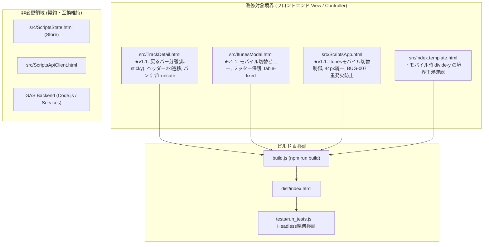
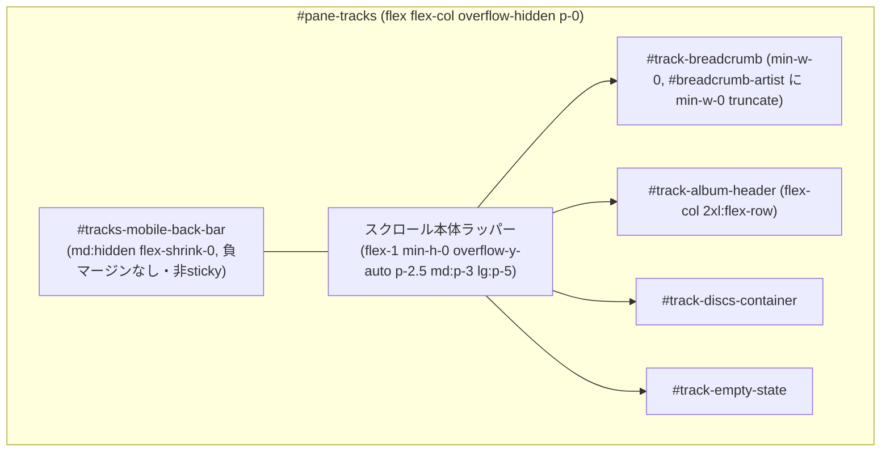
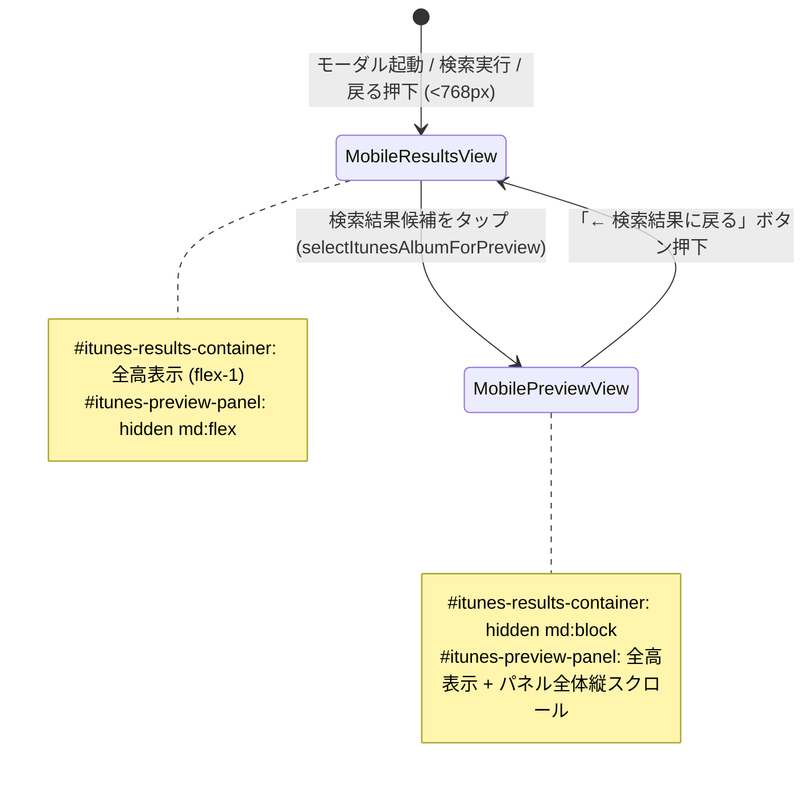

# システムアーキテクチャ設計書: スマートフォン画面における楽曲一覧レイアウト・視認性の改善

- **文書バージョン**: 1.1.0
- **作成日**: 2026年11月14日
- **最終改訂日**: 2026年11月14日（QA検証レポート `docs/qa/mobile_track_list_layout_qa_report.md` 差し戻しに伴う全幅帯幾何設計・モーダル縦領域再設計）
- **作成ロール**: システムアーキテクト (`system-architect`)
- **対象要望**: 「スマホで楽曲一覧を見ると、タイトルなどの情報が左に寄って見えづらいので、改善して欲しい」
- **成果物パス**: `docs/architecture/mobile_track_list_layout_design.md`

---

## 0. 記述区分ラベル定義

本設計書では、原則に基づき情報の性質を明確に区別する。

- **【事実】**: リポジトリ内の現行ソースコード・ビルドスクリプト・テストコード・QA実ブラウザ計測ログから直接確認された事実。
- **【前提】**: 設計・運用上の前提条件。
- **【決定】**: 本アーキテクチャ設計で採択・定義した仕様および制約。
- **【推奨】**: 後続フェーズ（テックリード、シニアコーダー、QA）への推奨設計・検証方針。
- **【要確認】**: ユーザー／プロダクトオーナーの判断を仰ぐ確認事項・不明点（推測で埋めない）。

---

## 1. 要件定義サマリー

### 1.1 現象およびQA差し戻し事項の根本原因分析

スマートフォン幅（`320px`〜`430px`、`<768px`）における「タイトルなどの情報が左に寄って見えづらい」現象、および v1.0.0 設計に対する QA 実ブラウザ（Edge Headless）検証で検出された境界幅・モーダル破綻（`BUG-001`〜`BUG-008`）の根本原因は以下の通り特定された。

#### 原因1（主因）: 3ペイン構成の右ペイン幅制約と `#track-album-header` 横3列配置の幾何学的破綻 (`BUG-001`) 【事実】
- **対象ファイル**: `src/index.template.html` (L25), `src/TrackDetail.html` (L21-80)
- **実測・幾何学的制約**:
  `<main>` は `grid grid-cols-1 md:grid-cols-12` であり、STEP 3（`#pane-tracks`）は `md:col-span-5`（全体幅の `5/12 = 41.67%`）しか割り当てられない。各ビューポート幅における `#pane-tracks` 実効幅と、`#track-album-header` 内側（ペイン外余白＋カード内 `p-3 md:p-4`＋ボーダー `2px` 控除後）の利用可能幅は次の通りである。
  - **モバイル (`320px` / `375px` / `430px`)**: `#pane-tracks` 幅 `320px` / `375px` / `430px` → カード内側実効幅 `274px` / `329px` / `384px`
  - **タブレット縦 / 小型PC (`768px`, `md:`)**: `#pane-tracks` 幅 **`319px`** → カード内側実効幅 **`245px`**（`md:p-5` 時。**実は 320px スマホよりも狭い！**）
  - **タブレット横 / ノートPC (`1024px`, `lg:`)**: `#pane-tracks` 幅 **`426px`** → カード内側実効幅 **`352px`**
  - **標準ノートPC (`1280px`, `xl:`)**: `#pane-tracks` 幅 **`533px`** → カード内側実効幅 **`459px`**
  - **大画面デスクトップ (`1536px`, `2xl:`)**: `#pane-tracks` 幅 **`640px`** → カード内側実効幅 **`566px`**
- **破綻メカニズム**:
  - 変更前コードおよび v1.0.0 設計では、`md:`（`768px`）以上で `#track-album-header` が横並び（`md:flex-row`）に戻り、左側ジャケット画像（`md:w-28` = `112px`）＋ 右側3操作ボタン横並び（ラベル表示・`whitespace-nowrap` で計 **`212px`**）が同一行を占有していた。
  - `768px`（内側 `245px`）および `1024px`（内側 `352px`）では、`112px + 212px + gap(32px) = 356px > カード内側幅` となるため、**タイトル・アーティスト名の幅が `0px` に潰れて消失し、`768px` ではジャケット画像と「編集」「曲追加」ボタンが `85px` 分物理的に重なる（`BUG-001`）** ことが QA 実ブラウザ計測で確認された。
  - また `1280px`（内側 `459px`）でも横並びに `112px + 212px + 32px` を使うとメタデータ幅は `103px` 程度しか残らない。

#### 原因2（主因）: トラック一覧行（`.track-row-item`）の重複バッジと単一行切り捨て 【事実】
- **対象ファイル**: `src/ScriptsApp.html` (`renderTrackDetail`, L1173-1219)
- 左端にトラック番号があるにもかかわらず右端に `Track ${t.trackNumber}` バッジ（約 `55px〜70px`）が重複配置され、さらに曲名・トラックアーティスト名に一律 `truncate` が付いていたため、モバイル狭幅で曲名が途中で切れて左寄りに窮屈な表示となっていた。
- （v1.0.0 実装による `<768px` での重複バッジ非表示化・`break-words` 化は QA にて AC-003 合格を確認済み。ただし `768px〜1024px` の狭い3ペイン幅も考慮した折り返し／省略境界の見直しが必要。）

#### 原因3（設計不備）: `#tracks-mobile-back-bar` の `sticky top-0` と負マージン併用によるスクロール隙間 (`BUG-004`) 【事実】
- **対象ファイル**: `src/TrackDetail.html` (L1-11)
- `#pane-tracks` 自身に `overflow-y-auto` と上パディング（`p-2.5`）を持たせ、内部の `#tracks-mobile-back-bar` に `-mt-2.5` と `sticky top-0` を併用したため、CSS Sticky 配置仕様によりスクロール時にバー上端に `11px` の隙間が生じ、背後のボタンやトラック行が透けて見えた（QA実測確認済み）。
- `ArtistList.html` や `AlbumList.html` と同様に、戻るバーをスクロールコンテナ外の固定ヘッダー（`flex-shrink-0`）へ分離すれば物理的に根絶できる。

#### 原因4（既存潜在不備）: `#breadcrumb-artist` の省略制御欠如 (`BUG-005`) 【事実】
- **対象ファイル**: `src/TrackDetail.html` (L14-18)
- `#breadcrumb-album` には `truncate` があるが `#breadcrumb-artist` に `truncate min-w-0` が無いため、長大なアーティスト名時に `768px〜1024px` の3ペイン幅を突き破って水平オーバーフロー（`460px > 426px`）を引き起こす。

#### 原因5（モーダル設計不備）: `ItunesModal` モバイル縦幅不足・フッター崩壊・テーブル横溢れ (`BUG-002`, `BUG-003`, `BUG-006`) 【事実】
- **対象ファイル**: `src/ItunesModal.html` (L1-98), `src/ScriptsApp.html` (`selectItunesAlbumForPreview`, L1696-1770)
- **フッター崩壊**: フッターの右ボタングループに `flex-shrink-0`・`whitespace-nowrap` が無く、左の長いサマリーに押し潰されてボタンが縦長（最大 `h: 188px`）に縦割れ崩壊した。
- **テーブル高さ `0px` 破綻 (`BUG-002`)**: `320×640` 画面の `h-[92vh]`（`589px`）からヘッダー・検索バー・フッターを除いた残余高さを、さらに上下2ペイン同時表示（`2fr : 3fr`）で分割したため、プレビューパネル全体が `139px〜220px` 程度しかなく、プレビューヘッダー（ジャケット `64px` + 折り返しタイトル）を除くとテーブルラッパーの高さが **`0px`** に潰れた。さらに `#itunes-preview-content` に `min-h-0` があったため親パネルにもスクロールが発生せず閲覧不能となった。
- **テーブル横溢れ (`BUG-003`)**: `<table>` に `table-fixed` が無いため、`table-layout: auto` により長大無空白文字列でテーブル幅が `675px〜1072px` に膨張した。
- **44px タップ領域漏れ (`BUG-006`)**: `ItunesModal.html` の閉じる・キャンセル・登録ボタンおよび `handleGlobalSearch()` のアーティスト／アルバム候補行に `min-h-[44px]` が未適用だった。

#### 原因6（既存潜在不備）: 画像エラーハンドラの二重発火 (`BUG-007`) 【事実】
- **対象ファイル**: `src/ScriptsApp.html` (L39-48, L1163 等)
- `window.addEventListener('error', ..., true)`（キャプチャフェーズ）と個別要素の `img.onerror` の双方が同一エラーイベントに対して発火し、Step 0 → Step 1 → Step 2 が1回で連続実行されてしまい、Google Drive 予備 URL（`drive.google.com/thumbnail`）へのフォールバックがスキップされている。

---

### 1.2 機能要件 (Functional Requirements)

- **FR-MOB-001【全幅帯対応 `#track-album-header` レスポンシブ再構成】**:
  - 【決定】`#track-album-header` は、モバイル幅（`320px〜767px`）だけでなく、3ペイン構成により `#pane-tracks` 実効幅が狭いタブレット／標準ノートPC帯域（`768px〜1535px`、`<2xl`）においても縦2段構成（上段＝ジャケット＋メタデータ、下段＝操作アクションバー）を維持し、`1536px` 以上（`2xl:`）でのみ横1行構成へ遷移すること（比較根拠は ADR-01 参照）。
  - 【決定】すべてのビューポート幅帯（`320px`〜`1536px+`）において、メタデータ領域の実効幅を **最低 `160px` 以上** 確保し、要素の物理的重なりや `0px` 潰れを完全にゼロとすること。
  - 【決定】アルバム名・アーティスト名は狭幅・中幅（`<2xl`）では `break-words` による折り返し表示を許容し、タイトル消失を防ぐこと。
- **FR-MOB-002【操作ボタングループの視認性・一貫性】**:
  - 【決定】操作ボタン（`#btn-edit-album`, `#btn-add-track-to-album`, `#btn-delete-album`）は全解像度帯で単一DOMを維持し、アイコン＋テキストラベル（「編集」「曲追加」「削除」）を 1行（`whitespace-nowrap`）で表示して操作性を一貫させること。
- **FR-MOB-003【STEP 3 トラック一覧行の視認性と横幅活用】**:
  - 【決定】モバイル（`<768px`）のトラック行では重複する右端の `Track N` バッジを非表示とし、曲名・アーティスト名の `break-words` 折り返しを許容すること。なお、`768px〜1023px` の狭い3ペイン右領域でも長大無空白文字列が水平オーバーフローしないよう、トラック行全体に `min-w-0` と適切な省略／折り返し制御を徹底すること。
- **FR-MOB-004【戻るバー（`#tracks-mobile-back-bar`）の非Sticky固定ヘッダー化と余白最適化】**:
  - 【決定】`BUG-004` を根絶するため、`#tracks-mobile-back-bar` での `sticky top-0` と負マージン（`-mt-*`, `-mx-*`）の使用を廃止し、`ArtistList.html` / `AlbumList.html` と同一の「外枠 `flex flex-col overflow-hidden` ＋ 固定ヘッダー `flex-shrink-0` ＋ スクロール本体 `flex-1 overflow-y-auto`」構造へ統一すること。
  - 【決定】`#pane-tracks` スクロール本体のパディングは、狭小 `768px` ペイン幅でタイトル幅 `160px` 以上を確保するため、段階的パディング（モバイル `p-2.5`、タブレット `md:p-3`、PC `lg:p-5`）とすること。
- **FR-MOB-005【パンくずリスト（`#track-breadcrumb`）の水平オーバーフロー防止】**:
  - 【決定】`#breadcrumb-artist` と `#breadcrumb-album` の双方に `min-w-0 truncate` を適用し、親コンテナには `min-w-0` を設定して `768px〜1024px` 帯域での水平オーバーフロー（`BUG-005`）を防止すること。
- **FR-MOB-006【`ItunesModal` モバイルプレビューの操作性・高さ確保・テーブル溢れ防止】**:
  - 【決定】`ItunesModal` フッターのボタングループに `flex-shrink-0` と各ボタン `whitespace-nowrap` を適用し、モバイル時はサマリーとボタングループが重なり・縦割れしない折り返し／2段構成（`flex-col sm:flex-row` 等）とすること（`BUG-002` フッター対策）。
  - 【決定】モバイル（`<768px`）における `ItunesModal` 2ペインの高さ不足とテーブル高さ `0px` 潰れ（`BUG-002`）を解消するため、モバイル時は **「検索結果ビュー」と「プレビュービュー（戻るバー付き）」の切替表示 ＋ プレビューパネル全体縦スクロール（`md:` 以上のみ内部テーブル独立スクロール）** を採用すること（詳細は ADR-04）。
  - 【決定】`ItunesModal` プレビューテーブルに `table-fixed` と明示的列幅、およびセル内 `break-words [overflow-wrap:anywhere]` を適用し、全幅帯で水平オーバーフロー（`BUG-003`）を根絶すること。
- **FR-MOB-007【画像エラーハンドラの二重発火防止（既存潜在バグ是正）】**:
  - 【推奨】`BUG-007` について、`window` キャプチャエラーリスナーと個別 `img.onerror` の二重呼出しによる Step 1 スキップを解消し、Drive 予備 URL フォールバックが正しく機能するようにすること（詳細は ADR-05）。

---

### 1.3 非機能要件 (Non-Functional Requirements)

- **NFR-UX-001【WCAG 2.1 タッチターゲット 44px 基準の網羅】**:
  - STEP 3 の全操作ボタン・トラック行だけでなく、`ItunesModal`（閉じる・キャンセル・登録・検索実行・候補アイテム）および横断検索ドロップダウン全候補行（アーティスト・アルバム・楽曲）で `min-h-[44px]`（正方形アイコンボタンは `min-w-[44px]` も）を統一確保すること（`BUG-006` 解消）。
- **NFR-UX-002【全ブレークポイント幾何保証（重なりゼロ・横溢れゼロ・`0px` 潰れゼロ）】**:
  - 代表幅 `320px`, `375px`, `430px`, `640px`, `767px`, `768px`, `1024px`, `1280px`, `1536px` のすべてにおいて、以下を実測で保証すること：
    1. いかなるペイン・テーブル・モーダルでも意図しない水平オーバーフロー（`scrollWidth > clientWidth`）が発生しないこと。
    2. 兄弟要素・ボタン・画像同士の矩形重複（Overlap）が発生しないこと。
    3. タイトル・アーティスト名・収録曲テーブル領域の描画幅・高さが `0px` に潰れないこと。
- **NFR-COMPAT-001【DOM ID 契約維持とテスト戦略強化】**:
  - 既存のすべての必須 DOM ID を単一DOMとして維持する。
  - 静的正規表現チェックのみに依存したテスト盲点（`BUG-008`）を補うため、設計改訂後のクラス契約に合わせたユニットテスト更新に加え、Headless ブラウザによる実描画幾何検査を受け入れ検証の必須基準とする。
- **NFR-MAINT-001 / NFR-SEC-001**:
  - SSOT ビルド（`src/*.html` → `npm run build` → `dist/index.html`）、`Utils.escapeHtml()`、およびインラインイベント属性禁止（`onerror="..."` 不在）を厳守する。

---

### 1.4 前提条件と制約事項

1. **【前提】`<main>` の 12列グリッド比率（`md:col-span-3 / 4 / 5`）の維持**:
   - PC 3ペインの横幅配分（3:4:5）自体は既存の基本設計で確定しており、本改修ではグリッド比率を変更せず、右ペイン（`5/12`）の狭さを前提としてヘッダー・パンくず・行の内部レイアウトを幾何学的に適合させる。
2. **【制約】単一DOM原則（Duplicate ID 禁止）**:
   - PC・タブレット・モバイル間で同一機能ボタン（`#btn-edit-album` 等）を複製しない。
3. **【前提】Tailwind Play CDN (v3系) 標準クラス範囲**:
   - `[overflow-wrap:anywhere]` 等の arbitrary property または `break-words` 等の標準ユーティリティを用い、Play CDN 環境で正しくコンパイルされるクラスのみを採用する。

---

### 1.5 不明点・確認事項・ブロッキング事項

- **ブロッキング事項**: なし（QA 実測データにより全幅帯の幾何制約が数値レベルで完全確定済み）。
- **【要確認 / 判断確定方針】**:
  - v1.0.0 で提示した確認事項（Q-01〜Q-04）については、QA検証・ユーザー体験要件を踏まえ本 v1.1.0 にて以下の通り設計方針を反映した（最終的なプロダクトオーナー承認対象として明記）：
    - **Q-01（対象スコープ）**: `ItunesModal` 楽曲プレビューおよびモバイル検索ドロップダウンを今回スコープに含める（AC-007 合格のため必須）。
    - **Q-02（操作ボタンラベル）**: 全解像度帯で「編集」「曲追加」「削除」のテキストラベルを1行表示で維持する。
    - **Q-03（`Track N` バッジ）**: `<768px` のみ非表示とし、`md:` 以上では表示維持する。
    - **Q-04（折り返し行数）**: 長文や長大無空白文字列も全文視認できるよう `break-words` / `anywhere` 折り返しを基本とする。

---

## 2. システム境界とコンポーネント構成

### 2.1 システム境界と変更影響範囲

変更範囲はフロントエンド UI 層（`src/TrackDetail.html`, `src/ItunesModal.html`, `src/ScriptsApp.html`, および `<main>` 境界確認のため `src/index.template.html`）に限定され、バックエンド・API・Store データ構造への影響はない。



### 2.2 各コンポーネントの責務（v1.1.0 改訂版）

| コンポーネント | ファイル | v1.1.0 における責務および変更点 |
| :--- | :--- | :--- |
| **メイン骨格** | `src/index.template.html` | ・`<main>` の `divide-y md:divide-y-0 md:divide-x` について、モバイル時の単一ペイン表示と境界線（`1px`）の干渉がないよう整合維持（必要に応じモバイル側ボーダー整理）。 |
| **トラック詳細ペイン** | `src/TrackDetail.html` | ・`#pane-tracks` を `flex flex-col overflow-hidden p-0` とし、`#tracks-mobile-back-bar` を `flex-shrink-0` 固定ヘッダーとして分離（`sticky` と負マージン廃止、`BUG-004` 解消）。<br>・スクロール本体ラッパー（`flex-1 min-h-0 overflow-y-auto p-2.5 md:p-3 lg:p-5`）を新設。<br>・`#breadcrumb-artist` に `min-w-0 truncate` を付与（`BUG-005` 解消）。<br>・`#track-album-header` の横並び遷移を **`2xl:flex-row`** へ引き上げ、`<2xl`（`320px〜1535px`）では縦2段構成を維持。ジャケットサイズを段階制御（`w-20 h-20 lg:w-24 lg:h-24 xl:w-28 xl:h-28`）。 |
| **iTunes検索モーダル** | `src/ItunesModal.html` | ・モバイル（`<768px`）では「検索結果リスト」と「プレビューパネル（戻るバー `#btn-itunes-mobile-back` 付き）」を排他切替表示とし、双方に `370px+` の全高を確保。<br>・`#itunes-preview-content` およびテーブルラッパーの `min-h-0` / `overflow-y-auto` を `md:` 以上限定とし、モバイル時は `#itunes-preview-panel` 全体でスクロール可能にする（`BUG-002` 解消）。<br>・`<table>` へ `table-fixed` と明示的列幅、`break-words [overflow-wrap:anywhere]` を適用（`BUG-003` 解消）。<br>・フッターを `flex-col sm:flex-row` 構成とし、ボタン側へ `flex-shrink-0`・`whitespace-nowrap`・`min-h-[44px]` を適用（`BUG-002`, `BUG-006` 解消）。 |
| **UIコントローラー** | `src/ScriptsApp.html` | ・`ItunesModal` モバイルビュー切替制御（検索・リセット・戻る押下時は検索結果ビュー、候補選択時はプレビュービューへ切替）。<br>・`selectItunesAlbumForPreview` のテーブルセルから横溢れ原因となる固定制約を排し `break-words [overflow-wrap:anywhere]` を適用。<br>・`handleGlobalSearch` のアーティスト・アルバム候補行に `min-h-[44px]` 適用（`BUG-006`）。<br>・`#track-header-artwork` 等の画像エラーイベント二重発火（`window` キャプチャ＋個別 `onerror`）を防止（`BUG-007`）。 |

---

## 3. データフローとインターフェース

### 3.1 全ブレークポイント別 `#track-album-header` 幾何計算表（v1.1.0 検証値）

すべての代表幅帯において、メタデータ領域幅が **`160px` 以上**、ボタン各幅が **`80px` 以上（1行ラベル表示＋`44px` 高以上）** かつ **物理重なり `0px`** となることを設計値として確定する。

| ビューポート幅 | ペイン幅 (`col-span-5`) | スクロール本体 Padding (左右計) | カード内側実効幅 (`-26px` / `-34px`) | ヘッダー構成 (`2xl:flex-row`) | ジャケット幅 | 操作ボタン群占有幅 | **メタデータ実効幅** | 判定 |
| :---: | :---: | :---: | :---: | :---: | :---: | :---: | :---: | :---: |
| **`320px`** (Mobile XS) | `320px` | `p-2.5` (`20px`) | `274px` | 縦2段 (`flex-col`) | `80px` (`w-20`) | 下段3等分 (各約 `87px`) | **`182px`** | **安全** |
| **`375px`** (Mobile Std) | `375px` | `p-2.5` (`20px`) | `329px` | 縦2段 (`flex-col`) | `80px` (`w-20`) | 下段3等分 (各約 `105px`) | **`237px`** | **安全** |
| **`430px`** (Mobile LG) | `430px` | `p-2.5` (`20px`) | `384px` | 縦2段 (`flex-col`) | `80px` (`w-20`) | 下段3等分 (各約 `124px`) | **`292px`** | **安全** |
| **`768px`** (`md:` 最小3ペイン) | `319px` | `md:p-3` (`24px`) | `261px` (`p-4`時 `261px`) ※1 | 縦2段 (`flex-col`) | `80px` (`w-20`) | 下段3等分 (各約 `83px`) | **`169px`** | **安全** |
| **`1024px`** (`lg:` 3ペイン) | `426px` | `lg:p-5` (`40px`) | `352px` (`p-4` 34px引) | 縦2段 (`flex-col`) | `96px` (`lg:w-24`) | 下段3等分 (各約 `113px`) | **`240px`** | **安全** |
| **`1280px`** (`xl:` 標準PC) | `533px` | `lg:p-5` (`40px`) | `459px` (`p-4` 34px引) | 縦2段 (`flex-col`) | `112px` (`xl:w-28`) | 下段3等分 (各約 `149px`) | **`331px`** | **安全** |
| **`1536px`** (`2xl:` 大画面) | `640px` | `lg:p-5` (`40px`) | `566px` (`p-4` 34px引) | **横1行 (`2xl:flex-row`)** | `112px` (`xl:w-28`) | 右端横並び (`212px`) | **`210px`** | **安全** |

※1: カード内パディングを `p-3 2xl:p-4` とすれば `768px` 時はさらに `8px` 広くなりメタデータ実効幅 **`177px`**、ボタン各幅 **`85px`**（`320px` スマホ同等以上）となるため、より推奨される。

---

### 3.2 `#pane-tracks` スクロール構造および `ItunesModal` モバイル切替フロー





### 3.3 コンポーネント構造インターフェース（DOM契約仕様 v1.1.0）

v1.0.0 で定義した `TrackDetailDomContract` / `TrackRowDomContract` はすべてそのまま維持し、以下を追加契約として定義する。

```typescript
/**
 * v1.1.0 追加 DOM 契約（ItunesModal モバイル切替 & 非sticky戻るバー）
 */
interface MobileLayoutV11Contract {
  trackDetail: {
    paneSection: '#pane-tracks'; // overflow-hidden + flex-col
    mobileBackBar: '#tracks-mobile-back-bar'; // flex-shrink-0（sticky・負マージン禁止）
    scrollContainer: '.track-detail-scroll-body'; // flex-1 min-h-0 overflow-y-auto
    breadcrumbArtist: '#breadcrumb-artist'; // min-w-0 truncate 必須
  };
  itunesModal: {
    resultsContainer: '#itunes-results-container';
    previewPanel: '#itunes-preview-panel'; // モバイル全高スクロール可能
    mobileBackToResultsBtn: '#btn-itunes-mobile-back'; // md:hidden, min-h-[44px]
    previewTracksTable: 'table.table-fixed'; // 水平オーバーフロー防止
    footerButtons: '#btn-cancel-itunes-modal' | '#btn-submit-itunes-batch'; // flex-shrink-0 whitespace-nowrap min-h-[44px]
  };
}
```

---

## 4. アーキテクチャ上の決定事項 (ADR)

### ADR-01 (改訂): `#track-album-header` の縦2段維持範囲の `2xl:` (`1536px`) までの拡張

- **ステータス**: 【決定】(v1.0.0 から改訂)
- **決定**:
  `src/TrackDetail.html` の `#track-album-header` における横並び遷移境界を、v1.0.0 の `md:flex-row`（`768px`）から **`2xl:flex-row`（`1536px`）** へ引き上げる。
  `<1536px`（`320px`〜`1535px`）では縦2段構成（上段＝ジャケット画像＋メタデータ、下段＝3等分操作バー）を維持し、ラベル付き操作ボタン（「編集」「曲追加」「削除」）を全解像度帯で一貫表示する。また `#pane-tracks` のスクロール本体パディングを `p-2.5 md:p-3 lg:p-5` とし、タイトル・アーティスト名は `break-words 2xl:truncate` とする。
- **理由**:
  1. QA 実ブラウザ計測（`BUG-001`）により、`#pane-tracks` は `md:col-span-5`（`41.67%`）であるため、`768px` ではカード内側幅 `245px`、`1024px` では `352px` しかなく、ジャケット（`112px`）＋ ラベル付き3ボタン（`212px`）を横並びにするとメタデータ幅が `0px` に潰れて画像とボタンが物理重複することが実証された。
  2. `2xl:flex-row` へ引き上げることで、`768px` で **`169px〜177px`**、`1024px` で **`240px`**、`1280px` で **`331px`**、`1536px` で **`210px`** と、全解像度帯で余裕あるタイトル表示幅を確保できる。
- **検討した代替案**:
  - *代替案A: `xl:flex-row`（`1280px`）で横並びにし、`1280px〜1535px` の間だけボタンラベルを非表示（`hidden 2xl:inline`）にしてアイコンのみにする。*
    - 却下理由: 画面幅の拡大に応じて「ラベルあり（`<1280px`）→ ラベルなし（`1280〜1535px`）→ ラベルあり（`>=1536px`）」と UI 要素の出現・消失が反転し、操作一貫性が損なわれるため。また `1280px` ノートPC環境では `331px` のメタデータ幅が得られる `2xl:flex-row` の方が長文アルバム名の視認性に優れる。
  - *代替案B: PC（`md:` 以上）はすべてボタンをアイコンのみ（ラベルなし）にする。*
    - 却下理由: それでも `768px` 時はカード内側 `245px` に対し `112px + 140px + 32px = 284px > 245px` となり、なお破綻する（ジャケット `80px` にしても残り `13px` しか残らず `BUG-001` を解決できない）。
- **トレードオフ**:
  - `1280px`〜`1535px` のノートPC表示において、従来の1行ヘッダーと比較してヘッダーカードの高さが操作バー1行分（約 `52px`）増加する。しかし、`768px〜1280px` でタイトルが読めない致命的不具合を解消し、ボタンの誤タップ防止・ラベル常時視認性を得られる利益が圧倒的に大きい。
- **結果・影響**:
  - `320px` から `1536px` 以上まですべての解像度で要素重なりゼロ・タイトル消失ゼロ・横溢れゼロを達成する。

---

### ADR-02: モバイルトラック行における重複 `Track N` バッジ非表示化と長大文字列折り返し（維持・補強）

- **決定**:
  v1.0.0 の設計（`<768px` での右端 `Track N` バッジ非表示化および `break-words md:truncate`）を維持しつつ、`768px〜1024px` の狭幅3ペインでも長大無空白英数字が突き抜けないよう、行コンテナの `min-w-0` および `[overflow-wrap:anywhere]`（または `break-words` + `min-w-0`）の徹底を補強する。
- **理由**:
  QA 検証により、モバイル幅での AC-003 合格は実証済みであり、`768px〜1024px` での長大文字列による行内破綻も確実に予防する必要があるため。
- **検討した代替案 / トレードオフ / 結果・影響**: v1.0.0 と同様。

---

### ADR-03 (改訂): `#tracks-mobile-back-bar` の非 Sticky 固定ヘッダー分離

- **ステータス**: 【決定】(v1.0.0 改訂: `BUG-004` 対応)
- **決定**:
  `#pane-tracks` を `ArtistList.html` / `AlbumList.html` と同一の「外枠 `flex flex-col overflow-hidden p-0` ＋ 上部固定戻るバー（`md:hidden flex-shrink-0`、負マージンなし）＋ スクロール本体（`flex-1 min-h-0 overflow-y-auto`）」構造へ分離する。
- **理由**:
  `overflow-y-auto` コンテナの内側パディングを負マージン `-mt-2.5` で相殺しつつ `sticky top-0` を用いると、CSS Sticky 仕様上スクロール時にマージンボックスが吸着し `11px` の隙間が生じて背後が透ける（`BUG-004`）。スクロール本体と戻るバーを兄弟要素として分離することで隙間を物理的にゼロにできる。
- **検討した代替案**:
  - *代替案A: `#pane-tracks` の上パディングを `pt-0` にして `sticky` を残す。*
    - 却下理由: `<main>` の `divide-y` 等による `1px` ボーダーが上端に残るリスクがあり、また既に `ArtistList.html` / `AlbumList.html` で実証済みの「固定ヘッダー＋独立スクロール本体」パターンに統一する方がプロジェクト全体の保守性・一貫性が高いため。
- **トレードオフ**:
  - スクロール本体用のラッパー `<div>` が1つ追加される（既存IDおよびイベントへの影響はなし）。
- **結果・影響**:
  - スクロール時の隙間・背後要素の透けが完全に解消される。

---

### ADR-04 (新設): `ItunesModal` のモバイル切替表示・パネル全体スクロール・`table-fixed` 導入

- **ステータス**: 【決定】(`BUG-002`, `BUG-003`, `BUG-006` 対応)
- **決定**:
  1. **モバイル（`<768px`）における検索結果↔プレビューの排他切替表示**:
     モバイルでは検索結果一覧（`#itunes-results-container`）とプレビューパネル（`#itunes-preview-panel`）を同時縦積みせず、1画面1ビューで切り替える（候補選択でプレビューへ遷移し、プレビュー上部に戻るバー「← 検索結果一覧へ」を配置）。PC（`md:` 以上）は従来通り左右2ペイン同時表示（`md:grid-cols-12`）を維持する。
  2. **パネル全体スクロール化**:
     `#itunes-preview-content` およびテーブルラッパーの `min-h-0` / 内部スクロールを **`md:` 以上のみ（`md:flex-1 md:min-h-0 md:overflow-y-auto`）** とし、モバイル時は `#itunes-preview-panel` 全体で縦スクロールさせることで、長文アルバム名でも楽曲テーブル高さが `0px` に潰れない構造にする。
  3. **`table-fixed` と折り返し・フッター保護**:
     プレビュー `<table>` に `table-fixed` を適用し、曲名・アーティストセルに `break-words [overflow-wrap:anywhere]` を適用する。フッターは `flex-col sm:flex-row` でボタン群（`flex-shrink-0 whitespace-nowrap min-h-[44px]`）を保護する。
- **理由**:
  スマホ縦長画面（`320×640`）の限られたモーダル高さ（約 `380px` 領域）を上下2ペインで分割すると、150px〜220px の枠内でプレビューヘッダーがテーブル領域を `0px` に圧迫することが実測で判明したため。本アプリのメイン画面と同じステップ切替思想をモーダル内にも適用することで、検索結果も楽曲テーブルも十分な高さで快適に閲覧できる。
- **検討した代替案**:
  - *代替案A: 上下2ペイン同時表示を維持し、プレビューパネル全体スクロール化のみ行う。*
    - 却下理由: テーブルの `0px` 潰れは防げるが、検索結果が `92px`・プレビュー窓が `139px`（`320×640` 実測）という極小の覗き窓になり、スクロール操作性が著しく低いため。
- **トレードオフ**:
  - `ScriptsApp.html` にモバイル時の `ItunesModal` ビュー切替メソッド（状態切替クラス操作）を追加する必要がある。
- **結果・影響**:
  - スマホでの iTunes / MusicBrainz 検索結果および収録曲プレビューの視認性・操作性が抜本的に改善し、`BUG-002`, `BUG-003`, `BUG-006` がすべて解消される。

---

### ADR-05 (新設): 画像エラーハンドラの二重発火防止方針 (`BUG-007` 是正)

- **ステータス**: 【決定】(`BUG-007` 関連是正)
- **決定**:
  `ScriptsApp.html` において、`window.addEventListener('error', ..., true)`（キャプチャフェーズ）と各動的生成画像・`#track-header-artwork` の個別 `img.onerror` プロパティの双方で同一イベントに対し `Utils.handleImageError` が2回呼ばれる重複を解消する。
- **理由**:
  QA 検証により、1回の画像エラーでキャプチャリスナー（Step 0→1）と `img.onerror`（Step 1→2）が連続発火し、Google Drive 予備サムネイル URL（Step 1）へのフォールバックがスキップされる実障害が確認されたため（既存設計 `album_art_mobile_fix_design.md` ADR-03 の意図は個別 `onerror` による iOS Safari 対応であり、全対象画像へ個別 `onerror` バインドが完了している現状では二重発火を防ぐ設計整理が必要）。
- **検討した代替案**:
  - *代替案A: `window` キャプチャリスナーを残し、イベント単位の多重処理防止ガード（または個別 `onerror` バインド済み要素のスキップ）を設ける。*
  - *代替案B: 全 `img[data-artwork]` に個別 `onerror` バインドが適用されていることを確認の上、`window` キャプチャリスナーを廃止する。*
  - 選択方針: 既存のモック／単体テスト影響を抑えつつ確実に二重発火を止める具体的な機構（例：個別バインドへの一元化または二重呼出ガード）の選定はテックリードへ委任する。
- **トレードオフ / 結果・影響**:
  - Drive 画像の3段階フォールバック（`lh3` → `drive.google.com/thumbnail` → デフォルト SVG）が意図通り機能するようになる。

---

## 5. 品質特性に関する考慮事項

- **セキュリティ**: v1.0.0 と同様（`Utils.escapeHtml()` 徹底、インラインイベント属性禁止、XSS 耐性維持）。
- **パフォーマンス**: モバイル戻るバーの分離・`ItunesModal` ビュー切替は軽微なクラス操作のみであり、描画負荷増はゼロ。
- **保守性**:
  - `tests/run_tests.js` [16] の静的クラス名検証は本改訂（`2xl:flex-row`, `#tracks-mobile-back-bar` の非 sticky 分離、`ItunesModal` ビュー切替）に合わせて同期更新する。
  - さらに `BUG-008` への対策として、Tailwind Play CDN 実描画を含む Headless ブラウザ幾何検証を QA ゲート必須項目として定義する。

---

## 6. 受け入れ基準 (Acceptance Criteria)

Phase 4（QA検証）および Phase 5（コードレビュー）において検証すべき受け入れ基準を以下に定義する。

- [ ] **AC-001 (モバイル幅 320px〜430px の STEP 3 視認性)**:
  `320px`, `375px`, `430px` で STEP 3 を表示した際、アルバム名・アーティスト名が左に押し潰されることなく全幅折り返しで明瞭に読め、操作ボタン3つも1行ラベル付き・`44px` 以上で重なりなく配置されていること。
- [ ] **AC-002 (PC・タブレット幅 `768px`〜`1536px+` における `#track-album-header` 非破壊と幅保証 - BUG-001解消)**:
  `768px`, `1024px`, `1280px`, `1536px` のすべてにおいて、`#track-header-album-name` および `#track-header-artist-name` の描画幅が **`160px` 以上** 確保され、`0px` 消失・ボタンとの物理重なり・水平オーバーフローが一切発生しないこと。
- [ ] **AC-003 (トラック行・パンくずリストの視認性と水平溢れゼロ - BUG-005解消)**:
  `320px〜1536px` の全幅帯において、通常データ・長文日本語・長大無空白英数字のいずれも水平オーバーフロー（`scrollWidth > clientWidth`）が発生せず、`<768px` では重複 `Track N` バッジが非表示・行高 `44px` 以上であること。`#breadcrumb-artist` も省略表示で溢れないこと。
- [ ] **AC-004 (戻るバー `11px` 隙間ゼロ - BUG-004解消)**:
  モバイル幅で `#pane-tracks` のスクロール領域を下方へスクロールした際、`#tracks-mobile-back-bar` が上端に隙間なく固定され、背後の要素が一切透けて見えないこと。
- [ ] **AC-005 (`ItunesModal` モバイル切替・フッター保護・テーブル幅収容 - BUG-002, BUG-003解消)**:
  `320×640`〜`430×932` で `ItunesModal` を開いた際、フッターボタンが縦割れせず（`whitespace-nowrap`・`44px` 以上）、検索結果とプレビュー（戻るバー付き切替＋パネル全体スクロール）が長文タイトル時でも高さ `0px` に潰れず閲覧・スクロールできること。また長大無空白文字列を含むプレビューテーブルが親幅を超過しないこと（`table-fixed`）。
- [ ] **AC-006 (全対話要素 44px タッチターゲット統一 - BUG-006解消)**:
  STEP 3 全ボタン、`ItunesModal` の閉じる／キャンセル／登録／戻るボタン、および横断検索ドロップダウンの全候補行（アーティスト・アルバム・楽曲）で高さ `44px` 以上が確保されていること。
- [ ] **AC-007 (画像エラー二重発火の解消 - BUG-007解消)**:
  `#track-header-artwork` 等で画像エラーが発生した際、Step 0 → Step 1（予備 URL）→ Step 2（デフォルト SVG）が 1ステップずつ正しく遷移すること。
- [ ] **AC-008 (ビルド・ユニットテスト・実ブラウザ幾何検証の完全パス - BUG-008対応)**:
  `npm run build` および `npm test` がすべて Exit Code 0 でパスし、さらに Headless ブラウザによる主要幅帯（`320, 375, 768, 1024, 1280, 1536`）での実座標・重なり・オーバーフロー計測に不合格項目がゼロであること。
