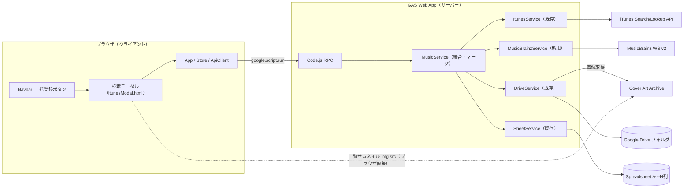
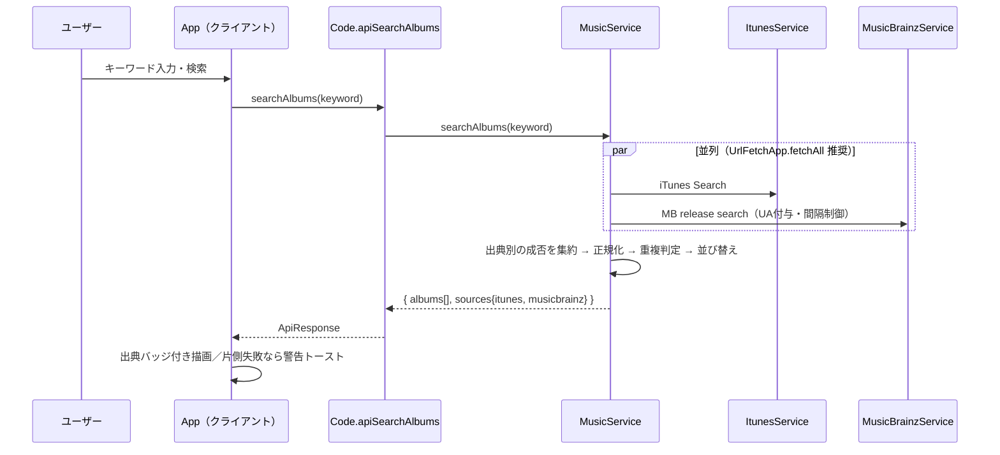

# システムアーキテクチャ設計書: アルバム検索への MusicBrainz 結果マージ & 一括登録ボタン名称変更

- **文書バージョン**: 1.0.0
- **作成日**: 2026年10月18日
- **作成ロール**: システムアーキテクト (`system-architect`)
- **対象要望（原文）**: 「iTunes APIでの検索機能について、MusicBrainzのAPIで検索した結果もマージして表示できるようにして欲しい。これに合わせて、iTunesから一括登録、というボタンの名称も変更して欲しい」
- **成果物パス**: `docs/architecture/musicbrainz_search_merge_design.md`
- **引き渡し先**: テックリード (`tech-lead`)

> 本書では各記述に以下の区分ラベルを付す。
> **【事実】** リポジトリ／公式ドキュメント／実レスポンスで確認済み ・ **【前提】** 設計上置いた仮定 ・ **【決定】** 本設計での決定事項 ・ **【推奨】** 推奨だが最終判断はユーザー／テックリード ・ **【未確認】** 検証できていない事項

---

## 1. 要件定義サマリー

### 1.1 現状分析（As-Is）【事実】

| 項目 | 現状 | 根拠 |
| :--- | :--- | :--- |
| 検索 | `ItunesService.searchAlbums(term)` が iTunes Search API（`country=jp, media=music, entity=album, limit=25`）を `UrlFetchApp.fetch` で呼び出し、`ItunesAlbumSummary[]` を返す | `src/ItunesService.js` L10-43, `src/Config.js` L71-79 |
| 詳細取得 | `ItunesService.lookupAlbumSongs(collectionId)` が Lookup API（`entity=song`）で `discNumber/trackNumber/trackName/artistName` を取得し `ItunesAlbumDetail` を返す | `src/ItunesService.js` L50-101 |
| 業務ロジック | `MusicService.searchItunesAlbums / lookupItunesAlbum / saveAlbumFromItunes` | `src/MusicService.js` L36-181 |
| RPC | `apiSearchItunes(keyword)`, `apiLookupItunesAlbum(collectionId)`, `apiSaveAlbumBatch(payload)` | `src/Code.js` L72-137 |
| 一括保存 | `saveAlbumFromItunes(payload)` は **ソース非依存**の汎用ペイロード（`albumName, albumArtist, releaseDate, artworkUrl500, tracks[{cdNumber, trackNumber, trackName, trackArtist}]`）を検証し、`DriveService.downloadAndSaveArtwork(artworkUrl500)` → `SheetService.insertTracksBatch` を実行 | `src/MusicService.js` L71-181 |
| ジャケット保存 | `downloadAndSaveArtwork` は任意の外部 URL を `UrlFetchApp.fetch`（リダイレクト追従はデフォルト）で取得し Drive に保存。非200や例外時は空文字を返し登録は継続（Graceful Degradation） | `src/DriveService.js` L18-60 |
| フロント | `ScriptsApp.html` の `openItunesModal / executeItunesSearch / renderItunesResults / selectItunesAlbumForPreview / submitItunesBatch`。結果リストは `data-id="${collectionId}"` で識別。状態は `ScriptsState.html` の `itunesSearchResults / selectedItunesAlbum` | `src/ScriptsApp.html` L617-801, `src/ScriptsState.html` L19-21 |
| ボタン | `Navbar.html` の `#btn-open-itunes-modal`：PC「iTunesから一括登録」／SP「iTunes登録」 | `src/Navbar.html` L43-50 |
| モーダル | `ItunesModal.html` 見出し「iTunes からアルバムを一括登録」、送信ボタン「このアルバムを一括登録」 | `src/ItunesModal.html` L12, L90 |
| ビルド | `build.js` が `index.template.html` に各 HTML を展開して `src/index.html` を生成。`.claspignore` で `src/index.template.html` は除外され、**GAS にデプロイされるのは生成物 `index.html`** | `build.js`, `.claspignore` |
| 生成物の不整合 | 現在の `src/index.html` は Navbar 文言が「iTunes一括登録」、モーダル見出しが「iTunes アルバム一括登録」となっており、**ソース（`Navbar.html` / `ItunesModal.html`）と不一致**＝ビルド未反映の状態 | `src/index.html` L129, L331 |
| シート | A〜H 列（CD番号, アルバムアーティスト名, アルバム名, アーティスト名, トラック番号, トラック名, リリース日, アルバムアートURL）。出典列は存在しない | `src/Config.js` L61-70, `README.md` |
| マニフェスト | `script.external_request` スコープ付与済み。Advanced Service なし。`executeAs: USER_DEPLOYING` | `src/appsscript.json` |
| テスト | `tests/run_tests.js`・`tests/red_team_attack_test.js` が `ItunesService` / `searchItunesAlbums` / `saveAlbumFromItunes` / `Navbar.html` 等を直接参照 | `tests/*.js` |

### 1.2 MusicBrainz / Cover Art Archive 仕様調査結果

| # | 項目 | 内容 | 区分 |
| :-- | :--- | :--- | :--- |
| MB-1 | エンドポイント | `https://musicbrainz.org/ws/2/`。JSON は `fmt=json` | 【事実】公式ドキュメント |
| MB-2 | 検索 | `/ws/2/release?query=<Lucene>&limit=<1..100, 既定25>&offset=`。`dismax=true` で特殊構文をエスケープする簡易パーサに切替可能。応答に `score`(0-100) が付与 | 【事実】Search ドキュメント |
| MB-3 | 検索応答 JSON 構造 | `releases[]` に `id`(MBID), `score`, `title`, `status`, `disambiguation`, `artist-credit[]{name, joinphrase?, artist{name}}`, `release-group{id, primary-type, secondary-types}`, `date`, `country`, `barcode`, `track-count`, `media[]{format, disc-count, track-count}` を含む | 【事実】実レスポンスで確認（本調査環境から。GAS からではない） |
| MB-4 | 詳細（lookup） | `/ws/2/release/{MBID}?inc=recordings+artist-credits&fmt=json`。`media[]{position, format, title, track-count, tracks[]{position, number, title, length, artist-credit[]}}` および `cover-art-archive{front, back, count, artwork}` を含む | 【事実】実レスポンスで確認 |
| MB-5 | `track.number` | 文字列（ヴァイナル等で `"A1"` 形式もあり得る）。整数のトラック番号には `position` を使う | 【事実】JSON 構造／【前提】`A1` 形式の存在は MB の一般仕様 |
| MB-6 | フリーワード検索の挙動 | フィールド未指定のクエリでもアーティスト名での一致結果が返る（例: `Official髭男dism` で 6,752 件ヒット）。一方、愛称（例: `ヒゲダン`）は 0 件 | 【事実】実レスポンス／ただし関連度の質は【未確認】 |
| MB-7 | User-Agent | **全リクエストに、管理者連絡先を含む意味のある UA が必須**（推奨形式 `AppName/<version> ( contact-url or email )`）。空/汎用 UA は「anonymous」扱いで制限対象 | 【事実】Rate Limiting ドキュメント |
| MB-8 | レート制限 | **送信元 IP 単位で平均 1 req/秒**。超過すると 503 となり、**その IP からの全リクエストが拒否**される。加えて UA 単位・全体（300 req/秒）の制限あり。ルールは予告なく変更され得る | 【事実】Rate Limiting ドキュメント |
| MB-9 | データライセンス | MB コアデータは CC0。ジャケット画像の著作権は各権利者に帰属 | 【前提】一般に周知の MB ポリシー（本調査で原文未精読） |
| CAA-1 | カバーアート | `https://coverartarchive.org/release/{MBID}/front-(250\|500\|1200)` で正面画像のサムネイルを取得。**307 リダイレクト**で archive.org 上の実体へ誘導。画像が無ければ 404。レート超過時 503 | 【事実】CAA API ドキュメント |
| CAA-2 | 検索結果とカバー有無 | 検索応答には `cover-art-archive` 情報が含まれないため、一覧段階ではカバー有無が不明（404 になり得る）。lookup 応答の `cover-art-archive.front` で判定可能 | 【事実】MB-3/MB-4 の比較 |
| CAA-3 | CAA 固有のレート制限詳細 | ドキュメントに章はあるが本調査で内容未精読 | 【未確認】 |

### 1.3 GAS（UrlFetchApp）制約の検討

| # | 論点 | 評価 | 区分 |
| :-- | :--- | :--- | :--- |
| GAS-1 | UA ヘッダ指定 | `UrlFetchApp.fetch(url, { headers: { 'User-Agent': ... } })` でヘッダは指定できるが、**GAS は UA に `Google-Apps-Script` 識別子を付加／上書きする**との情報が多数ある。独自 UA 文字列が MB に届く形式（付加か置換か）は**未検証** | 【未確認・ブロッキング（PoC 必須）】 |
| GAS-2 | 送信元 IP | UrlFetchApp の送信元は**Google の共有 IP プール**。MB の「IP 単位 1 req/秒」制限が他の GAS 利用者のトラフィックと合算され、**自アプリが低頻度でも 503 を受ける可能性**がある | 【未確認・重大リスク】 |
| GAS-3 | 並列取得 | `UrlFetchApp.fetchAll(requests[])` で iTunes と MB を並列呼び出し可能 | 【事実】GAS 標準 API |
| GAS-4 | タイムアウト | UrlFetchApp にリクエスト単位のタイムアウト指定オプションはない（既存設計書 NFR-PERF-001 の「5秒タイムアウト」は UrlFetchApp では直接実現不可） | 【前提】GAS 公開仕様の一般知識 |
| GAS-5 | 呼び出し間隔制御 | `Utilities.sleep` と `CacheService`（最終呼び出し時刻の共有）、`LockService` で同一スクリプト内の呼び出し間隔を制御可能。ただし GAS-2 の共有 IP 問題は解決できない | 【事実】GAS 標準 API |
| GAS-6 | 307 リダイレクト | `UrlFetchApp.fetch` は `followRedirects` 既定 `true` のため、`DriveService.downloadAndSaveArtwork` で CAA URL をそのまま扱える見込み | 【前提】実機未検証 |
| GAS-7 | クォータ | UrlFetchApp 呼び出し回数の日次クォータが存在（本機能で 1 検索あたり +1 回、1 選択あたり +1 回、1 登録あたり画像 +1 回）。個人用途では問題にならない想定 | 【前提】 |

### 1.4 機能要件 (Functional Requirements)

- **FR-MB-001【統合検索】**: 検索モーダルでキーワード検索を実行すると、iTunes Search API と MusicBrainz release 検索を**同一操作で**実行し、結果を**1つのリストにマージ**して表示すること。
- **FR-MB-002【出典表示】**: 各検索結果に出典（`iTunes` / `MusicBrainz`）をバッジ等で明示すること。MusicBrainz 結果には版の識別に必要な補足情報（形態 `format`、国 `country`、注記 `disambiguation`、枚数）を可能な範囲で表示すること。
- **FR-MB-003【重複判定】**: iTunes 結果と MusicBrainz 結果で同一アルバムと判定されたものは、§4 ADR-004 の規則に従い重複表示を抑止すること。
- **FR-MB-004【並び順】**: §4 ADR-005 の規則に従い決定的（同じ入力なら同じ順序）に並べること。
- **FR-MB-005【片側障害時のフォールバック】**: 片方の API が失敗（HTTP エラー、503、例外、JSON 不正）しても、もう片方の結果を表示し、失敗した出典をユーザーに非致命的な警告として通知すること。両方失敗した場合のみエラー扱いとすること。
- **FR-MB-006【MusicBrainz 詳細プレビュー】**: MusicBrainz 由来の結果を選択した場合、release lookup により収録曲（ディスク番号＝`media.position`、トラック番号＝`track.position`、曲名、トラックアーティスト）を取得し、既存と同じプレビュー領域に表示すること。
- **FR-MB-007【MusicBrainz 由来の一括登録】**: MusicBrainz 由来アルバムも既存の一括登録フロー（`apiSaveAlbumBatch`）で登録できること。カバーアートが存在する場合は CAA の 500px 画像を既存と同様に Google Drive へ保存すること。存在しない場合はジャケット無しで登録を継続すること。
- **FR-MB-008【既存 iTunes 機能の非退行】**: iTunes 由来アルバムの検索・プレビュー・登録の挙動（ディスク分割、500x500 画像保存、エラー処理）は現行と同等であること。
- **FR-UI-001【ボタン名称変更】**: ヘッダーの「iTunesから一括登録」ボタン（PC/SP 両表記）を、出典非依存の名称（§4 ADR-008）へ変更すること。
- **FR-UI-002【関連文言の整合】**: モーダル見出し、ローディング文言、エラートースト、README・ドキュメント等で「iTunes」専用と読める表記を §3.5 の範囲で整合させること。
- **FR-OPS-001【機能スイッチ】**: MusicBrainz 連携を設定値で無効化でき、無効時は現行（iTunes のみ）と同じ挙動に戻ること。

### 1.5 非機能要件 (Non-Functional Requirements)

- **NFR-MB-POLICY-001（API 利用規約順守）**: MusicBrainz への全リクエストに、アプリ名・バージョン・連絡先を含む UA を付与すること（GAS-1 の検証結果次第で実現方式を確定）。
- **NFR-MB-RATE-001（レート制限順守）**: 本アプリから MusicBrainz への呼び出しは平均 1 req/秒を超えないこと。1 回の検索操作で MB への呼び出しは **1 回**、1 回のプレビュー選択で **1 回**に限定すること（ページング・一覧段階での追加 lookup は禁止）。
- **NFR-PERF-001（応答時間）**: 統合検索の応答時間は、iTunes 単独時と比べ「遅い方の API 応答時間」程度に収まること（直列呼び出しによる加算を避ける）。MB 側の 503 に対するリトライは最大 1 回とし、検索全体を過度に遅延させないこと。
- **NFR-SEC-001（XSS 防止）**: MB 由来の全文字列（title, artist-credit, disambiguation, format 等）は既存 `Utils.escapeHtml` でエスケープしてから DOM へ挿入すること。インライン `onerror="..."` 属性の埋め込みは禁止（既存テスト方針）。
- **NFR-SEC-002（入力検証）**: MBID はサーバー側で UUID 形式（`^[0-9a-f]{8}-[0-9a-f]{4}-[0-9a-f]{4}-[0-9a-f]{4}-[0-9a-f]{12}$`、大小文字無視）を検証し、不正値は `VALIDATION_FAILED` とすること。出典識別子はホワイトリスト（`itunes` / `musicbrainz`）で検証すること。
- **NFR-SEC-003（クエリ構文インジェクション防止）**: MB 検索クエリにユーザー入力を埋め込む際は、Lucene 特殊文字のエスケープ、または `dismax=true` の利用により、意図しない検索構文の解釈を防ぐこと。URL エンコードは必須。
- **NFR-SEC-004（式インジェクション防止）**: 保存時は既存 `escapeFormula_` を必ず経由すること（既存 `saveAlbumFromItunes` の再利用で担保）。
- **NFR-REL-001（障害分離）**: MB 側の障害・遅延・仕様変更が iTunes 側の検索・登録を阻害しないこと。
- **NFR-MAINT-001（保守性）**: MB 連携は `ItunesService` と同じ粒度の独立クラスに閉じ込め、マージロジックは Node のユニットテストで検証可能な純粋関数として実装可能な配置にすること。
- **NFR-COMPAT-001（データ互換性）**: スプレッドシート列構成（A〜H）を変更しないこと。

### 1.6 前提条件と制約事項

1. 【前提】本アプリは個人（少人数）用途であり、同時利用者は少数。MB への呼び出し頻度はユーザー操作起点のみ。
2. 【事実】フロントエンドは Tailwind CDN + バニラ JS、バックエンドは GAS V8 標準サービスのみ。外部ライブラリは追加しない。
3. 【事実】GAS に配備されるのは `build.js` による生成物 `src/index.html`。HTML 部品を変更したら**必ずビルドが必要**。
4. 【決定】既存 RPC（`apiSearchItunes`, `apiLookupItunesAlbum`）は削除せず互換維持する（既存テスト・ロールバック容易性のため）。
5. 【決定】DOM の内部 ID（`modal-itunes`, `btn-open-itunes-modal`, `itunes-*`）は変更しない（ADR-009）。

### 1.7 不明点・ブロッキング事項

| ID | 内容 | 種別 | 解消方法 |
| :-- | :--- | :--- | :--- |
| **BLK-1** | GAS の `UrlFetchApp` から MB へ送られる実際の UA 文字列（独自 UA が付加・置換・無視のどれになるか）と、それに対し MB が 200 を返すか | **ブロッキング（技術）** | 実装着手前に GAS 上で PoC 実施（`https://musicbrainz.org/ws/2/release?query=test&fmt=json&limit=1` を独自 UA 付きで呼び出し、ステータスと応答を記録。可能ならエコーサービスで送信 UA を確認） |
| **BLK-2** | GAS 共有 IP による 503 の発生頻度（GAS-2）。高頻度で 503 となる場合、本機能は実用に耐えない | **ブロッキング（技術）** | BLK-1 の PoC で数回〜数十回（1 秒以上間隔）試行し 503 率を計測。高い場合は ADR-001 の代替案（プロキシ）をユーザーと再協議 |
| **BLK-3** | UA に記載する**連絡先**（URL またはメールアドレス）。推奨形式は `MusicInfoApp/1.x ( contact )` | **ブロッキング（ユーザー判断）** | ユーザーに確認。候補: リポジトリ URL `https://github.com/nankojin-ops/MusicInfo-app`（`package.json` 記載）またはユーザーのメールアドレス |
| Q-1 | ボタン名称の最終決定（ADR-008 推奨案: PC「アルバム検索・一括登録」／SP「一括登録」） | 要確認（非ブロッキング・既定値あり） | ユーザー確認 |
| Q-2 | 並び順方針（ADR-005 推奨: iTunes 結果→MB 結果のブロック連結） | 要確認（既定値あり） | ユーザー確認 |
| Q-3 | 重複判定方針（ADR-004 推奨: 厳格一致時のみ MB 側を非表示） | 要確認（既定値あり） | ユーザー確認 |
| Q-4 | MB の DVD / Blu-ray 等の映像メディアを登録対象に含めるか（ADR-007 推奨: 含める＋プレビューで形態表示） | 要確認（既定値あり） | ユーザー確認 |
| Q-5 | MB の部分日付（`YYYY` / `YYYY-MM`）の保存方法（ADR-007 / R-6） | 要確認（既定値あり） | ユーザー確認＋テックリードが `SheetService` 書き込み時の自動型変換を検証 |
| U-1 | 1 リリースの収録曲数が非常に多い場合に lookup の `tracks` が省略・切り詰めされるか | 【未確認】 | テックリードが大型ボックスセットで PoC。切り詰め時は「全曲取得できない」旨を警告する方針で吸収 |
| U-2 | CAA の 307 → archive.org を `UrlFetchApp`（followRedirects 既定）で取得し Drive 保存できるか | 【未確認】 | BLK-1 PoC と同時に検証 |

---

## 2. システム境界とコンポーネント構成

### 2.1 システム境界

- **内部**: GAS Web App（`Code.js` RPC 層、`MusicService` 業務層、各 Service）、フロント（`ScriptsApp/State/ApiClient`、`Navbar`、`ItunesModal`）、スプレッドシート、Google Drive。
- **外部（既存）**: iTunes Search / Lookup API（`itunes.apple.com`）、Apple 画像 CDN（`mzstatic.com`）。
- **外部（新規）**: MusicBrainz Web Service v2（`musicbrainz.org/ws/2`）、Cover Art Archive（`coverartarchive.org` → `archive.org`）。
- **境界外（本スコープ外）**: MB へのデータ投稿・認証付き API、release-group 単位の集約表示、検索ページング、既存登録済みデータの出典遡及付与。



### 2.2 各コンポーネントの責務

| コンポーネント | 区分 | 責務 |
| :--- | :--- | :--- |
| `MusicBrainzService`（新規 `src/MusicBrainzService.js`） | 新規 | MB release 検索・release lookup の HTTP 呼び出し、UA 付与、呼び出し間隔制御、503 時の限定リトライ、MB JSON → アプリ共通モデル（§3.2）への正規化、CAA URL 生成。**マージは行わない** |
| `ItunesService` | 既存・原則変更なし | iTunes 検索・lookup。共通モデルへの適合のため、`source` 等の付与は `MusicService` 側の写像で行うことを推奨（テックリード裁量） |
| `MusicService` | 既存・拡張 | ①統合検索（両 Service を呼び、出典別の成否を集約）②マージ（重複判定・並び順）③出典に応じた詳細取得の振り分け ④既存 `saveAlbumFromItunes` による保存（ソース非依存のため再利用） |
| マージロジック | 新規（配置はテックリード裁量） | 純粋関数として実装し Node テスト可能にすること（`MusicService` のメソッドまたは独立ユーティリティ） |
| `Code.js` | 既存・拡張 | 新 RPC `apiSearchAlbums(keyword)`, `apiLookupMusicBrainzRelease(mbid)` を追加。既存 RPC は維持 |
| `Config` | 既存・拡張 | `CONSTANTS.MUSICBRAINZ`（BASE_URL, SEARCH_LIMIT, USER_AGENT 構成要素, MIN_INTERVAL_MS, ENABLED, CAA_BASE_URL 等）を追加。連絡先はスクリプトプロパティでの上書きを許容（推奨） |
| `DriveService` | 既存・変更不要見込み | CAA 500px URL をそのまま `downloadAndSaveArtwork` に渡す（U-2 の検証結果次第） |
| `SheetService` | 既存・変更なし | 列構成不変 |
| `ApiClient` | 既存・拡張 | `searchAlbums(keyword)`, `lookupMusicBrainzRelease(mbid)` を追加 |
| `Store` | 既存・拡張 | 検索結果を出典付き統合モデルで保持。選択中アルバムに `source` を保持 |
| `App` | 既存・拡張 | 統合検索呼び出し、出典バッジ付き描画、出典に応じた lookup 振り分け、警告トースト、画像エラーフォールバック |
| `Navbar.html` / `ItunesModal.html` | 既存・文言変更 | §3.5 の文言変更 |
| `build.js` | 既存・変更なし | 変更後に必ず実行し `index.html` を再生成 |

### 2.3 外部依存関係

| 依存先 | 用途 | 認証 | 主な制約 |
| :--- | :--- | :--- | :--- |
| iTunes Search/Lookup | 既存検索・詳細 | 不要 | 既存どおり |
| MusicBrainz WS v2 | 検索・詳細 | 不要 | UA 必須、IP 単位 1 req/秒、503 |
| Cover Art Archive | ジャケット画像 | 不要 | 307 リダイレクト、404（画像なし）、503 |
| GAS `UrlFetchApp` / `CacheService` / `LockService` / `Utilities` | HTTP、間隔制御 | 既存スコープ（`script.external_request`）で可。`CacheService` / `LockService` は追加スコープ不要の見込み【前提】 | 共有 IP、UA 付加 |

---

## 3. データフローとインターフェース

### 3.1 データフロー

#### (A) 統合検索



- 【決定】片側失敗は**例外として RPC 失敗にしない**。`sources.<name>.ok=false` と非機密なメッセージを返し、クライアントが警告表示する。
- 【決定】両側失敗時のみ例外（`code: 'ALBUM_SEARCH_ALL_FAILED'` 等）として既存エラー経路に乗せる。
- 【決定】MB 無効（FR-OPS-001）時は `sources.musicbrainz = { ok: true, skipped: true, count: 0 }` 相当で iTunes のみ返す。

#### (B) MusicBrainz アルバム選択 → プレビュー

1. クライアントは選択項目の `source` を見て振り分ける。`itunes` → 既存 `apiLookupItunesAlbum(collectionId)`、`musicbrainz` → 新 `apiLookupMusicBrainzRelease(mbid)`。
2. サーバーは MBID を検証 → `GET /ws/2/release/{mbid}?inc=recordings+artist-credits&fmt=json`（UA・間隔制御付き）。
3. 正規化（§3.3 マッピング）して `AlbumDetail`（既存 `ItunesAlbumDetail` と同形＋`source`/`sourceId`）を返す。
4. クライアントは既存プレビュー描画をそのまま利用（形態列の追加は任意）。

#### (C) 一括登録

1. クライアントは選択中 `AlbumDetail` から既存 `BatchSavePayload`（`albumName, albumArtist, releaseDate, artworkUrl500, tracks`）を組み立て、既存 `apiSaveAlbumBatch` を呼ぶ。**出典によらず同一経路**。
2. サーバー `saveAlbumFromItunes` が検証・式エスケープ → `artworkUrl500` があれば `DriveService.downloadAndSaveArtwork`（MB の場合は CAA `front-500` URL。307 を追従）→ `insertTracksBatch`。
3. 画像取得失敗（404/503/例外）時は既存仕様どおり空 URL で登録継続。

### 3.2 主要インターフェース定義（契約）

> 型名は説明用。実装時の JSDoc 名はテックリード裁量。

**`AlbumSearchResult`（検索結果 1 件・出典共通）**

| フィールド | 型 | iTunes | MusicBrainz | 備考 |
| :--- | :--- | :--- | :--- | :--- |
| `source` | `'itunes' \| 'musicbrainz'` | `itunes` | `musicbrainz` | 必須 |
| `sourceId` | string | `String(collectionId)` | release MBID | 必須。クライアントの選択キー |
| `collectionId` | number | 既存値 | （なし） | **互換維持のため iTunes 項目には残す** |
| `albumName` | string | `collectionName` | `title` | |
| `albumArtist` | string | `artistName` | artist-credit 連結（§3.3） | |
| `artworkUrl100` | string | 既存 | CAA `front-250` URL | 一覧サムネイル用（MB は 404 の可能性あり） |
| `artworkUrl500` | string | 既存 | （一覧では空でもよい。詳細で確定） | |
| `releaseDate` | string | `YYYY-MM-DD` | `date`（`YYYY` / `YYYY-MM` / `YYYY-MM-DD` / 空） | |
| `trackCount` | number | `trackCount` | `track-count` | |
| `primaryGenreName` | string | 既存 | 空 | |
| `extra` | object | 省略可 | `{ format, country, disambiguation, discCount, status, score }` | 表示補助。任意 |

**`AlbumSearchResponse`（`apiSearchAlbums` の `data`）**

```text
{
  albums: AlbumSearchResult[],
  sources: {
    itunes:      { ok: boolean, count: number, error?: string },
    musicbrainz: { ok: boolean, count: number, error?: string, skipped?: boolean }
  }
}
```

**`AlbumDetail`（`apiLookupMusicBrainzRelease` の `data.albumDetail`）**: 既存 `ItunesAlbumDetail` と同形（`albumName, albumArtist, releaseDate, artworkUrl100, artworkUrl500, trackCount, tracks[{cdNumber, trackNumber, trackName, trackArtist}]`）＋ `source`, `sourceId`、任意で `tracks[].mediumFormat`。

**新規 RPC（`Code.js`）** — 戻り値は既存 `ApiResponse` 形式（`success/data/error/code/timestamp`）を踏襲

| RPC | 引数 | 成功時 `data` | 主なエラー `code` |
| :--- | :--- | :--- | :--- |
| `apiSearchAlbums` | `keyword: string` | `AlbumSearchResponse` | `VALIDATION_FAILED`, `ALBUM_SEARCH_ALL_FAILED` |
| `apiLookupMusicBrainzRelease` | `mbid: string` | `{ albumDetail: AlbumDetail }` | `VALIDATION_FAILED`, `MUSICBRAINZ_API_NETWORK_ERROR`, `MUSICBRAINZ_RATE_LIMITED`, `ALBUM_NOT_FOUND` |

既存 `apiSearchItunes` / `apiLookupItunesAlbum` / `apiSaveAlbumBatch` は**シグネチャ・挙動とも変更しない**。

### 3.3 MusicBrainz → アプリモデルのマッピング規則

| アプリ項目 | MB 由来 | 規則 |
| :--- | :--- | :--- |
| `albumName` | `release.title` | trim。空なら「不明なアルバム」（iTunes と同じ既定文言） |
| `albumArtist` | `release["artist-credit"]` | 各要素の `name`（クレジット名）＋`joinphrase` を連結。空なら「不明なアーティスト」 |
| `cdNumber` | `media[].position` | 整数・1以上。欠損時は配列順の 1 始まり連番 |
| `trackNumber` | `media[].tracks[].position` | 整数・1以上。**`number`（文字列）は使わない** |
| `trackName` | `tracks[].title` | trim |
| `trackArtist` | `tracks[]["artist-credit"]` | 連結。空ならアルバムアーティスト |
| `releaseDate` | `release.date` | ADR-007 参照 |
| `artworkUrl500` | `cover-art-archive.front === true` の時のみ `https://coverartarchive.org/release/{mbid}/front-500` | false/欠損時は空文字 |
| `artworkUrl100` | 同上 `front-250` | 詳細では `front` 判定後に設定 |
| 並び | — | `cdNumber` → `trackNumber` 昇順（既存 iTunes と同じ） |

> 【事実】アーティストのクレジット名は版により表記が異なる（例: デジタル版 `OFFICIAL HIGE DANDISM`、CD 版 `Official髭男dism`）。クレジット名を採用するため、同一アーティストでもシート上で別アーティストとして扱われる可能性がある（R-5）。

### 3.4 状態管理（クライアント）

- 【推奨】`Store.state.itunesSearchResults` / `selectedItunesAlbum` は**キー名を維持したまま**統合モデルを格納するか、汎用名（例: `albumSearchResults` / `selectedSearchAlbum`）へ改名するかはテックリード裁量。改名する場合は `red_team_attack_test.js` の静的検査（`submitItunesBatch` の `isSaving` ガード検査等）への影響を確認すること。
- 結果リスト要素の識別は `data-source` + `data-id`（`sourceId`）とし、クリック時は**インデックスではなく `source`+`sourceId` で配列から引く**こと（属性値は必ずエスケープ）。

### 3.5 文言変更範囲（FR-UI-001/002）

| 場所 | 現行 | 変更案（推奨） |
| :--- | :--- | :--- |
| `Navbar.html` L43 コメント | `iTunes検索で登録ボタン` | `アルバム検索・一括登録ボタン` |
| `Navbar.html` L48（PC） | `iTunesから一括登録` | **`アルバム検索・一括登録`** |
| `Navbar.html` L49（SP） | `iTunes登録` | **`一括登録`** |
| `ItunesModal.html` L12 見出し | `iTunes からアルバムを一括登録` | `アルバムを検索して一括登録` ＋小さく補足 `iTunes / MusicBrainz` |
| `ItunesModal.html` L23 placeholder | `アーティスト名、アルバム名を入力...` | 変更不要 |
| `ItunesModal.html` L90 送信ボタン | `このアルバムを一括登録` | 変更不要 |
| `ScriptsApp.html` L655 トースト | `iTunes検索エラー: ...` | `アルバム検索エラー: ...`（片側失敗の警告は別文言: 例 `MusicBrainz の検索に失敗したため iTunes の結果のみ表示しています`） |
| `ScriptsApp.html` L710 ローディング | `iTunesから収録曲とディスク情報を取得中...` | 出典に応じ `iTunes から…` / `MusicBrainz から…` に切替 |
| `ScriptsApp.html` 各 JSDoc コメント（`iTunes モーダル表示` 等） | iTunes 表記 | 意味が変わる箇所のみ更新（無関係なコメントは保持） |
| `Code.js` `apiSaveAlbumBatch` の JSDoc（`iTunesアルバム一括保存API`） | iTunes 表記 | `アルバム一括保存API（iTunes / MusicBrainz 共通）` |
| `README.md` 機能説明・構成・ファイル一覧（`ItunesModal.html` 説明、`src/` 配下ファイル数「全20ファイル」、スクリプト一覧に `MusicBrainzService` 追加） | — | 更新 |
| `src/index.html` | ビルド生成物（現在ソースと不一致） | **`npm run build` で再生成**（手編集禁止） |
| `docs/REQUIREMENTS.md` 等の既存仕様書 | — | 【推奨】本設計書へのリンク追記程度に留める（改訂範囲はテックリード判断） |

---

## 4. アーキテクチャ上の決定事項 (ADR)

### ADR-001: MusicBrainz 呼び出し経路（GAS から直接呼び出す）

- **決定**: GAS サーバーの `UrlFetchApp` から MB を直接呼び出す。ただし **BLK-1/BLK-2 の PoC 合格を実装着手の条件**とする。
- **理由**: 既存アーキテクチャ（外部 API はサーバー経由）に整合し、追加インフラ不要。
- **検討した代替案**:
  1. **ブラウザから MB を直接 `fetch`**: MB は CORS 対応しているとされるが【未確認】、ブラウザは `User-Agent` ヘッダを変更できない（禁止ヘッダ）。GAS の iframe サンドボックス内での外部 fetch 挙動も追加検証が必要。サーバー側の検証・テスト資産も使えない。
  2. **外部プロキシ（Cloudflare Workers 等）経由**: UA 完全制御・専用 IP で MB 規約を最も確実に満たすが、新たなインフラ・アカウント・運用コストが発生し、本プロジェクトの「GAS 標準サービスのみ」方針から逸脱。
- **トレードオフ**: 直接呼び出しは最小構成だが、UA 付加問題と共有 IP による 503 を制御できない。
- **結果・影響**: PoC で不合格の場合は代替案 2 をユーザーと再協議（本設計書の他 ADR はほぼそのまま流用可能）。

### ADR-002: 統合はサーバー側で 1 RPC にまとめ、`fetchAll` で並列取得する

- **決定**: 新 RPC `apiSearchAlbums` がサーバー側で iTunes と MB を `UrlFetchApp.fetchAll` で並列取得し、マージ済み結果と出典別ステータスを返す。
- **理由**: マージ・重複判定ロジックを Node ユニットテスト可能なサーバー側純粋関数に集約できる。クライアントの状態遷移が単純。並列化で応答時間は「遅い方」程度。
- **検討した代替案**: **クライアントから 2 RPC を並列発行し、到着順に段階表示**。iTunes 結果を先に見せられる UX 利点があるが、マージ・重複判定がクライアント JS に入りテストしにくい（既存テストは主に静的検査）。到着順で並びが変わる・選択中に再描画される等の状態管理が複雑。
- **トレードオフ**: MB が遅い場合、iTunes 結果の表示も待たされる。
- **結果・影響**: `fetchAll` 採用に伴い、`ItunesService` / `MusicBrainzService` は「リクエスト生成」と「レスポンス解釈」を分離できる構造が望ましい（具体設計はテックリード）。`fetchAll` を使わず逐次呼び出しにする場合は NFR-PERF-001 の未達リスクを許容したことになる。

### ADR-003: MB 検索対象は `release`（`release-group` ではない）

- **決定**: MB の検索は `/ws/2/release` を使い、検索結果 1 件 = 1 リリース（特定の版）とする。
- **理由**: 登録に必要なディスク構成・トラック一覧は release 単位でしか確定しない。release-group を検索すると、選択後にさらに「どの版か」を選ばせる 2 段階 UI と追加の API 呼び出し（レート消費）が必要になる。iTunes の `collection` も実質的に 1 版。
- **検討した代替案**: `release-group` 検索 → 選択時に代表 release を自動選択（自動選択の誤りでトラック構成が異なる危険）／release 一覧の 2 段階選択（UI 変更大・API 呼び出し増）。
- **トレードオフ**: 同じアルバムの版違い（CD / デジタル / 24bit 等）が複数並び、一覧が冗長になる。
- **結果・影響**: 版の識別のため `format / country / disambiguation / discCount` を一覧に表示する（FR-MB-002）。件数は `limit=25`（iTunes と同数）を既定とする。

### ADR-004: 重複判定は「出典間・厳格一致」のみ

- **決定**: iTunes 項目と MB 項目の間でのみ重複判定し、以下を**すべて**満たす場合に MB 項目を非表示（iTunes 項目を残す）。MB 内部の版違い同士は統合しない。
  1. 正規化アルバム名が一致
  2. 正規化アルバムアーティスト名が一致
  3. 総トラック数が一致
  4. リリース年が一致（双方に年がある場合。片方欠損なら不一致扱い）
  - 正規化: Unicode NFKC → 小文字化 → 前後空白除去 → 連続空白・記号の除去（括弧内の版表記は**除去しない**）。
- **理由**: 誤統合（別の版・別作品を消してしまう）は登録データ誤りに直結し、見逃し（重複が残る）は無害。iTunes 側を残すのは、画像が確実に存在しジャンル情報もあり、既存実績のある経路だから。
- **検討した代替案**: (a) 重複判定なし（実装最小・一覧冗長） (b) タイトル＋アーティストのみの緩い一致（誤統合リスク） (c) 両者を 1 行に統合し出典切替 UI（UI 複雑）。
- **トレードオフ**: 表記ゆれ（ローマ字表記・クレジット名差異）では重複が残る。
- **結果・影響**: マージ関数は純粋関数とし、上記 4 条件それぞれの境界ケースをユニットテストで担保すること。

### ADR-005: 並び順は「iTunes ブロック → MusicBrainz ブロック」

- **決定**: iTunes 結果を API 返却順のまま先頭に、続いて MB 結果を `score` 降順（同点は API 返却順）で連結する。単一リストで、各項目に出典バッジを付ける。
- **理由**: iTunes は関連度スコアを返さず、MB の `score` と比較可能な尺度がない。既存ユーザー体験（iTunes 結果が上位）を維持しつつ、決定的な順序になる。
- **検討した代替案**: (a) 交互インターリーブ（両出典が上位に見えるが、関連度の低い MB 版違いが iTunes 上位結果を押し下げる） (b) リリース日順（関連度を無視） (c) 出典別セクション見出し付き（「マージ表示」要望との整合が弱い）。
- **トレードオフ**: MB にしか無いアルバムがリスト下部になる。
- **結果・影響**: Q-2 としてユーザー確認。並び規則はマージ関数内の 1 箇所に閉じ込め、変更容易にする。

### ADR-006: レート制限・UA・障害時方針

- **決定**:
  1. MB リクエストには常に `User-Agent: MusicInfoApp/<version> ( <contact> )` と `Accept: application/json` を付与（`<contact>` は BLK-3。`Config` 定数＋スクリプトプロパティ上書き可）。
  2. `MusicBrainzService` は `CacheService`（スクリプトキャッシュ）に最終呼び出し時刻を記録し、前回から 1,100ms 未満なら差分を `Utilities.sleep` で待つ（同時実行の厳密な直列化に `LockService` を使うかはテックリード判断。待ち時間上限を設けること）。
  3. HTTP 503 は 1 回だけ約 1 秒待ってリトライし、再度失敗なら `MUSICBRAINZ_RATE_LIMITED` とする。その他の非 200 は即失敗。
  4. 統合検索では MB 失敗を非致命扱い（FR-MB-005）。lookup 失敗は既存のプレビュー失敗トーストで通知。
  5. `Config.CONSTANTS.MUSICBRAINZ.ENABLED`（または同等のスクリプトプロパティ）で機能停止できる。
- **理由**: 公式規約（MB-7/MB-8）順守と、障害の局所化。
- **検討した代替案**: 指数バックオフ複数回（応答遅延が大きく Web App の操作性を損なう）／間隔制御なし（ユーザーが連打した場合に規約違反の恐れ）。
- **トレードオフ**: 間隔制御・リトライで最悪 2 秒強の遅延が加算される。共有 IP 起因の 503 は防げない。
- **結果・影響**: 検索ボタンの多重送信防止（実行中は無効化）をクライアントでも行うこと。

### ADR-007: データモデルは変更せず、MB データを既存スキーマへ写像する

- **決定**:
  1. シート列（A〜H）は変更しない。**出典列は追加しない**。
  2. 一括保存は既存 `apiSaveAlbumBatch` / `saveAlbumFromItunes` を出典共通で再利用する（メソッド名の汎用化・エイリアス追加はテックリード裁量。既存テスト参照があるため既存名は残すこと）。
  3. メディア（ディスク）は**形態を問わず全メディアを登録対象**とし、プレビューで形態（CD / DVD 等）を確認できるようにする【推奨・Q-4】。
  4. リリース日は MB の値を**加工せずそのまま**渡す【推奨・Q-5】。
- **理由**: 既存データ・既存画面（アーティスト／アルバム／トラック表示、編集機能）への影響をゼロにする。出典列は現状の画面で使い道がなく、列追加は `SheetService` の読み書き・既存シートのマイグレーションを伴う。
- **検討した代替案**: (a) I 列に「出典」「外部 ID」を追加（将来の再取得・重複検知に有用だが、移行コスト・既存テスト改修大） (b) 映像メディアを自動除外（形態名の網羅的判定が必要で誤除外の恐れ） (c) 部分日付を `YYYY-01-01` 等に補完（存在しない精度を捏造する）。
- **トレードオフ**: 登録後にどの出典から来たか追跡できない。部分日付はスプレッドシートの自動型変換の影響を受け得る（R-6）。
- **結果・影響**: 部分日付の書き込み結果（`2021` → 数値、`2021-08` → 日付 2021-08-01 に変換される可能性）をテックリードが検証し、問題があれば「文字列として書き込む」等の対処を計画に含めること。

### ADR-008: ボタン名称

- **決定（推奨案）**: PC **「アルバム検索・一括登録」**、SP **「一括登録」**。モーダル見出しは「アルバムを検索して一括登録」＋補足表記「iTunes / MusicBrainz」。
- **理由**: 出典名を含めないため、将来の出典追加・削除に強い。「検索して一括で登録する」という操作内容を直接表す。SP は隣の「手動」ボタンとの対比で「一括登録」が最短で意味が通る（現行 SP「iTunes登録」より短く、320px 幅でも収まりやすい）。
- **検討した代替案**:

| 案 | PC 表記 | SP 表記 | 長所 | 短所 |
| :-- | :--- | :--- | :--- | :--- |
| **A（推奨）** | アルバム検索・一括登録 | 一括登録 | 操作が明確、出典非依存 | 出典が見えない（モーダル内で補足） |
| B | 外部DBから一括登録 | DB登録 | 外部データ利用が伝わる | 「DB」が技術用語で一般ユーザーに硬い |
| C | iTunes / MusicBrainz から一括登録 | 一括登録 | 出典が明確 | PC で長くヘッダーが窮屈。出典増減のたびに改名 |
| D | オンライン検索で一括登録 | ネット登録 | 平易 | 「オンライン」が曖昧 |
| E | アルバムを検索して登録 | 検索登録 | 平易 | 「一括」の意味（全曲まとめて）が抜ける |

- **トレードオフ**: 案 A は出典をボタン上で示さないため、MusicBrainz 対応の発見性はモーダル内表示に依存する。
- **結果・影響**: Q-1 としてユーザー最終確認。文言変更範囲は §3.5。

### ADR-009: 内部識別子（DOM ID / ファイル名 / 既存 RPC 名）は変更しない

- **決定**: `ItunesModal.html`、`modal-itunes`、`btn-open-itunes-modal`、`itunes-*` 系 ID、`apiSearchItunes` 等の既存名は維持する。
- **理由**: ユーザーに見えない識別子の改名は価値が小さく、`build.js` の include 名・テストの静的検査・CSS/JS 参照を広範に壊すリスクがある。
- **検討した代替案**: 全面リネーム（例: `AlbumSearchModal.html`、`modal-album-search`）。命名の一貫性は高いが変更差分が大きい。
- **トレードオフ**: 内部名と表示名が乖離する（コメントで補足する）。
- **結果・影響**: 将来、出典追加などでリファクタリングする際に別途検討。

---

## 5. 品質特性に関する考慮事項

### 5.1 セキュリティ
- MB 由来文字列はすべて外部入力として扱い `Utils.escapeHtml` 経由で描画（NFR-SEC-001）。`data-*` 属性値もエスケープ。
- MBID の UUID 検証、出典のホワイトリスト検証（NFR-SEC-002）。サーバーは**クライアントから受け取った任意 URL で MB/CAA を呼ばない**（URL はサーバーで MBID から組み立てる）。
- 保存経路は既存 `saveAlbumFromItunes` の検証・`escapeFormula_` を再利用（NFR-SEC-004）。`artworkUrl500` はクライアント由来の値である点は既存と同じ（既存リスクの範囲内。必要なら許可ホスト検証の追加をテックリードが判断）。
- UA の連絡先は MB に送信される（個人メールを使う場合はユーザー同意が必要 → BLK-3）。
- エラーメッセージに外部 API の生レスポンス本文を含めない。

### 5.2 スケーラビリティ
- 個人用途前提。MB 呼び出しはユーザー操作 1 回につき最大 1 回（＋リトライ 1 回）。一覧段階での lookup や CAA のサーバー取得は行わない（サムネイルはブラウザが直接取得）。
- 複数ユーザーが同時に使う場合は `CacheService` による間隔制御で緩和するが、共有 IP 問題（GAS-2）は残る。

### 5.3 信頼性
- 障害分離: MB 失敗時も iTunes 結果を表示（FR-MB-005）。機能スイッチで即時無効化可能（FR-OPS-001）。
- 一覧サムネイル（CAA `front-250`）は 404 があり得るため、既存方針どおり **DOM 生成後に `img.onerror = () => Utils.handleImageError(img)` をバインド**し、既定 SVG へフォールバック。
- 画像保存失敗は登録を阻害しない（既存仕様）。
- 外部 API 仕様変更への耐性として、JSON の欠損フィールドは既定値で補完し例外を投げない正規化を行う。

### 5.4 保守性
- `MusicBrainzService` を `ItunesService` と同形（クラス＋`module.exports`）で追加し、Node テストで `UrlFetchApp` / `CacheService` をモック可能にする。
- マージ・正規化・重複判定は純粋関数としてテスト。
- 定数は `Config.CONSTANTS.MUSICBRAINZ` に集約。
- `build.js` の `htmlIncludes` 変更は不要（新規 HTML 部品を追加しない設計）。新規 `.js` は GAS にそのまま push される（`.claspignore` 対象外）。
- README のファイル一覧・手動配置手順（ファイル数）を更新。

### 5.5 リスク一覧

| ID | リスク | 影響 | 発生可能性 | 対策 |
| :-- | :--- | :--- | :--- | :--- |
| R-1 | GAS が UA を書き換え、MB が規約違反／anonymous 扱い | MB 連携不可・ブロック | 中【未確認】 | BLK-1 PoC。不合格ならプロキシ案（ADR-001 代替案 2） |
| R-2 | 共有 IP により 503 多発 | MB 結果が頻繁に欠落 | 中【未確認】 | BLK-2 PoC、1 回リトライ、片側フォールバック、機能スイッチ |
| R-3 | MB 版違いで一覧が冗長 | 選択しづらい | 高 | 補足情報表示、iTunes ブロック先頭（ADR-005） |
| R-4 | 重複判定の誤統合 | 目的の版が非表示 | 低 | 厳格 4 条件（ADR-004）＋境界テスト |
| R-5 | クレジット名の表記差で同一アーティストが別扱い | アーティスト一覧が分裂 | 中 | 既存の「アルバム編集」機能で登録後に修正可能。プレビューでアーティスト名を確認できる |
| R-6 | 部分日付がシートで自動型変換 | リリース日が不正確に | 中 | テックリードが検証し書式・書き込み方法を計画（ADR-007） |
| R-7 | 映像メディア（DVD/BD）のトラックがディスクとして登録 | 意図しない Disc 2 等 | 中 | プレビューで形態表示、Q-4 確認 |
| R-8 | 生成物 `index.html` の再ビルド漏れ（現時点で既に不一致） | 文言変更が反映されない | 高 | 受け入れ基準にビルド実行と差分確認を含める |
| R-9 | CAA リダイレクト／画像形式（PNG 等）で Drive 保存が失敗・誤 MIME | ジャケット欠落 | 低〜中【未確認】 | U-2 PoC。失敗時は既存どおり画像なしで登録継続 |
| R-10 | 将来 MB がレート規約を変更 | 連携不安定 | 低 | 定数化・機能スイッチ |

---

## 6. 受け入れ基準 (Acceptance Criteria)

### 6.1 着手前ゲート
- [ ] **AC-0-1**: GAS 上の PoC で、独自 UA を指定した MB 検索リクエストが HTTP 200 を返すことを確認し、送信 UA の実態（付加/置換）を記録した（BLK-1）。
- [ ] **AC-0-2**: 1 秒以上間隔の連続試行で 503 発生率を計測し、ユーザーが許容可能と判断した（BLK-2）。
- [ ] **AC-0-3**: UA の連絡先がユーザーにより確定した（BLK-3）。

### 6.2 機能
- [ ] **AC-1**: キーワード検索で、iTunes と MB の結果が 1 つのリストに表示され、各項目に出典バッジが表示される。
- [ ] **AC-2**: 並び順が「iTunes（API 返却順）→ MB（score 降順）」である（ADR-005 を採用した場合）。
- [ ] **AC-3**: ADR-004 の 4 条件をすべて満たす MB 項目は表示されず、1 条件でも異なれば表示される（ユニットテストで各条件の境界を検証）。
- [ ] **AC-4**: MB をモックで失敗（503 / 500 / 例外 / 不正 JSON）させた場合、iTunes 結果のみ表示され、MB 失敗の警告トーストが出る。iTunes 失敗時は MB 結果のみ表示され同様に警告が出る。
- [ ] **AC-5**: 両方失敗時はエラートーストが表示され、モーダルは操作可能な状態に戻る。
- [ ] **AC-6**: MB 項目を選択すると、ディスク番号（`media.position`）・トラック番号（`track.position`）・曲名・アーティストがプレビューに CD→トラック順で表示される。複数ディスクのリリースで Disc 2 以降が正しく分離される。
- [ ] **AC-7**: MB 項目を一括登録すると、シート A〜H 列に既存と同じ形式で行が追加される。`cover-art-archive.front=true` の場合は Drive に画像が保存され H 列に Drive URL が入る。`false` の場合は H 列空で登録が成功する。
- [ ] **AC-8**: 不正な MBID（UUID 形式でない、HTML/スクリプト文字列を含む）で `apiLookupMusicBrainzRelease` を呼ぶと `VALIDATION_FAILED` となり外部呼び出しは行われない。
- [ ] **AC-9**: MB 由来の文字列に `<script>` 等を含むモックデータを与えても、一覧・プレビューで実行されずエスケープ表示される。
- [ ] **AC-10**: MB 一覧サムネイルが 404 の場合、既定のジャケット SVG にフォールバックする（インライン `onerror` 属性を使わない）。
- [ ] **AC-11**: 機能スイッチで MB を無効化すると、検索結果が iTunes のみとなり、挙動が変更前と同等である。
- [ ] **AC-12**: 1 回の検索操作で MB へのリクエストは最大 2 回（初回＋503 時リトライ 1 回）、1 回のプレビュー選択で同じく最大 2 回であることをモックで検証。連続呼び出し時に 1 秒以上の間隔が確保される。
- [ ] **AC-13**: 全 MB リクエストに `User-Agent`（アプリ名・バージョン・連絡先を含む）が指定されていることをモックで検証。

### 6.3 非退行
- [ ] **AC-14**: iTunes 項目の選択・プレビュー・一括登録が変更前と同じ結果になる（既存 `apiLookupItunesAlbum` / `apiSaveAlbumBatch` 経路）。
- [ ] **AC-15**: `npm test`（`run_tests.js` + `red_team_attack_test.js`）が全件成功し、新規テスト（`MusicBrainzService` 正規化、マージ／重複判定／並び順、片側失敗、MBID 検証、UA 付与、間隔制御）が追加されている。

### 6.4 UI 文言・ビルド
- [ ] **AC-16**: ヘッダーボタンが PC「アルバム検索・一括登録」／SP「一括登録」（またはユーザー確定案）に変わり、320px 幅でヘッダーが折り返し・はみ出ししない。
- [ ] **AC-17**: モーダル見出し・ローディング文言・エラートーストが §3.5 のとおり更新されている。
- [ ] **AC-18**: `npm run build` 実行後の `src/index.html` に新文言が反映され、旧文言「iTunes一括登録」「iTunesから一括登録」「iTunes登録」が残っていない。
- [ ] **AC-19**: README の機能説明・ファイル構成・手動配置ファイル一覧に MusicBrainz 連携と `MusicBrainzService.js` が反映されている。

---

## 付録 A. テックリードへの引き継ぎメモ

1. **最初に PoC（AC-0-1〜0-3）を実施**し、不合格なら実装計画を止めてアーキテクトとユーザーへエスカレーションすること。
2. 変更想定ファイル（参考・確定はテックリード）: 新規 `src/MusicBrainzService.js`／変更 `src/Config.js`, `src/MusicService.js`, `src/Code.js`（`getMusicService` の DI に MB サービス追加を含む）, `src/ScriptsApiClient.html`, `src/ScriptsState.html`, `src/ScriptsApp.html`, `src/Navbar.html`, `src/ItunesModal.html`, `README.md`, `tests/*.js`／再生成 `src/index.html`。
3. `MusicService` のコンストラクタ引数追加は既存テスト（`new MusicService(config, sheet, drive, itunes)`）を壊さないよう、**省略可能な第 5 引数**とする等の互換配慮を行うこと。
4. 本設計で未決定の実装詳細（Lucene クエリの組み立て方〔フィールド指定 or `dismax`〕、`fetchAll` 用のリクエスト生成分離方法、Store キー名の改名可否、`LockService` 採否）はテックリードの裁量とする。ただし NFR-SEC-003・NFR-MB-RATE-001 を満たすこと。
