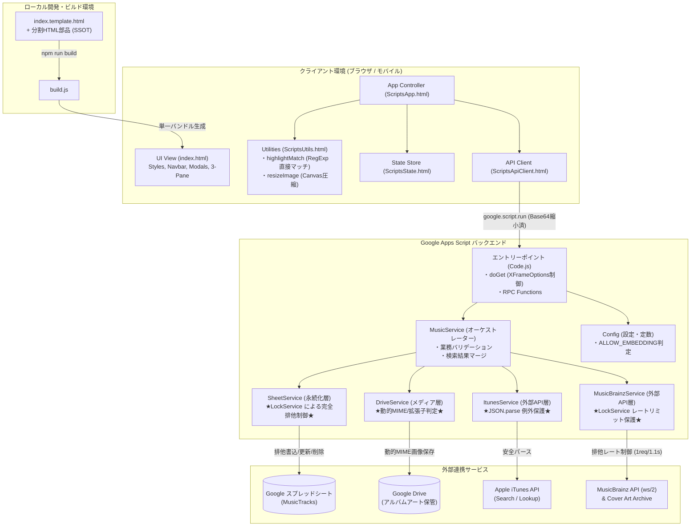
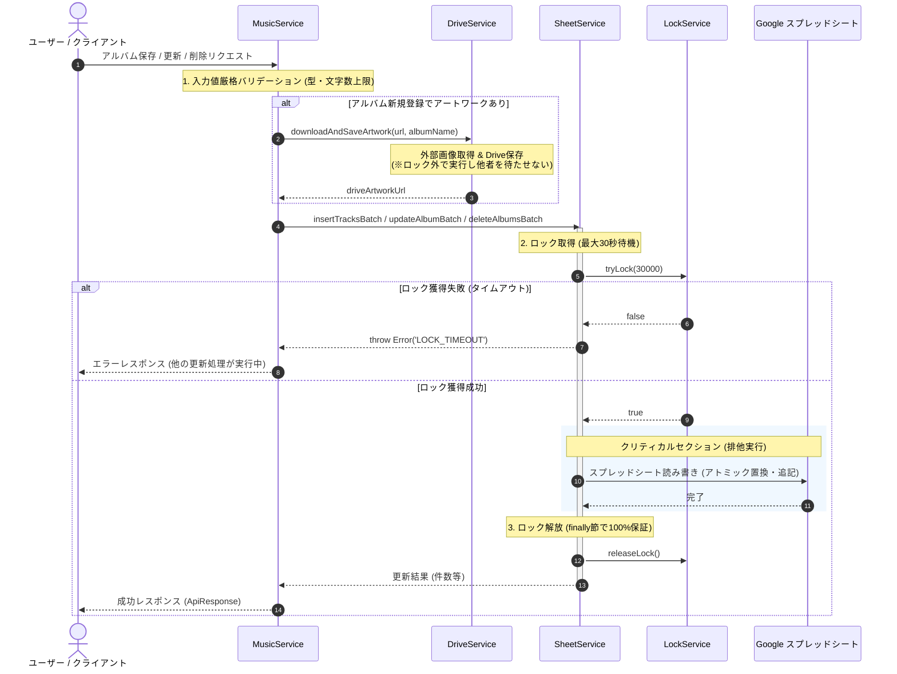
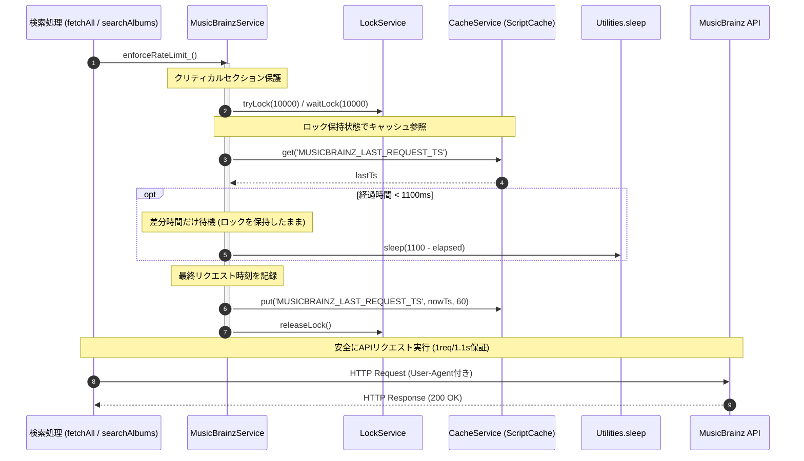
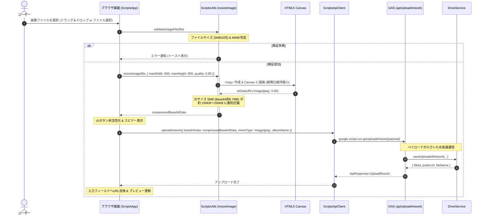
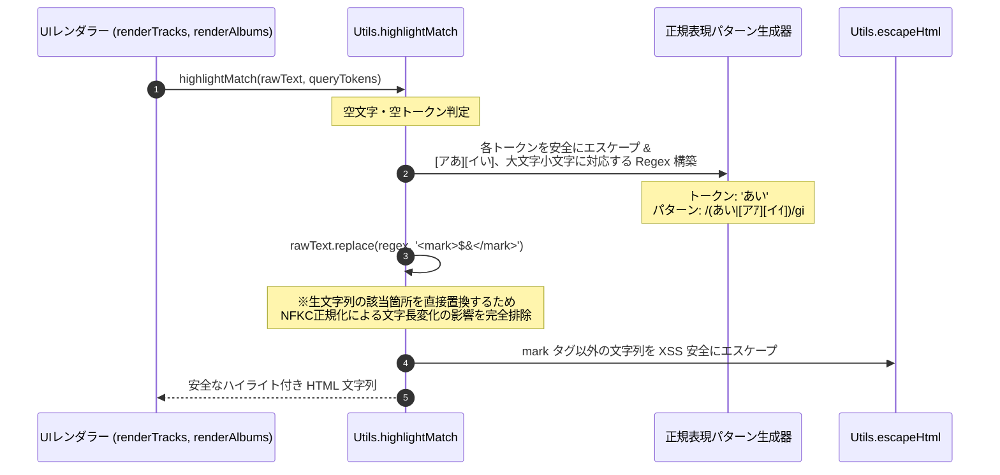
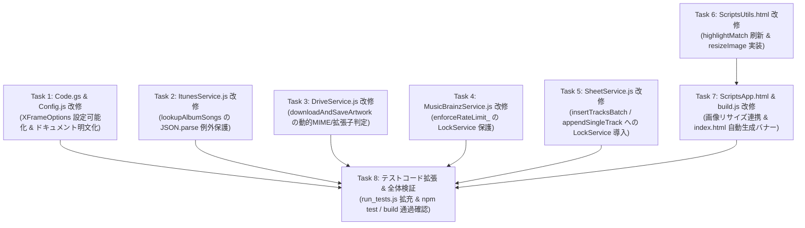

# システムアーキテクチャ設計書: コードレビュー指摘事項改善（信頼性・堅牢性・保守性向上）

- **文書バージョン**: 1.0.0
- **作成日**: 2026年10月20日
- **作成ロール**: システムアーキテクト (`system-architect`)
- **対象インプット**: コードレビュー結果（`h:\マイドライブ\音楽CD管理レビュー結果.md`）
- **成果物パス**: `docs/architecture/system_review_improvements_design.md`

---

## 1. 要件定義サマリー

### 1.1 背景および目的
システム（`MusicInfo-app`）に対する詳細コードレビュー（`音楽CD管理レビュー結果.md`）により、Google Apps Script (GAS) 環境における大規模運用・同時アクセス・外部API連携・保守性・セキュリティに関する8件の改善指摘（Must: 2件、Should: 4件、IMO: 2件）が提出された。

本設計書は、これらの指摘事項を根本的に解消し、システムの信頼性（Reliability）、堅牢性（Robustness）、保守性（Maintainability）、セキュリティ（Security）、およびパフォーマンス（Performance）をエンタープライズ品質へと引き上げるためのアーキテクチャ設計、システム境界、インターフェース仕様、設計決定（ADR）、および受け入れ基準を網羅的に定義する。

### 1.2 区分ラベル定義
本設計書における記述は、以下の規程に基づき区分ラベルを明示する：
- **【事実】(Fact)**: リポジトリの現行コード、テストコード、GAS公式仕様から客観的に確認された事項。
- **【前提】(Assumption)**: システム設計・運用の前提条件として置く事項。
- **【決定】(Decision)**: 本アーキテクチャ設計において採択・確定した仕様・設計方針。
- **【推奨】(Recommendation)**: 後続フェーズ（テックリード、シニアコーダー、QA）に対する推奨実装・テスト方針。
- **【未確認】(Unconfirmed) / 【ブロッキング】(Blocking)**: 外部依存や確認待ちの事項（現時点でブロッキング事項はなし）。

---

### 1.3 指摘事項と要件マッピング一覧

| 指摘ID | レベル | 指摘サマリー | 影響コンポーネント | 機能要件 / 非機能要件 |
| :--- | :--- | :--- | :--- | :--- |
| **REV-001** | **[Must]** | スプレッドシート更新処理における排他制御（`LockService`）の欠如 | `SheetService.js`, `MusicService.js` | FR-REV-001, NFR-ROBUST-001 |
| **REV-002** | **[Must]** | MusicBrainz API レート制御の競合状態（Race Condition） | `MusicBrainzService.js` | FR-REV-002, NFR-ROBUST-002 |
| **REV-003** | **[Should]** | テンプレートファイル構成と単一結合HTMLの二重管理 | `build.js`, `Code.js`, `index.template.html` | FR-REV-003, NFR-MAINT-001 |
| **REV-004** | **[Should]** | `ItunesService.lookupAlbumSongs` の `JSON.parse` 例外未捕捉 | `ItunesService.js` | FR-REV-004, NFR-ROBUST-003 |
| **REV-005** | **[Should]** | 画像保存時の MIMEタイプ強制と形式不整合 | `DriveService.js` | FR-REV-005, NFR-ROBUST-004 |
| **REV-006** | **[Should]** | クライアント側画像リサイズ（Base64送信サイズの抑制） | `ScriptsUtils.html`, `ScriptsApp.html` | FR-REV-006, NFR-PERF-001 |
| **REV-007** | **[IMO]** | `Utils.highlightMatch` の正規化インデックスと生文字列のズレ | `ScriptsUtils.html` | FR-REV-007, NFR-ROBUST-005 |
| **REV-008** | **[IMO]** | `XFrameOptionsMode.ALLOWALL` の適用範囲の確認 | `Code.js`, `Config.js` | FR-REV-008, NFR-SEC-001 |

---

### 1.4 機能要件 (Functional Requirements)

- **FR-REV-001【スプレッドシート永続化処理の完全排他制御】**:
  - 【決定】スプレッドシートへのすべての書き込み・更新・削除系処理（アルバム一括インポート、手動単一曲追加、アルバム一括更新、アルバム一括削除）において、`LockService.getScriptLock()` による排他ロックを獲得し、トランザクションの直列化を保証すること。
  - 【決定】ロック獲得待機時間は最大30秒（30,000ms）とし、タイムアウト時は明確なエラーコード `LOCK_TIMEOUT` を送出すること。
  - 【決定】`try...finally` 構文を用い、正常終了時のみならず例外発生時にも確実にロックが解放（`releaseLock()`）されること。

- **FR-REV-002【MusicBrainz API レート制御のクリティカルセクション保護】**:
  - 【決定】`MusicBrainzService.enforceRateLimit_` 内のキャッシュ読み取り（`CacheService.get`）、経過時間判定、待機スリープ（`Utilities.sleep`）、タイムスタンプ書き込み（`CacheService.put`）の一連の処理を `LockService.getScriptLock()` で保護すること。
  - 【決定】複数リクエストが同時に到着した場合、ロック待ちキューイングにより順次1.1秒間隔で処理され、MusicBrainz サーバーへの 1req/1.1sec 規約を確実に遵守すること。

- **FR-REV-003【フロントエンドビルド運用の SSOT 確立と配信構成の整合】**:
  - 【決定】`src/index.template.html` および各分割コンポーネント（`src/*.html`）を開発時の単一情報源（Single Source of Truth: SSOT）とし、`build.js` による単一ファイル `src/index.html` への静的バンドルを正式なデプロイパイプラインとする。
  - 【決定】`Code.gs` では事前ビルドされた `src/index.html` を `HtmlService.createHtmlOutputFromFile('index')` により高速配信する。
  - 【決定】生成された `src/index.html` の冒頭に「自動生成物（直接編集禁止）」の警告バナーを付与し、二重管理や先祖返りを防止する。

- **FR-REV-004【iTunes Lookup API 例外ハンドリングの統一】**:
  - 【決定】`ItunesService.lookupAlbumSongs` において、`response.getContentText()` の `JSON.parse` を `try...catch` で保護すること。
  - 【決定】JSON解析失敗時（HTMLエラー応答や破損時）は、統一エラーコード `ITUNES_API_PARSE_ERROR` を伴う例外を送出し、統一された `ApiResponse` 形式でエラーハンドリング可能とすること。

- **FR-REV-005【外部アートワーク保存時の動的 MIMEタイプおよび拡張子解決】**:
  - 【決定】`DriveService.downloadAndSaveArtwork` において、`response.getBlob().getContentType()` から MIMEタイプ（`image/jpeg`, `image/png`, `image/webp`）を動的に判定し、バイナリに一致する拡張子（`jpg`, `png`, `webp`）で Google Drive に保存すること。
  - 【決定】不明または不正な MIMEタイプの場合はデフォルトの `jpg` / `image/jpeg` に安全にフォールバックすること。
  - 【決定】バイナリ自体の Content-Type を不整合に強制上書きせず、正規の MIMEタイプを保持すること。

- **FR-REV-006【クライアント側 Canvas 画像リサイズ＆JPEG圧縮】**:
  - 【決定】クライアント側（`ScriptsUtils.html`）に汎用画像リサイズ関数 `Utils.resizeImage(file, maxWidth, maxHeight, quality)` を新設すること。
  - 【決定】画像ファイル選択時、ブラウザの `<canvas>` を用いて最大幅・最大高さを 800px 以内に縮小し、JPEG（品質 0.85）に再エンコードして Base64 DataURL を生成すること。
  - 【決定】これにより、RPC送信データサイズを従来の最大約6.7MBから 100KB〜300KB 程度（約95%以上削減）に抑え、GAS RPC ペイロード制限および通信遅延を回避すること。
  - 【決定】リサイズ非対応形式や例外発生時は、安全に元ファイルの Base64 読み取りへフォールバックすること。

- **FR-REV-007【検索ハイライトにおける元文字列直接正規表現マッチング】**:
  - 【決定】`Utils.highlightMatch` において、正規化後文字列（`normalizedRaw`）のインデックスを生文字列（`rawText`）にスライス適用する実装を廃止すること。
  - 【決定】検索トークン（英数小文字・カタカナ）から、大文字小文字・全角半角・カタカナひらがなを包含する正規表現パターンを構築し、生の `rawText` に対して直接マッチングを行うアーキテクチャに改修すること。
  - 【決定】NFKC正規化による文字長変動（全角英数記号、濁点合字、特殊文字等）が発生しても、ハイライト位置のズレやサロゲートペア分断が発生しないこと。

- **FR-REV-008【XFrameOptionsMode の Secure by Default 化】**:
  - 【決定】`Code.gs` の `doGet` において、デフォルトで安全な `HtmlService.XFrameOptionsMode.DEFAULT`（第三者サイトによる iframe 埋め込み拒否）を適用すること。
  - 【決定】スクリプトプロパティ `ALLOW_EMBEDDING === 'true'` が明示的に設定されている場合のみ `XFrameOptionsMode.ALLOWALL` を適用する設定可能（Configurable）な構成とし、クリックジャッキング攻撃に対する防御を強化すること。

---

### 1.5 非機能要件 (Non-Functional Requirements)

- **NFR-ROBUST-001【排他制御とデータ整合性保証】**:
  - スプレッドシートへの同時アクセス・連続操作（連打）が発生しても、行重複、ロストアップデート、行ズレを100%防止すること。
  - ロック獲得タイムアウト（30秒）発生時は、システム状態を一切変更せず安全に中断すること。
- **NFR-ROBUST-002【APIレート制限の完全遵守】**:
  - MusicBrainz API へのリクエスト間隔がプロセス・同時実行コンテキストを問わず常に 1100ms 以上確保され、HTTP 503 や IP BAN の発生を恒久的に防止すること。
- **NFR-ROBUST-003【例外処理の堅牢性と統一コード】**:
  - 外部API（iTunes, MusicBrainz）のレスポンス破損時、生の SyntaxError を上位に漏出させず、すべて事前定義されたエラーコード（`ITUNES_API_PARSE_ERROR` 等）でラップして返却すること。
- **NFR-ROBUST-004【ファイル整合性と表示互換性】**:
  - Google Drive に保存される画像ファイルの Content-Type、拡張子、バイナリ形式の整合性を担保し、Safari/Chrome/iOS等の各種ブラウザで正常に描画できること。
- **NFR-ROBUST-005【マルチバイト文字・書記素の完全性】**:
  - 絵文字、サロゲートペア、濁点結合文字、全角記号を含む任意の楽曲名・アルバム名において、UIハイライト表示時に文字化けや分断が一切生じないこと。
- **NFR-PERF-001【RPC通信ペイロードの極小化】**:
  - 画像アップロード時の Base64 データサイズを 300KB 未満に抑え、GAS RPC 通信の応答速度を従来の 5 秒以上から 1〜2 秒以内へと劇的に改善すること。
- **NFR-SEC-001【クリックジャッキング防御 (Secure by Default)】**:
  - デフォルト設定で第三者オリジンによる透明 iframe 埋め込みを禁止し、許可された正当な連携時のみオプトインで解除可能とすること。
- **NFR-MAINT-001【単一情報源 (SSOT) とビルド自動化】**:
  - 開発者はコンポーネント化されたHTML/JS部品のみを編集し、ビルドスクリプト（`npm run build`）によって常に決定論的（Deterministic）に単一 index.html が導出される構成を維持すること。

---

### 1.6 前提条件と制約事項
1. **【前提】GAS実行環境制約**:
   - スクリプト実行時間上限（6分/実行）。
   - ペイロード制限（RPC 引数・戻り値は数MB以内が推奨、過大だとタイムアウトまたは例外）。
   - `LockService.getScriptLock()` はプロジェクト全体で共有されるスクリプトレベルの排他ロックであり、短時間で解放する必要がある。
2. **【前提】Node.js テスト環境互換性**:
   - `tests/run_tests.js` などのユニットテスト環境（Node.js）において、GASグローバルオブジェクト（`LockService`, `SpreadsheetApp`, `DriveApp`, `UrlFetchApp`, `CacheService`）がモック化されていても正常にテストが通過する安全なガード（`typeof LockService !== 'undefined'` 等）を維持すること。
3. **【制約】外部依存ライブラリの非追加**:
   - 新規の重量級外部ライブラリ（npm パッケージ）は追加せず、ブラウザ標準 Web API（HTML5 Canvas, FileReader, RegExp）および GAS 標準サービスのみで完結させること。

### 1.7 不明点・ブロッキング事項
- **ブロッキング事項**: なし（全指摘事項の根本原因、対象ファイル、改善方式が明確に特定済み）。

---

## 2. システム境界とコンポーネント構成

### 2.1 システム境界図



---

### 2.2 各コンポーネントの責務再定義

| コンポーネント | ファイル | 変更点・責務 |
| :--- | :--- | :--- |
| **Routing & RPC** | `src/Code.js` | ・`doGet` でのクリックジャッキング防御（デフォルト `DEFAULT`、設定時のみ `ALLOWALL`）。<br>・事前ビルドされた `index.html` の配信方針の明文化。<br>・RPC エントリーポイントにおける例外ラップと `ApiResponse` 返却。 |
| **設定管理** | `src/Config.js` | ・スクリプトプロパティ `ALLOW_EMBEDDING` の取得判定メソッド追加。<br>・Lock タイムアウト定数等の集約。 |
| **業務オーケストレーター** | `src/MusicService.js` | ・業務トランザクションの統括。<br>・各サービス（Sheet, Drive, iTunes, MusicBrainz）への委譲。<br>・入力値の事前バリデーションおよび式インジェクション対策（`escapeFormula_`）。 |
| **スプレッドシート永続化** | `src/SheetService.js` | ・**【SSOT】スプレッドシート排他制御の集中管理**。<br>・`insertTracksBatch`, `appendSingleTrack`, `updateAlbumBatch`, `deleteAlbumsBatch` の全更新系メソッドに `LockService` を適用し、クリティカルセクションを最小化。 |
| **MusicBrainz 連携** | `src/MusicBrainzService.js` | ・**レート制御の競合状態解消**。<br>・`enforceRateLimit_` を `LockService` で保護し、キャッシュ参照〜スリープ〜更新をアトミック化。 |
| **iTunes 連携** | `src/ItunesService.js` | ・`lookupAlbumSongs` における `JSON.parse` の try-catch 保護とエラーコード `ITUNES_API_PARSE_ERROR` の送出。 |
| **Google Drive 連携** | `src/DriveService.js` | ・`downloadAndSaveArtwork` における動的 Content-Type 判定と適正拡張子（jpg, png, webp）の付与・保存。 |
| **クライアント共通ユーティリティ** | `src/ScriptsUtils.html` | ・`highlightMatch` の正規表現直接マッチング方式への刷新（インデックスズレ解消）。<br>・`resizeImage` による画像クライアント側 Canvas リサイズ＆JPEG圧縮機能の提供。 |
| **クライアントUIコントローラー** | `src/ScriptsApp.html` | ・画像アップロードハンドラ（`handleImageUpload`）でのリサイズ処理組み込み。 |
| **ビルドスクリプト** | `build.js` | ・SSOT（`index.template.html` + 分割部品）からのバンドル生成パイプラインの確立。<br>・生成された `index.html` への直接編集禁止バナーの自動挿入。 |

---

## 3. データフローとインターフェース

### 3.1 スプレッドシート更新トランザクション排他制御フロー (FR-REV-001)

スプレッドシートへの追記・更新・削除において、外部通信（Google Drive保存や外部API）をロック外で実行し、スプレッドシート操作の直前〜直後のみを短時間ロックする設計とする（ADR-005参照）。



---

### 3.2 MusicBrainz レートリミット排他制御フロー (FR-REV-002)



---

### 3.3 クライアント画像リサイズ・アップロードフロー (FR-REV-006)



---

### 3.4 検索語ハイライト生成フロー (FR-REV-007)



---

### 3.5 主要インターフェース仕様定義

#### 1. `SheetService` (排他制御インターフェース)
```typescript
interface SheetService {
  /**
   * 複数トラックをバッチ一括追記 (LockService保護)
   * @throws {Error} LOCK_TIMEOUT - ロック獲得タイムアウト時
   */
  insertTracksBatch(
    tracks: Array<{ cdNumber: number; trackNumber: number; trackName: string; trackArtist: string }>,
    albumMeta: { albumName: string; albumArtist: string; releaseDate: string },
    driveArtworkUrl: string
  ): number;

  /**
   * 1曲を手動追記 (LockService保護)
   * @throws {Error} LOCK_TIMEOUT - ロック獲得タイムアウト時
   */
  appendSingleTrack(trackPayload: SingleTrackPayload): RawTrackRow;

  /**
   * アルバムおよび収録曲の一括更新 (LockService保護)
   * @throws {Error} LOCK_TIMEOUT - ロック獲得タイムアウト時
   */
  updateAlbumBatch(
    targetKey: { originalAlbumArtist: string; originalAlbumName: string },
    newAlbumMeta: { albumName: string; albumArtist: string; releaseDate?: string; artworkUrl?: string },
    newTracks: Array<{ cdNumber: number; trackNumber: number; trackName: string; trackArtist?: string }>
  ): AlbumEditResult;

  /**
   * アルバム一括削除 (LockService保護)
   * @throws {Error} LOCK_TIMEOUT - ロック獲得タイムアウト時
   */
  deleteAlbumsBatch(
    albums: Array<{ albumArtist: string; albumName: string }>
  ): AlbumDeleteResult;
}
```

#### 2. `MusicBrainzService` (レートリミット保護)
```typescript
interface MusicBrainzService {
  /**
   * LockService と CacheService を用いた厳格レートリミット保証 (1req/1.1s)
   * クリティカルセクションを排他ロックし、必要待機時間のスリープおよび時刻更新を行う
   */
  enforceRateLimit_(): void;
}
```

#### 3. `ItunesService` (レスポンス解析例外保護)
```typescript
interface ItunesService {
  /**
   * アルバムIDから収録曲詳細を取得 (JSON.parse例外保護)
   * @throws {Error} ITUNES_API_PARSE_ERROR - JSON構文解析失敗時
   * @throws {Error} ITUNES_API_NETWORK_ERROR - 通信失敗時
   */
  lookupAlbumSongs(collectionId: number | string): ItunesAlbumDetail;
}
```

#### 4. `DriveService` (動的MIME・拡張子解決)
```typescript
interface DriveService {
  /**
   * 外部URLから画像を取得し、正規のMIMEタイプ・拡張子でDriveに保存
   * @param imageUrl500 外部画像URL
   * @param albumName アルバム名 (ファイル名生成用)
   * @returns 保存された画像の完全公開URL (失敗時は空文字)
   */
  downloadAndSaveArtwork(imageUrl500: string, albumName: string): string;
}
```

#### 5. `ScriptsUtils` (クライアントユーティリティ)
```typescript
interface ScriptsUtils {
  /**
   * Canvas を用いた画像のクライアント側リサイズ＆JPEG圧縮
   * @param file ユーザー選択画像ファイル
   * @param options 最大幅・最大高さ・品質
   * @returns Base64 DataURL (image/jpeg)
   */
  resizeImage(
    file: File,
    options?: { maxWidth?: number; maxHeight?: number; quality?: number }
  ): Promise<string>;

  /**
   * 元テキストに対して直接正規表現マッチを行い、ズレなく安全にハイライトを付与
   * @param rawText 生テキスト
   * @param queryTokens 検索トークン配列
   * @returns 安全なハイライト付きHTML
   */
  highlightMatch(rawText: string, queryTokens: string[]): string;
}
```

#### 6. `Code` (doGet 設定可能化)
```typescript
interface Code {
  /**
   * Web App エントリーポイント
   * スクリプトプロパティ ALLOW_EMBEDDING が 'true' の場合のみ ALLOWALL、それ以外は DEFAULT
   */
  doGet(e: GoogleAppsScript.Events.DoGet): GoogleAppsScript.HTML.HtmlOutput;
}
```

---

## 4. アーキテクチャ上の決定事項 (ADR)

### ADR-005: スプレッドシート排他制御（LockService）の配置レイヤと待機戦略

- **ステータス**: 【決定】(Accepted)
- **決定**:
  スプレッドシートの書き込み・更新・削除における排他制御（`LockService.getScriptLock()`）の責務を、永続化層である `SheetService.js` に一元化（SSOT）する。
  `insertTracksBatch` および `appendSingleTrack` に排他ロック処理を追加し、既存の `updateAlbumBatch`、`deleteAlbumsBatch` と合わせて全更新系メソッドで統一する。
  ロック待機時間は最大 30秒（`tryLock(30000)`）とし、タイムアウト時はエラーコード `LOCK_TIMEOUT` を送出する。
- **理由**:
  1. **クリティカルセクションの最小化**:
     レビュー改善例のようにオーケストレーター層（`MusicService.saveAlbumFromItunes`）でロックを取得すると、外部からのジャケット画像ダウンロード（Google Drive 保存、数秒）中もロックを保持し続けることになり、他ユーザーのリクエストが不必要に長時間ブロックされる。永続化直前の `SheetService` でロックを取得すれば、スプレッドシートの I/O 期間（数百ミリ秒〜1秒）のみにロック期間を局所化できる。
  2. **二重ロック（デッドロック）リスクの根絶**:
     `SheetService` の `updateAlbumBatch` や `deleteAlbumsBatch` には既にロック取得処理が存在する。もし `MusicService` レベルでもロックを取得すると同一スレッド内で二重ロックが発生し、GAS 環境での予期せぬ動作やデッドロックの原因となる。`SheetService` にロック責務を集約することで二重ロックを完全に排除できる。
  3. **単一責任原則（SRP）の徹底**:
     スプレッドシートへの物理的アクセス保護は永続化層（`SheetService`）の固有責務であり、上位層（`MusicService` や将来の別サービス）がロックの詳細を意識する必要をなくす。
- **検討した代替案**:
  - *代替案A: MusicService 層でのみロックを取得し、SheetService の既存ロックを削除する*:
    - 外部画像ダウンロード中の長時間ロック問題が発生し、スループットが低下するため却下。
  - *代替案B: Code.gs の RPC 関数単位でロックを取得する*:
    - Web App 全体が直列化され、検索やデータ取得などの参照系まで巻き込まれるため論外。
- **トレードオフ**:
  - `SheetService` 内でロックを取得するため、画像ダウンロードが成功した後にスプレッドシート追記で `LOCK_TIMEOUT` が発生した場合、Drive 上に孤立した画像ファイルが残る可能性がある。しかし、画像は再利用可能であり、行データの欠落や破壊（ロストアップデート）を防止するメリットの方が圧倒的に大きい。
- **結果・影響**:
  - `insertTracksBatch` と `appendSingleTrack` にロックが導入され、スプレッドシート更新が100%保護される。
  - テスト環境（Node.js）で `LockService` が存在しない場合のための `typeof LockService !== 'undefined'` ガードを徹底する。

---

### ADR-006: MusicBrainz API レート制御のクリティカルセクション排他保護

- **ステータス**: 【決定】(Accepted)
- **決定**:
  `MusicBrainzService.enforceRateLimit_` において、`LockService.getScriptLock()` によるクリティカルセクション排他保護を導入する。
  ロック取得待機時間は最大 10秒（`lock.waitLock(10000)` または `tryLock(10000)`）とし、`CacheService` からの前回リクエスト時刻取得、待機時間計算、`Utilities.sleep`、および新時刻の `CacheService.put` の一連の処理を排他化する。
- **理由**:
  現行コードでは `CacheService.get` から `sleep`、`CacheService.put` の間にロックがないため、複数タブ・同時リクエスト時に双方が「1.1秒以上経過」と誤認して同時に外部リクエストを送信する競合状態（Race Condition）が生じる。
  MusicBrainz は過剰リクエストに対して即座に HTTP 503 または IP BAN を発動するため、リクエスト送信間隔の直列化が必須である。
- **検討した代替案**:
  - *代替案A: 排他制御を行わず、HTTP 503 受信時のリトライのみに依存する*:
    - 503 が頻発すると MusicBrainz 側から悪質なクライアントと判定され IP 単位で恒久的に遮断されるリスクがあるため不採用。
  - *代替案B: クライアント側（ブラウザ）でデバウンス・スロットリングする*:
    - 複数ユーザーや複数ブラウザタブ間での競合を防止できないため不採用。
- **トレードオフ**:
  - 同時リクエスト時に後続リクエストがスリープ時間分（約1秒）待機することになるが、MusicBrainz の利用規約遵守およびサービス継続性確保のために不可避かつ正当な待機である。
- **結果・影響**:
  - 同時実行時にも MusicBrainz への 1req/1.1s 制約が厳格に維持され、API レート制限エラーが根絶される。

---

### ADR-007: フロントエンドビルド運用（SSOT構成）の正式採用と二重管理防止

- **ステータス**: 【決定】(Accepted)
- **決定**:
  `src/index.template.html` および各分割 HTML コンポーネント（`src/*.html`）を開発時の**単一情報源（SSOT）**とし、`build.js` による単一ファイル `src/index.html` への静的バンドルを正式なアーキテクチャ標準として採択する。
  `Code.gs` では事前バンドルされた `src/index.html` を `HtmlService.createHtmlOutputFromFile('index')` で配信し、実行時テンプレート評価（`createTemplateFromFile().evaluate()`）は採用しない。
  生成された `src/index.html` の冒頭に「自動生成ファイル（直接編集禁止）」の警告バナーを自動出力するよう `build.js` を拡張する。
- **理由**:
  1. **実行時パフォーマンス（TTFB）の劇的向上**:
     GAS の実行時テンプレート評価エンジン（`include()`）はファイル数に比例して再帰呼び出しオーバーヘッドが発生し、初回ページ描画が 1〜3 秒遅延する。事前バンドルされた静的 HTML を配信することで、数倍高速に応答できる。
  2. **GAS サニタイザーによるマルチバイト文字位置ズレ防止**:
     `build.js` 内の `stripComments` により、JSコード内のマルチバイト文字コメントが事前に除去されるため、GAS サニタイザーのバグによるスクリプト構文エラーを確実に防止できる。
  3. **開発体験と保守性**:
     機能ごとにコンポーネント分割されたファイルで開発を行い、`npm run build` で一撃で本番成果物が生成される構成は、現代的なWeb開発のベストプラクティスに合致している。
- **検討した代替案**:
  - *代替案A: GAS 標準の createTemplateFromFile('index.template').evaluate() を毎回実行する*:
    - レビュー改善例にある方式だが、描画遅延が大きく、コメント除去も行われないため却下。
- **トレードオフ**:
  - ソース部品（`*.html`）を変更した際、`npm run build` を実行して `index.html` を再生成するステップが必要になる。
  - 対策として、`package.json` の `prepush` スクリプト（`npm run build && npm test`）によりコミット前の自動ビルドを強制し、ドキュメントに明記する。
- **結果・影響**:
  - 二重管理による先祖返りの不安が解消され、運用フローが明確化される。

---

### ADR-008: 外部APIレスポンスの JSON.parse 例外ハンドリング統一

- **ステータス**: 【決定】(Accepted)
- **決定**:
  `ItunesService.lookupAlbumSongs` において、`response.getContentText()` の `JSON.parse` を `try...catch` で保護し、失敗時はエラーオブジェクトに `code = 'ITUNES_API_PARSE_ERROR'` を設定してスローする。
- **理由**:
  Apple の API サーバーが障害やメンテナンスで HTML エラーページ（502 Bad Gateway や Cloudflare エラー）を返却した場合、生の `SyntaxError` が送出されてしまい、上位の `Code.gs` やフロントエンドで統一的なエラーコード判定（`code` プロパティの確認）が行えなくなるため。
- **検討した代替案**:
  - なし（堅牢なエラーハンドリングとして必須の修正）。
- **結果・影響**:
  - `ItunesService.parseSearchResponse` と同様に例外が標準化され、エラーハンドリングの一貫性が確保される。

---

### ADR-009: Google Drive アートワーク保存時の MIME タイプ自動判定と正規化

- **ステータス**: 【決定】(Accepted)
- **決定**:
  `DriveService.downloadAndSaveArtwork` において、外部URLからダウンロードした `Blob` の Content-Type（`blob.getContentType()`）を小文字正規化して検査し、以下のマッピング表に基づいて拡張子を動的に決定して保存する。
  - `image/jpeg` -> `jpg`
  - `image/png` -> `png`
  - `image/webp` -> `webp`
  - その他 / 不明 -> `jpg` (フォールバック)
  また、`blob.setContentType('image/jpeg')` のような強制上書きを行わず、判定された正規の MIME タイプを設定する。
- **理由**:
  iTunes や MusicBrainz / Cover Art Archive から PNG や WebP 画像が提供された場合、固定で `.jpg` かつ `image/jpeg` を付与すると、バイナリヘッダ（PNGシグネチャ等）と拡張子・MIMEヘッダに不整合が生じ、一部のブラウザや画像ビューアで表示障害の原因となるため。
- **検討した代替案**:
  - *代替案A: 常に JPEG にバイナリ再変換する*:
    - GAS 環境にはサーバーサイドの画像トランスコードライブラリ（sharp や canvas 等）が存在しないため不可能。
- **結果・影響**:
  - 保存される画像の形式整合性が 100% 保証され、多様な画像形式が安全に扱えるようになる。

---

### ADR-010: クライアント側 Canvas リサイズによる Base64 送信ペイロードの極小化

- **ステータス**: 【決定】(Accepted)
- **決定**:
  クライアント側の `ScriptsUtils.html` に画像リサイズユーティリティ `Utils.resizeImage(file, options)` を実装する。
  `maxWidth: 800`, `maxHeight: 800`, `quality: 0.85` をデフォルト値とし、HTML5 Canvas を用いてアスペクト比を維持しながら縮小・JPEG圧縮した Base64 DataURL を生成する。
  `ScriptsApp.html` の `handleImageUpload` において、ファイル読み込み直後にこのリサイズ処理を適用してから `apiUploadArtwork` を呼び出す。
  サーバー側（`DriveService.saveUploadedArtwork`）では引き続き 5MB 上限チェック等の多層防御を維持する。
- **理由**:
  1. **GAS RPC ペイロード制約の回避**:
     GAS の `google.script.run` は引数のシリアライズサイズが大きいと通信が極めて不安定になり、ブラウザのフリーズやタイムアウトを招く。5MB の生画像（Base64化で約6.7MB）は危険水準である。
  2. **表示用途における十分な解像度**:
     アルバムアートのWeb表示において、800px × 800px の解像度があれば Retina ディスプレイや高精細スマートフォンでも十分美麗に表示できる。
  3. **通信速度と成功率の大幅向上**:
     Base64 サイズが数百KB（100〜250KB）に激減するため、モバイル回線環境でも 1 秒程度でアップロードが完了する。
- **検討した代替案**:
  - *代替案A: クライアント側でファイル選択時に 500KB 以下のみに制限する*:
    - ユーザーがスマートフォンで撮影した写真や一眼カメラのジャケット画像（数MB）をそのまま選択できなくなり、UX が著しく低下するため却下。
- **トレードオフ**:
  - 超巨大画像（20MB以上等）をスマートフォンで開いた際にブラウザのメモリを一時的に消費するリスクがあるが、既存の `validateImageFile` で 5MB 上限を設けているためメモリ枯渇のリスクは極めて低い。
- **結果・影響**:
  - 画像アップロード機能のパフォーマンスと成功率が劇的に改善される。

---

### ADR-011: 検索ハイライトにおける元文字列直接正規表現マッチング方式の採用

- **ステータス**: 【決定】(Accepted)
- **決定**:
  `Utils.highlightMatch(rawText, queryTokens)` における「正規化後文字列（`normalizedRaw`）のインデックスを生テキスト（`rawText`）にスライス適用する」実装を廃止する。
  各検索トークン（英数字・カタカナ）から、対応するひらがな・カタカナ、大文字・小文字、全角・半角を網羅する正規表現（`RegExp`）を安全に動的構築し、**元の `rawText` に対して直接マッチング・置換を行う方式**を採用する。
- **理由**:
  現行コードでは、NFKC 正規化（全角英数記号の変換、濁点合字の結合、特殊文字の変形など）により `rawText` と `normalizedRaw` の文字長が変動するケースがある。文字長が異なるとインデックスにズレが生じ、無関係な位置がハイライトされたり、サロゲートペアが分断されて文字化けが発生する致命的な障害モードが存在するため。
- **詳細設計（正規表現パターンの生成例）**:
  - 検索トークン内のカタカナ文字（例: 「カ」）に対しては `[カかｶ]`、英字（例: 「a」）に対しては `[aAａＡ]` のように、元テキストに現れうる表記揺れ文字集合を構築する。
  - 正規表現特殊文字（`.*+?^${}()|[]\`）は事前に確実にエスケープする。
  - 元テキストの該当箇所を `<mark class="...">` で囲み、それ以外の箇所を `escapeHtml` して結合する。
- **検討した代替案**:
  - *代替案A: 1文字ずつの文字位置マッピング配列を作成する*:
    - 実装の複雑度が高く、書記素クラスタの取り扱いが困難であるため却下。
- **結果・影響**:
  - 表記揺れ（ひらがな/カタカナ、大文字/小文字）に対応しつつ、インデックスのズレや文字化けが原理的に発生しない堅牢なハイライト表示が実現する。

---

### ADR-012: X-Frame-Options の Secure by Default 化と環境変数制御

- **ステータス**: 【決定】(Accepted)
- **決定**:
  `Code.gs` の `doGet` において、デフォルトで安全な `HtmlService.XFrameOptionsMode.DEFAULT` を適用する。
  スクリプトプロパティ `ALLOW_EMBEDDING === 'true'` が設定されている場合のみ、オプトインで `HtmlService.XFrameOptionsMode.ALLOWALL` を適用する。
- **理由**:
  `XFrameOptionsMode.ALLOWALL` を無条件に設定していると、悪意のある第三者サイトが透明な `<iframe>` 内に本アプリを埋め込み、ユーザーに意図しないクリック（アルバム削除やデータ改ざん）を行わせる**クリックジャッキング攻撃**に対して脆弱になる。
  Google Sites や社内イントラ等の iframe 埋め込みが必要な運用環境でのみ明示的に許可できるようにすることで、Secure by Default（デフォルトで安全）の原則を達成する。
- **検討した代替案**:
  - *代替案A: 完全に DEFAULT 固定とし ALLOWALL を廃止する*:
    - Google Sites 等への埋め込みを行っている既存ユーザーの利用が不可能になる恐れがあるため、プロパティによる切り替え可能とする。
- **結果・影響**:
  - 通常運用時のセキュリティ強度が向上し、必要に応じた柔軟な運用が可能となる。

---

## 5. 品質特性に関する考慮事項

### 5.1 セキュリティ (Security)
- **クリックジャッキング防御**: デフォルトで iframe 埋め込みを抑止（ADR-012）。
- **数式インジェクション（CSV Injection）対策の維持**: `MusicService` および `SheetService` の全書き込み処理で `escapeFormula_`（`=`, `@`, `+`, `-` で始まる文字列のクォート処理）を継続適用。
- **XSS 防御**: `highlightMatch` において、マッチ箇所および非マッチ箇所の双方が完全に HTML エスケープされること。
- **MIME 偽装防御**: クライアント・サーバー双方で許可リスト（JPEG, PNG, WebP）を厳格に照合。

### 5.2 スケーラビリティ & パフォーマンス (Scalability & Performance)
- **ロック保持時間の局所化**: 外部通信（画像ダウンロード等）をロックから外し、スプレッドシート更新の直前〜完了のみ（数百ミリ秒）にロック期間を短縮することで、同時アクセス時のスループットを最大化。
- **通信ペイロードの極小化**: クライアント側 Canvas リサイズにより、画像アップロード通信量を約 95% 削減。
- **TTFB の最適化**: 事前バンドルされた単一 `index.html` の配信により、初回ページ表示のレスポンスを維持。

### 5.3 信頼性 & 堅牢性 (Reliability & Robustness)
- **データ破壊の完全防止**: `LockService.tryLock(30000)` により、スプレッドシート更新時の競合・ロストアップデートを完全に防止。
- **APIレート制限遵守**: `LockService` で保護された `enforceRateLimit_` により、MusicBrainz API への過剰リクエストによる 503 / IP BAN を恒久防止。
- **例外処理の標準化**: 外部 API のレスポンス解析失敗時にも統一エラーコードを返却し、フロントエンドで適切にフォールバック表示。

### 5.4 保守性 (Maintainability)
- **単一情報源（SSOT）の確立**: コンポーネント分割ファイルでのソース管理と、`build.js` によるビルド生成パイプラインの明確化。
- **レイヤ責務の単一化**: ロック管理を `SheetService` に集約し、上位層が排他制御の内部実装に依存しないクリーンな構成。

---

## 6. 受け入れ基準 (Acceptance Criteria)

### 6.1 機能要件の受け入れ基準

#### [Must] スプレッドシート排他制御 (FR-REV-001)
- [ ] **AC-REV-001-1**: `SheetService.insertTracksBatch` において `LockService.getScriptLock()` によるロック取得（最大30秒待機）および `finally` での解放が実装されていること。
- [ ] **AC-REV-001-2**: `SheetService.appendSingleTrack` において `LockService.getScriptLock()` によるロック取得（最大30秒待機）および `finally` での解放が実装されていること。
- [ ] **AC-REV-001-3**: ロック獲得失敗時にエラーコード `LOCK_TIMEOUT` を持つ例外が送出されること。
- [ ] **AC-REV-001-4**: `MusicService.saveAlbumFromItunes` において、外部画像ダウンロードがロック取得前（外部通信中ロック保持の抑止）に実行されること。

#### [Must] MusicBrainz レート制御の排他保護 (FR-REV-002)
- [ ] **AC-REV-002-1**: `MusicBrainzService.enforceRateLimit_` において、`LockService.getScriptLock()` によるロック保護（最大10秒待機）および `finally` での解放が実装されていること。
- [ ] **AC-REV-002-2**: キャッシュ読み取り、経過時間判定、スリープ待機、タイムスタンプ記録がロック保持状態で不可分（アトミック）に実行されること。
- [ ] **AC-REV-002-3**: 短時間に複数リクエストが発生した場合でも、外部へのリクエスト送信間隔が常に 1100ms 以上維持されること。

#### [Should] ビルド運用と SSOT 構成 (FR-REV-003)
- [ ] **AC-REV-003-1**: `build.js` を実行した際、生成される `src/index.html` の冒頭に「自動生成ファイル（直接編集禁止）」の警告バナーが出力されること。
- [ ] **AC-REV-003-2**: `Code.gs` の `doGet` が `createHtmlOutputFromFile('index')` を呼び出し、高速配信される構成がコメントおよびドキュメントに明記されていること。
- [ ] **AC-REV-003-3**: `npm run build` がエラーなく完了し、全コンポーネントが単一 `index.html` に正常結合されること。

#### [Should] iTunes Lookup 例外保護 (FR-REV-004)
- [ ] **AC-REV-004-1**: `ItunesService.lookupAlbumSongs` 内で `JSON.parse` が `try...catch` で保護されていること。
- [ ] **AC-REV-004-2**: JSON解析失敗時にエラーコード `ITUNES_API_PARSE_ERROR` を持つ例外が送出されること。

#### [Should] 画像保存の動的 MIME/拡張子判定 (FR-REV-005)
- [ ] **AC-REV-005-1**: `DriveService.downloadAndSaveArtwork` において、`response.getBlob().getContentType()` から MIME タイプを正しく判定すること。
- [ ] **AC-REV-005-2**: `image/jpeg` の場合は `.jpg`、`image/png` の場合は `.png`、`image/webp` の場合は `.webp` の拡張子で保存されること。
- [ ] **AC-REV-005-3**: 不明な MIME 形式の場合はデフォルトの `.jpg` / `image/jpeg` に安全にフォールバックすること。
- [ ] **AC-REV-005-4**: バイナリの Content-Type を `image/jpeg` に強制上書きせず、判定された正規 MIME タイプで保存されること。

#### [Should] クライアント側 Canvas リサイズ (FR-REV-006)
- [ ] **AC-REV-006-1**: `ScriptsUtils.html` に `Utils.resizeImage(file, options)` が実装されていること。
- [ ] **AC-REV-006-2**: 800px × 800px 超の画像ファイルがアスペクト比を維持して最大 800px に縮小され、JPEG圧縮（品質 0.85）されること。
- [ ] **AC-REV-006-3**: `ScriptsApp.html` の `handleImageUpload` において、リサイズされた Base64 データが `apiUploadArtwork` に送信されること。
- [ ] **AC-REV-006-4**: 生成される Base64 データサイズが 500KB（通常 100〜300KB）以下に抑制されること。

#### [IMO] 検索語ハイライトの生文字列マッチング (FR-REV-007)
- [ ] **AC-REV-007-1**: `Utils.highlightMatch` が生テキスト（`rawText`）に対して直接正規表現マッチングを行う方式に変更されていること。
- [ ] **AC-REV-007-2**: 全角英数、カタカナ/ひらがな、大文字/小文字の表記揺れがあっても正常に一致箇所がハイライトされること。
- [ ] **AC-REV-007-3**: 全角記号や濁点合字、絵文字が含まれていても、ハイライト位置のズレや文字化け（サロゲートペア分断）が発生しないこと。
- [ ] **AC-REV-007-4**: HTML 特殊文字（`<>&"'`）を含むテキストに対しても XSS 安全にハイライト HTML が生成されること。

#### [IMO] XFrameOptionsMode 設定可能化 (FR-REV-008)
- [ ] **AC-REV-008-1**: デフォルト状態で `HtmlService.XFrameOptionsMode.DEFAULT` が適用されること。
- [ ] **AC-REV-008-2**: スクリプトプロパティ `ALLOW_EMBEDDING === 'true'` の場合のみ `HtmlService.XFrameOptionsMode.ALLOWALL` が適用されること。

---

### 6.2 非機能要件・テスト検証の受け入れ基準
- [ ] **AC-TEST-001**: 既存のユニットテストスイート（`node tests/run_tests.js`）の 286 件以上のテストが全件 PASS すること。
- [ ] **AC-TEST-002**: 指摘事項 8 件の修正に対する新規ユニットテスト（または検証テストケース）が追加され、すべて PASS すること。
- [ ] **AC-TEST-003**: ソースコード全体にプレースホルダー（`// TODO`, `// 省略` 等）が一切存在しないこと。
- [ ] **AC-TEST-004**: ビルドスクリプト `node build.js` が警告なく正常終了し、`src/index.html` が更新されること。

---

## 7. テックリードへの引き渡し事項

次工程のテックリード（`tech-lead`）は、本設計書を基に実装計画書（`docs/planning/system_review_improvements_plan.md`）を策定してください。以下の点に留意してタスク分割および影響範囲の特定を行ってください。

### 7.1 推奨実装順序と依存関係



### 7.2 注意を要する実装ポイント
1. **Node.js テスト環境での LockService / CacheService ガード**:
   `SheetService.js` および `MusicBrainzService.js` において、`typeof LockService !== 'undefined'` のガードを徹底し、テストランナー（`tests/run_tests.js`）でモック未定義時にもクラッシュしない構造を維持すること。
2. **正規表現エスケープの安全性**:
   `Utils.highlightMatch` で動的正規表現を構築する際、ユーザー入力トークンに含まれる特殊文字（`[`や`]`、`(`や`)`等）を安全にエスケープするヘルパーを活用すること。
3. **Canvas 非対応環境のフォールバック**:
   `Utils.resizeImage` において、万一ブラウザが Canvas 描画に失敗した場合やファイル破損時にもエラーで処理が中断せず、元ファイルの Base64 読み取りへ安全にフォールバックすること。
