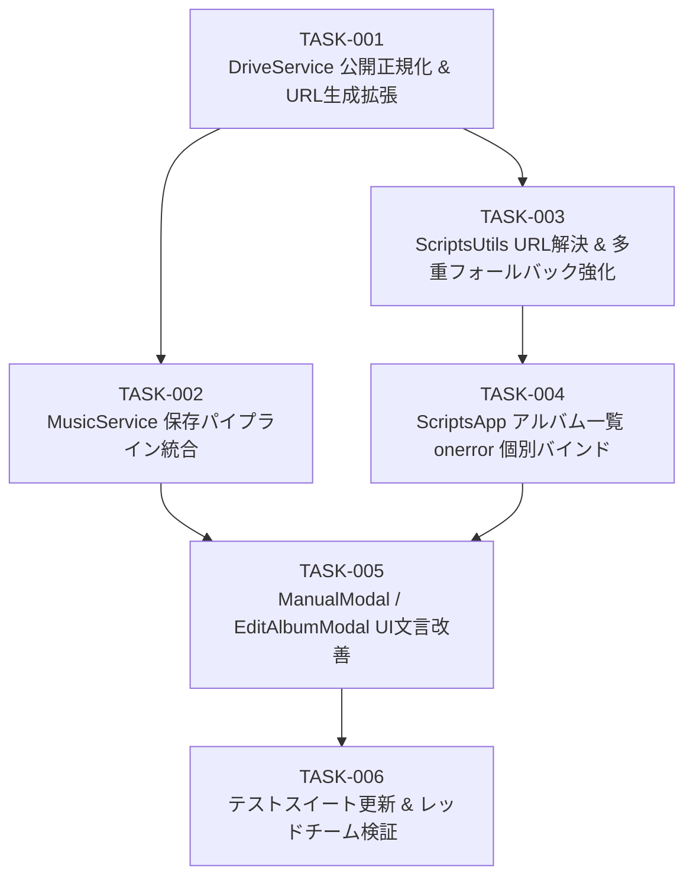

# 実装計画・タスク仕様書: 手動登録アルバムアートのスマートフォン表示不具合の解消

- **文書バージョン**: 1.0.0
- **作成日**: 2026年10月17日
- **作成ロール**: テックリード (`tech-lead`)
- **上流設計書**: `docs/architecture/album_art_mobile_fix_design.md`
- **成果物パス**: `docs/planning/album_art_mobile_fix_plan.md`

---

## 1. アーキテクチャレビュー所見

### 1.1 実現可能性評価: 【極めて高い (Feasible)】
上流のシステムアーキテクチャ設計書（`docs/architecture/album_art_mobile_fix_design.md`）で提示された分析および方針（ADR-01〜ADR-04）を批判的に検証した結果、技術的実現可能性は極めて高く、現行システムのアーキテクチャおよび制約と完全に合致していると評価する。

1. **認証格差・サードパーティCookie問題の解決性 (ADR-01)**:
   - PCでは自身のGoogleログインセッションCookieで表示できていた非公開Drive画像が、モバイル（iOS Safari ITP / Android Chrome）では403 Forbiddenになるという根本原因の分析は技術的に正確である。
   - バックエンドのGAS実行権限（`appsscript.json`: `"executeAs": "USER_DEPLOYING"`) を利用し、保存時にサーバーサイドで `DriveApp.Access.ANYONE_WITH_LINK, DriveApp.Permission.VIEW` を自動適用するアプローチは、ユーザー側の操作ミスをゼロにする最も確実な根本対策である。
2. **配信URLスキームの信頼性 (ADR-02)**:
   - `https://lh3.googleusercontent.com/d/{fileId}` はGoogleの静的画像配信専用エッジであり、リダイレクトなしで直接バイナリを高速配信するため、モバイル端末およびサードパーティCookie制限環境において最も堅牢に動作する。
3. **モバイルSafariのエラーハンドリング保証 (ADR-03)**:
   - iOS Safari（WebKit）において、`window.addEventListener('error', ..., true)` のキャプチャフェーズで `` の403/404エラーが捕捉されない問題に対し、動的DOM生成直後に JavaScript から個別の `img.onerror` をバインドする方式は、ブラウザ間の挙動差を完全に吸収できる。
   - プロジェクトのセキュリティ規約（インライン `onerror="..."` 属性の静的検査）にも100%合致する。

### 1.2 留意事項・技術リスクと対策
レビューにおいて特定された留意事項および技術リスクは以下の4点であり、本計画書のタスク仕様にて予防・対処策を組み込んでいる：

1. **Node.jsテスト環境における `DriveApp` / `UrlFetchApp` 未定義リスク**:
   - `tests/run_tests.js` や `tests/red_team_attack_test.js` はローカルのNode.js環境で実行される。Node.js環境下ではGASグローバルオブジェクト（`DriveApp`, `UrlFetchApp`）が存在しないため、`DriveService.js` の新設メソッド（`ensurePublicArtwork`）で `typeof DriveApp === 'undefined'` や例外ハンドリングを防御的に行わないと `ReferenceError` で単体テストがクラッシュする。
   - **対策**: `DriveService.ensurePublicArtwork` 内で `typeof DriveApp !== 'undefined'` を安全にチェックし、テスト環境やAPI利用不可環境では gracefully に元URLまたは解決可能なURLを返却する防御的実装とする。
2. **既存テストアサーション（`tests/run_tests.js`）との整合性**:
   - `tests/run_tests.js` line 155-159 において、`Utils.resolveArtworkUrl` の返り値が現在 `https://drive.google.com/thumbnail?id=testId123&sz=w400` であることを検証している。
   - ADR-02 に従い `https://lh3.googleusercontent.com/d/{id}` をプライマリに変更する場合、このテスト期待値を更新しなければテストが失敗する。
   - **対策**: 単体テスト更新タスク（TASK-006）にて、テストコードのアサーションを設計書仕様（`lh3.googleusercontent.com/d/...`）へ整合更新する。
3. **全件JIT修復によるGASタイムアウト抑止**:
   - `getAllMusicData()` 内で全スプレッドシート行に対して無差別にDrive API共有設定をループ実行すると、行数増加に伴いGASのWeb App推奨実行時間（30秒）を超過する恐れがある。
   - **対策**: スプレッドシートのバックエンド書き込み更新は `saveSingleTrack` および `updateAlbum` の保存時に限定する。画面描画時はフロントエンドの `Utils.resolveArtworkUrl` がオンザフライで `lh3.googleusercontent.com/d/{id}` に変換することで、全件データ読み込み時のタイムアウトを完全回避しつつ即時修復を実現する（二段構えの自己修復）。
4. **インラインイベント属性禁止規約の厳格遵守**:
   - `src/index.html` および各HTMLパーシャルにおいて、HTML属性としての `onerror="..."` はセキュリティ静的検査（テスト[9]）で検出されビルド拒否される。
   - **対策**: HTML文字列には一切 `onerror` を記述せず、DOMツリー生成直後に `container.querySelectorAll('img[data-artwork]')` に対して JS プロパティ経由（`img.onerror = () => Utils.handleImageError(img);`）でバインドする。

### 1.3 アーキテクトへのエスカレーション有無: 【エスカレーション不要】
アーキテクチャ設計書の全要件・決定事項と本実装計画は完全に整合しており、仕様変更やアーキテクチャの再設計は一切不要である。

---

## 2. 影響範囲・変更対象ファイル一覧

| レイヤー | 対象ファイル | 変更種別 | 変更概要 |
| :--- | :--- | :---: | :--- |
| **Backend** | `src/DriveService.js` | 修正 | - `extractDriveFileId(url)` メソッドの追加<br>- `generatePublicUrl(fileId)` メソッドの追加 (`lh3.googleusercontent.com/d/{id}` 生成)<br>- `ensurePublicArtwork(rawUrl, albumName)` パイプラインの実装 (共有権限付与 & 外部DL保存)<br>- Node.jsテスト環境防御 (ReferenceError防止) |
| **Backend** | `src/MusicService.js` | 修正 | - `saveSingleTrack`: `artworkUrl` を永続化前に `ensurePublicArtwork` で正規化<br>- `updateAlbum`: `album.artworkUrl` を永続化前に `ensurePublicArtwork` で正規化 (JIT修復)<br>- 例外時の Graceful Degradation (楽曲登録を阻害しない) |
| **Frontend** | `src/ScriptsUtils.html` | 修正 | - `resolveArtworkUrl`: モバイル最優先URL（`lh3.googleusercontent.com/d/{id}`）へ生成変更<br>- `handleImageError`: Step 0 (`lh3`) → Step 1 (`drive.google.com/thumbnail`) → Step 2 (SVG) のフォールバックチェーンに整合 |
| **Frontend** | `src/ScriptsApp.html` | 修正 | - `renderAlbumList`: カード描画直後に `img[data-artwork]` へ JavaScript から `img.onerror` を個別バインド |
| **Frontend** | `src/ManualModal.html` | 修正 | - `manual-artwork-url` の placeholder および注記文言の改善（Drive共有リンクや画像URLを入力すればスマホ対応で自動公開される旨） |
| **Frontend** | `src/EditAlbumModal.html` | 修正 | - `edit-album-artwork-url` の placeholder および注記文言の改善 |
| **Test** | `tests/run_tests.js` | 修正 | - `Utils.resolveArtworkUrl` の期待値更新 (`lh3.googleusercontent.com/d/...`)<br>- `DriveService.ensurePublicArtwork` / `generatePublicUrl` のテストケース追加<br>- `Utils.handleImageError` のフォールバック動作検証追加 |

### 依存関係・後方互換性への考慮事項
- **スプレッドシートデータスキーマ**: 既存のA〜H列（H列: アートワークURL）の構造は一切変更しない。
- **既存 `DriveService.generateWebUrl`**: 既存テストおよび他モジュールとの後方互換性を保つため `generateWebUrl`（thumbnail形式）は残し、新設メソッドとして `generatePublicUrl`（lh3形式）を追加する。
- **iTunesインポート機能への影響**: 既存の `MusicService.saveAlbumFromItunes` は従来通り正常動作を保証する。

---

## 3. インターフェース・データ構造仕様

### 3.1 バックエンド `DriveService.js` インターフェース
```javascript
class DriveService {
  /**
   * Google DriveのURLまたは文字列からファイルIDを安全に抽出（バックエンド用）
   * @param {string} url 
   * @returns {string|null} 抽出されたDriveファイルID、見つからない場合はnull
   */
  extractDriveFileId(url)

  /**
   * モバイル・サードパーティCookie遮断環境に最適化された完全公開URLを生成
   * @param {string} fileId Google Drive ファイルID
   * @returns {string} https://lh3.googleusercontent.com/d/{fileId}
   */
  generatePublicUrl(fileId)

  /**
   * 手動登録または更新されたアルバムアートURLを検査・正規化し、
   * スマホ未認証環境からでも確実に表示可能な完全公開URLを返却する
   * 
   * 処理ルール:
   * 1. 空値または非文字列の場合: '' を返却
   * 2. Google DriveのURL/IDの場合: DriveAppでファイルを取得し setSharing(ANYONE_WITH_LINK, VIEW) を適用。
   *    成功時は generatePublicUrl(fileId) を返却。
   *    ファイル取得失敗・テスト環境時はフォールバックとして generatePublicUrl(fileId) を返却。
   * 3. 外部Web画像URL (http/https でDrive以外) の場合: downloadAndSaveArtwork を呼び出してDriveに保存し、公開URLを返却。
   *    保存失敗時は元の rawUrl を返却。
   * 4. その他・不明な形式: 元の rawUrl を返却。
   * 
   * @param {string} rawUrl ユーザー入力URL
   * @param {string} albumName アルバム名 (ファイル命名・ログ用)
   * @returns {string} 正規化された完全公開URL
   */
  ensurePublicArtwork(rawUrl, albumName)
}
```

### 3.2 フロントエンド `Utils` (`src/ScriptsUtils.html`) インターフェース
```javascript
class Utils {
  /**
   * Google Drive等の画像URLをWeb上で確実に表示可能なURLに解決
   * 優先URL: https://lh3.googleusercontent.com/d/{fileId}
   * @param {string} url 
   * @param {number} [size=800] 
   * @returns {string}
   */
  static resolveArtworkUrl(url, size = 800)

  /**
   * 画像読み込み失敗時の多重フォールバック処理 (3段階保証)
   * Step 0 (初発): data-error-step="1" に更新し、予備ホスト (drive.google.com/thumbnail) へ切り替え
   * Step 1 (予備失敗) または Drive以外の画像エラー: data-error-step="2" に更新し、getDefaultArtworkSvg() をセット。ループ防止のため onerror 解除
   * @param {HTMLImageElement} imgEl 
   * @param {string} [originalUrl] 
   */
  static handleImageError(imgEl, originalUrl)
}
```

---

## 4. テスト戦略

### 4.1 単体テスト方針 (`tests/run_tests.js`)
1. **DriveService の新設機能テスト**:
   - `extractDriveFileId`: `/file/d/{id}`, `?id={id}`, `lh3.../d/{id}`, 生のID からの正確な抽出検証
   - `generatePublicUrl`: `https://lh3.googleusercontent.com/d/{id}` の出力検証
   - `ensurePublicArtwork`: Node.js環境（`DriveApp` 未定義）でもクラッシュせず、適切な公開URLまたは元URLが返却されることの検証
2. **Utils のURL解決 & フォールバックテスト**:
   - `resolveArtworkUrl`: Drive URL が `https://lh3.googleusercontent.com/d/{id}` に解決されることの検証
   - `handleImageError`: Step 0 から Step 1 へのフォールバック（thumbnail）、Step 1 から Step 2 へのフォールバック（SVG）の状態遷移検証
3. **MusicService の自動正規化統合テスト**:
   - `saveSingleTrack` および `updateAlbum` 実行時に、アートワークURLが `ensurePublicArtwork` を通して正規化されて保存されることの検証

### 4.2 結合テスト・セキュリティ検査方針
1. **インライン onerror 不在の静的セキュリティ検査**:
   - `tests/run_tests.js` の [9] において、`src/index.html` および各 `.html` ファイル内にインライン `onerror` 属性が存在しないことを再確認。
2. **レッドチーム攻撃耐性検証 (`tests/red_team_attack_test.js`)**:
   - 不正な型（null, undefined, 数値, 記号, 式インジェクション文字列）がアートワークURLに注入された場合でも、システムが例外で停止せず安全に無害化・処理されることの全152件検証。

### 4.3 回帰テスト観点
- iTunes検索および一括登録（`saveAlbumFromItunes`）が従来通り機能すること。
- アルバム一覧画面のアルバム選択、検索、トラック詳細表示、手動登録モーダル開閉、アルバム編集モーダル開閉が正常に動作すること。

---

## 5. 実装タスク一覧 (順序定義)



---

### タスク [TASK-001]: DriveService の公開正規化・URL生成機能拡張
- **ID**: `TASK-001`
- **目的**: 手動登録された画像URLを解析し、未認証モバイル環境からでもアクセス可能な完全公開URLを生成・提供する基盤メソッドを `DriveService` に実装する。
- **入力**: ユーザー入力URL（Google Drive共有リンク、ファイルID、外部Web画像URL、空文字）
- **期待される結果**:
  - `extractDriveFileId(url)` により各形式のDrive URL/文字列からファイルIDを抽出可能になる。
  - `generatePublicUrl(fileId)` により `https://lh3.googleusercontent.com/d/{fileId}` が返却される。
  - `ensurePublicArtwork(rawUrl, albumName)` により、Driveファイルの場合は `ANYONE_WITH_LINK` 共有が付与され公開URLが返却される。外部画像の場合は `downloadAndSaveArtwork` が実行される。
  - Node.js環境（`typeof DriveApp === 'undefined'`）でも例外送出せず安全に動作する。
- **対象ファイル**: `src/DriveService.js`
- **依存関係**: なし（先行タスク不要）
- **受け入れ基準**:
  - `extractDriveFileId` が `/file/d/`, `?id=`, `lh3.googleusercontent.com/d/`, 25文字以上の生ID を正しくパースすること。
  - `generatePublicUrl` が空文字入力時は `''`、ID入力時は `https://lh3.googleusercontent.com/d/{id}` を返すこと。
  - `DriveApp` が未定義の環境でも `ensurePublicArtwork` がクラッシュせず、正常にフォールバックすること。
- **検証方法**:
  - `node -e "const DS = require('./src/DriveService'); const ds = new DS({}); console.log(ds.extractDriveFileId('https://drive.google.com/file/d/abc12345/view')); console.log(ds.generatePublicUrl('abc12345')); console.log(ds.ensurePublicArtwork('https://drive.google.com/file/d/abc12345/view', 'Test'));"` を実行し、想定通りのURLが出力されること。

---

### タスク [TASK-002]: MusicService における手動登録・編集パイプラインの統合
- **ID**: `TASK-002`
- **目的**: 楽曲の手動登録（`saveSingleTrack`）およびアルバム編集（`updateAlbum`）において、アートワークURLを永続化する前に `DriveService.ensurePublicArtwork` を通して自動公開正規化を行う。
- **入力**: クライアントから送信された手動登録ペイロードおよびアルバム編集ペイロード
- **期待される結果**:
  - `saveSingleTrack` で `artworkUrl` が渡された際、`this.driveService.ensurePublicArtwork` で得られた公開URLがスプレッドシート（H列）に保存される。
  - `updateAlbum` で `album.artworkUrl` が渡された際、同様に `ensurePublicArtwork` で正規化されたURLがスプレッドシートに保存される。
  - 画像正規化で万一エラーが発生した場合でも、楽曲情報の登録・編集自体は失敗せず継続されること（Graceful Degradation）。
- **対象ファイル**: `src/MusicService.js`
- **依存関係**: `TASK-001`
- **受け入れ基準**:
  - `saveSingleTrack` 実行時、引数の `artworkUrl` が `ensurePublicArtwork` を経由して正規化されること。
  - `updateAlbum` 実行時、引数の `album.artworkUrl` が `ensurePublicArtwork` を経由して正規化されること。
  - `driveService` がモックまたは存在しない場合でも既存のテストケースが全て成功すること。
- **検証方法**:
  - `node tests/run_tests.js` を実行し、[4] MusicService バリデーションテスト および [6.3] 二重バリデーションテスト が成功すること。

---

### タスク [TASK-003]: ScriptsUtils のフロントエンドURL解決および多重フォールバック強化
- **ID**: `TASK-003`
- **目的**: スマートフォンおよびサードパーティCookie遮断環境において最も高速・確実に画像を表示するため、`Utils.resolveArtworkUrl` のプライマリURLを `lh3.googleusercontent.com` に最適化し、`Utils.handleImageError` の多重フォールバックチェーンを整合させる。
- **入力**: 解決前の画像URL文字列（スプレッドシートH列の値、Driveリンク等）
- **期待される結果**:
  - `Utils.resolveArtworkUrl(url)` が、Google Drive URLに対して `https://lh3.googleusercontent.com/d/{driveId}` を返却する。
  - `Utils.handleImageError(imgEl, originalUrl)` において、
    - Step 0 (初回エラー): `data-error-step="1"` にセットし、セカンダリURL `https://drive.google.com/thumbnail?id={driveId}&sz=w400` を試行。
    - Step 1 (セカンダリエラー) または Drive以外の画像エラー: `data-error-step="2"` にセットし、`Utils.getDefaultArtworkSvg()` をセットし、`onerror = null` で安全に解除。
- **対象ファイル**: `src/ScriptsUtils.html`
- **依存関係**: `TASK-001`
- **受け入れ基準**:
  - Drive URL（`/file/d/`, `?id=`, `uc?id=`）を渡した際、`https://lh3.googleusercontent.com/d/{id}` が返されること。
  - 通常の外部画像URLや空文字を渡した際は、従来通りの値が維持されること。
  - `handleImageError` が無限ループに陥らないこと。
- **検証方法**:
  - Node.js sandbox 環境で `ScriptsUtils.html` を読み込み、`resolveArtworkUrl` と `handleImageError` の動作をテストスクリプトで検証する。

---

### タスク [TASK-004]: ScriptsApp のアルバム一覧における安全な個別 onerror バインディング
- **ID**: `TASK-004`
- **目的**: iOS Safari / WebKit 環境で `window` のキャプチャフェーズに到達しない画像読み込みエラーを完全に捕捉するため、`renderAlbumList` で生成された各アルバムカードの `` 要素に対して、JavaScript から安全に個別の `onerror` ハンドラを結線する。
- **入力**: `renderAlbumList` で動的生成された DOM ツリー（`album-grid-container`）
- **期待される結果**:
  - アルバムカード内の各 `img[data-artwork]` 要素に `img.onerror = () => Utils.handleImageError(img);` が設定される。
  - HTML文字列内にインライン属性（`onerror="..."`）は一切追加されない（セキュリティ規約遵守）。
- **対象ファイル**: `src/ScriptsApp.html`
- **依存関係**: `TASK-003`
- **受け入れ基準**:
  - `renderAlbumList` の `container.innerHTML = html;` 実行直後に、`container.querySelectorAll('img[data-artwork]')` に対して要素プロパティとしての `onerror` が設定されること。
  - `src/index.html` にインライン `onerror` が存在しないこと（セキュリティ検査合格）。
- **検証方法**:
  - `node tests/run_tests.js` を実行し、[9] インライン onerror 属性不在検査がパスすること。

---

### タスク [TASK-005]: 手動登録・アルバム編集モーダルのUI/UXおよびヘルプ文言改善
- **ID**: `TASK-005`
- **目的**: ユーザーが手動登録および編集時に迷わずGoogle Driveのリンク等を入力できるよう、プレースホルダーおよび説明文言を改善し、自動でスマホ対応公開設定される旨を明記する。
- **入力**: なし
- **期待される結果**:
  - `ManualModal.html`: `manual-artwork-url` のプレースホルダーが `Google Driveリンクまたは画像URL (自動でスマホ対応公開設定されます)` に改善される。
  - `EditAlbumModal.html`: `edit-album-artwork-url` のプレースホルダーが同様に改善され、分かりやすい注記が追加される。
- **対象ファイル**: `src/ManualModal.html`, `src/EditAlbumModal.html`
- **依存関係**: `TASK-002`, `TASK-004`
- **受け入れ基準**:
  - ユーザーがどのようなDrive URL形式（共有リンク、編集リンク等）を入力しても受け入れられる旨がUI上で明瞭に伝わること。
  - 既存のフォーム送信処理、 Enterキー誤送信抑止、44pxタップ領域が破壊されないこと。
- **検証方法**:
  - `node tests/red_team_attack_test.js` を実行し、UI/モーダル関連の全テストがパスすること。

---

### タスク [TASK-006]: 単体テスト・セキュリティテスト・レッドチーム攻撃検証の拡充と既存テスト整合
- **ID**: `TASK-006`
- **目的**: 新設・変更された全メソッドの単体テストを追加し、`tests/run_tests.js` の既存アサーションを最新設計書仕様に整合させ、全86件以上の単体テストおよび全152件以上のレッドチーム攻撃テストを完全パスさせる。
- **入力**: 変更後のコードベース
- **期待される結果**:
  - `tests/run_tests.js` 内の `Utils.resolveArtworkUrl` テスト期待値が `https://lh3.googleusercontent.com/d/testId123` に整合更新される。
  - `DriveService.extractDriveFileId`, `generatePublicUrl`, `ensurePublicArtwork` の単体テストが追加される。
  - `Utils.handleImageError` のステップ遷移テストが追加される。
  - `node tests/run_tests.js` が全件成功（Exit Code 0）する。
  - `node tests/red_team_attack_test.js` が全件成功（Exit Code 0）する。
- **対象ファイル**: `tests/run_tests.js`
- **依存関係**: `TASK-001`, `TASK-002`, `TASK-003`, `TASK-004`, `TASK-005`
- **受け入れ基準**:
  - 単体テスト成功件数 >= 86件、失敗 0件。
  - レッドチーム攻撃テスト成功件数 >= 152件、失敗 0件。
  - 回帰バグが一切存在しないこと。
- **検証方法**:
  - `node tests/run_tests.js`
  - `node tests/red_team_attack_test.js`
  の両コマンドを実行し、Exit Code 0 であることを確認。
