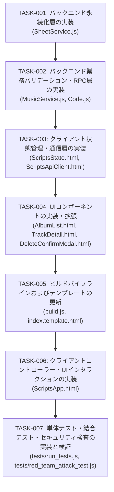

# 実装計画・タスク仕様書: アルバム削除機能（複数選択・一括削除および個別削除）

- **文書バージョン**: 1.0.0
- **作成日**: 2026年10月19日
- **作成ロール**: テックリード (`tech-lead`)
- **上流設計書**: `docs/architecture/album_bulk_delete_design.md`
- **成果物パス**: `docs/planning/album_bulk_delete_plan.md`

---

## 1. アーキテクチャレビュー所見

### 1.1 実現可能性評価: 【極めて高い (Feasible)】
上流のシステムアーキテクチャ設計書（`docs/architecture/album_bulk_delete_design.md`）で定義された要件、システム境界、データフロー、およびアーキテクチャ決定事項（ADR-DEL-001〜005）を批判的に検証した結果、技術的実現可能性は極めて高く、現行コードベースの構造・制約条件と完全に整合していると評価する。

1. **アトミック一括置換方式の妥当性 (ADR-DEL-001)**:
   - スプレッドシート操作において、行ごとの `deleteRow()` を排除し、「全行読込（`getValues`）→ メモリ上での対象行一括除外 → データ領域クリア（`clearContent`）→ 残存行一括書き戻し（`setValues`）」を採用した判断は、GAS API呼び出し回数を最少（実質3回）に抑え、タイムアウト（30秒制限）を根本から抑止する。既存の `updateAlbumBatch` でも実績のある安全で高速なパターンであり、完全なAll-or-Nothingトランザクション整合性を担保できる。
2. **Drive画像ファイルの保持方針 (ADR-DEL-002)**:
   - アルバム削除時にGoogle Drive内のジャケット画像ファイルを即時削除せず保持する方針は、スプレッドシートのバージョン履歴（版の履歴）からの完全復元性を担保し、同一画像URLを別アルバムや手動登録楽曲で共有していた場合の「リンク切れ巻き込み事故」を確実に防止する。またDriveApp呼び出しのオーバーヘッドをゼロに抑えるため、削除処理のミリ秒応答に直結する。
3. **選択モードトグル方式のUX整合性 (ADR-DEL-003)**:
   - STEP 2 ヘッダーの「選択」ボタンにより通常閲覧モードと選択モードを切り替える設計は、通常時の快適なドリルダウン操作（アルバムカードをタップして瞬時にトラック一覧へ遷移）を一切阻害せず、モバイル画面における誤タップや視覚的ノイズを最小化する。選択モード中はカード全体がトグルタップターゲットとなり、WCAG 44px タップ領域を自然にクリアできる。
4. **識別キーの複合キー規約整合性 (ADR-DEL-004)**:
   - `albumArtist` と `albumName` の正規化文字列ペアを識別キーとする仕様は、既存スプレッドシートの1トラック1行フラット構造および `updateAlbumBatch` の規約と完全に合致しており、余分な行ID列新設等の破壊的マイグレーションを回避できる。
5. **クライアントキャッシュ即時同期と画面フォールバック (ADR-DEL-005)**:
   - 削除完了後に `apiGetAllData` を再取得せず、`Store.deleteAlbumsFromCatalog` によりブラウザ内メモリ上で差分除外とツリー再構築（`buildCatalog`）を行う方針は、ネットワーク遅延のない瞬時の画面更新（100ms未満）を実現する。選択中アーティストの全アルバム削除時やSTEP 3表示中アルバム削除時の自動フォールバック制御も破綻なく定義されている。

---

### 1.2 留意事項・技術リスクと対策

本計画では、以下の7点に留意し、各タスクの仕様およびテストコードに対策を組み込んでいる：

1. **スプレッドシート全行削除時（残存トラック0件）の境界値ガード**:
   - シート内の全アルバム・全トラックが削除され、残存行（`retainedRows`）が0件となった場合、`sheet.getRange(2, 1, 0, 8).setValues([])` を実行するとGASのSpreadsheetApp仕様により実行時例外が発生する。
   - **対策**:
     `SheetService.deleteAlbumsBatch` において、`dataRange.clearContent()` を実行した後、`if (retainedRows.length > 0)` の条件ガードを設け、残存行が1行以上存在する場合にのみ `setNumberFormat('@')` および `setValues(retainedRows)` を実行する。残存行0件時はヘッダー行（1行目）のみが保護されて正常終了する。
2. **スプレッドシート空（データ行0件: `lastRow < 2`）時の早期安全リターン**:
   - スプレッドシートにヘッダー行しか存在しない、または完全に空の状態で削除APIが呼び出された場合。
   - **対策**:
     `lastRow < 2` の場合は例外を投げず、削除対象0件として安全に `{ deletedAlbumCount: 0, deletedTrackCount: 0, deletedAlbums: [], remainingRowCount: 0 }` を返却する。
3. **複合キーの正規化と $O(1)$ 高速ルックアップ**:
   - 数千行のトラックから複数アルバムに合致する行を線形探索で走査する場合、アルバム数 $M$ × トラック数 $N$ の二重ループ $O(M \times N)$ となり効率が落ちる。
   - **対策**:
     削除対象キーのペアを `${trim(albumArtist)}:::${trim(albumName)}` の形式で `Set` に格納し、$O(1)$ のハッシュルックアップを行う。これにより全体計算量を $O(N)$ に抑え、大規模カタログでも数ミリ秒でフィルタリングを完了させる。
4. **排他ロック（`LockService`）の確実な解放**:
   - スプレッドシート更新中に例外（フォーマットエラー等）が発生した場合にロックが残存すると、他ユーザーが10秒間操作不能となる。
   - **対策**:
     `try ... finally` 構文を徹底し、いかなる例外発生時も `finally` ブロック内で `lock.releaseLock()` を確実に呼び出す。
5. **モバイル親指操作最適化 (WCAG 44px) と誤操作抑止**:
   - スマートフォンの狭小画面（幅375px〜430px）での操作ミスを防ぐため、選択ボタン、全選択/全解除ボタン、削除ボタン、モーダル内ボタンはすべて最小 44px × 44px のタップ領域を確保する。
   - 削除確定モーダルには危険色（赤系 `bg-rose-600` / `hover:bg-rose-700`）を適用し、削除対象アルバム名と削除楽曲総数の警告を明記する。
6. **二重送信抑止と視覚的フィードバック**:
   - 削除実行中にユーザーが確定ボタンを連打した場合の多重RPC送信を抑止する。
   - **対策**:
     モーダル確定ボタン押下時に即時 `btn.disabled = true` とし、スピナーアニメーションを表示する。API通信が完了するまでモーダルを閉じない。
7. **削除後の画面ステップ自動フォールバック制御**:
   - STEP 3 で表示中のアルバムが削除された場合、存在しないアルバムデータが表示され続ける不整合が発生する。
   - **対策**:
     削除完了後、現在選択中の `selectedAlbum` が削除対象に含まれていた場合は STEP 3 をクリア（空状態表示）とし、モバイル環境では STEP 2（または STEP 1）に自動復帰する。また選択中アーティストの全アルバムが削除された場合は、STEP 1 に安全に復帰する。

---

### 1.3 アーキテクトへのエスカレーション有無: 【エスカレーション不要】
アーキテクチャ設計書の全要件・決定事項と本実装計画は完全に整合しており、設計変更やアーキテクトへのエスカレーションは一切不要である。

---

## 2. 影響範囲・変更対象ファイル一覧

| レイヤー | 対象ファイル | 変更種別 | 変更概要 |
| :--- | :--- | :---: | :--- |
| **Backend (Persistence)** | `src/SheetService.js` | 修正 | - `deleteAlbumsBatch(albumKeys)` メソッドの新設（`LockService` 排他ロック獲得、全行取得、複合キーSetによる対象行除外、`clearContent` & `setValues` アトミック一括置換、残存0行時ガード、削除結果集計返却） |
| **Backend (Domain Logic)** | `src/MusicService.js` | 修正 | - `deleteAlbums(payload)` メソッドの新設（入力検証・`SheetService.deleteAlbumsBatch` への委譲）<br>- `validateDeletePayload_(payload)` の新設（型、要素数、必須キー、文字列長上限255の厳格検証） |
| **Backend (RPC Facade)** | `src/Code.js` | 修正 | - 公開RPC関数 `apiDeleteAlbumsBatch(payload)` の新設（例外捕捉・共通エンベロープラッピング）<br>- Node.js テスト用 `module.exports` への `apiDeleteAlbumsBatch` 追加 |
| **Frontend (Model / State)** | `src/ScriptsState.html` | 修正 | - `Store.state` への `isAlbumSelectMode: false` および `selectedAlbumKeysForDeletion: new Set()` の初期化プロパティ追加<br>- `deleteAlbumsFromCatalog(deletedKeys)` メソッドの新設（`allTracks` からの差分除外、`buildCatalog()` 再構築、選択状態クリア） |
| **Frontend (Client Service)** | `src/ScriptsApiClient.html` | 修正 | - `deleteAlbumsBatch(albums)` メソッドの新設（`this.callGAS('apiDeleteAlbumsBatch', { albums })` のPromise化） |
| **Frontend (UI View)** | `src/AlbumList.html` | 修正 | - STEP 2 ヘッダーへの「選択」切替ボタン配置<br>- 選択モード用ツールバー（全選択、全解除、選択件数バッジ、削除ボタン）の追加（WCAG 44px対応） |
| **Frontend (UI View)** | `src/TrackDetail.html` | 修正 | - アルバムヘッダー操作ボタングループに「アルバム削除」ボタン（`#btn-delete-album`）を追加（WCAG 44px対応） |
| **Frontend (Modal View)** | `src/DeleteConfirmModal.html` | 新規作成 | - 削除確認モーダル（削除対象アルバム名一覧、削除楽曲総数警告、赤色確定ボタン、キャンセルボタン、Enter誤送信抑止、44pxタップ領域確保） |
| **Frontend (Template)** | `src/index.template.html` | 修正 | - `<?!= include('DeleteConfirmModal'); ?>` の追加 |
| **Build System** | `build.js` | 修正 | - `htmlIncludes` 配列に `'DeleteConfirmModal'` を追加 |
| **Frontend (Controller)** | `src/ScriptsApp.html` | 修正 | - 選択モードトグル制御（`toggleAlbumSelectMode`）<br>- アルバム選択/解除トグル（`toggleAlbumSelection`）<br>- 全選択 / 全解除ハンドリング（`selectAllAlbums`, `deselectAllAlbums`）<br>- アルバムカード内チェックボックスUI描画および選択ハイライト<br>- 個別アルバム削除ボタンのハンドリング<br>- 削除確認モーダル開閉・確定実行（ローディング制御・二重送信防止）<br>- 削除後のキャッシュ同期・画面自動フォールバック制御・トースト通知表示 |
| **Unit Test** | `tests/run_tests.js` | 修正 | - `SheetService.deleteAlbumsBatch` 単体テスト（単一削除、複数削除、全行削除、存在しないアルバム、排他ロック競合、数式インジェクション保護）<br>- `MusicService.deleteAlbums` / `validateDeletePayload_` 単体テスト<br>- `Code.apiDeleteAlbumsBatch` RPCテスト<br>- `Store.deleteAlbumsFromCatalog` キャッシュ同期テスト<br>- `ApiClient.deleteAlbumsBatch` メソッド存在確認<br>- `build.js` バンドル構文およびモーダルインクルード確認 |
| **Security / Red Team Test** | `tests/red_team_attack_test.js` | 修正 | - 破壊的テスト（空ペイロード、不正型、空文字キー、超長大キー）<br>- UIアクセシビリティ検証（新規ボタン・チェックボックスの44pxタップターゲット確保、Enter誤送信抑止）<br>- 削除モーダル二重送信防止検証（実行中のボタン非活性化） |

---

### 依存関係・後方互換性への考慮事項

1. **スプレッドシートデータスキーマの維持**:
   - `MusicTracks` シートの列構成（A〜H列）およびヘッダー構造は一切変更しない。既存データとの完全互換性を維持する。
2. **既存機能との排他整合性**:
   - アルバム一括インポート（`saveAlbumBatch`）、手動登録（`saveSingleTrack`）、アルバム編集（`updateAlbumBatch`）と同一の `LockService.getScriptLock()` を使用し、クリティカルセクションを相互に保護する。
3. **Google Drive上のアートワーク画像ファイル**:
   - 削除時はDriveAppに対する削除API呼び出しを行わず、ファイルを保持する（ADR-DEL-002）。これにより、既存の画像URL共有やバージョン履歴からの復元性が損なわれない。

---

## 3. インターフェース・データ構造仕様

### 3.1 データ型定義 (TypeScript表記)

```typescript
/**
 * アルバム削除対象の識別キー
 */
interface AlbumIdentityKey {
  albumArtist: string; // アルバムアーティスト名 (必須・トリム済み・最大255文字)
  albumName: string;   // アルバム名 (必須・トリム済み・最大255文字)
}

/**
 * apiDeleteAlbumsBatch リクエストペイロード
 */
interface DeleteAlbumsPayload {
  albums: Array<AlbumIdentityKey>; // 削除対象アルバムリスト (1件以上の配列)
}

/**
 * apiDeleteAlbumsBatch 成功時レスポンスデータ
 */
interface DeleteAlbumsResult {
  deletedAlbumCount: number;             // 削除されたアルバム総数
  deletedTrackCount: number;             // スプレッドシートから削除されたトラック行数
  deletedAlbums: Array<AlbumIdentityKey>; // 実際に削除されたアルバム一覧
  remainingRowCount: number;            // 削除後のスプレッドシート残存トラック総行数
}

/**
 * 共通 API レスポンスエンベロープ
 */
interface ApiResponse<T> {
  success: boolean;
  data?: T;
  error?: string;
  code?: string;
  timestamp: string;
}
```

---

### 3.2 関数シグネチャと契約仕様

#### 1. `SheetService.prototype.deleteAlbumsBatch(albumKeys)`
- **シグネチャ**: `deleteAlbumsBatch(albumKeys: Array<{ albumArtist: string, albumName: string }>): DeleteAlbumsResult`
- **事前条件 (Preconditions)**:
  - `albumKeys` は1件以上の有効な識別キーオブジェクト配列であること。
- **事後条件 (Postconditions)**:
  - スプレッドシートから `albumKeys` に合致するすべてのトラック行が削除される。
  - 合致しなかった行は順序および内容（式インジェクションエスケープ含む）を保って保持される。
  - 全行削除時はヘッダー行（1行目）のみが保護され、データ領域（2行目以降）が空になる。
  - 排他ロックは成否に関わらず確実に解放される。
- **送出例外**:
  - `LOCK_TIMEOUT`: 他ユーザー処理中で10秒以内にロックを取得できなかった場合。
  - `SPREADSHEET_OPEN_ERROR`: スプレッドシートが開けない場合。

#### 2. `MusicService.prototype.deleteAlbums(payload)`
- **シグネチャ**: `deleteAlbums(payload: DeleteAlbumsPayload): DeleteAlbumsResult`
- **業務フロー**:
  1. `this.validateDeletePayload_(payload)` を実行。
  2. `this.sheetService.deleteAlbumsBatch(payload.albums)` を呼び出して結果を返却。

#### 3. `MusicService.prototype.validateDeletePayload_(payload)`
- **シグネチャ**: `validateDeletePayload_(payload: any): void`
- **検証ルール**:
  - `payload` がオブジェクト（非null、非配列）であること。
  - `payload.albums` が配列であり、要素数が1以上であること。
  - 各要素がオブジェクトであり、トリム後の `albumArtist` および `albumName` が空文字でないこと。
  - 各 `albumArtist` および `albumName` が255文字以内であること。
  - 不正時は `err.code = 'VALIDATION_FAILED'` を付与した例外を送出。

#### 4. `Code.js` : `apiDeleteAlbumsBatch(payload)`
- **シグネチャ**: `apiDeleteAlbumsBatch(payload: any): ApiResponse<DeleteAlbumsResult>`
- **責務**:
  - `getMusicService().deleteAlbums(payload)` を `try ... catch` で実行。
  - 成功時: `{ success: true, data: result, timestamp: ... }`
  - 失敗時: `{ success: false, error: err.message, code: err.code || 'ALBUM_DELETE_ERROR', timestamp: ... }`

#### 5. `ApiClient.prototype.deleteAlbumsBatch(albums)`
- **シグネチャ**: `deleteAlbumsBatch(albums: Array<AlbumIdentityKey>): Promise<DeleteAlbumsResult>`
- **実装内容**: `return this.callGAS('apiDeleteAlbumsBatch', { albums: albums });`

#### 6. `Store.prototype.state` 拡張プロパティ
```javascript
this.state = {
  // ... 既存プロパティ ...
  isAlbumSelectMode: false,               // 選択（削除）モード中か否か
  selectedAlbumKeysForDeletion: new Set() // 選択中アルバムキーのSet ("albumArtist:::albumName")
};
```

#### 7. `Store.prototype.deleteAlbumsFromCatalog(deletedKeys)`
- **シグネチャ**: `deleteAlbumsFromCatalog(deletedKeys: Array<AlbumIdentityKey>): void`
- **実装内容**:
  1. 複合キー Set を生成: `${trim(albumArtist)}:::${trim(albumName)}`
  2. `this.state.allTracks` から一致する行を除外。
  3. `this.buildCatalog()` を呼び出してカタログツリーおよびインデックスを再構築。
  4. `this.state.selectedAlbumKeysForDeletion.clear()` および `this.state.isAlbumSelectMode = false` を実行。

---

## 4. テスト戦略

### 4.1 単体テスト方針 (Unit Tests)

1. **`SheetService.deleteAlbumsBatch` の単体テスト (`tests/run_tests.js`)**:
   - **単一アルバム削除**: 複数アルバムが存在する状態で指定の1アルバム（複数トラック）のみが正確に削除され、他アルバム行が保持されること。
   - **複数アルバム一括削除**: 複数の異なるアルバム（計複数トラック）が一度の呼び出しで正確に削除されること。
   - **全行削除（残存0行）境界値**: シート内の全アルバムを削除した際、ヘッダー行が保護され、例外なく `remainingRowCount === 0` が返ること。
   - **存在しないアルバムキー指定**: スプレッドシート内に存在しないアルバムキーを渡した場合、既存行が破壊されず `deletedAlbumCount === 0`, `deletedTrackCount === 0` が返ること。
   - **排他制御（`LockService`）**: ロック取得成功時に `releaseLock` が確実に呼ばれること。ロック取得失敗時に `LOCK_TIMEOUT` 例外が送出されること。
   - **数式インジェクション保護**: 残存行に `=SUM(1,2)` などの数式文字列が含まれている場合、書き戻し後も先頭シングルクォート等のエスケープが維持されること。
2. **`MusicService.deleteAlbums` / `validateDeletePayload_` の単体テスト**:
   - 正常系: 有効なアルバムリストで正常に委譲・実行されること。
   - 異常系: null/空オブジェクト、`albums` 欠落、`albums: []` (空配列)、`albumArtist` 空文字、`albumName` 空文字、255文字超過で `VALIDATION_FAILED` 例外が送出されること。
3. **`Code.apiDeleteAlbumsBatch` RPCの単体テスト**:
   - 正常系: `{ success: true, data: { ... } }` が返却されること。
   - 異常系: サービス例外発生時に `{ success: false, error: ..., code: ... }` が返却されること。
4. **`Store.deleteAlbumsFromCatalog` の単体テスト**:
   - 削除対象アルバムのトラック行が `allTracks` から漏れなく除外されること。
   - `buildCatalog` が呼び出され、アーティスト一覧やアルバム件数が正しく減算されること。
   - 選択状態（Set）がクリアされ、選択モードフラグが `false` にリセットされること。

---

### 4.2 結合テスト方針 (Integration Tests)

1. **複数選択・一括削除フローの結合検証**:
   - STEP 2 で「選択」ボタン押下 → 複数カード選択 → 「削除」ボタン押下 → 削除確認モーダル表示 → 「削除を実行する」確定 → バックエンドAPI呼び出し → キャッシュ除外 → モード解除・画面再描画・トースト通知表示の一連の整合性。
2. **個別アルバム削除フローの結合検証**:
   - STEP 3 で「削除」ボタン押下 → 単一アルバムの確認モーダル表示 → 確定 → 同一API呼び出し → キャッシュ除外 → STEP 3 クリア・STEP 2 復帰の一連の整合性。
3. **全アルバム削除時の自動フォールバック結合検証**:
   - あるアーティストに属する全アルバムを一括削除した場合、当該アーティストが STEP 1 から消去され、STEP 1（または先頭アーティスト）へ安全に画面が遷移すること。

---

### 4.3 回帰テスト観点 (Regression Tests)

1. **既存編集機能（`updateAlbumBatch`）の無影響検証**:
   - アルバム編集モーダルからの更新が従来通りアトミックかつ排他制御下で実行できること。
2. **既存インポート・追加機能の無影響検証**:
   - iTunes / MusicBrainz からの一括インポートおよび手動1曲追加が従来通り正常動作すること。
3. **構文解析およびGAS V8評価順序シミュレーション**:
   - プレースホルダー（`// TODO`, `// 省略` 等）の不存在検査。
   - 全JSファイルの `vm.Script` 構文検査。
   - GAS V8 ランタイムにおける3通りの評価順序（アルファベット順、逆順、依存定義順）でIdentifier重複等のエラーが発生しないこと。
4. **ビルド成果物（`src/index.html`）の検証**:
   - `node build.js` により `DeleteConfirmModal` が正しくインクルードされ、HTML構文エラーおよびインライン `onerror` が存在しないこと。

---

### 4.4 セキュリティ & Red Team 観点

1. **破壊的攻撃ペイロード検証**:
   - `{ albums: null }`, `{ albums: [{ albumArtist: 123 }] }`, `{ albums: [{ albumArtist: 'A', albumName: '' }] }` などのファジング入力に対し即座に拒絶（`VALIDATION_FAILED`）すること。
2. **WCAG 2.1 AA 44px タップ領域検査**:
   - 選択ボタン、全選択ボタン、全解除ボタン、一括削除ボタン、個別削除ボタン、モーダル内ボタンがすべて 44px × 44px 以上のタップ領域を保持していること。
3. **モーダル内のEnterキー誤送信防止**:
   - 削除モーダルにフォームまたはボタン群が存在する場合、意図しないEnterキー押下による誤送信・ページリロードが発生しないこと（`onsubmit="event.preventDefault();"`）。
4. **多重送信（Race Condition）防止**:
   - 削除確定ボタン押下時に即時 `disabled = true` となり、通信完了まで再クリックが抑止されること。

---

## 5. 実装タスク一覧 (順序定義)



---

### タスク [TASK-001]: バックエンド永続化層の実装 (`SheetService.js`)
- **ID**: TASK-001
- **目的**: 
  スプレッドシートから指定されたアルバム群の全トラック行を一括削除する `deleteAlbumsBatch` メソッドを実装する。
- **入力**: 
  - `albumKeys`: `Array<{ albumArtist: string, albumName: string }>`
- **期待される結果**: 
  - `LockService.getScriptLock().tryLock(10000)` により排他ロックを獲得。
  - スプレッドシート全行を取得し、複合キー Set `${trim(albumArtist)}:::${trim(albumName)}` で対象行を除外。
  - `dataRange.clearContent()` を実行。
  - 残存行が1行以上ある場合（`retainedRows.length > 0`）のみ `setNumberFormat('@')` と `setValues(retainedRows)` を実行。
  - `SpreadsheetApp.flush()` を呼び出し、`finally` で確実にロックを解放。
  - `{ deletedAlbumCount, deletedTrackCount, deletedAlbums, remainingRowCount }` を返却。
- **対象ファイル**: 
  - `src/SheetService.js`
- **依存関係**: 
  - なし（先行タスクなし）
- **受け入れ基準**: 
  - `lastRow < 2` の場合に空結果オブジェクトを安全に返却すること。
  - ロック取得タイムアウト時に `LOCK_TIMEOUT` 例外を送出すること。
  - 全行削除時にヘッダー（1行目）が維持されエラーなく完了すること。
  - 残存行の数式インジェクション防止文字（`'=...`）が書き戻し後も維持されること。
- **検証方法**: 
  - `node tests/run_tests.js` を実行し、構文チェックおよび単体テストで動作を確認する。

---

### タスク [TASK-002]: バックエンド業務バリデーション・RPC層の実装 (`MusicService.js`, `Code.js`)
- **ID**: TASK-002
- **目的**: 
  アルバム削除リクエストの厳格な二重バリデーションロジックおよび外部公開RPC関数を実装する。
- **入力**: 
  - `payload`: `DeleteAlbumsPayload`
- **期待される結果**: 
  - `MusicService.js` に `deleteAlbums(payload)` および `validateDeletePayload_(payload)` を実装。
  - `payload.albums` が配列であること、要素数が1以上であること、各要素が空文字でないトリム済み `albumArtist` および `albumName`（最大255文字）を保持していることを検証。
  - 不正時は `err.code = 'VALIDATION_FAILED'` 例外を送出。
  - `Code.js` に `apiDeleteAlbumsBatch(payload)` を新設し、成功・失敗に応じた共通レスポンスエンベロープを返却。
  - `Code.js` の `module.exports` に `apiDeleteAlbumsBatch` を追加。
- **対象ファイル**: 
  - `src/MusicService.js`
  - `src/Code.js`
- **依存関係**: 
  - TASK-001
- **受け入れ基準**: 
  - 空配列、空文字、型不正のペイロードが確実に `VALIDATION_FAILED` で遮断されること。
  - `Code.apiDeleteAlbumsBatch` が公開され、Node.js 環境から呼び出し可能なこと。
- **検証方法**: 
  - `node tests/run_tests.js` による構文および単体呼び出し検証。

---

### タスク [TASK-003]: クライアント状態管理・通信層の実装 (`ScriptsState.html`, `ScriptsApiClient.html`)
- **ID**: TASK-003
- **目的**: 
  クライアント側の選択状態管理、キャッシュ即時差分同期メソッド、および一括削除APIクライアント通信メソッドを実装する。
- **入力**: 
  - `deletedKeys`: `Array<{ albumArtist: string, albumName: string }>`
- **期待される結果**: 
  - `ScriptsState.html` の `Store.state` に `isAlbumSelectMode: false` および `selectedAlbumKeysForDeletion: new Set()` を初期化追加。
  - `deleteAlbumsFromCatalog(deletedKeys)` メソッドを実装し、`allTracks` から該当アルバムの行を除外後、`buildCatalog()` を呼び出してカタログツリーを再構築し、選択状態をリセット。
  - `ScriptsApiClient.html` に `deleteAlbumsBatch(albums)` を追加し、`this.callGAS('apiDeleteAlbumsBatch', { albums })` をPromise返却。
- **対象ファイル**: 
  - `src/ScriptsState.html`
  - `src/ScriptsApiClient.html`
- **依存関係**: 
  - TASK-002
- **受け入れ基準**: 
  - `deleteAlbumsFromCatalog` 実行後に `allTracks` から指定アルバム行が除外され、`musicCatalog` および `artistList` が正確に更新されること。
  - `selectedAlbumKeysForDeletion` がクリアされ、`isAlbumSelectMode` が `false` になること。
- **検証方法**: 
  - `node tests/run_tests.js` による構文および Store メソッド単体検証。

---

### タスク [TASK-004]: UIコンポーネントの実装・拡張 (`AlbumList.html`, `TrackDetail.html`, `DeleteConfirmModal.html`)
- **ID**: TASK-004
- **目的**: 
  STEP 2 の選択モードUI、STEP 3 の個別削除ボタン、および削除確認モーダルHTMLコンポーネントを作成・配置する。
- **入力**: 
  - UI要件仕様、Tailwind CSSユーティリティクラス
- **期待される結果**: 
  - `src/AlbumList.html`:
    - ヘッダー右側に「選択」ボタン（`#btn-toggle-album-select`）を配置。
    - 選択モード中のみ表示される操作ツールバー（`#album-selection-toolbar`: 非表示 `hidden` 初期化）を追加。
    - ツールバー内に「全選択」ボタン（`#btn-select-all-albums`）、「全解除」ボタン（`#btn-deselect-all-albums`）、選択件数バッジ（`#selected-album-count-badge`）、「削除」ボタン（`#btn-delete-selected-albums`: disabled 初期化）を配置。
  - `src/TrackDetail.html`:
    - アルバム操作ボタングループ内に「アルバム削除」ボタン（`#btn-delete-album`）を追加。
  - `src/DeleteConfirmModal.html`:
    - 新規作成。モーダル外枠（`#modal-delete-confirm`）、ヘッダー、削除対象アルバムリスト表示領域（`#delete-confirm-album-list`）、削除曲数警告表示（`#delete-confirm-track-warning`）、キャンセルボタン（`#btn-cancel-delete-album`）、実行ボタン（`#btn-confirm-execute-delete`、赤系 `bg-rose-600`、スピナー枠 `#delete-album-spinner`）を配置。
    - フォーム内に `onsubmit="event.preventDefault();"` を適用。
    - すべてのボタンで最小 44px × 44px のタップターゲットを確保。
- **対象ファイル**: 
  - `src/AlbumList.html`
  - `src/TrackDetail.html`
  - `src/DeleteConfirmModal.html` (新規)
- **依存関係**: 
  - TASK-003
- **受け入れ基準**: 
  - すべての操作ボタンが WCAG 44px 基準を満たしていること。
  - 削除確認モーダル内に警告文・対象リスト・キャンセル・確定ボタンが揃っていること。
  - プレースホルダー（`// TODO` 等）が一切含まれていないこと。
- **検証方法**: 
  - `node tests/run_tests.js` によるプレースホルダー・構文チェック。

---

### タスク [TASK-005]: ビルドパイプラインおよびテンプレートの更新 (`build.js`, `index.template.html`)
- **ID**: TASK-005
- **目的**: 
  新規モーダル `DeleteConfirmModal` をビルド対象およびテンプレートに登録し、単一バンドル `src/index.html` に正常統合する。
- **入力**: 
  - `build.js`, `src/index.template.html`, `src/DeleteConfirmModal.html`
- **期待される結果**: 
  - `build.js` の `htmlIncludes` 配列に `'DeleteConfirmModal'` を追加。
  - `src/index.template.html` の各種モーダル include セクションに `<?!= include('DeleteConfirmModal'); ?>` を追加。
  - `node build.js` を実行し、`src/index.html` が正常に生成され、モーダルDOMが含まれること。
- **対象ファイル**: 
  - `build.js`
  - `src/index.template.html`
  - `src/index.html` (ビルド成果物)
- **依存関係**: 
  - TASK-004
- **受け入れ基準**: 
  - `node build.js` が exit code 0 で成功すること。
  - 生成された `src/index.html` 内に `modal-delete-confirm` が存在すること。
- **検証方法**: 
  - `node build.js` 実行および `node tests/run_tests.js` 実行。

---

### タスク [TASK-006]: クライアントコントローラー・UIインタラクションの実装 (`ScriptsApp.html`)
- **ID**: TASK-006
- **目的**: 
  選択モードの切り替え、アルバム選択トグル、動的チェックボックス描画、モーダル開閉、削除実行、キャッシュ同期、自動画面フォールバックを実装する。
- **入力**: 
  - Store状態、DOM要素、ApiClient
- **期待される結果**: 
  - `bindEvents` に以下のイベントリスナーを追加：
    - `#btn-toggle-album-select`: `toggleAlbumSelectMode()`
    - `#btn-select-all-albums`: `selectAllAlbums()`
    - `#btn-deselect-all-albums`: `deselectAllAlbums()`
    - `#btn-delete-selected-albums`: 複数削除確認モーダルを開く
    - `#btn-delete-album` (STEP 3): 個別削除確認モーダルを開く
    - `#btn-cancel-delete-album` / `#btn-close-delete-confirm`: モーダルを閉じる
    - `#btn-confirm-execute-delete`: `executeDeleteAlbums()`
    - モーダル外側クリックおよび Esc キーでモーダルを閉じる
  - `renderAlbumList` の改修:
    - 選択モード有効時、各カードにチェックボックスUIを表示し、カードクリックで `toggleAlbumSelection(albumKey)` を実行（STEP 3遷移を抑止）。
    - 選択中カードに枠線ハイライト（`border-indigo-500 bg-indigo-950/20`）とチェックマーク点灯を付与。
    - 選択件数バッジ（`{N}件選択中`）および削除ボタン（0件時は disabled、1件以上で enabled）を更新。
  - 削除実行処理（`executeDeleteAlbums`）:
    - 確定ボタンを disabled 化、スピナー表示。
    - `api.deleteAlbumsBatch(albums)` を呼び出し。
    - 成功時: `store.deleteAlbumsFromCatalog(albums)` でキャッシュ即時更新、モーダルを閉じる、トースト表示（`〇〇などN件のアルバム（計M曲）を削除しました`）。
    - 画面フォールバック制御（ADR-DEL-005）:
      - 選択中アーティストにアルバムが残っている場合: アルバム一覧を再描画。
      - 選択中アーティストの全アルバムが削除された場合: アーティスト一覧を再描画し、モバイルは STEP 1 へ復帰、PCは先頭アーティストを選択。
      - 表示中のアルバムが削除された場合: STEP 3 をクリア（空状態）。
    - 失敗時: トーストでエラー表示、ボタン状態を復帰。
- **対象ファイル**: 
  - `src/ScriptsApp.html`
- **依存関係**: 
  - TASK-005
- **受け入れ基準**: 
  - 選択モードトグル、全選択、全解除、個別選択が正しく動作すること。
  - 選択モード中にカードタップで詳細にドリルダウンしないこと。
  - 削除実行中に多重クリックが抑止されること。
  - 削除完了後に画面が安全にフォールバックし、不整合なデータが表示されないこと。
- **検証方法**: 
  - `node build.js` 実行後、`node tests/run_tests.js` を実行。

---

### タスク [TASK-007]: 単体テスト・結合テスト・セキュリティ検査の実装と検証 (`tests/run_tests.js`, `tests/red_team_attack_test.js`)
- **ID**: TASK-007
- **目的**: 
  アルバム一括削除および個別削除機能に関する網羅的な単体テスト、結合テスト、Red Teamセキュリティテストを追加し、品質と安全性を検証する。
- **入力**: 
  - テストフレームワーク、モック環境
- **期待される結果**: 
  - `tests/run_tests.js`:
    - `SheetService.deleteAlbumsBatch`: 正常削除、複数削除、全行削除（0行残存）、対象なし、排他ロック獲得・解放、ロックタイムアウト、式インジェクション保護のテストケースを追加。
    - `MusicService.deleteAlbums`: 正常系、バリデーション例外（空配列、空文字、型不正）のテストケースを追加。
    - `Code.apiDeleteAlbumsBatch`: 正常系および異常系エンベロープレスポンスのテストケースを追加。
    - `Store.deleteAlbumsFromCatalog`: キャッシュ除外および `buildCatalog` 再構築のテストケースを追加。
    - `src/index.html` 内の新規要素（`modal-delete-confirm`, `btn-toggle-album-select`, `btn-delete-album` 等）の存在および構文チェック。
  - `tests/red_team_attack_test.js`:
    - 破壊的ペイロード攻撃耐性テスト（空オブジェクト、配列外、長大キー）。
    - UIアクセシビリティ検査（新規全ボタンの min-h-[44px] min-w-[44px] タップターゲット検証、Enterキー誤送信抑止検証）。
    - 多重送信防止検証（実行中の disabled 化）。
  - すべてのテストがオールグリーン（成功）すること。
- **対象ファイル**: 
  - `tests/run_tests.js`
  - `tests/red_team_attack_test.js`
- **依存関係**: 
  - TASK-006
- **受け入れ基準**: 
  - `node tests/run_tests.js` が 100% PASS すること（失敗 0 件）。
  - `node tests/red_team_attack_test.js` が 100% PASS すること（指摘/失敗 0 件）。
  - プレースホルダーが存在しないこと。
- **検証方法**: 
  - `node build.js`
  - `node tests/run_tests.js`
  - `node tests/red_team_attack_test.js`
