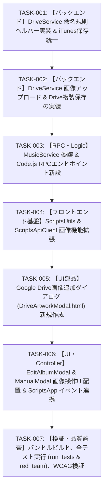

# 実装計画・タスク仕様書: アルバムアート画像アップロード・Googleドライブ連携およびファイル命名規則統一

- **文書バージョン**: 1.0.0
- **作成日**: 2026年10月19日
- **作成ロール**: テックリード (`tech-lead`)
- **上流設計書**: `docs/architecture/image_upload_feature_design.md`
- **成果物パス**: `docs/planning/image_upload_feature_plan.md`

---

## 1. アーキテクチャレビュー所見

### 1.1 実現可能性評価: 【極めて高い (Feasible)】
上流のシステムアーキテクチャ設計書（`docs/architecture/image_upload_feature_design.md`）で定義された要件および方針（ADR-IMG-001〜004）を批判的に検証した結果、技術的実現可能性は極めて高く、現行システムのアーキテクチャ・制約条件と完全に整合していると評価する。

1. **ファイル命名規則の厳格統一 (ADR-IMG-001)**:
   - ユーザー要望「iTunes APIで取得する画像と同じルールで、最後の数値部分だけは `YYYYMMDDHHMM00` (JST基準) にして」に対し、`DriveService` に単一のファイル名生成ヘルパー `generateArtworkFileName(albumName, extension, date)` を配置し、iTunesからのダウンロード（`downloadAndSaveArtwork`）とユーザーアップロード/Drive追加（`saveUploadedArtwork`, `importArtworkFromDrive`）の双方で共通利用する方針は、二重実装と将来の命名乖離を防ぐ最もクリーンな設計である。
2. **即時アップロード方式の優位性 (ADR-IMG-002)**:
   - ファイル選択時に独立したRPC `apiUploadArtwork` で即座にDrive保存と公開URL払い出しを行う方式は、アルバム編集API（`apiUpdateAlbumBatch`）や手動登録API（`apiSaveTrackSingle`）のペイロードを軽量（URL文字列のみ）に維持でき、GASの実行時間上限（30秒）やメモリ消費を圧迫しない。
   - 手動登録時の「連続登録」機能においても、払い出された公開URLをキャッシュしてそのまま使い回せるため、UXと通信負荷の観点から最適である。
3. **Google Driveリンク/ID入力＋専用フォルダ自動複製方式 (ADR-IMG-003)**:
   - Google Picker APIを回避し、共有URL/ID入力＋バックエンドでの `file.makeCopy` を採用した判断は妥当である。追加のGCP認証（OAuthクライアントID/APIキー）設定が不要で「スプレッドシートとDriveフォルダIDをスクリプトプロパティに入れるだけで動く」ゼロ設定性を維持できる。
   - アプリ専用フォルダ（`DRIVE_FOLDER_ID`）へ新命名規則で複製保存するため、ユーザー個人Driveでの元ファイル削除によるリンク切れを確実に予防できる。
4. **MIMEタイプ・容量制限 (ADR-IMG-004)**:
   - JPEG, PNG, WebP の3形式および 5.0MB 上限は、現代のジャケット画像配信として必要十分であり、GAS RPC制限（約50MB）に対し安全なマージンを確保している。

---

### 1.2 留意事項・技術リスクと対策

本計画では、以下の5点に留意し、各タスクの仕様およびテストコードに対策を組み込んでいる：

1. **GAS環境における `Utilities.formatDate` のタイムゾーン（`Asia/Tokyo`）と Node.js 単体テスト環境での互換性**:
   - GAS環境では `Utilities.formatDate(date, 'Asia/Tokyo', "yyyyMMddHHmm'00'")` が利用可能であるが、Node.js ローカルテスト環境（`tests/run_tests.js`）では `Utilities` は未定義である。
   - **対策**:
     - `DriveService.generateArtworkFileName` の実装において、`typeof Utilities !== 'undefined' && Utilities.formatDate` を使用しつつ、Node.js 環境でも安全に JST（UTC+9）で動作するフォールバック（`Intl.DateTimeFormat` または UTC+9 オフセット計算）を備えた多重防御とする。
     - 併せて、`tests/run_tests.js` 側でも `global.Utilities = { formatDate: ..., base64Decode: ..., newBlob: ... }` のモックを定義し、GAS標準サービスへの依存を完全にシミュレートする。
2. **Base64デコード時のDataURLプレフィックス分離とMIMEタイプ・サイズ検証**:
   - ブラウザの `FileReader.readAsDataURL` は `data:image/jpeg;base64,/9j/4AAQ...` のようにDataURLヘッダを付与する。これをそのまま `Utilities.base64Decode` に渡すと不正文字列としてGAS側でデコードエラーまたは破損が発生する。
   - **対策**:
     - バックエンド側で正規表現 `^data:([^;]+);base64,(.+)$` を用い、DataURLヘッダからMIMEタイプを抽出し、純粋なBase64文字列のみを取り出してデコードする。
     - 許容MIMEタイプ（`image/jpeg`, `image/png`, `image/webp`）のホワイトリスト検証をクライアント側およびサーバー側で二重実施する。
     - デコード後のバイト長が5MB（`5 * 1024 * 1024` バイト）を超過していないかを厳格に検査する。
3. **Google Drive `file.makeCopy` の挙動とアクセス権限・Graceful Degradation**:
   - ユーザーが入力したDriveファイルが別アカウント所有で「閲覧者によるダウンロード/コピー禁止」が設定されている場合や、アクセス権限がない場合は `makeCopy` が失敗する。
   - **対策**:
     - 元ファイルの存在・アクセス可否を確認し、不可の場合は分かりやすいエラーコード（`DRIVE_ACCESS_DENIED` 等）でユーザーに通知する。
     - 万一コピー作成権限のみ不足している場合は、フォールバックとして元ファイルに対して `setPublicSharing` を試み、元ファイルの公開URL（`https://lh3.googleusercontent.com/d/{fileId}`）を返却するGraceful Degradationを実装する。
4. **秒固定 `'00'` による同一分内同名ファイルの共存**:
   - 要求仕様「最後の数値部分だけはYYYYMMDDHHMM00にして」により、同一分内に同じアルバム名の画像を複数回アップロードすると、ファイル名が完全に同一になる。
   - **対策**:
     - Google Driveは同一フォルダ内に同名ファイルを複数保持することが仕様上許容されており、ユニークな `fileId` で識別・配信されるためシステム上の不具合は生じない。この挙動を前提として仕様化する。
5. **モバイル親指操作最適化 (WCAG 44px) と二重送信防止**:
   - スマートフォン画面でのタップミスを防ぐため、新規UIボタンは最低 44px × 44px のタップターゲットを確保する。
   - 画像アップロード中・Drive解決中は、アップロードボタン・保存ボタンを disabled 化し、スピナーアニメーションを表示して二重送信を防止する。
   - モーダル内フォームの Enter キー誤送信抑止（`onsubmit="event.preventDefault();"`）を徹底する。

---

### 1.3 アーキテクトへのエスカレーション有無: 【エスカレーション不要】
アーキテクチャ設計書の全要件・決定事項と本実装計画は完全に整合しており、設計変更やアーキテクトへのエスカレーションは一切不要である。

---

## 2. 影響範囲・変更対象ファイル一覧

| レイヤー | 対象ファイル | 変更種別 | 変更概要 |
| :--- | :--- | :---: | :--- |
| **Backend (Storage)** | `src/DriveService.js` | 修正 | - `generateArtworkFileName(albumName, extension, date)` の新設（`artwork_${name}_YYYYMMDDHHMM00.ext`）<br>- `saveUploadedArtwork(base64Data, mimeType, albumName)` の新設（Base64デコード・5MB制限・MIME検証・Drive保存・公開URL返却）<br>- `importArtworkFromDrive(driveUrlOrId, albumName, copyToAppFolder)` の新設（Drive ID抽出・元ファイル画像検証・専用フォルダ複製・新命名適用・公開URL返却）<br>- `downloadAndSaveArtwork` の命名生成部を `generateArtworkFileName` へ統一リファクタリング |
| **Backend (Logic)** | `src/MusicService.js` | 修正 | - `uploadArtwork(payload)` の新設（ペイロード検証・`DriveService.saveUploadedArtwork` への委譲）<br>- `resolveDriveArtwork(payload)` の新設（ペイロード検証・`DriveService.importArtworkFromDrive` への委譲） |
| **Backend (RPC)** | `src/Code.js` | 修正 | - `apiUploadArtwork(payload)` RPCエンドポイント新設<br>- `apiResolveDriveArtwork(payload)` RPCエンドポイント新設<br>- `module.exports` への新RPC関数追加 |
| **Frontend (Utils)** | `src/ScriptsUtils.html` | 修正 | - `validateImageFile(file)` ヘルパーの追加（MIME検証・5MBチェック）<br>- `readFileAsBase64(file)` ヘルパーの追加（FileReader Promise化） |
| **Frontend (Client)** | `src/ScriptsApiClient.html` | 修正 | - `uploadArtwork(payload)` APIラッパー追加<br>- `resolveDriveArtwork(payload)` APIラッパー追加 |
| **Frontend (UI Component)** | `src/DriveArtworkModal.html` | 新規作成 | - Google Drive画像追加専用モーダル（取得手順3ステップガイド、URL/ID入力欄、適用/キャンセルボタン、44pxタップターゲット確保） |
| **Frontend (UI)** | `src/EditAlbumModal.html` | 修正 | - アートワーク入力行に「ローカルから選択」「Driveから追加」ボタン追加<br>- 隠しファイル入力要素 `<input type="file" id="edit-album-file-input" ...>` 配置<br>- アップロード中スピナー・進捗表示UIの配置 |
| **Frontend (UI)** | `src/ManualModal.html` | 修正 | - アートワーク入力行に「ローカルから選択」「Driveから追加」ボタン追加<br>- 隠しファイル入力要素 `<input type="file" id="manual-file-input" ...>` 配置<br>- 即時プレビュー表示枠 `` およびアップロード中スピナーの配置 |
| **Frontend (App Controller)** | `src/ScriptsApp.html` | 修正 | - ローカルファイル選択イベント（即時DataURLプレビュー・サイズ検証・API送信・URL入力欄更新）<br>- Drive追加モーダル開閉および解決処理（Drive URL入力・API送信・URL入力欄更新・プレビュー表示）<br>- 処理中ローディングスピナー・ボタン活性/非活性（二重送信抑止）制御 |
| **Build** | `build.js` | 修正 | - `htmlIncludes` 配列に `'DriveArtworkModal'` を追加 |
| **Test** | `tests/run_tests.js` | 修正 | - `generateArtworkFileName` 命名規則厳格検証（JSTタイムゾーン、秒固定00、サニタイズ、拡張子）<br>- `saveUploadedArtwork` 単体テスト（正常系、不正MIME、5MB超過、Base64プレフィックス分離）<br>- `importArtworkFromDrive` 単体テスト（Drive複製、画像形式検証、フォールバック）<br>- `apiUploadArtwork` / `apiResolveDriveArtwork` RPCテスト<br>- `Utilities` モックの追加 |
| **Security/RedTeam Test** | `tests/red_team_attack_test.js` | 修正 | - 破壊的テスト（不正Base64、悪意あるMIMEタイプ、パストラバーサル・ヌルバイトアルバム名）<br>- 式インジェクション防止検証（生成URL/ファイル名のサニタイズ）<br>- UIアクセシビリティ検証（新規ボタンの44pxタップターゲット、Enter送信抑止） |

---

### 依存関係・後方互換性への考慮事項

1. **スプレッドシートデータスキーマの維持**:
   - `MusicTracks` シートの列構成（H列: アルバムアートURL）は一切変更せず、既存スキーマとの完全互換性を維持する。
2. **既存テキスト入力欄への直接URL入力の後方互換**:
   - 既存の `#edit-album-artwork-url` および `#manual-artwork-url` のテキストボックスはそのまま維持され、手作業で画像URLやDriveリンクを入力した場合でも、従来通り保存時の `ensurePublicArtwork` により正規化・公開設定される。
3. **iTunesインポート機能との統一**:
   - iTunes API検索経由での保存時（`saveAlbumFromItunes` 内の `downloadAndSaveArtwork`）も新命名規則 `artwork_${name}_${YYYYMMDDHHMM00}.jpg` が適用され、システム全体でファイル命名が完全に統一される。

---

## 3. インターフェース・データ構造仕様

### 3.1 データ型定義 (TypeScript表記)

```typescript
/**
 * ローカル画像アップロード リクエストペイロード
 */
interface UploadArtworkPayload {
  /** Base64エンコードされた画像データ (DataURL形式 'data:image/...;base64,...' または純粋Base64) */
  base64Data: string;
  /** 画像のMIMEタイプ ('image/jpeg' | 'image/png' | 'image/webp') */
  mimeType: string;
  /** アルバム名 (ファイル名生成およびサニタイズ用) */
  albumName: string;
  /** 元ファイル名 (任意) */
  originalFileName?: string;
}

/**
 * Google Drive画像追加 リクエストペイロード
 */
interface ResolveDriveArtworkPayload {
  /** Google Drive の URL または ファイルID */
  driveUrlOrId: string;
  /** アルバム名 (ファイル名生成用) */
  albumName: string;
  /** アプリ専用管理フォルダへ複製するかどうか (デフォルト: true) */
  copyToAppFolder?: boolean;
}

/**
 * 画像処理 共通レスポンスデータ
 */
interface ArtworkResultData {
  /** Google Drive のファイルID */
  fileId: string;
  /** スマートフォン未認証環境からでも表示可能な完全公開URL (https://lh3.googleusercontent.com/d/{fileId}) */
  publicUrl: string;
  /** 保存されたファイル名 (artwork_xxx_YYYYMMDDHHMM00.ext) */
  fileName: string;
}

/**
 * 統一 API レスポンス形式
 */
interface ApiResponse<T> {
  success: boolean;
  data?: T;
  error?: string;
  code?: string;
  timestamp: string;
}
```

---

### 3.2 バックエンド詳細仕様

#### 3.2.1 `DriveService.js`

```javascript
/**
 * 新命名規則に基づくアルバムアート画像ファイル名生成
 * フォーマット: artwork_${sanitizedAlbumName}_${YYYYMMDDHHMM00}.${extension}
 * 
 * @param {string} albumName - アルバム名
 * @param {string} [extension='jpg'] - 拡張子 ('jpg' | 'png' | 'webp')
 * @param {Date} [date=new Date()] - 基準日時
 * @returns {string} 生成されたファイル名
 */
generateArtworkFileName(albumName, extension = 'jpg', date = new Date()) {
  const sanitized = this.sanitizeFileName(albumName);
  const ext = String(extension || 'jpg').toLowerCase().replace(/^\./, '');

  let dateStr = '';
  if (typeof Utilities !== 'undefined' && Utilities.formatDate) {
    dateStr = Utilities.formatDate(date, 'Asia/Tokyo', "yyyyMMddHHmm'00'");
  } else {
    // Node.js テスト環境向けフォールバック (JST / UTC+9)
    const jstTime = new Date(date.getTime() + (9 * 60 + date.getTimezoneOffset()) * 60000);
    const y = jstTime.getFullYear();
    const m = String(jstTime.getMonth() + 1).padStart(2, '0');
    const d = String(jstTime.getDate()).padStart(2, '0');
    const h = String(jstTime.getHours()).padStart(2, '0');
    const min = String(jstTime.getMinutes()).padStart(2, '0');
    dateStr = `${y}${m}${d}${h}${min}00`;
  }

  return `artwork_${sanitized}_${dateStr}.${ext}`;
}

/**
 * Base64形式のローカル画像バイナリを専用Driveフォルダへ保存
 * 
 * @param {string} base64Data - Base64データ (DataURL形式可)
 * @param {string} mimeType - MIMEタイプ ('image/jpeg', 'image/png', 'image/webp')
 * @param {string} albumName - アルバム名
 * @returns {ArtworkResultData}
 */
saveUploadedArtwork(base64Data, mimeType, albumName)

/**
 * Google Drive上の画像ファイルをインポートし、専用管理フォルダへ新命名規則で複製・公開設定
 * 
 * @param {string} driveUrlOrId - DriveのURLまたはファイルID
 * @param {string} albumName - アルバム名
 * @param {boolean} [copyToAppFolder=true] - 管理フォルダへ複製するかどうか
 * @returns {ArtworkResultData}
 */
importArtworkFromDrive(driveUrlOrId, albumName, copyToAppFolder = true)
```

#### 3.2.2 `MusicService.js`

```javascript
/**
 * ローカル画像アップロードの業務受付・バリデーション・保存オーケストレーション
 * @param {UploadArtworkPayload} payload 
 * @returns {ArtworkResultData}
 */
uploadArtwork(payload) {
  if (!payload || typeof payload !== 'object') {
    const err = new Error('リクエストペイロードが不正です。');
    err.code = 'VALIDATION_FAILED';
    throw err;
  }
  const { base64Data, mimeType, albumName } = payload;
  if (!base64Data || typeof base64Data !== 'string') {
    const err = new Error('画像データが指定されていません。');
    err.code = 'VALIDATION_FAILED';
    throw err;
  }
  return this.driveService.saveUploadedArtwork(base64Data, mimeType, albumName);
}

/**
 * Google Drive画像のインポート業務受付・バリデーション・複製オーケストレーション
 * @param {ResolveDriveArtworkPayload} payload 
 * @returns {ArtworkResultData}
 */
resolveDriveArtwork(payload) {
  if (!payload || typeof payload !== 'object') {
    const err = new Error('リクエストペイロードが不正です。');
    err.code = 'VALIDATION_FAILED';
    throw err;
  }
  const { driveUrlOrId, albumName, copyToAppFolder } = payload;
  if (!driveUrlOrId || typeof driveUrlOrId !== 'string') {
    const err = new Error('Google DriveのURLまたはファイルIDを指定してください。');
    err.code = 'VALIDATION_FAILED';
    throw err;
  }
  return this.driveService.importArtworkFromDrive(driveUrlOrId, albumName, copyToAppFolder !== false);
}
```

#### 3.2.3 `Code.js` (RPCエントリーポイント)

```javascript
/**
 * 【RPC】ローカルアートワーク画像アップロードAPI
 * @param {UploadArtworkPayload} payload 
 * @returns {ApiResponse<ArtworkResultData>}
 */
function apiUploadArtwork(payload) {
  try {
    const data = getMusicService().uploadArtwork(payload);
    return { success: true, data: data, timestamp: new Date().toISOString() };
  } catch (err) {
    console.error('apiUploadArtwork エラー:', err);
    return {
      success: false,
      error: err.message,
      code: err.code || 'ARTWORK_UPLOAD_ERROR',
      timestamp: new Date().toISOString()
    };
  }
}

/**
 * 【RPC】Google Drive画像インポート・複製API
 * @param {ResolveDriveArtworkPayload} payload 
 * @returns {ApiResponse<ArtworkResultData>}
 */
function apiResolveDriveArtwork(payload) {
  try {
    const data = getMusicService().resolveDriveArtwork(payload);
    return { success: true, data: data, timestamp: new Date().toISOString() };
  } catch (err) {
    console.error('apiResolveDriveArtwork エラー:', err);
    return {
      success: false,
      error: err.message,
      code: err.code || 'DRIVE_RESOLVE_ERROR',
      timestamp: new Date().toISOString()
    };
  }
}
```

---

### 3.3 フロントエンド詳細仕様

#### 3.3.1 `ScriptsUtils.html`

```javascript
/**
 * アップロード対象画像ファイルのクライアント側バリデーション
 * @param {File} file 
 * @returns {{ valid: boolean, error?: string, mimeType?: string, extension?: string }}
 */
static validateImageFile(file) {
  if (!file) {
    return { valid: false, error: 'ファイルが選択されていません。' };
  }
  const maxSize = 5 * 1024 * 1024; // 5MB
  if (file.size > maxSize) {
    return { valid: false, error: '画像サイズは5MB以内にしてください。' };
  }
  const allowedMimes = ['image/jpeg', 'image/png', 'image/webp'];
  let mime = file.type;
  // 拡張子からのフォールバック判定
  const name = file.name || '';
  const extMatch = name.match(/\.([a-zA-Z0-9]+)$/);
  const ext = extMatch ? extMatch[1].toLowerCase() : '';
  if (!mime) {
    if (ext === 'jpg' || ext === 'jpeg') mime = 'image/jpeg';
    else if (ext === 'png') mime = 'image/png';
    else if (ext === 'webp') mime = 'image/webp';
  }
  if (!allowedMimes.includes(mime)) {
    return { valid: false, error: '対応形式はJPEG、PNG、WebPのみです。' };
  }
  const extMapping = { 'image/jpeg': 'jpg', 'image/png': 'png', 'image/webp': 'webp' };
  return { valid: true, mimeType: mime, extension: extMapping[mime] || 'jpg' };
}

/**
 * File オブジェクトを Base64 DataURL 文字列として読み込む
 * @param {File} file 
 * @returns {Promise<string>}
 */
static readFileAsBase64(file) {
  return new Promise((resolve, reject) => {
    const reader = new FileReader();
    reader.onload = () => resolve(reader.result);
    reader.onerror = (e) => reject(new Error('ファイルの読み込みに失敗しました。'));
    reader.readAsDataURL(file);
  });
}
```

#### 3.3.2 `ScriptsApiClient.html`

```javascript
/**
 * ローカルアートワーク画像アップロード
 * @param {UploadArtworkPayload} payload 
 * @returns {Promise<ArtworkResultData>}
 */
uploadArtwork(payload) {
  return this.callGAS('apiUploadArtwork', payload);
}

/**
 * Google Drive画像解決・複製
 * @param {ResolveDriveArtworkPayload} payload 
 * @returns {Promise<ArtworkResultData>}
 */
resolveDriveArtwork(payload) {
  return this.callGAS('apiResolveDriveArtwork', payload);
}
```

---

## 4. テスト戦略

### 4.1 単体テスト方針 (`tests/run_tests.js`)

1. **命名規則の厳格検証 (`generateArtworkFileName`)**:
   - `artwork_${sanitizedName}_YYYYMMDDHHMM00.${ext}` フォーマットの完全一致。
   - JST日時の正確なフォーマット検証（例: `2026-10-19T11:45:32Z` → `20261019204500`）。
   - 秒が必ず `'00'` で固定されていること。
   - 特殊文字・禁止文字（`/`, `\`, `:`, `*`, `?`, `"`, `<`, `>`, `|`）のサニタイズ検証。
   - 空文字アルバム名時に `'album'` にフォールバックすること。
   - JPEG, PNG, WebP 各拡張子の反映。
2. **ローカル画像保存の検証 (`saveUploadedArtwork`)**:
   - DataURLプレフィックス付きBase64の正常保存と公開URL返却。
   - プレーンBase64の正常保存。
   - 不正MIMEタイプ（`image/gif`, `application/pdf`, `text/html` 等）での `VALIDATION_FAILED` 例外送出。
   - 5MB超過バイナリでの `VALIDATION_FAILED` 例外送出。
   - 空データでの例外送出。
3. **Google Drive画像解決・複製の検証 (`importArtworkFromDrive`)**:
   - 正しいDrive URLおよびファイルIDからの抽出・複製・公開URL返却。
   - 元ファイルが画像でない場合の拒絶。
   - コピー失敗時のGraceful Degradation（元ファイル公開URLフォールバック）。
4. **RPCエンドポイント (`apiUploadArtwork`, `apiResolveDriveArtwork`)**:
   - 正常系レスポンス（`success: true`）の確認。
   - 異常系での `success: false` およびエラーコード返却の確認。

---

### 4.2 破壊的テスト・レッドチーム攻撃方針 (`tests/red_team_attack_test.js`)

1. **悪意ある入力・型汚染攻撃**:
   - `uploadArtwork`: `null`, `undefined`, 空オブジェクト, 数値, 配列等の破壊的ペイロード耐性。
   - `resolveDriveArtwork`: 巨大文字列、不正URL、パストラバーサル（`../../`）、ヌルバイト（`\0`）耐性。
2. **スプレッドシート数式インジェクション（CSV Injection）対策**:
   - アップロードされたファイル名やアルバム名に `=`, `+`, `-`, `@` が含まれる場合、スプレッドシート書き込み時に安全にエスケープ（`escapeFormula_`）されること。
3. **UI・アクセシビリティ・WCAG検証**:
   - 新規追加されるアップロードボタン・Drive追加ボタン・ダイアログボタンがすべて 44px × 44px 以上のタッチターゲットを確保していること。
   - フォーム内 Enter キー押下時の誤送信抑止（`onsubmit="event.preventDefault();"`）が維持されていること。

---

### 4.3 回帰テスト観点

- 既存テスト 159 件（単体テスト＋レッドチーム攻撃テスト）が 100% パスすること。
- 既存の「アルバム情報編集」「手動登録」「iTunesアルバム検索・一括保存」「MusicBrainz検索」が一切破壊されていないこと。

---

## 5. 実装タスク一覧 (順序定義)



---

### タスク [TASK-001]: 【バックエンド】DriveService 命名規則ヘルパー実装 & iTunes保存統一
- **ID**: TASK-001
- **目的**: ユーザー要望に厳格準拠したアートワークファイル命名ヘルパー `generateArtworkFileName` を実装し、iTunes画像保存 `downloadAndSaveArtwork` を新ヘルパーへリファクタリングする。
- **入力**:
  - `docs/architecture/image_upload_feature_design.md` (FR-IMG-003, ADR-IMG-001)
  - `src/DriveService.js` (既存の `Date.now()` 命名部)
- **期待される結果**:
  - `generateArtworkFileName(albumName, extension, date)` が追加され、`artwork_${sanitizedName}_${YYYYMMDDHHMM00}.${ext}` 形式のファイル名が返却される。
  - 日時部分は日本標準時（`Asia/Tokyo`, UTC+9）でフォーマットされ、末尾秒は固定 `'00'` となる。
  - `downloadAndSaveArtwork` 内のファイル名生成が新ヘルパーの呼び出しに置換される。
  - GAS環境およびNode.jsテスト環境の双元でエラーなく動作する。
- **対象ファイル**:
  - `src/DriveService.js`
  - `tests/run_tests.js`
- **依存関係**: なし（最優先着手タスク）
- **受け入れ基準**:
  - AC-001-1: アルバム名 `First Love`, 拡張子 `jpg`, 日時 `2026-10-19 20:45:32 JST` で `artwork_First_Love_20261019204500.jpg` が生成されること。
  - AC-001-2: 記号・禁止文字がアンダースコアにサニタイズされること。
  - AC-001-3: 空文字時に `artwork_album_YYYYMMDDHHMM00.jpg` となること。
  - AC-001-4: 拡張子指定（`png`, `webp`）が正しく反映されること。
  - AC-001-5: `downloadAndSaveArtwork` でも新ヘルパーが適用されること。
- **検証方法**:
  - `tests/run_tests.js` に `generateArtworkFileName` の単体テストを追加し、`cmd.exe /c "npm test"` を実行してパスすること。

---

### タスク [TASK-002]: 【バックエンド】DriveService 画像アップロード保存 & Drive複製保存の実装
- **ID**: TASK-002
- **目的**: Base64画像データをデコードして管理フォルダへ保存する `saveUploadedArtwork`、および指定Driveファイルを管理フォルダへ複製して公開権限を付与する `importArtworkFromDrive` を実装する。
- **入力**:
  - `docs/architecture/image_upload_feature_design.md` (FR-IMG-001, FR-IMG-002, ADR-IMG-003, ADR-IMG-004)
  - `src/DriveService.js`
- **期待される結果**:
  - `saveUploadedArtwork(base64Data, mimeType, albumName)`:
    - DataURLヘッダからMIMEタイプを安全に抽出・分離。
    - 許可MIMEタイプ（`image/jpeg`, `image/png`, `image/webp`）を検証。
    - 5MB容量制限をチェック。
    - Base64デコード（`Utilities.base64Decode`）し、新命名規則で `folder.createFile(blob)` を実行。
    - 公開権限付与（`setPublicSharing`）を行い、`ArtworkResultData`（`fileId`, `publicUrl`, `fileName`）を返却。
  - `importArtworkFromDrive(driveUrlOrId, albumName, copyToAppFolder)`:
    - `extractDriveFileId` でIDを抽出。
    - 元ファイルを取得し、画像形式であることを検証。
    - 管理フォルダへ `file.makeCopy(newFileName, appFolder)` を実行し、公開権限付与して `ArtworkResultData` を返却。
    - コピー失敗時のGraceful Degradation（元ファイル公開URLフォールバック）を実装。
- **対象ファイル**:
  - `src/DriveService.js`
  - `tests/run_tests.js`
- **依存関係**: TASK-001
- **受け入れ基準**:
  - AC-002-3: 5MB超過時に `VALIDATION_FAILED` エラーを送出すること。
  - AC-002-4: 不正MIMEタイプで `VALIDATION_FAILED` エラーを送出すること。
  - AC-003-2: Drive URL/IDから管理フォルダへ新命名規則で複製され、公開URLが返却されること。
- **検証方法**:
  - `tests/run_tests.js` に `saveUploadedArtwork` および `importArtworkFromDrive` のモック単体テストを追加し、`cmd.exe /c "npm test"` でパスすること。

---

### タスク [TASK-003]: 【RPC・Logic】MusicService 委譲 & Code.js RPCエンドポイント新設
- **ID**: TASK-003
- **目的**: バックエンドロジック（`MusicService`）にバリデーション・委譲処理を追加し、GAS Web AppのRPCエントリーポイント（`Code.js`）に公開APIを新設する。
- **入力**:
  - `src/MusicService.js`
  - `src/Code.js`
  - 仕様節 3.2.2, 3.2.3
- **期待される結果**:
  - `MusicService.uploadArtwork(payload)` および `MusicService.resolveDriveArtwork(payload)` を新設。
  - `Code.js` に `apiUploadArtwork(payload)` および `apiResolveDriveArtwork(payload)` を新設。
  - 成功時は `{ success: true, data: { fileId, publicUrl, fileName }, timestamp }`、失敗時は `{ success: false, error, code, timestamp }` の統一レスポンスを返却。
  - `Code.js` の `module.exports` に両関数を追加。
- **対象ファイル**:
  - `src/MusicService.js`
  - `src/Code.js`
  - `tests/run_tests.js`
- **依存関係**: TASK-002
- **受け入れ基準**:
  - ペイロード未指定時に `VALIDATION_FAILED` エラーを返却すること。
  - RPC呼び出しが成功し、統一フォーマットでレスポンスが返却されること。
- **検証方法**:
  - `tests/run_tests.js` で `apiUploadArtwork`, `apiResolveDriveArtwork` のRPC呼出テストを実行しパスすること。

---

### タスク [TASK-004]: 【フロントエンド基盤】ScriptsUtils & ScriptsApiClient 画像機能拡張
- **ID**: TASK-004
- **目的**: クライアント側での画像検証・DataURL読み取りユーティリティ、および新RPCを呼び出す `ApiClient` メソッドを実装する。
- **入力**:
  - `src/ScriptsUtils.html`
  - `src/ScriptsApiClient.html`
  - 仕様節 3.3.1, 3.3.2
- **期待される結果**:
  - `Utils.validateImageFile(file)` を追加（サイズ5MB制限、MIME/拡張子判定）。
  - `Utils.readFileAsBase64(file)` を追加（`FileReader` によるDataURL取得Promise）。
  - `ApiClient.uploadArtwork(payload)` を追加（`apiUploadArtwork` 呼出）。
  - `ApiClient.resolveDriveArtwork(payload)` を追加（`apiResolveDriveArtwork` 呼出）。
- **対象ファイル**:
  - `src/ScriptsUtils.html`
  - `src/ScriptsApiClient.html`
  - `tests/run_tests.js`
- **依存関係**: TASK-003
- **受け入れ基準**:
  - 5MB超過ファイルに対して `valid: false` とエラーメッセージが返ること。
  - 不正拡張子/MIMEに対して `valid: false` が返ること。
  - `ApiClient` にメソッドが定義されていること。
- **検証方法**:
  - `tests/run_tests.js` に `Utils.validateImageFile` の境界値テストを追加しパスすること。

---

### タスク [TASK-005]: 【UI部品】Google Drive画像追加ダイアログ (DriveArtworkModal.html) 新規作成
- **ID**: TASK-005
- **目的**: ユーザーが直感的にGoogle Drive画像の共有リンクまたはIDを入力できる専用モーダルUIを新設し、`build.js` に組み込む。
- **入力**:
  - `docs/architecture/image_upload_feature_design.md` (FR-IMG-002, ADR-IMG-003)
  - `build.js`
- **期待される結果**:
  - `src/DriveArtworkModal.html` を新規作成。
    - モーダルヘッダー（タイトル、閉じるボタン）。
    - Google Driveリンクの取得方法ガイド（3ステップ：①Driveで画像右クリック → ②「リンクをコピー」 → ③ここに貼り付け）。
    - Drive URL/ID入力欄（クリアボタン付き）。
    - アクションボタン（「適用する」「キャンセル」、最低44px高さ確保）。
    - 処理中スピナー。
  - `build.js` の `htmlIncludes` 配列に `'DriveArtworkModal'` を追加。
  - `src/index.template.html` に `<?!= include('DriveArtworkModal'); ?>` を追加。
- **対象ファイル**:
  - `src/DriveArtworkModal.html` (新規作成)
  - `src/index.template.html`
  - `build.js`
- **依存関係**: TASK-004
- **受け入れ基準**:
  - AC-003-1: 「Driveから追加」をクリックした際に本モーダルが表示できる構造になっていること。
  - すべてのボタンが 44px × 44px 以上のタップターゲットを有すること。
  - `node build.js` でエラーなくバンドルされること。
- **検証方法**:
  - `cmd.exe /c "node build.js"` を実行し、`src/index.html` にモーダルHTMLが正しく埋め込まれることを確認。

---

### タスク [TASK-006]: 【UI・Controller】EditAlbumModal & ManualModal 画像操作UI配置 & ScriptsApp イベント連携
- **ID**: TASK-006
- **目的**: `EditAlbumModal` および `ManualModal` に画像追加ボタン群・プレビュー枠を配置し、`ScriptsApp.html` でローカルアップロード・Drive追加・即時プレビュー・二重送信防止制御を実装する。
- **入力**:
  - `src/EditAlbumModal.html`
  - `src/ManualModal.html`
  - `src/DriveArtworkModal.html`
  - `src/ScriptsApp.html`
- **期待される結果**:
  - `EditAlbumModal.html`:
    - アートワークURL入力欄の横または上部に「📁 ローカルから選択」「☁️ Driveから追加」ボタン（44px確保）を追加。
    - 隠し `<input type="file" id="edit-album-file-input" accept="image/jpeg,image/png,image/webp" class="hidden">` を配置。
    - アップロード中インジケーター（スピナー）を配置。
  - `ManualModal.html`:
    - アートワークURL入力欄に同様のボタン群および隠し file input を配置。
    - 即時プレビュー枠 `` を配置。
  - `ScriptsApp.html`:
    - ファイル選択時: `Utils.validateImageFile` で検証 → `Utils.readFileAsBase64` で即時プレビュー表示 → スピナー表示 & ボタンdisabled化 → `api.uploadArtwork` 実行 → URL入力欄に `publicUrl` をセット → 成功トースト表示。
    - Drive追加時: `DriveArtworkModal` を開き、URL/IDを入力して適用 → スピナー表示 → `api.resolveDriveArtwork` 実行 → URL入力欄にセット & プレビュー更新 → 成功トースト表示。
    - エラー発生時: スピナー解除、エラー通知（トースト）、フォーム入力内容を保持（クラッシュ・画面遷移防止）。
- **対象ファイル**:
  - `src/EditAlbumModal.html`
  - `src/ManualModal.html`
  - `src/ScriptsApp.html`
- **依存関係**: TASK-005
- **受け入れ基準**:
  - AC-002-1: アルバム編集画面からローカル画像を選択し、即時プレビューおよびDrive保存URL反映ができること。
  - AC-002-2: 手動登録画面からも同様に画像アップロードができること。
  - AC-002-5: アップロード中にスピナーが表示され、ボタンが非活性化されること。
  - AC-003-2: Drive追加モーダルからURLを指定して反映・プレビューできること。
- **検証方法**:
  - `node build.js` を実行し、ブラウザまたはローカルテストでイベント登録およびDOM整合性を確認。

---

### タスク [TASK-007]: 【検証・品質監査】バンドルビルド、全テスト実行 (run_tests & red_team)、WCAG検証
- **ID**: TASK-007
- **目的**: フロントエンドバンドルを生成し、単体テスト・結合テスト・レッドチーム破壊的テストスイートを実行して全受け入れ基準の達成を客観的に検証する。
- **入力**:
  - 全実装コード
  - `tests/run_tests.js`
  - `tests/red_team_attack_test.js`
- **期待される結果**:
  - `node build.js` により `src/index.html` が正常にビルドされる。
  - `tests/run_tests.js` の新設テストを含む全単体テストが 100% パスする。
  - `tests/red_team_attack_test.js` の破壊的テスト、パストラバーサル、MIME偽装、式インジェクション、44pxタッチターゲット、Enter送信抑止検証が 100% パスする。
  - 既存の159件のテストを含め、リグレッションが一切発生しないこと。
- **対象ファイル**:
  - `build.js`
  - `src/index.html`
  - `tests/run_tests.js`
  - `tests/red_team_attack_test.js`
- **依存関係**: TASK-001 〜 TASK-006
- **受け入れ基準**:
  - 全受け入れ基準 (AC-001〜AC-005) を完全充足すること。
  - `npm test` 実行結果が終了コード 0、全件パスとなること。
- **検証方法**:
  - `cmd.exe /c "npm run prepush"` を実行し、全テストパスを確認。
