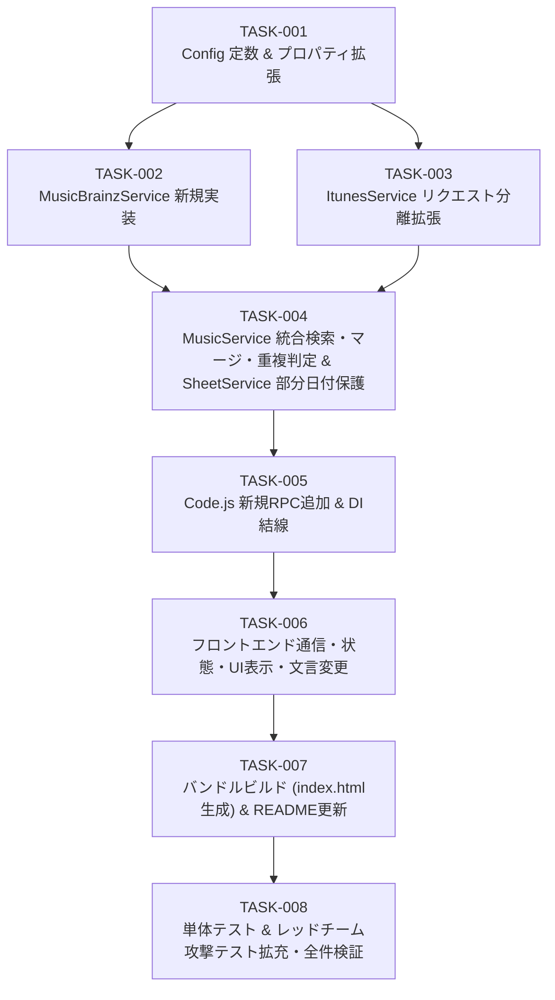

# 実装計画・タスク仕様書: アルバム検索への MusicBrainz 結果マージ & 一括登録ボタン名称変更

- **文書バージョン**: 1.0.0
- **作成日**: 2026年10月18日
- **作成ロール**: テックリード (`tech-lead`)
- **上流設計書**: `docs/architecture/musicbrainz_search_merge_design.md`
- **成果物パス**: `docs/planning/musicbrainz_search_merge_plan.md`
- **引き渡し先**: シニアコーダー (`senior-coder`)

---

## 1. アーキテクチャレビュー所見

### 1.1 実現可能性評価: 【極めて高い (Feasible)】
上流のシステムアーキテクチャ設計書（`docs/architecture/musicbrainz_search_merge_design.md`）およびユーザー承認事項（ゲート1確定内容）を現行コードベースと照合・批判的レビューした結果、技術的実現可能性は極めて高く、既存のレイヤードアーキテクチャおよびテスト資産と高い整合性を持つと評価する。

1. **既存一括登録パイプライン（`saveAlbumFromItunes`）の完全再利用性 (ADR-007)**:
   - `src/MusicService.js` L71-181 の `saveAlbumFromItunes(payload)` は、入力として `{ albumName, albumArtist, releaseDate, artworkUrl500, tracks: [{ cdNumber, trackNumber, trackName, trackArtist }] }` を受け取り、ソース非依存でバリデーション・式インジェクション無害化（`escapeFormula_`）・`DriveService.downloadAndSaveArtwork`・`SheetService.insertTracksBatch` を実行する構造になっている。
   - MusicBrainz の lookup 結果を同一の `AlbumDetail` 構造に正規化することで、保存処理およびスプレッドシート列構造（A〜H列）に一切の破壊的変更を加えずに統合可能である。
2. **並列取得と片側障害分離の両立 (ADR-002 / ADR-006 / FR-MB-005)**:
   - `ItunesService` と `MusicBrainzService` の双方に「HTTPリクエストオブジェクト生成（`buildSearchRequest`）」と「HTTPレスポンス解析（`parseSearchResponse`）」を分離して実装することで、GAS 実行時は `UrlFetchApp.fetchAll` による並列通信を行い、かつ万一 `fetchAll` 自体が DNS/SSL 例外を投げた場合や Node.js モック環境では個別呼び出しへ安全にフォールバックする二段構えの構成が可能である。
3. **カバーアート 404 および 307 リダイレクトへの耐性 (CAA-1 / CAA-2 / NFR-SEC-001)**:
   - 一覧表示時の Cover Art Archive (CAA) サムネイル（`front-250`）はカバー未登録時に 404 を返すが、既存の `ScriptsApp.html`（L425-427）と同様に DOM 挿入直後に `img.onerror = () => Utils.handleImageError(img)` をバインドすることで、インライン `onerror` 禁止規約（`tests/run_tests.js` セクション[9]）を100%遵守しつつデフォルト SVG へ安全にフォールバックできる。

### 1.2 技術的論点の精査結果・リスクと対策（設計書 付録A 対応）

| # | 技術的論点 | 精査結果（事実・リスク） | 本計画での確定仕様・対策 |
| :-- | :--- | :--- | :--- |
| **1** | **Q-5: MBの部分日付（`YYYY` / `YYYY-MM`）と `SheetService` 書き込み時の自動型変換** | **【重大発見】** `SheetService.js` の `insertTracksBatch` / `updateAlbumBatch` は `Range.setValues` でG列（リリース日）に書き込む。Google スプレッドシートはセル書式が「自動」のままだと `'2021-08'` を **`Date(2021, 7, 1)`（`2021-08-01`）へ自動型変換**し、次回 `fetchAllTracks()`（L71-72）で `'2021-08-01'` に変質する（存在しない「1日」が捏造される）。また、フロントの `EditAlbumModal.html`（L70 `<input type="date">`）は `YYYY-MM-DD` 以外の文字列（`'2021'` や `'2021-08'`）を `.value` に代入するとブラウザが空文字 `''` にクリアしてしまうため、アルバム編集保存時にリリース日が消失するリスクがある。 | 1. **バックエンド対策 (`SheetService.js`)**: `insertTracksBatch` および `updateAlbumBatch` において、`setValues` 実行前にG列（7列目）の対象 Range に対して `if (dateRange && typeof dateRange.setNumberFormat === 'function') dateRange.setNumberFormat('@');`（書式なしテキスト）を適用する。これにより Node モックの引数検証を壊さず、実機シートでの `YYYY-MM` → `Date` 変換を完全に防止する。<br>2. **フロントエンド対策 (`ScriptsApp.html`)**: `openEditAlbumModal` で元の `album.releaseDate` を `this.editingOriginalReleaseDate` に保持し、`dateInput` の `change`/`input` イベントで変更フラグ `this.editingReleaseDateChanged = true` を記録する。未変更かつ元の値が部分日付（`/^\d{4}(-\d{2})?$/`）の場合は `handleSaveAlbumEdit` で元の部分日付を維持する。 |
| **2** | **Lucene クエリ構文と `dismax` の扱い (NFR-SEC-003)** | MB `/ws/2/release` は既定で Lucene 構文を解釈するため、ユーザー入力に `+ - & | ! ( ) { } [ ] ^ " ~ * ? : \ /` 等が含まれると構文エラー（HTTP 400）や意図しないクエリ改変を招く。 | `MusicBrainzService.sanitizeSearchQuery(term)` で制御文字除去＋Lucene特殊文字エスケープ（`/[+\-&|!(){}[\]^"~*?:\\/]/g` → `\\$&`）を行った上で、URLクエリに `&dismax=true&fmt=json` を付与する二重防御とする。 |
| **3** | **重複判定（ADR-004）における記号のみタイトルの境界ケース** | ADR-004 の正規化規則（NFKC → 小文字化 → 空白・記号除去）を単純適用すると、記号のみのアルバム名（例: Ed Sheeran の `+`, `=`, `÷`）がすべて空文字 `""` になり、曲数・年が一致した場合に誤統合される恐れがある。 | 正規化関数 `normalizeForComparison_(str)` において、記号除去後の文字列が空文字になった場合は「NFKC＋小文字化＋空白除去のみ（記号保持）」の文字列へフォールバックする。さらに正規化後が空文字同士の場合は一致とみなさない（`false`）。 |
| **4** | **`MusicService` コンストラクタ第5引数の後方互換性** | 既存テスト（`tests/run_tests.js`, `tests/red_team_attack_test.js`, `tests/qa_comprehensive_test.js`）はすべて `new MusicService(config, sheet, drive, itunes)` の4引数で呼び出している。 | `constructor(config, sheetService, driveService, itunesService, musicBrainzService = null)` とし、第5引数省略時も既存メソッドおよびテストが100%無変更で動作する設計とする。`Code.js` の `getMusicService()` で `new MusicBrainzService(config)` を第5引数に注入する。 |
| **5** | **`Store` キー名と `red_team_attack_test.js` 静的検査の互換性** | `tests/red_team_attack_test.js` L429-431 が `ScriptsApp.html` 内の `submitItunesBatch` と `this.store.state.isSaving` の記述を静的検査している。 | ADR-009 に従い、`Store.state.itunesSearchResults` / `selectedItunesAlbum` のキー名および `App` の既存メソッド名（`openItunesModal`, `executeItunesSearch`, `renderItunesResults`, `selectItunesAlbumForPreview`, `submitItunesBatch`）は維持する。 |
| **6** | **ビルド生成物 `src/index.html` の不整合 (R-8)** | 現状の `src/index.html` は過去のビルド状態のままソースと乖離している。また `tests/run_tests.js` [9] は `src/index.html` を直接検査する。 | HTML/JS 変更後に必ず `npm run build`（`node build.js`）を実行して `src/index.html` を再生成し、旧文言が残っていないことをテストで自動検証する。 |

### 1.3 アーキテクトへのエスカレーション有無: 【エスカレーション不要】
ユーザーゲート1で全確認事項（Q-1〜Q-5、BLK-3）が確定しており、設計書の全ADR（ADR-001〜009）と矛盾や欠陥はないため、エスカレーションは不要である。なお、ローカル環境からは GAS 実機通信（BLK-1/BLK-2/U-2）を実行できないため、本計画書では「Nodeモックでの完全検証」と「GASデプロイ後の実機PoC・確認手順」を明確に分離して定義する。

---

## 2. 影響範囲・変更対象ファイル一覧

| レイヤー | 対象ファイル | 変更種別 | 変更概要 |
| :--- | :--- | :---: | :--- |
| **Backend** | `src/Config.js` | 修正 | - スクリプトプロパティ `MUSICBRAINZ_USER_AGENT`, `MUSICBRAINZ_ENABLED` の読み取り追加<br>- `getMusicBrainzUserAgent()`, `isMusicBrainzEnabled()` メソッド追加<br>- `Config.CONSTANTS.MUSICBRAINZ` 定数定義の追加 |
| **Backend** | `src/MusicBrainzService.js` | **新規** | - MusicBrainz WS v2 (`release` 検索・lookup) クライアントクラスの実装<br>- UAヘッダ付与、`CacheService` + `Utilities.sleep` による1,100ms間隔制御、HTTP 503時の1回限定リトライ<br>- MBID (UUID) バリデーション、Luceneクエリサニタイズ、MB JSON → 共通モデル正規化、CAA URL生成 |
| **Backend** | `src/ItunesService.js` | 修正 | - 既存 `searchAlbums` / `lookupAlbumSongs` の挙動・戻り値を完全維持しつつ、`fetchAll` 並列実行用の `buildSearchRequest(term)` / `parseSearchResponse(response)` を追加 |
| **Backend** | `src/MusicService.js` | 修正 | - コンストラクタに省略可能な第5引数 `musicBrainzService = null` を追加<br>- `searchAlbums(keyword)`: iTunes + MB 統合検索（`fetchAll` 並列・個別フォールバック・片側失敗分離・マージ）<br>- `mergeAlbumSearchResults(itunesAlbums, mbAlbums)`: 重複判定（4条件厳格一致）＋並び順（iTunes → MB score降順）の純粋関数メソッド<br>- `normalizeForComparison_(str)`: NFKC・小文字・空白記号正規化ヘルパー<br>- `lookupMusicBrainzRelease(mbid)`: MB リリース詳細取得の業務メソッド |
| **Backend** | `src/SheetService.js` | 修正 | - `insertTracksBatch` / `updateAlbumBatch` でG列（リリース日）書き込み時に `setNumberFormat('@')`（プレーンテキスト書式）を安全に適用し、MBの部分日付（`YYYY-MM` 等）の自動Date型変換を防止 |
| **Backend** | `src/Code.js` | 修正 | - `getMusicService()` で `MusicBrainzService` を生成・DI注入<br>- 新規RPC `apiSearchAlbums(keyword)`, `apiLookupMusicBrainzRelease(mbid)` の追加および `module.exports` への追加<br>- `apiSaveAlbumBatch` のJSDocコメント更新 |
| **Frontend** | `src/Navbar.html` | 修正 | - `#btn-open-itunes-modal` の表示文言を PC: `アルバム検索・一括登録`、SP: `一括登録` に変更（FR-UI-001） |
| **Frontend** | `src/ItunesModal.html` | 修正 | - モーダル見出しを `アルバムを検索して一括登録` ＋補足バッジ `iTunes / MusicBrainz` に変更（FR-UI-002） |
| **Frontend** | `src/ScriptsApiClient.html` | 修正 | - `searchAlbums(keyword)`, `lookupMusicBrainzRelease(mbid)` メソッドの追加（既存メソッド維持） |
| **Frontend** | `src/ScriptsState.html` | 修正 | - JSDoc・コメント整理および `searchSources` 状態フィールドの初期値追加（既存 `itunesSearchResults` / `selectedItunesAlbum` は完全維持） |
| **Frontend** | `src/ScriptsApp.html` | 修正 | - `executeItunesSearch`: `api.searchAlbums` 呼び出し、検索中ボタン無効化、片側失敗時の警告トースト表示、エラー文言を `アルバム検索エラー: ...` に変更<br>- `renderItunesResults`: 出典バッジ（`iTunes` / `MusicBrainz`）とMB補足情報（形態・国・枚数・注記）のXSSエスケープ描画、サムネイル `img[data-artwork]` への個別 `onerror` バインド、`data-source` + `data-id` によるクリック結線<br>- `selectItunesAlbumForPreview(id, source = 'itunes')`: 出典別のローディング文言切替・Lookup API振り分け、プレビュー画像 `onerror` バインド、トラック表でのメディア形態（CD/DVD等）表示、曲数切り詰め警告表示<br>- `openEditAlbumModal` / `handleSaveAlbumEdit`: MB部分日付（`YYYY` / `YYYY-MM`）の編集時消失防止保護 |
| **Build** | `src/index.html` | 再生成 | - `npm run build`（`node build.js`）により単一バンドルHTMLを再生成（手編集禁止） |
| **Test** | `tests/run_tests.js` | 修正 | - `MusicBrainzService` 単体テスト、`MusicService` マージ・重複判定4条件境界・並び順・片側障害・MBID検証テスト、`Code.js` 新RPCテスト、`Navbar.html` / `ItunesModal.html` / `src/index.html` 文言反映テストの追加 |
| **Test** | `tests/red_team_attack_test.js` | 修正 | - MBID インジェクション攻撃、MB検索クエリLucene構文インジェクション攻撃、MBレスポンスへのXSSペイロード混入・欠損JSON破壊耐性テストの追加 |
| **Docs** | `README.md` | 修正 | - MusicBrainz 連携・Cover Art Archive 自動保存の説明追加、ディレクトリ構成・手動配置ファイル一覧（全21ファイル：`MusicBrainzService.js` 追加）・スクリプトプロパティ説明の更新 |

---

## 3. インターフェース・データ構造仕様

### 3.1 `src/Config.js` 拡張仕様
```javascript
class Config {
  constructor() {
    // 既存プロパティに加え以下を読み込む
    // props.MUSICBRAINZ_USER_AGENT: 未設定時は Config.CONSTANTS.MUSICBRAINZ.DEFAULT_USER_AGENT
    // props.MUSICBRAINZ_ENABLED: 'false' または '0' の場合のみ false、それ以外は Config.CONSTANTS.MUSICBRAINZ.ENABLED (true)
  }

  /**
   * MusicBrainz API 通信用 User-Agent を取得
   * @returns {string}
   */
  getMusicBrainzUserAgent()

  /**
   * MusicBrainz 連携が有効かどうかを取得
   * @returns {boolean}
   */
  isMusicBrainzEnabled()

  static get CONSTANTS() {
    return {
      SHEET_HEADERS: [ /* 既存8列不変 */ ],
      ITUNES: { /* 既存不変 */ },
      MUSICBRAINZ: {
        BASE_URL: 'https://musicbrainz.org/ws/2',
        RELEASE_ENDPOINT: 'https://musicbrainz.org/ws/2/release',
        CAA_BASE_URL: 'https://coverartarchive.org/release',
        DEFAULT_USER_AGENT: 'MusicInfoApp/1.0 ( https://github.com/nankojin-ops/MusicInfo-app )',
        LIMIT: 25,
        MIN_INTERVAL_MS: 1100,
        RETRY_DELAY_MS: 1100,
        MAX_RETRIES: 1,
        CACHE_KEY_LAST_REQ: 'MUSICBRAINZ_LAST_REQUEST_TS',
        ENABLED: true
      }
    };
  }
}
```

### 3.2 `src/MusicBrainzService.js`（新規）インターフェース仕様
```javascript
class MusicBrainzService {
  /**
   * @param {Config} [config] 省略時は内部で new Config() を生成
   */
  constructor(config)

  /**
   * MusicBrainz 連携の有効状態を返却
   * @returns {boolean}
   */
  isEnabled()

  /**
   * 送信する User-Agent ヘッダ文字列を取得
   * @returns {string}
   */
  getUserAgent()

  /**
   * MBID (UUID v4 等の標準UUID形式) の厳格バリデーション
   * 正規表現: /^[0-9a-f]{8}-[0-9a-f]{4}-[0-9a-f]{4}-[0-9a-f]{4}-[0-9a-f]{12}$/i
   * @param {string} mbid
   * @returns {boolean}
   */
  isValidMbid(mbid)

  /**
   * Lucene 特殊文字のエスケープおよび制御文字除去 (NFR-SEC-003)
   * @param {string} term
   * @returns {string}
   */
  sanitizeSearchQuery(term)

  /**
   * カバーアートアーカイブ (CAA) の正面画像URLを生成
   * @param {string} mbid
   * @param {250|500|1200} [size=250]
   * @returns {string} https://coverartarchive.org/release/{mbid}/front-{size}
   */
  buildCoverArtUrl(mbid, size = 250)

  /**
   * artist-credit 配列を表示用アーティスト名文字列へ連結
   * 各要素の (credit.name || credit.artist?.name || '') + (credit.joinphrase || '') を連結
   * @param {Array<object>} artistCredit
   * @param {string} [fallback='']
   * @returns {string}
   */
  formatArtistCredit(artistCredit, fallback = '')

  /**
   * UrlFetchApp.fetch / fetchAll 用の検索リクエストオブジェクトを生成
   * URL: ${RELEASE_ENDPOINT}?query=${encodeURIComponent(sanitized)}&limit=${LIMIT}&dismax=true&fmt=json
   * headers: { 'User-Agent': this.getUserAgent(), 'Accept': 'application/json' }
   * muteHttpExceptions: true
   * @param {string} term
   * @returns {{ url: string, method: string, headers: Object<string, string>, muteHttpExceptions: boolean }|null}
   */
  buildSearchRequest(term)

  /**
   * 検索 HTTPResponse を解析し AlbumSearchResult[] に正規化
   * - HTTP 503: err.code = 'MUSICBRAINZ_RATE_LIMITED'
   * - その他非200: err.code = 'MUSICBRAINZ_API_NETWORK_ERROR'
   * - JSON不正: err.code = 'MUSICBRAINZ_API_PARSE_ERROR'
   * @param {GoogleAppsScript.URL_Fetch.HTTPResponse} response
   * @returns {Array<AlbumSearchResult>}
   */
  parseSearchResponse(response)

  /**
   * fetchAll で初回レスポンスを取得済みのケース向けに、503時の1回リトライとパースを行う
   * @param {object} requestObj buildSearchRequest の戻り値
   * @param {GoogleAppsScript.URL_Fetch.HTTPResponse} initialResponse
   * @returns {Array<AlbumSearchResult>}
   */
  executeWithRetryFromInitialResponse(requestObj, initialResponse)

  /**
   * キーワードから MusicBrainz リリース一覧を検索（レート制御＋503時1回リトライ付き）
   * @param {string} term
   * @returns {Array<AlbumSearchResult>}
   */
  searchReleases(term)

  /**
   * MBID からリリース収録曲・メディア情報を詳細取得（UUID検証＋レート制御＋503時1回リトライ付き）
   * URL: ${RELEASE_ENDPOINT}/${encodeURIComponent(mbid)}?inc=recordings+artist-credits&fmt=json
   * - MBID不正時: HTTP通信を行わず err.code = 'VALIDATION_FAILED' を送出
   * - HTTP 404時: err.code = 'ALBUM_NOT_FOUND' を送出
   * - HTTP 503時: 1回リトライ後、再失敗で err.code = 'MUSICBRAINZ_RATE_LIMITED' を送出
   * - その他非200: err.code = 'MUSICBRAINZ_API_NETWORK_ERROR' を送出
   * @param {string} mbid
   * @returns {AlbumDetail}
   */
  lookupRelease(mbid)

  /**
   * CacheService と Utilities.sleep を用いて前回リクエストから MIN_INTERVAL_MS (1100ms) 以上の間隔を確保
   * Node.js 環境（CacheService / Utilities 未定義時）でも安全に動作すること
   */
  enforceRateLimit_()
}
```

### 3.3 `src/MusicService.js` 統合検索・マージ仕様
```javascript
class MusicService {
  /**
   * @param {Config} config
   * @param {SheetService} sheetService
   * @param {DriveService} driveService
   * @param {ItunesService} itunesService
   * @param {MusicBrainzService} [musicBrainzService=null]
   */
  constructor(config, sheetService, driveService, itunesService, musicBrainzService = null)

  /**
   * iTunes と MusicBrainz の統合アルバム検索
   * 1. keyword が空文字/空白のみの場合は err.code = 'VALIDATION_FAILED' を送出
   * 2. MB有効時は iTunes と MB を並列取得（UrlFetchApp.fetchAll が利用可能かつ両Serviceが buildSearchRequest を持つ場合は fetchAll、それ以外は個別呼び出し）
   * 3. 片側のみ失敗した場合は例外にせず sources.<name>.ok = false, error = message として記録し、成功側の結果のみマージして返却
   * 4. 両方失敗した場合（MB無効時にiTunesが失敗した場合を含む）は err.code = 'ALBUM_SEARCH_ALL_FAILED' を送出
   * @param {string} keyword
   * @returns {AlbumSearchResponse}
   */
  searchAlbums(keyword)

  /**
   * MusicBrainz リリース詳細（収録曲・メディア構成）の取得
   * @param {string} mbid
   * @returns {{ albumDetail: AlbumDetail }}
   */
  lookupMusicBrainzRelease(mbid)

  /**
   * iTunes 検索結果と MusicBrainz 検索結果のマージ・重複排除・ソート（純粋関数）
   * - iTunes 各要素に source: 'itunes', sourceId: String(item.collectionId) を補完
   * - MB 各要素に source: 'musicbrainz', sourceId: String(item.sourceId || item.id) を補完
   * - 重複判定 (ADR-004): 以下の4条件すべてが iTunes 要素と一致する MB 要素を除外
   *   (1) normalizeForComparison_(albumName) が非空かつ一致
   *   (2) normalizeForComparison_(albumArtist) が非空かつ一致
   *   (3) Number(trackCount) > 0 かつ一致
   *   (4) releaseDate の先頭4桁年 (/^\d{4}/) が双方に存在しかつ一致
   * - 並び順 (ADR-005): 先頭に iTunes 結果（元の順序維持）、続けて重複除外後の MB 結果を extra.score 降順（同点は元の順序維持）で連結
   * @param {Array<object>} itunesAlbums
   * @param {Array<object>} mbAlbums
   * @returns {Array<AlbumSearchResult>}
   */
  mergeAlbumSearchResults(itunesAlbums, mbAlbums)

  /**
   * 重複判定用の文字列正規化ヘルパー (ADR-004)
   * Unicode NFKC -> toLowerCase() -> trim() -> 空白・句読点・記号の除去
   * ※記号除去で空文字になる場合（記号のみのタイトル "+" や "=" 等）は空白除去のみの文字列へフォールバック
   * @param {string} str
   * @returns {string}
   */
  normalizeForComparison_(str)
}
```

### 3.4 共通データ構造（`AlbumSearchResult` / `AlbumDetail`）

#### `AlbumSearchResult`
```javascript
{
  source: 'itunes' | 'musicbrainz',
  sourceId: string,          // iTunes: String(collectionId), MB: release MBID
  collectionId?: number,     // iTunes のみ（後方互換維持）
  albumName: string,         // 欠損時は '不明なアルバム'
  albumArtist: string,       // 欠損時は '不明なアーティスト'
  artworkUrl100: string,     // iTunes: 100x100 URL, MB: CAA front-250 URL
  artworkUrl500: string,     // iTunes: 500x500 URL, MB: CAA front-500 URL
  releaseDate: string,       // iTunes: 'YYYY-MM-DD', MB: 'YYYY-MM-DD' | 'YYYY-MM' | 'YYYY' | ''
  trackCount: number,        // 正整数または0
  primaryGenreName: string,  // iTunes: ジャンル名, MB: ''
  extra?: {                  // MB のみ付与
    format: string,          // 例: 'CD', 'CD + DVD', 'Digital Media'
    country: string,         // 例: 'JP', 'US', 'XW'
    disambiguation: string,  // 例: '初回限定盤'
    discCount: number,       // media.length
    status: string,          // 例: 'Official'
    score: number            // 0〜100
  }
}
```

#### `AlbumDetail`
```javascript
{
  source: 'itunes' | 'musicbrainz',
  sourceId: string,
  collectionId?: number,     // iTunes のみ
  albumName: string,
  albumArtist: string,
  releaseDate: string,
  artworkUrl100: string,     // MB: cover-art-archive.front === true の時のみ CAA front-250 URL、それ以外は ''
  artworkUrl500: string,     // MB: cover-art-archive.front === true の時のみ CAA front-500 URL、それ以外は ''
  trackCount: number,
  truncated?: boolean,       // MB: メディア合計曲数より取得tracks配列が少ない場合 true (U-1対策)
  expectedTrackCount?: number,
  tracks: Array<{
    cdNumber: number,        // 1以上の整数 (MB: medium.position || index + 1)
    trackNumber: number,     // 1以上の整数 (MB: track.position || index + 1 ※track.numberは使用禁止)
    trackName: string,
    trackArtist: string,
    mediumFormat?: string    // MB: medium.format (例: 'CD', 'DVD', 'Blu-ray')
  }>
}
```

---

## 4. テスト戦略

ローカル環境では GAS 実機ランタイム（Google 共有 IP や実際の `UrlFetchApp`）は動作しないため、**「A. ローカル Node.js モック検証」** と **「B. GAS デプロイ後の実機検証（PoC 含む）」** を明確に分離して実施する。

### 4.1 ローカル Node.js 単体テスト・結合テスト (`tests/run_tests.js`)
1. **`Config` の拡張テスト**:
   - `Config.CONSTANTS.MUSICBRAINZ` の各定数存在確認。
   - デフォルト User-Agent が `MusicInfoApp/1.0 ( https://github.com/nankojin-ops/MusicInfo-app )` であること。
   - スクリプトプロパティ `MUSICBRAINZ_USER_AGENT` および `MUSICBRAINZ_ENABLED`（`'false'` で無効化）の上書き動作検証。
2. **`MusicBrainzService` のモック検証**:
   - `isValidMbid`: 正常な UUID（大小文字）で `true`、不正文字列・空文字・XSS文字列で `false`。
   - `sanitizeSearchQuery`: Lucene 特殊文字が安全にエスケープされること。
   - `formatArtistCredit`: 複数アーティスト＋`joinphrase`（`feat.`, `&` 等）が正しく連結されること。
   - `searchReleases`（`global.UrlFetchApp` モック）:
     - リクエストヘッダに `User-Agent` と `Accept: application/json` が付与されていること（AC-13）。
     - URL に `dismax=true` と `fmt=json` が含まれること。
     - MB の検索レスポンス JSON が `AlbumSearchResult[]` に正しく正規化されること。
     - HTTP 503 応答時に **1回だけ** リトライが実行され、2回目が 200 なら成功、2回目も 503 なら `MUSICBRAINZ_RATE_LIMITED` 例外となること（AC-12）。
     - 連続呼び出し時に `CacheService` と `Utilities.sleep` モックを通じて 1,100ms 以上の間隔制御が働くこと（AC-12）。
   - `lookupRelease`（`global.UrlFetchApp` モック）:
     - 不正 MBID 入力時に `UrlFetchApp.fetch` が **1回も呼ばれず** `VALIDATION_FAILED` がスローされること（AC-8）。
     - 複数メディア（Disc 1: CD, Disc 2: DVD）およびアナログ盤表記（`number: "A1"`, `position: 1`）を含むモック JSON に対し、`cdNumber` と `trackNumber` が `position`（正整数）から抽出され昇順ソートされること（AC-6, Q-4）。
     - `cover-art-archive.front === true` の時は CAA URL が設定され、`false` または未定義の時は `artworkUrl100` / `artworkUrl500` が空文字 `''` になること（AC-7）。
3. **`MusicService` 統合検索・マージ・重複判定・障害分離の検証**:
   - **重複判定 4条件の境界テスト（AC-3）**:
     - ①アルバム名・アーティスト名・曲数・リリース年の4条件すべて一致（表記ゆれ `NFKC` / 空白差を含む）→ MB 側が非表示になり iTunes 側のみ残ること。
     - ②アルバム名が異なる（例: `Editorial` vs `Editorial (Deluxe)`）→ 両方表示されること。
     - ③アーティスト名が異なる → 両方表示されること。
     - ④曲数が1曲異なる（12曲 vs 13曲）→ 両方表示されること。
     - ⑤リリース年が異なる（2021 vs 2022）、または片方のリリース日が空文字 → 両方表示されること。
     - ⑥記号のみのアルバム名（`+` vs `=`）→ 誤統合されず両方表示されること。
   - **並び順の検証（AC-2）**:
     - iTunes 結果ブロック（API返却順）の後ろに MB 結果ブロック（`score` 降順、同点は元の順序）が並ぶこと。
   - **片側障害フォールバックの検証（AC-4, AC-5）**:
     - MB が例外（503 / ネットワークエラー）を投げた場合 → RPC は成功し、iTunes 結果のみ返却され `sources.musicbrainz.ok === false` となること。
     - iTunes が例外を投げた場合 → RPC は成功し、MB 結果のみ返却され `sources.itunes.ok === false` となること。
     - 両方失敗した場合 → `ALBUM_SEARCH_ALL_FAILED` 例外がスローされること。
   - **機能スイッチ無効時の検証（AC-11）**:
     - `MUSICBRAINZ_ENABLED: 'false'` の場合、MB へのリクエストを行わず iTunes 結果のみ返し、`sources.musicbrainz.skipped === true` となること。
   - **MB 由来データの一括登録検証（AC-7, Q-5）**:
     - `lookupRelease` で得た `AlbumDetail`（部分日付 `'2021-08'` を含む）を `saveAlbumFromItunes` に渡した際、正常にシート保存されること。
4. **UI 文言・バンドル生成物検証（AC-16, AC-17, AC-18）**:
   - `Navbar.html`、`ItunesModal.html`、およびビルド後の `src/index.html` に新文言（「アルバム検索・一括登録」「一括登録」「アルバムを検索して一括登録」）が含まれ、旧文言（「iTunesから一括登録」「iTunes登録」「iTunes一括登録」）が残存していないことをアサートする。
   - `src/index.html` にインライン `onerror=` 属性が1件も存在しないこと（AC-10）。

### 4.2 レッドチーム破壊的テスト (`tests/red_team_attack_test.js`)
1. **MBID インジェクション攻撃**:
   - `../release/xxx`, `12345`, `<script>alert(1)</script>`, SQL/Lucene 構文、NULL バイト等を `lookupMusicBrainzRelease` に注入し、すべて `VALIDATION_FAILED` で遮断されること。
2. **MB 検索クエリ構文インジェクション耐性**:
   - `AND OR NOT + - && || ! ( ) { } [ ] ^ " ~ * ? : \ /` や超長大文字列・サロゲートペアを入力してもクラッシュせず安全にエスケープされること。
3. **悪意ある MB レスポンス JSON 耐性**:
   - `releases` 要素の `title`, `artist-credit`, `disambiguation`, `format` に `` や `=IMPORTXML(...)` が含まれる場合、およびフィールド全欠損オブジェクト `{}` が混入した場合でも、例外を起こさず正規化・XSSエスケープ・式エスケープされること。

### 4.3 GAS デプロイ後の実機確認項目（BLK-1 / BLK-2 / U-1 / U-2 対応）
シニアコーダーによる実装・ローカル全テスト合格後、ユーザーが `npm run push` で GAS 環境へ反映した際に以下の実機確認を実施できるようにする：
1. **BLK-1（UA ヘッダ到達確認）**: GAS エディタまたは Web App から検索を実行し、MusicBrainz API が HTTP 200 で応答すること。
2. **BLK-2（共有 IP での 503 発生率確認）**: 数秒間隔で複数回検索を実行し、503 エラーが頻発しないこと（万一 503 が発生しても iTunes 結果が表示され警告トーストが出ること）。
3. **U-2（CAA 307 リダイレクト画像保存確認）**: カバーアートのある MusicBrainz リリースを選択して一括登録し、Google Drive フォルダにジャケット画像が保存されスマートフォン・PC双方で表示されること。
4. **Q-5（部分日付のシート保存確認）**: リリース日が `YYYY` または `YYYY-MM` の MusicBrainz リリースを登録し、スプレッドシートG列で `YYYY-MM-01` に自動変換されず文字列として保持されること。

---

## 5. 実装タスク一覧 (順序定義)



---

### タスク [TASK-001]: `Config.js` の MusicBrainz 定数・プロパティ管理拡張
- **ID**: `TASK-001`
- **目的**: MusicBrainz WS v2 および Cover Art Archive の接続設定、デフォルト User-Agent（BLK-3確定値）、レート制限定数、およびスクリプトプロパティによる UA 上書き・機能スイッチ（FR-OPS-001）を `Config` クラスに追加する。
- **入力**: `src/Config.js`、スクリプトプロパティ（`MUSICBRAINZ_USER_AGENT`, `MUSICBRAINZ_ENABLED`）
- **期待される結果**:
  - `Config.CONSTANTS.MUSICBRAINZ` に `BASE_URL`, `RELEASE_ENDPOINT`, `CAA_BASE_URL`, `DEFAULT_USER_AGENT` (`'MusicInfoApp/1.0 ( https://github.com/nankojin-ops/MusicInfo-app )'`), `LIMIT` (`25`), `MIN_INTERVAL_MS` (`1100`), `RETRY_DELAY_MS` (`1100`), `MAX_RETRIES` (`1`), `CACHE_KEY_LAST_REQ`, `ENABLED` (`true`) が定義される。
  - `config.getMusicBrainzUserAgent()` がスクリプトプロパティ `MUSICBRAINZ_USER_AGENT`（未設定時は `DEFAULT_USER_AGENT`）を返す。
  - `config.isMusicBrainzEnabled()` がスクリプトプロパティ `MUSICBRAINZ_ENABLED`（`'false'` または `'0'` の時のみ `false`、未設定時は `CONSTANTS.MUSICBRAINZ.ENABLED`）を返す。
- **対象ファイル**: `src/Config.js`
- **依存関係**: なし
- **受け入れ基準**:
  - 既存の `getSpreadsheetId()`, `getDriveFolderId()`, `getSheetName()`, `validate()`, `CONSTANTS.SHEET_HEADERS`, `CONSTANTS.ITUNES` が一切変更されず互換維持されること。
  - `PropertiesService` が未定義の Node.js 環境でもデフォルト値で安全に動作すること。
- **検証方法**:
  - `node -e "const Config = require('./src/Config'); const c = new Config(); console.log(c.getMusicBrainzUserAgent(), c.isMusicBrainzEnabled(), Config.CONSTANTS.MUSICBRAINZ);"`

---

### タスク [TASK-002]: `MusicBrainzService.js` の新規実装
- **ID**: `TASK-002`
- **目的**: MusicBrainz API との HTTP 通信、User-Agent 付与、1,100ms 呼び出し間隔制御、HTTP 503 時の1回リトライ、MBID 検証、Lucene クエリサニタイズ、およびレスポンス正規化を担う `MusicBrainzService` クラスを新規作成する。
- **入力**: 検索キーワード `term`、またはリリース MBID `mbid`
- **期待される結果**:
  - §3.2 の全メソッドを備えた `src/MusicBrainzService.js` が作成され、`module.exports = MusicBrainzService` でエクスポートされる。
  - `searchReleases(term)` および `buildSearchRequest(term)` / `parseSearchResponse(response)` / `executeWithRetryFromInitialResponse(req, res)` が実装される。
  - `lookupRelease(mbid)` が UUID バリデーション、`/ws/2/release/{mbid}?inc=recordings+artist-credits&fmt=json` の呼び出し、全メディア（CD/DVD/Blu-ray 等）からの `cdNumber` (`medium.position`)・`trackNumber` (`track.position`)・`mediumFormat` の抽出、および `cover-art-archive.front === true` に基づく CAA URL 設定を行う。
- **対象ファイル**: `src/MusicBrainzService.js`（新規）
- **依存関係**: `TASK-001`
- **受け入れ基準**:
  - 全リクエストに `headers: { 'User-Agent': this.getUserAgent(), 'Accept': 'application/json' }` が含まれること（AC-13）。
  - `isValidMbid` が不正な UUID を拒否し、`lookupRelease` が通信前に `err.code = 'VALIDATION_FAILED'` を投げること（AC-8）。
  - トラック番号に文字列 `track.number`（`"A1"` 等）を使わず、整数の `track.position`（欠損時は連番）を使用すること（MB-5, AC-6）。
  - ファイル内に `// TODO` 等の禁止プレースホルダーを含めないこと。
- **検証方法**:
  - Node.js で `require('./src/MusicBrainzService')` が構文エラーなくロードでき、モック `UrlFetchApp` を用いて `searchReleases` / `lookupRelease` が期待通りのオブジェクトを返すことを確認。

---

### タスク [TASK-003]: `ItunesService.js` の並列取得用リクエスト分離拡張
- **ID**: `TASK-003`
- **目的**: `UrlFetchApp.fetchAll` による iTunes / MusicBrainz 並列検索を可能にしつつ、既存の `ItunesService.searchAlbums(term)` のインターフェース・挙動を完全維持する。
- **入力**: 検索キーワード `term`
- **期待される結果**:
  - `buildSearchRequest(term)`: トリム済みキーワードが空なら `null`、非空なら `{ url, method: 'get', muteHttpExceptions: true }` を返す。
  - `parseSearchResponse(response)`: HTTP 200 チェック・JSON パース・`wrapperType === 'collection'` フィルタ・`ItunesAlbumSummary[]` マッピングを行う。
  - `searchAlbums(term)`: 内部で `buildSearchRequest` と `parseSearchResponse` を呼び出す形にリファクタリングされ、既存の戻り値・エラーコード（`ITUNES_API_NETWORK_ERROR`）を100%維持する。
- **対象ファイル**: `src/ItunesService.js`
- **依存関係**: `TASK-001`
- **受け入れ基準**:
  - 既存の `searchAlbums(term)`, `lookupAlbumSongs(collectionId)`, `convertTo500x500ArtworkUrl(url100)` のシグネチャと挙動が変わらないこと（AC-14）。
- **検証方法**:
  - `node tests/run_tests.js` の既存 `[3] ItunesService のテスト` がパスすること。

---

### タスク [TASK-004]: `MusicService.js` の統合検索・マージ・重複判定実装と `SheetService.js` の部分日付保護
- **ID**: `TASK-004`
- **目的**:
  1. `MusicService` に統合検索 `searchAlbums`、純粋関数マージ `mergeAlbumSearchResults`（ADR-004 重複判定4条件・ADR-005 並び順）、および `lookupMusicBrainzRelease` を実装する。
  2. `SheetService` のバッチ書き込み時にG列（リリース日）へプレーンテキスト書式 `'@'` を指定し、MB の部分日付（`YYYY-MM`）がスプレッドシート上で勝手に `YYYY-MM-01` の Date 型へ変換される問題（Q-5 / R-6）を防止する。
- **入力**: 検索キーワード `keyword`、または `mbid`、または保存対象トラック配列
- **期待される結果**:
  - `MusicService` コンストラクタが第5引数 `musicBrainzService = null` を受け取る（省略可能）。
  - `searchAlbums(keyword)` が iTunes と MB を呼び出し、片側失敗時は成功側の結果＋`sources.<name>.ok = false` を返し、両方失敗時のみ `err.code = 'ALBUM_SEARCH_ALL_FAILED'` を投げる。
  - `mergeAlbumSearchResults(itunesAlbums, mbAlbums)` が ADR-004 の4条件すべてを満たす MB 項目のみを除外し、iTunes ブロック（API返却順）→ MB ブロック（`extra.score` 降順）に整列して返す。
  - `SheetService.insertTracksBatch` および `updateAlbumBatch` で G列 Range に `if (dateRange && typeof dateRange.setNumberFormat === 'function') dateRange.setNumberFormat('@');` が実行される。
- **対象ファイル**: `src/MusicService.js`, `src/SheetService.js`
- **依存関係**: `TASK-002`, `TASK-003`
- **受け入れ基準**:
  - 既存の `searchItunesAlbums`, `lookupItunesAlbum`, `saveAlbumFromItunes`, `saveSingleTrack`, `updateAlbum` がすべて無変更で動作すること。
  - 重複判定の4条件（正規化アルバム名・正規化アルバムアーティスト名・総トラック数・4桁リリース年）が1つでも異なれば MB 項目が残ること（AC-3）。
  - 記号のみのアルバム名（`+` と `=` など）が誤って同一視されないこと。
  - Node.js テストのモック `sheet.getRange`（`setNumberFormat` 未定義）でも例外が発生しないこと。
- **検証方法**:
  - `node tests/run_tests.js` および `node tests/red_team_attack_test.js` が既存テスト含めすべてパスすること。

---

### タスク [TASK-005]: `Code.js` の新規 RPC 追加と DI 結線
- **ID**: `TASK-005`
- **目的**: フロントエンドから呼び出す新規 RPC `apiSearchAlbums(keyword)` と `apiLookupMusicBrainzRelease(mbid)` を `Code.js` に公開し、`getMusicService()` で `MusicBrainzService` を注入する。
- **入力**: クライアントからの RPC 呼び出し引数（`keyword`, `mbid`）
- **期待される結果**:
  - `getMusicService()` が `const musicBrainzService = new MusicBrainzService(config);` を生成し `new MusicService(config, sheetService, driveService, itunesService, musicBrainzService)` を返す。
  - `apiSearchAlbums(keyword)` が `getMusicService().searchAlbums(keyword)` を呼び出し、既存の `ApiResponse` 形式（`{ success, data, error, code, timestamp }`）で返す（デフォルトエラーコード: `'ALBUM_SEARCH_ERROR'`）。
  - `apiLookupMusicBrainzRelease(mbid)` が `getMusicService().lookupMusicBrainzRelease(mbid)` を呼び出し、`ApiResponse` 形式で返す（デフォルトエラーコード: `'MUSICBRAINZ_LOOKUP_ERROR'`）。
  - `apiSaveAlbumBatch` の JSDoc コメントを `アルバム一括保存API（iTunes / MusicBrainz 共通）` に更新する。
  - `module.exports` に `apiSearchAlbums`, `apiLookupMusicBrainzRelease` を追加する。
- **対象ファイル**: `src/Code.js`
- **依存関係**: `TASK-004`
- **受け入れ基準**:
  - 既存 RPC（`apiGetAllData`, `apiSearchItunes`, `apiLookupItunesAlbum`, `apiSaveAlbumBatch`, `apiSaveTrackSingle`, `apiUpdateAlbumBatch`）の関数名・引数が一切変更されないこと。
- **検証方法**:
  - `node -e "const Code = require('./src/Code'); console.log(Object.keys(Code));"` で新旧 RPC 関数がすべてエクスポートされていることを確認。

---

### タスク [TASK-006]: フロントエンド通信・状態・UI 表示・ボタン名称変更の実装
- **ID**: `TASK-006`
- **目的**: ユーザーゲート1で確定したボタン名称・モーダル見出しへの変更（FR-UI-001/002）、出典バッジと MB 補足情報（形態・国・枚数・注記）の表示（FR-MB-002）、片側失敗時の警告トースト表示（FR-MB-005）、出典に応じた Lookup 振り分けとプレビュー表示（FR-MB-006 / Q-4）、および部分日付の編集保護（Q-5）を実装する。
- **入力**: `src/Navbar.html`, `src/ItunesModal.html`, `src/ScriptsApiClient.html`, `src/ScriptsState.html`, `src/ScriptsApp.html`
- **期待される結果**:
  1. **`src/Navbar.html`**:
     - L43 コメントを `<!-- アルバム検索・一括登録ボタン -->` に変更。
     - L48（PC）を `<span class="hidden sm:inline">アルバム検索・一括登録</span>`、L49（SP）を `<span class="sm:hidden">一括登録</span>` に変更。
  2. **`src/ItunesModal.html`**:
     - L12 の見出しを `アルバムを検索して一括登録` に変更し、横に `<span class="text-[11px] font-normal text-slate-400 bg-slate-800/80 px-2 py-0.5 rounded border border-slate-700/80 font-mono">iTunes / MusicBrainz</span>` を配置。
  3. **`src/ScriptsApiClient.html`**:
     - `searchAlbums(keyword)`（`this.callGAS('apiSearchAlbums', keyword)`）と `lookupMusicBrainzRelease(mbid)`（`this.callGAS('apiLookupMusicBrainzRelease', mbid)`）を追加。
  4. **`src/ScriptsState.html`**:
     - `this.state` に `searchSources: null` を追加（既存の `itunesSearchResults: []`, `selectedItunesAlbum: null` はそのまま維持）。
  5. **`src/ScriptsApp.html`**:
     - `executeItunesSearch()`:
       - 検索実行中は `#btn-itunes-search-submit` を `disabled = true` にし、`finally` で解除する。
       - `this.api.searchAlbums(keyword)` を呼び出し、`res.albums` を `this.store.state.itunesSearchResults` に、`res.sources` を `this.store.state.searchSources` に格納。
       - `res.sources` を確認し、`musicbrainz.ok === false`（かつ `!musicbrainz.skipped`）なら `Utils.showToast('MusicBrainz の検索に失敗したため iTunes の結果のみ表示しています', 'warning', 4500)`、`itunes.ok === false` なら `Utils.showToast('iTunes の検索に失敗したため MusicBrainz の結果のみ表示しています', 'warning', 4500)` を表示。
       - 例外時は `Utils.showToast(\`アルバム検索エラー: \${err.message}\`, 'error')` を表示。
     - `renderItunesResults()`:
       - 各項目の `source = item.source || 'itunes'`、`sourceId = item.sourceId || String(item.collectionId || '')` を取得し、`data-source="${Utils.escapeHtml(source)}"` と `data-id="${Utils.escapeHtml(sourceId)}"` を付与。
       - 出典バッジ（`iTunes` は indigo 系、`MusicBrainz` は amber/emerald 系で視覚的に区別）を表示。
       - MB 項目の場合、`item.extra`（`format`, `country`, `discCount > 1 ? discCount + '枚組' : ''`, `disambiguation`）をすべて `Utils.escapeHtml` でエスケープして表示。
       - サムネイル `` にはインライン `onerror` を書かず、`data-artwork="${Utils.escapeHtml(item.artworkUrl100 || '')}" data-error-step="0"` を付与し、`container.innerHTML = html` の直後に `container.querySelectorAll('img[data-artwork]').forEach(img => { img.onerror = () => Utils.handleImageError(img); })` をバインド（AC-10）。
       - クリック時に `this.selectItunesAlbumForPreview(id, source)` を呼び出す。
     - `selectItunesAlbumForPreview(collectionId, source = 'itunes')`:
       - ローディング文言を出典に応じて `'MusicBrainz から収録曲とディスク情報を取得中...'` / `'iTunes から収録曲とディスク情報を取得中...'` に切り替え。
       - `source === 'musicbrainz'` の場合は `this.api.lookupMusicBrainzRelease(collectionId)`、それ以外は `this.api.lookupItunesAlbum(collectionId)` を呼び出す。
       - プレビュー画像 `#itunes-preview-artwork` に `art.onerror = () => Utils.handleImageError(art);` を設定し、`detail.artworkUrl100 || Utils.getDefaultArtworkSvg()` をセット。
       - プレビューの CD 列に `t.cdNumber` と併せて `t.mediumFormat`（存在する場合、`Utils.escapeHtml(t.mediumFormat)`）を表示（Q-4）。
       - `detail.truncated === true` の場合は `Utils.showToast('収録曲数が非常に多いため、一部のトラックが省略されている可能性があります', 'warning', 5000)` を通知（U-1）。
     - `openEditAlbumModal` / `handleSaveAlbumEdit`:
       - 部分日付（`YYYY` / `YYYY-MM`）のアルバムを編集モーダルで開いた際、日付入力欄を触らずに保存しても元の部分日付が消えないよう `this.editingOriginalReleaseDate` で保護する。
- **対象ファイル**: `src/Navbar.html`, `src/ItunesModal.html`, `src/ScriptsApiClient.html`, `src/ScriptsState.html`, `src/ScriptsApp.html`
- **依存関係**: `TASK-005`
- **受け入れ基準**:
  - すべての外部由来文字列が `Utils.escapeHtml` を経由して HTML に埋め込まれていること（AC-9）。
  - インライン `onerror` 属性が一切使用されていないこと（AC-10）。
  - `submitItunesBatch` の二重送信防止ガード（`if (this.store.state.isSaving) return;`）がそのまま維持されていること。
- **検証方法**:
  - 各 `.html` ファイルの `<script>` ブロックが `new vm.Script()` で構文エラーなくパースできること。

---

### タスク [TASK-007]: フロントエンドバンドルビルド (`src/index.html` 再生成) と `README.md` 更新
- **ID**: `TASK-007`
- **目的**: 変更した HTML コンポーネント・スクリプト群を `build.js` で `src/index.html` にバンドル反映し、`README.md` のドキュメントを最新化する。
- **入力**: `src/*.html`, `build.js`, `README.md`
- **期待される結果**:
  - `npm run build`（`node build.js`）により `src/index.html` が再生成され、新ボタン文言・新モーダル見出し・新スクリプトコードがすべて反映される。
  - `README.md` の機能説明、ファイル一覧（`src/MusicBrainzService.js` 追加、手動配置ファイル数「全20ファイル」→「全21ファイル」または現在の正確なファイル数）、オプションのスクリプトプロパティ（`MUSICBRAINZ_USER_AGENT`, `MUSICBRAINZ_ENABLED`）の説明が更新される。
- **対象ファイル**: `src/index.html`, `README.md`
- **依存関係**: `TASK-006`
- **受け入れ基準**:
  - `src/index.html` 内に「iTunesから一括登録」「iTunes登録」「iTunes一括登録」の旧文字列が1つも残っていないこと（AC-18）。
  - `README.md` に `MusicBrainzService.js` が記載されていること（AC-19）。
- **検証方法**:
  - `node build.js` を実行し、正常終了すること。

---

### タスク [TASK-008]: 単体テスト・レッドチーム攻撃テストの拡充と全件パス検証
- **ID**: `TASK-008`
- **目的**: §4.1 および §4.2 で定義したすべてのテストケース（AC-1〜AC-19 の自動検証可能項目すべて）を `tests/run_tests.js` および `tests/red_team_attack_test.js` に追加し、全テストスイートが失敗 0 件でパスすることを保証する。
- **入力**: `tests/run_tests.js`, `tests/red_team_attack_test.js`, `tests/qa_comprehensive_test.js`
- **期待される結果**:
  - `tests/run_tests.js` の構文チェック対象 `jsFiles` に `'MusicBrainzService.js'` が追加される。
  - `MusicBrainzService` の正規化・UA付与・1,100ms間隔制御・503時1回リトライ・MBID検証・CAA URL生成・複数メディア/アナログ盤トラック番号抽出の単体テストが追加される。
  - `MusicService` の統合検索・重複判定4条件境界テスト・並び順テスト・片側失敗フォールバックテスト・両側失敗例外テスト・機能スイッチ無効化テストが追加される。
  - `SheetService` の部分日付（`'2021-08'`, `'2021'`）書き込みおよび `setNumberFormat('@')` 呼び出し検証テストが追加される。
  - UI 文言更新および旧文言不在の自動検査が追加される。
  - `tests/red_team_attack_test.js` に MBID 攻撃・Lucene 構文インジェクション・MB 悪性 JSON ペイロードの破壊テストが追加される。
- **対象ファイル**: `tests/run_tests.js`, `tests/red_team_attack_test.js`
- **依存関係**: `TASK-007`
- **受け入れ基準**:
  - `npm test`（`node tests/run_tests.js && node tests/red_team_attack_test.js`）および `node tests/qa_comprehensive_test.js` がすべて Exit Code 0（失敗 0 件）で完了すること（AC-15）。
- **検証方法**:
  - `npm test`
  - `node tests/qa_comprehensive_test.js`
