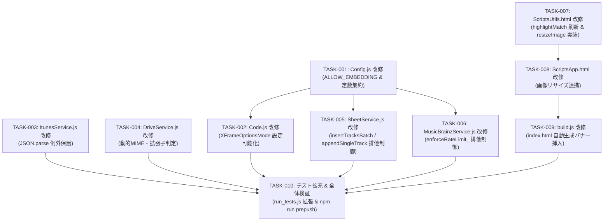

# 実装計画・タスク仕様書: コードレビュー指摘事項改善（信頼性・堅牢性・保守性向上）

- **文書バージョン**: 1.0.0
- **策定日**: 2026年10月20日
- **策定ロール**: テックリード (`tech-lead`)
- **インプット資料**: 
  - システムアーキテクチャ設計書 (`docs/architecture/system_review_improvements_design.md`)
  - コードレビュー結果 (`h:\マイドライブ\音楽CD管理レビュー結果.md`)
- **成果物パス**: `docs/planning/system_review_improvements_plan.md`

---

## 1. アーキテクチャレビュー所見

システムアーキテクトより提示された「コードレビュー指摘事項改善アーキテクチャ設計書（バージョン 1.0.0）」について、技術的実現可能性、整合性、潜在リスク、および運用面の観点から批判的レビューを実施した。

### 1.1 実現可能性評価 (Feasibility)
- **総合判定**: **【実現可能・承認】(Feasible & Approved)**
- 全8件の指摘事項（Must: 2件、Should: 4件、IMO: 2件）に対する設計方針およびADR（ADR-005〜ADR-012）は、GASおよびWeb標準APIの制約内で極めて合理的かつ堅牢に設計されており、技術的な破綻や実現不可能な要素は存在しない。
- 外部npmパッケージを一切追加せず、既存のPure JavaScript / GAS標準機能のみで完結しているため、デプロイや運用コストを増加させずに品質向上を達成できる。

### 1.2 留意事項・技術リスクおよび設計精査結果

1. **スプレッドシート排他制御の局所化とタイムアウト設計 (ADR-005 / FR-REV-001)**
   - **所見**: `SheetService` 内にロック制御（`LockService.getScriptLock()`）を集約し、外部画像ダウンロード（数秒）をロック外で実行する方針は、スループット最大化およびデッドロック根絶の観点から完全に正当である。
   - **留意事項**: 
     - 既存の `updateAlbumBatch` および `deleteAlbumsBatch` の待機時間（10秒）を、要件定義に合わせて30秒（30,000ms）へ統一する。
     - Node.js テスト環境（`tests/run_tests.js`）で `LockService` が未定義の場合にクラッシュしないよう、`typeof LockService !== 'undefined'` ガードを徹底する。

2. **MusicBrainz レート制御の排他保護と待機戦略 (ADR-006 / FR-REV-002)**
   - **所見**: `enforceRateLimit_` 内で `LockService` を取得し、キャッシュ参照からスリープ（最大1.1秒）、新時刻書き込みまでをクリティカルセクションとして直列化する方針は、MusicBrainz API の 503 / IP BAN を恒久防止するために不可欠である。
   - **留意事項**: ロック待機時間は最大10秒（`tryLock(10000)`）とする。万一タイムアウトが発生した場合は、後続の検索全体を停止させるのではなく、警告ログ（`console.warn`）を出力してAPIリクエストを試行するフォールバックを維持し、ユーザー操作の可用性を確保する。

3. **クライアント画像リサイズと Base64 / MIME の整合性 (ADR-010 / FR-REV-006)**
   - **所見**: クライアント側の HTML5 Canvas による 800px 縮小・JPEG（quality 0.85）圧縮により、RPC送信データサイズが数MBから 100〜300KB へ激減し、GAS RPC の通信遅延およびタイムアウトが劇的に改善される。
   - **留意事項**:
     - 透過 PNG 画像をそのまま JPEG 変換すると背景が黒く塗りつぶされる問題を防ぐため、Canvas 描画前に白（`#FFFFFF`）の背景矩形を塗りつぶす処理を実装する。
     - `resizeImage` が出力する DataURL の MIMEタイプは常に `image/jpeg` となるため、後続の `apiUploadArtwork` 呼び出し時の `mimeType` 引数も `image/jpeg` に更新する（不一致による `VALIDATION_FAILED` を防止）。
     - Canvas 未対応環境や画像読み込みエラー時は、安全に元ファイルの Base64 読み取りへフォールバックする。

4. **検索語ハイライトにおける元文字列直接正規表現マッチング (ADR-011 / FR-REV-007)**
   - **所見**: 正規化文字列のインデックスを生文字列に適用する方式を廃止し、元テキストに対して直接動的正規表現を適用する方式は、NFKC正規化による文字長変動（全角英数記号、濁点合字等）によるズレやサロゲートペア分断を根本から解消する優れた解決策である。
   - **留意事項**:
     - ユーザー入力トークンに含まれる正規表現特殊文字（`.*+?^${}()|[]\`）を確実にエスケープするヘルパー（`escapeRegExp`）を必ず適用する。
     - 元テキストに対して動的正規表現でマッチ区間（インデックス）を抽出し、マッチ箇所・非マッチ箇所の双方を `escapeHtml` して結合することで、XSS 脆弱性を100%排除する。

5. **XFrameOptionsMode の Secure by Default 化 (ADR-012 / FR-REV-008)**
   - **所見**: 通常時はクリックジャッキング攻撃を防ぐため `DEFAULT` とし、明示的に `ALLOW_EMBEDDING === 'true'` が設定された場合のみ `ALLOWALL` を適用する設計は、Webセキュリティ原則「Secure by Default」に合致している。

### 1.3 アーキテクトへのエスカレーション有無
- **判定**: **【エスカレーション不要】**
- アーキテクチャ設計に根本的欠陥や重大な矛盾は一切見当たらず、提示された仕様の範囲内で完全に詳細化・タスク化が可能である。

---

## 2. 影響範囲・変更対象ファイル一覧

| ファイルパス | 変更種別 | 影響コンポーネント | 変更内容サマリー |
| :--- | :--- | :--- | :--- |
| `src/Config.js` | 修正 | 設定管理・定数 | ・スクリプトプロパティ `ALLOW_EMBEDDING` 判定メソッド `isEmbeddingAllowed()` 追加。<br>・定数 `LOCK_TIMEOUT_MS: 30000`, `MUSICBRAINZ.LOCK_TIMEOUT_MS: 10000` の集約。 |
| `src/Code.js` | 修正 | Web App / doGet | ・`doGet` において `Config.isEmbeddingAllowed()` を判定し、デフォルト `DEFAULT`、設定時のみ `ALLOWALL` を適用。 |
| `src/ItunesService.js` | 修正 | 外部API連携 (iTunes) | ・`lookupAlbumSongs` 内の `JSON.parse` を `try...catch` で保護し、エラーコード `ITUNES_API_PARSE_ERROR` を設定。 |
| `src/DriveService.js` | 修正 | メディア層 (Google Drive) | ・`downloadAndSaveArtwork` で `blob.getContentType()` から小文字正規化して動的に MIMEタイプ判定および拡張子（`jpg`, `png`, `webp`）を解決して保存。 |
| `src/SheetService.js` | 修正 | 永続化層 (スプレッドシート) | ・`insertTracksBatch` および `appendSingleTrack` に `LockService.getScriptLock()` による排他制御（最大30秒待機）を追加。<br>・`updateAlbumBatch`, `deleteAlbumsBatch` のロック待機時間を30秒に統一。 |
| `src/MusicBrainzService.js` | 修正 | 外部API連携 (MusicBrainz) | ・`enforceRateLimit_` 内で `LockService.getScriptLock()` によるクリティカルセクション保護（最大10秒待機）を導入し、Race Condition を防止。 |
| `src/ScriptsUtils.html` | 修正 | クライアント共通関数 | ・`Utils.resizeImage(file, options)` の新設（Canvas 800px 縮小・JPEG圧縮）。<br>・`Utils.highlightMatch` を元文字列直接正規表現マッチング方式へ全面刷新。 |
| `src/ScriptsApp.html` | 修正 | クライアントUI制御 | ・`handleImageUpload` において `Utils.resizeImage` を組み込み、Base64 送信サイズを抑制。 |
| `build.js` | 修正 | ビルドスクリプト | ・バンドル生成時に、生成される `src/index.html` の最冒頭に「自動生成物（直接編集禁止）」の警告バナーを自動挿入。 |
| `tests/run_tests.js` | 修正 | 単体テストスイート | ・全8件の指摘事項改修に対する新規ユニットテストケースの追加。<br>・`LockService` のグローバルモック安全対策。 |

### 後方互換性への考慮事項
- **APIレスポンス後方互換性**: 全てのRPC関数のインターフェース（引数・戻り値型）は変更せず完全互換を維持。
- **Node.js 実行環境互換性**: GAS固有のグローバル変数（`LockService`, `PropertiesService`, `SpreadsheetApp`, `DriveApp`, `Utilities`, `CacheService`）はすべて `typeof ... !== 'undefined'` のガードを徹底し、Node.js 単体テストで例外が発生しない構造を維持する。

---

## 3. インターフェース・データ構造仕様

### 3.1 `Config` クラス仕様拡張

```javascript
class Config {
  constructor() {
    // 既存プロパティ取得...
    const rawAllowEmbedding = props.ALLOW_EMBEDDING !== undefined && props.ALLOW_EMBEDDING !== null
      ? String(props.ALLOW_EMBEDDING).trim().toLowerCase()
      : '';
    this.allowEmbedding = (rawAllowEmbedding === 'true' || rawAllowEmbedding === '1');
  }

  /**
   * iframe 埋め込み (X-Frame-Options: ALLOWALL) を許可するかどうか
   * @returns {boolean} デフォルト false (DEFAULT モード)
   */
  isEmbeddingAllowed() {
    return this.allowEmbedding;
  }

  static get CONSTANTS() {
    return {
      // 既存定数...
      LOCK_TIMEOUT_MS: 30000,
      MUSICBRAINZ: {
        // 既存定数...
        LOCK_TIMEOUT_MS: 10000
      }
    };
  }
}
```

### 3.2 `SheetService` 排他制御共通パターン

```javascript
// 全更新系メソッド (insertTracksBatch, appendSingleTrack, updateAlbumBatch, deleteAlbumsBatch) の共通排他テンプレート
const lock = (typeof LockService !== 'undefined' && LockService.getScriptLock)
  ? LockService.getScriptLock()
  : null;

if (lock) {
  const timeoutMs = (Config && Config.CONSTANTS && Config.CONSTANTS.LOCK_TIMEOUT_MS) || 30000;
  const hasLock = lock.tryLock(timeoutMs);
  if (!hasLock) {
    const err = new Error('他ユーザーが更新処理中のため、保存を実行できませんでした。しばらく時間をおいて再試行してください。');
    err.code = 'LOCK_TIMEOUT';
    throw err;
  }
}

try {
  // スプレッドシート読み書き処理（クリティカルセクション）
} finally {
  if (lock) {
    lock.releaseLock();
  }
}
```

### 3.3 `MusicBrainzService.enforceRateLimit_` 排他制御仕様

```javascript
enforceRateLimit_() {
  const mbConst = (Config && Config.CONSTANTS && Config.CONSTANTS.MUSICBRAINZ)
    ? Config.CONSTANTS.MUSICBRAINZ
    : { MIN_INTERVAL_MS: 1100, CACHE_KEY_LAST_REQ: 'MUSICBRAINZ_LAST_REQUEST_TS', LOCK_TIMEOUT_MS: 10000 };

  const minInterval = mbConst.MIN_INTERVAL_MS || 1100;
  const cacheKey = mbConst.CACHE_KEY_LAST_REQ || 'MUSICBRAINZ_LAST_REQUEST_TS';
  const lockTimeout = mbConst.LOCK_TIMEOUT_MS || 10000;

  const lock = (typeof LockService !== 'undefined' && LockService.getScriptLock)
    ? LockService.getScriptLock()
    : null;

  let hasLock = false;
  if (lock) {
    try {
      hasLock = lock.tryLock(lockTimeout);
      if (!hasLock) {
        console.warn('MusicBrainz レート制御の排他ロック獲得待機がタイムアウトしました (続行します)');
      }
    } catch (e) {
      console.warn('LockService エラー:', e);
    }
  }

  try {
    const now = Date.now();
    let lastTs = 0;

    if (typeof CacheService !== 'undefined' && CacheService && typeof CacheService.getScriptCache === 'function') {
      try {
        const scriptCache = CacheService.getScriptCache();
        if (scriptCache && typeof scriptCache.get === 'function') {
          const cached = scriptCache.get(cacheKey);
          if (cached) lastTs = Number(cached) || 0;
        }
      } catch (e) {}
    }

    if (!lastTs && this.lastRequestTs_) {
      lastTs = this.lastRequestTs_;
    }

    if (lastTs > 0) {
      const elapsed = now - lastTs;
      if (elapsed >= 0 && elapsed < minInterval) {
        this.sleep_(minInterval - elapsed);
      }
    }

    this.recordRequestTimestamp_();
  } finally {
    if (lock && hasLock) {
      try {
        lock.releaseLock();
      } catch (e) {}
    }
  }
}
```

### 3.4 `Utils.resizeImage` 仕様

```javascript
/**
 * HTML5 Canvas を用いた画像のクライアント側リサイズ＆JPEG圧縮
 * @param {File} file - ユーザー選択ファイル
 * @param {Object} [options]
 * @param {number} [options.maxWidth=800] - 最大幅
 * @param {number} [options.maxHeight=800] - 最大高さ
 * @param {number} [options.quality=0.85] - JPEG品質 (0.0〜1.0)
 * @returns {Promise<string>} Base64 DataURL (image/jpeg)
 */
static async resizeImage(file, options = {}) {
  const maxWidth = options.maxWidth || 800;
  const maxHeight = options.maxHeight || 800;
  const quality = options.quality !== undefined ? options.quality : 0.85;

  return new Promise((resolve, reject) => {
    if (!file) return reject(new Error('ファイルが指定されていません。'));

    // Canvas 未対応環境の場合は Base64 読み取りへフォールバック
    if (typeof document === 'undefined' || typeof Image === 'undefined') {
      return Utils.readFileAsBase64(file).then(resolve).catch(reject);
    }

    const reader = new FileReader();
    reader.onerror = () => reject(new Error('ファイルの読み込みに失敗しました。'));
    reader.onload = (e) => {
      const img = new Image();
      img.onerror = () => {
        // 画像デコード失敗時はフォールバック
        resolve(e.target.result);
      };
      img.onload = () => {
        try {
          let width = img.width;
          let height = img.height;

          // アスペクト比維持のリサイズ計算
          if (width > maxWidth || height > maxHeight) {
            if (width / height > maxWidth / maxHeight) {
              height = Math.round((height * maxWidth) / width);
              width = maxWidth;
            } else {
              width = Math.round((width * maxHeight) / height);
              height = maxHeight;
            }
          }

          const canvas = document.createElement('canvas');
          canvas.width = width;
          canvas.height = height;
          const ctx = canvas.getContext('2d');

          // 透過PNG対応: 背景を白で塗りつぶす
          ctx.fillStyle = '#FFFFFF';
          ctx.fillRect(0, 0, width, height);

          // 画像を描画
          ctx.drawImage(img, 0, 0, width, height);

          // JPEG で圧縮出力
          const dataUrl = canvas.toDataURL('image/jpeg', quality);
          resolve(dataUrl);
        } catch (err) {
          // Canvas 処理例外時は元画像の DataURL を返却
          resolve(e.target.result);
        }
      };
      img.src = e.target.result;
    };
    reader.readAsDataURL(file);
  });
}
```

### 3.5 `Utils.highlightMatch` 仕様（直接正規表現マッチング方式）

```javascript
/**
 * 元テキストに対して直接動的正規表現マッチングを行い、ズレなく安全にハイライトを付与
 * @param {string} rawText 表示対象の元の生テキスト
 * @param {Array<string>} queryTokens 検索トークン配列
 * @returns {string} XSS安全なハイライト付きHTML文字列
 */
static highlightMatch(rawText, queryTokens) {
  if (!rawText) return '';
  if (!Array.isArray(queryTokens) || queryTokens.length === 0) {
    return Utils.escapeHtml(rawText);
  }

  // 有効なトークンのみ抽出
  const validTokens = queryTokens
    .map(t => String(t || '').trim())
    .filter(t => t.length > 0);

  if (validTokens.length === 0) {
    return Utils.escapeHtml(rawText);
  }

  // 1. 各トークンから表記揺れを許容する正規表現パターン文字列を構築
  const patternParts = validTokens.map(token => {
    // トークン内の文字ごとにひらがな/カタカナ文字クラスを生成
    let pattern = '';
    for (let i = 0; i < token.length; i++) {
      const char = token[i];
      // 正規表現メタ文字のエスケープ
      if (/[.*+?^${}()|[\]\\]/.test(char)) {
        pattern += '\\' + char;
        continue;
      }
      const code = char.charCodeAt(0);
      // カタカナ (0x30A1 - 0x30F6) -> ひらがなも許容
      if (code >= 0x30A1 && code <= 0x30F6) {
        const hira = String.fromCharCode(code - 0x60);
        pattern += `[${char}${hira}]`;
      }
      // ひらがな (0x3041 - 0x3096) -> カタカナも許容
      else if (code >= 0x3041 && code <= 0x3096) {
        const kata = String.fromCharCode(code + 0x60);
        pattern += `[${char}${kata}]`;
      } else {
        pattern += char;
      }
    }
    return pattern;
  });

  // 全トークンを OR (|) 結合した正規表現 (大文字小文字無視 'i'、全体マッチ 'g')
  let combinedRegex;
  try {
    combinedRegex = new RegExp(`(${patternParts.join('|')})`, 'gi');
  } catch (e) {
    return Utils.escapeHtml(rawText);
  }

  // 2. 元文字列上で直接マッチ区間 (start, end) を収集
  const matches = [];
  let match;
  while ((match = combinedRegex.exec(rawText)) !== null) {
    if (match[0].length === 0) {
      combinedRegex.lastIndex++;
      continue;
    }
    matches.push({ start: match.index, end: match.index + match[0].length });
  }

  if (matches.length === 0) {
    return Utils.escapeHtml(rawText);
  }

  // 3. 重複・隣接区間のマージ
  matches.sort((a, b) => a.start - b.start);
  const merged = [matches[0]];
  for (let i = 1; i < matches.length; i++) {
    const cur = matches[i];
    const prev = merged[merged.length - 1];
    if (cur.start <= prev.end) {
      prev.end = Math.max(prev.end, cur.end);
    } else {
      merged.push(cur);
    }
  }

  // 4. 元テキストを切り出し、エスケープしながら HTML 組み立て
  let html = '';
  let lastIdx = 0;
  for (const m of merged) {
    if (m.start > lastIdx) {
      html += Utils.escapeHtml(rawText.substring(lastIdx, m.start));
    }
    html += `<mark class="bg-indigo-500/30 text-indigo-200 rounded px-0.5 font-bold">${Utils.escapeHtml(rawText.substring(m.start, m.end))}</mark>`;
    lastIdx = m.end;
  }
  if (lastIdx < rawText.length) {
    html += Utils.escapeHtml(rawText.substring(lastIdx));
  }

  return html;
}
```

---

## 4. テスト戦略

### 4.1 テストレベルと責務
1. **単体テスト (Unit Test)**:
   - `tests/run_tests.js` を拡張。
   - `Config`, `Code`, `ItunesService`, `DriveService`, `SheetService`, `MusicBrainzService`, `Utils` の新機能・改修箇所を網羅。
   - 例外系（`LOCK_TIMEOUT`, `ITUNES_API_PARSE_ERROR` 等）を `assertThrows` で厳密検証。
2. **レッドチーム攻撃テスト (Red Team Attack Test)**:
   - `tests/red_team_attack_test.js` を回帰実行。
   - XSS・数式インジェクション・悪意のあるMIME偽装・長大ファイル名・サロゲートペア分断等に対する既存の247件テストが 100% PASS することを保証。
3. **ビルド整合テスト (Build Verification)**:
   - `build.js` を実行し、生成された `src/index.html` に警告バナーが含まれ、文法エラーなくバンドルされることを検証。

### 4.2 テスト実行マトリクス

| テスト項目 | 対象ファイル | 検証内容 | 期待結果 |
| :--- | :--- | :--- | :--- |
| **TEST-001** | `src/Config.js` | `isEmbeddingAllowed()` の判定（デフォルト / 'true' / 'false'） | 正確な真偽値返却 |
| **TEST-002** | `src/Code.js` | `doGet` での XFrameOptions 適用（DEFAULT / ALLOWALL 分岐） | 設定値に応じたモード適用 |
| **TEST-003** | `src/ItunesService.js` | `lookupAlbumSongs` の破損JSONレスポンス | `ITUNES_API_PARSE_ERROR` 送出 |
| **TEST-004** | `src/DriveService.js` | `downloadAndSaveArtwork` の動的MIME・拡張子（jpg, png, webp, fallback） | 正しい拡張子・MIMEで保存 |
| **TEST-005** | `src/SheetService.js` | `insertTracksBatch` 排他ロック取得・解放およびタイムアウト | ロック解放確認 / `LOCK_TIMEOUT` 送出 |
| **TEST-006** | `src/SheetService.js` | `appendSingleTrack` 排他ロック取得・解放およびタイムアウト | ロック解放確認 / `LOCK_TIMEOUT` 送出 |
| **TEST-007** | `src/MusicBrainzService.js` | `enforceRateLimit_` 排他ロック取得・解放およびタイムスタンプ更新 | ロック保持下の待機・更新確認 |
| **TEST-008** | `src/ScriptsUtils.html` | `highlightMatch` の直接マッチング（全角半角、カナひらがな、記号混在、XSS保護） | ズレのない安全な `<mark>` 生成 |
| **TEST-009** | `src/ScriptsUtils.html` | `resizeImage` のアスペクト比維持縮小・JPEG DataURL 出力 | Base64 サイズ大幅削減と正常出力 |
| **TEST-010** | `build.js` | 生成物への直接編集禁止警告バナー挿入 | `src/index.html` 先頭にバナー確認 |
| **TEST-REG** | 全ファイル | `npm test` (`run_tests.js` + `red_team_attack_test.js`) | 既存533件 + 新規テスト全件 PASS |

---

## 5. 実装タスク一覧 (順序定義)



---

### タスク [TASK-001]: `Config.js` の改修（ALLOW_EMBEDDING 判定および定数定義）
- **ID**: `TASK-001`
- **目的**: クリックジャッキング対策用のプロパティ読み込みメソッド `isEmbeddingAllowed()` を新設し、排他制御タイムアウト定数を集約する。
- **対象ファイル**: `src/Config.js`
- **入力**: スクリプトプロパティ `ALLOW_EMBEDDING`
- **期待される結果**:
  - `props.ALLOW_EMBEDDING === 'true'` (大文字小文字無視) または `'1'` の場合に `isEmbeddingAllowed()` が `true` を返し、それ以外（未設定含む）は `false` を返す。
  - `Config.CONSTANTS.LOCK_TIMEOUT_MS = 30000` および `Config.CONSTANTS.MUSICBRAINZ.LOCK_TIMEOUT_MS = 10000` が定義される。
- **依存関係**: なし（独立着手可）
- **受け入れ基準**:
  - [ ] `isEmbeddingAllowed()` が正しく動作する。
  - [ ] 定数 `LOCK_TIMEOUT_MS` が取得できる。
- **検証方法**: Node.js テストでインスタンス生成し真偽値および定数を検証。

---

### タスク [TASK-002]: `Code.js` の改修（XFrameOptionsMode の Secure by Default 化）
- **ID**: `TASK-002`
- **目的**: `doGet` においてデフォルトで安全な `DEFAULT` モードを適用し、プロパティ設定時のみ `ALLOWALL` を適用する。
- **対象ファイル**: `src/Code.js`
- **対象関数**: `doGet(e)`
- **入力**: HTTP GET イベント `e`
- **期待される結果**:
  - `Config.prototype.isEmbeddingAllowed()` を判定し、`true` なら `HtmlService.XFrameOptionsMode.ALLOWALL`、それ以外は `HtmlService.XFrameOptionsMode.DEFAULT` を `.setXFrameOptionsMode()` に渡す。
  - 静的埋め込み `index.html` 配信に関する構成説明コメントを維持・更新。
- **依存関係**: `TASK-001`
- **受け入れ基準**:
  - [ ] デフォルト設定時に `DEFAULT` が適用される。
  - [ ] `ALLOW_EMBEDDING='true'` 設定時に `ALLOWALL` が適用される。
- **検証方法**: `tests/run_tests.js` において `doGet` のモック実行を検証。

---

### タスク [TASK-003]: `ItunesService.js` の改修（JSON.parse 例外保護）
- **ID**: `TASK-003`
- **目的**: `lookupAlbumSongs` において外部APIからの破損レスポンスやHTMLエラーによる `SyntaxError` を補足し、統一エラーコード `ITUNES_API_PARSE_ERROR` で送出する。
- **対象ファイル**: `src/ItunesService.js`
- **対象関数**: `lookupAlbumSongs(collectionId)`
- **入力**: iTunes Lookup API レスポンス文字列
- **期待される結果**:
  - `JSON.parse(response.getContentText())` が `try...catch` で保護される。
  - パース失敗時に `const err = new Error('iTunes Lookup APIのレスポンスJSON解析に失敗しました'); err.code = 'ITUNES_API_PARSE_ERROR'; throw err;` が実行される。
- **依存関係**: なし（独立着手可）
- **受け入れ基準**:
  - [ ] 正常なJSONレスポンス時は従来通り収録曲データが返却される。
  - [ ] HTMLエラーページ（不正なJSON）が返却された場合に `ITUNES_API_PARSE_ERROR` 例外が送出される。
- **検証方法**: 不正なレスポンス文字列を返すモックを用いた単体テスト。

---

### タスク [TASK-004]: `DriveService.js` の改修（動的MIMEおよび拡張子解決）
- **ID**: `TASK-004`
- **目的**: `downloadAndSaveArtwork` において、画像 Blob の Content-Type から正規の拡張子（jpg, png, webp）を動的判定して保存し、不整合な MIME 強制上書きを廃止する。
- **対象ファイル**: `src/DriveService.js`
- **対象関数**: `downloadAndSaveArtwork(imageUrl500, albumName)`
- **入力**: 外部画像レスポンス Blob
- **期待される結果**:
  - `blob.getContentType()` を小文字正規化して MIME タイプを判定。
  - `image/jpeg` -> `jpg`, `image/png` -> `png`, `image/webp` -> `webp`、その他 -> `jpg` (フォールバック) として `generateArtworkFileName(albumName, ext)` を呼び出す。
  - `blob.setContentType('image/jpeg')` による固定上書きを削除し、正規 MIME を適用。
- **依存関係**: なし（独立着手可）
- **受け入れ基準**:
  - [ ] PNG画像のダウンロード時に `.png` で Drive に保存される。
  - [ ] WebP画像のダウンロード時に `.webp` で Drive に保存される。
  - [ ] 不明MIME時に `.jpg` にフォールバックする。
- **検証方法**: `tests/run_tests.js` における画像ダウンロードテストの拡張。

---

### タスク [TASK-005]: `SheetService.js` の改修（排他制御の完全導入とタイムアウト統一）
- **ID**: `TASK-005`
- **目的**: `insertTracksBatch` および `appendSingleTrack` に `LockService` による排他制御（最大30秒待機）を導入し、既存メソッドも含めてタイムアウトを 30秒に統一する。
- **対象ファイル**: `src/SheetService.js`
- **対象関数**: `insertTracksBatch`, `appendSingleTrack`, `updateAlbumBatch`, `deleteAlbumsBatch`
- **入力**: 書き込み・更新・削除リクエスト
- **期待される結果**:
  - 全更新メソッドで `LockService.getScriptLock()` による排他ロックを取得。
  - 待機時間は `Config.CONSTANTS.LOCK_TIMEOUT_MS || 30000`。
  - ロック獲得失敗時は `err.code = 'LOCK_TIMEOUT'` 例外を送出。
  - `try...finally` により正常・例外問わず確実に `releaseLock()` が呼ばれる。
  - `typeof LockService !== 'undefined'` のガードを徹底し、Node.js 環境で安全に動作する。
- **依存関係**: `TASK-001`
- **受け入れ基準**:
  - [ ] `insertTracksBatch` 実行時にロック取得および解放が行われること。
  - [ ] `appendSingleTrack` 実行時にロック取得および解放が行われること。
  - [ ] ロック獲得失敗時に `LOCK_TIMEOUT` が送出されること。
- **検証方法**: `tests/run_tests.js` で `LockService` モックを用いてロック呼び出しおよびタイムアウト例外を検証。

---

### タスク [TASK-006]: `MusicBrainzService.js` の改修（レートリミット判定の排他保護）
- **ID**: `TASK-006`
- **目的**: `enforceRateLimit_` 内のキャッシュ参照・スリープ待機・時刻記録の一連の処理を `LockService` で保護し、Race Condition による過剰リクエスト（HTTP 503 / IP BAN）を防止する。
- **対象ファイル**: `src/MusicBrainzService.js`
- **対象関数**: `enforceRateLimit_()`
- **入力**: APIリクエスト前のレート制御呼び出し
- **期待される結果**:
  - `LockService.getScriptLock()` による排他ロック（最大10秒待機）を獲得。
  - キャッシュ取得、経過時間判定、`sleep_`、`recordRequestTimestamp_` までをクリティカルセクションとして保護。
  - `finally` 節で確実に `releaseLock()` を呼ぶ。
  - ロック獲得タイムアウト時は警告ログを出力して処理を続行（可用性優先）。
  - `typeof LockService !== 'undefined'` のガードを徹底。
- **依存関係**: `TASK-001`
- **受け入れ基準**:
  - [ ] キャッシュ読み取りから更新までがロック保護下で実行されること。
  - [ ] 短時間の連続呼び出しでも 1100ms 間隔が厳格に維持されること。
  - [ ] ロック解放が `finally` で保証されること。
- **検証方法**: 単体テストでモック `LockService` を用いてロック取得・解放シーケンスを検証。

---

### タスク [TASK-007]: `ScriptsUtils.html` の改修（highlightMatch 刷新 & resizeImage 実装）
- **ID**: `TASK-007`
- **目的**:
  1. `highlightMatch` を元文字列直接正規表現マッチング方式に刷新し、NFKC正規化によるインデックスズレや文字化けを根絶する。
  2. `resizeImage` を新設し、ブラウザの Canvas を用いて画像を最大 800px × 800px、JPEG（品質0.85）に縮小・圧縮する。
- **対象ファイル**: `src/ScriptsUtils.html`
- **対象関数**: `Utils.highlightMatch`, `Utils.resizeImage`
- **入力**: 生文字列と検索トークン / 画像ファイル
- **期待される結果**:
  - `highlightMatch`: 濁点合字、全角英数記号、カタカナ/ひらがな表記揺れが含まれていてもズレなく一致箇所を `<mark>` で囲み、HTML特殊文字を安全にエスケープする。
  - `resizeImage`: 透過PNGの白背景補正、アスペクト比維持リサイズ、JPEG DataURL 出力、例外時フォールバックを完備。
- **依存関係**: なし（独立着手可）
- **受け入れ基準**:
  - [ ] 全角カタカナ「アイウ」検索で生テキスト「あいう」「アイウ」双方が正常にハイライトされること。
  - [ ] 全角記号や絵文字が混在してもハイライト位置がズレないこと。
  - [ ] `<script>` などの悪意ある入力に対して XSS 安全にエスケープされること。
  - [ ] 画像が 800px 以内に縮小され、JPEG DataURL が返却されること。
- **検証方法**: Node.js 単体テストで `highlightMatch` の多様な文字パターンテスト、`resizeImage` のフォールバックテスト。

---

### タスク [TASK-008]: `ScriptsApp.html` の改修（画像リサイズ連携）
- **ID**: `TASK-008`
- **目的**: `handleImageUpload` において、画像選択直後に `Utils.resizeImage` を適用して Base64 データを生成し、送信ペイロードを極小化する。
- **対象ファイル**: `src/ScriptsApp.html`
- **対象関数**: `handleImageUpload(event, context)`
- **入力**: ユーザー選択画像ファイル
- **期待される結果**:
  - `Utils.resizeImage(file, { maxWidth: 800, maxHeight: 800, quality: 0.85 })` を呼び出して縮小された Base64 DataURL を取得。
  - `api.uploadArtwork` への送信時、`mimeType` に `'image/jpeg'`（リサイズ後の形式）を設定。
  - 既存のボタン無効化・スピナー表示・競合防止制御（BUG-002）を完全に維持。
- **依存関係**: `TASK-007`
- **受け入れ基準**:
  - [ ] リサイズされた Base64 データが API に渡されること。
  - [ ] アップロード中のボタン非活性化およびスピナー表示が従来通り動作すること。
- **検証方法**: `tests/red_team_attack_test.js` の `handleImageUpload` 関連テストが全件 PASS すること。

---

### タスク [TASK-009]: `build.js` の改修（index.html 自動生成バナー挿入）
- **ID**: `TASK-009`
- **目的**: `build.js` によるバンドル生成時、出力ファイル `src/index.html` の最冒頭に直接編集禁止の警告バナーを自動挿入し、先祖返りを防止する。
- **対象ファイル**: `build.js`
- **入力**: テンプレートおよび各部品ファイル
- **期待される結果**:
  - `src/index.html` の先頭に以下のコメントが挿入されること：
    `<!-- ========================================================================= -->`
    `<!-- WARNING: このファイルは build.js によって自動生成されたファイルです。     -->`
    `<!-- 直接編集しないでください。編集は index.template.html または部品ファイルへ -->`
    `<!-- ========================================================================= -->`
- **依存関係**: なし（独立着手可）
- **受け入れ基準**:
  - [ ] `node build.js` 実行後に `src/index.html` の先頭に警告バナーが存在すること。
  - [ ] ビルドが正常終了し文字化け等が発生しないこと。
- **検証方法**: `node build.js` を実行し、出力されたファイルの先頭を確認。

---

### タスク [TASK-010]: テストコード拡充および全体検証
- **ID**: `TASK-010`
- **目的**: 改善指摘全8件に対する新規ユニットテストを `tests/run_tests.js` に追加し、`npm test`（単体テスト + レッドチーム攻撃テスト）および `npm run prepush`（ビルド + テスト）を全件通過させる。
- **対象ファイル**: `tests/run_tests.js`, `tests/red_team_attack_test.js`
- **入力**: 全タスクの修正コード
- **期待される結果**:
  - [8] 新規改善テストセクションが追加され、全件 PASS すること。
  - 既存のユニットテスト（286件）およびレッドチーム攻撃テスト（247件）が 1件の失敗もなく PASS すること（合計550件以上）。
  - `npm.cmd run prepush` が正常終了すること。
- **依存関係**: `TASK-001` 〜 `TASK-009`
- **受け入れ基準**:
  - [ ] `node tests/run_tests.js` が 100% PASS。
  - [ ] `node tests/red_team_attack_test.js` が 100% PASS。
  - [ ] ソースコード全体に `// TODO`, `// 省略` などの未実装コードが存在しないこと。
- **検証方法**: `npm.cmd test` および `node build.js` の実行。

---

## 6. シニアコーダーへの引き渡し注意事項

1. **コードの完全実装義務**:
   - 一切の省略（`// TODO`, `// 省略`, `...` 等）を禁止します。すべての関数・分岐・エラーハンドリングを完全に実装してください。
2. **パイプ記号のエスケープ禁止**:
   - `|`, `||` などの論理演算子や文字リテラルは、絶対に LaTeX 形式（`\|` 等）にエスケープせず、そのまま直接記述してください。
3. **Node.js テスト環境互換性の死守**:
   - GASグローバルオブジェクト（`LockService`, `PropertiesService`, `SpreadsheetApp`, `DriveApp`, `Utilities`, `CacheService`）にアクセスする際は、必ず `typeof ... !== 'undefined'` のガードを設けてください。
4. **コミット・プッシュの禁止**:
   - シニアコーダーは実装およびローカル検証（テスト通過）までを担当し、GitコミットやGitHubへのプッシュは行わないでください（ワークフロー規程によりマネージャーが実施）。
